- [2. Arrays unidimensionales](#2-arrays-unidimensionales)
  - [2.1. Definición, creación y valores por defecto](#21-definición-creación-y-valores-por-defecto)
    - [2.1.1. Inmutabilidad del tamaño y creación](#211-inmutabilidad-del-tamaño-y-creación)
    - [2.1.2. Valores por defecto y gestión de la nulidad](#212-valores-por-defecto-y-gestión-de-la-nulidad)
    - [2.1.3. El array que ya usas: `string[] args`](#213-el-array-que-ya-usas-string-args)
  - [2.2. Obtener el tamaño con `.Length` y recorrido](#22-obtener-el-tamaño-con-length-y-recorrido)
    - [2.2.1. `array.Length`](#221-arraylength)
    - [2.2.2. Recorrido con bucle `for`](#222-recorrido-con-bucle-for)
    - [2.2.3. Recorrido con bucle `foreach`](#223-recorrido-con-bucle-foreach)
    - [2.2.4. Recorrido con filtrado de nulos](#224-recorrido-con-filtrado-de-nulos)
  - [2.3. Paso por referencia, devolución y clonación](#23-paso-por-referencia-devolución-y-clonación)
    - [2.3.1. Primero el símil: cómo se pasa un valor de tipo simple](#231-primero-el-símil-cómo-se-pasa-un-valor-de-tipo-simple)
    - [2.3.2. Qué guarda una variable de array: una dirección](#232-qué-guarda-una-variable-de-array-una-dirección)
    - [2.3.3. Qué se pasa al llamar a una función: la dirección, no los datos](#233-qué-se-pasa-al-llamar-a-una-función-la-dirección-no-los-datos)
    - [2.3.4. Aclarando el mal dicho: los arrays no pasan por referencia](#234-aclarando-el-mal-dicho-los-arrays-no-pasan-por-referencia)
    - [2.3.5. Con `ref`: cuando la función debe reemplazar el array](#235-con-ref-cuando-la-función-debe-reemplazar-el-array)
    - [2.3.6. Con `in`: cuando la función solo lee el array](#236-con-in-cuando-la-función-solo-lee-el-array)
    - [2.3.7. Clonación manual para romper la referencia](#237-clonación-manual-para-romper-la-referencia)
    - [2.3.8. Devolución de arrays](#238-devolución-de-arrays)
  - [2.4. Parámetros variables (`params`) y modificador `in`](#24-parámetros-variables-params-y-modificador-in)
  - [2.5. Identidad vs. igualdad (referencia vs. contenido)](#25-identidad-vs-igualdad-referencia-vs-contenido)
  - [2.6. Copias, clonación y la inmutabilidad del tamaño](#26-copias-clonación-y-la-inmutabilidad-del-tamaño)
  - [2.7. La trampa del alias](#27-la-trampa-del-alias)
  - [2.8. Arrays de tipos compuestos](#28-arrays-de-tipos-compuestos)


# 2. Arrays unidimensionales

> 💡 **Punto de partida:** Cuando abres tu lista de reproducción de Spotify, ¿te has fijado en que cada canción tiene un número de posición? La canción 0, la 1, la 2... Eso es un array: una lista ordenada donde cada elemento tiene una posición fija. Pero, ¿cómo se crea? ¿Cómo se recorre? ¿Qué pasa si quieres hacer una copia?

En este punto aprenderás a crear, recorrer y manipular arrays unidimensionales en C#: definición, valores por defecto, bucles, paso por referencia y clonación.

**Objetivos de aprendizaje:**

- Declarar y crear arrays unidimensionales en C#
- Conocer los valores por defecto según el tipo de dato
- Recorrer arrays con `for` y `foreach`
- Entender el paso por referencia y la clonación
- Diferenciar identidad (`==`) de igualdad (contenido)
- Usar los modificadores `params` e `in`
- Trabajar con `string[] args` y redimensionar arrays con `ref`

## 2.1. Definición, creación y valores por defecto

### 2.1.1. Inmutabilidad del tamaño y creación

| Característica | Detalle | Sintaxis C# |
| :--- | :--- | :--- |
| **Tamaño Fijo** | Se define al crear y **no puede cambiarse** | `int[] numeros = new int[10];` |
| **Homogeneidad** | Todos los elementos del mismo tipo | `var dias = new string[] { "Lun", "Mar", "Mié" };` |
| **Inicialización directa** | Asignar valores al crear | `int[] pares = { 2, 4, 6, 8 };` |

```csharp
// ✅ Creación con tamaño fijo (valores por defecto: 0)
int[] edades = new int[5];

// ✅ Creación con valores iniciales
string[] frutas = { "Manzana", "Pera", "Naranja" };

// ✅ Creación explícita
double[] precios = new double[] { 9.99, 19.99, 29.99 };
```

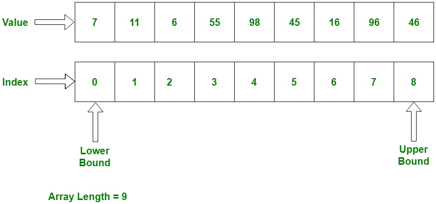

### 2.1.2. Valores por defecto y gestión de la nulidad

Cuando creas un array solo con su tamaño, C# lo rellena automáticamente:

| Tipo de Array | Valor por Defecto | Ejemplo |
| :--- | :--- | :--- |
| **Numérico** (`int[]`, `double[]`) | `0` / `0.0` | `new int[3]` → `{ 0, 0, 0 }` |
| **Booleano** (`bool[]`) | `false` | `new bool[2]` → `{ false, false }` |
| **Cadena** (`string[]`) | `null` | `new string[2]` → `{ null, null }` |
| **Anulable** (`int?[]`) | `null` | `new int?[2]` → `{ null, null }` |

> 📝 **Nota:** Un tipo anulable (`int?`) permite guardar `null` además de números. Lo verás en detalle en la UD04 sobre POO.

> ⚠️ **Advertencia:** `string[]` se inicializa a `null`, **no** a `""`. Si intentas acceder a un método de un elemento sin verificar, obtendrás `NullReferenceException`.

```csharp
int?[] numerosOpcionales = new int?[3];
numerosOpcionales[0] = 5;

// ❌ Peligro: acceder a un null
// Console.WriteLine(numerosOpcionales[1] + 1);  // NullReferenceException

// ✅ Solución 1: Coalescencia
Console.WriteLine($"Con coalescencia: {(numerosOpcionales[1] ?? 0) + 1}");

// ✅ Solución 2: Comprobación explícita
if (numerosOpcionales[1] != null)
    Console.WriteLine($"Con if: {numerosOpcionales[1] + 1}");
else
    Console.WriteLine("Valor nulo, no se puede operar");
```

📌 **Ejemplo real:** Netflix usa arrays de perfiles. Si un usuario solo tiene 2 perfiles pero el array tiene 5 posiciones, las 3 restantes son `null`. Cuando intentas acceder a un perfil vacío, la app verifica el `null` antes de mostrar datos.

### 2.1.3. El array que ya usas: `string[] args`

Antes de declarar tu primer array, ya estás usando uno: con Top-Level Statements, **`args` existe sin que tú lo crees** — es un `string[]` con los argumentos que pasas por línea de comandos.

```csharp
// Program.cs (Top-Level Statements): args ya está declarado para ti
Console.WriteLine($"Argumentos recibidos: {args.Length}");

for (int i = 0; i < args.Length; i++)
{
    Console.WriteLine($"  args[{i}] = {args[i]}");
}
```

Si ejecutas la app pasándole dos argumentos (con app por ficheros `.cs` sueltos funciona igual):

```bash
dotnet run miapp.cs -- Hola Mundo
```

`args` contiene `{ "Hola", "Mundo" }`, su `.Length` es 2 y lo recorres con `for` o `foreach` como cualquier otro array de cadenas. Si no pasas ningún argumento, `args.Length` es 0: un array **vacío**, no `null`.

📌 **Ejemplo real:** Cuando ejecutas `git commit -m "mensaje"`, Git recibe `commit` y el mensaje como argumentos de línea de comandos: internamente es lo mismo — un array de cadenas que otro programa recorre.

> 💡 **Consejo:** `args` es un array normal, así que puedes pasarlo a tus funciones (`ImprimirArgumentos(args)`) y procesarlo con todas las herramientas de este punto.

## 2.2. Obtener el tamaño con `.Length` y recorrido

### 2.2.1. `array.Length`

La propiedad `.Length` devuelve el número total de elementos. Es la forma fiable de conocer el límite del array.

```csharp
string[] colores = { "Rojo", "Verde", "Azul" };
Console.WriteLine($"Longitud: {colores.Length}");  // 3
Console.WriteLine($"Último índice: {colores.Length - 1}");  // 2
```

> 💡 **Consejo:** El último elemento siempre está en `array.Length - 1`. Si accedes a `array[array.Length]`, obtienes `IndexOutOfRangeException`.

### 2.2.2. Recorrido con bucle `for`

El bucle `for` se usa cuando necesitas **modificar** elementos o conocer el **índice** actual.

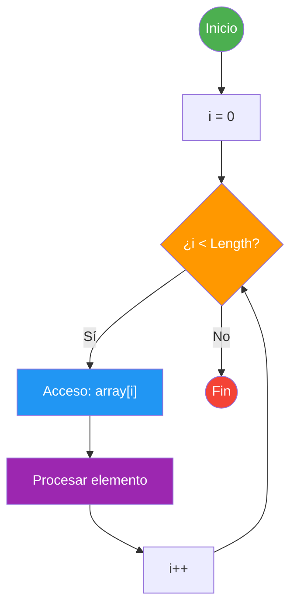

```csharp
int[] calificaciones = new int[5];

// ✅ Recorrer y modificar con for
for (int i = 0; i < calificaciones.Length; i++)
{
    calificaciones[i] = i * 10;
    Console.WriteLine($"Índice {i}: {calificaciones[i]}");
}
// Salida: 0, 10, 20, 30, 40
```

📌 **Ejemplo real:** YouTube usa un bucle `for` para cargar los 50 primeros comentarios de un vídeo. Cada comentario se accede por su índice y se muestra en pantalla.

### 2.2.3. Recorrido con bucle `foreach`

El `foreach` se usa cuando solo necesitas **leer** los valores. Es más seguro porque no puedes equivocarte con el índice.

```csharp
string[] diasSemana = { "L", "M", "X", "J", "V", "S", "D" };

// ✅ Recorrer con foreach (solo lectura)
foreach (string dia in diasSemana)
{
    Console.WriteLine($"Día: {dia}");
}
```

| Bucle | Cuándo usarlo | Ventaja |
| :--- | :--- | :--- |
| `for` | Necesitas modificar o conocer el índice | Acceso directo por posición |
| `foreach` | Solo necesitas leer cada elemento | Más seguro y legible |

### 2.2.4. Recorrido con filtrado de nulos

Para arrays de tipos anulables, debes verificar `null` antes de usar cada elemento.

```csharp
string?[] nombres = new string?[3];
nombres[0] = "Ana";
nombres[2] = "Luis";

// ✅ Filtrado con foreach + if
foreach (string? nombre in nombres)
{
    if (nombre != null)
        Console.WriteLine($"Usuario: {nombre}");
    else
        Console.WriteLine("Posición vacía");
}

// ✅ Alternativa más concisa con coalescencia
foreach (string? nombre in nombres)
{
    Console.WriteLine($"Usuario: {nombre ?? "vacío"}");
}
```

## 2.3. Paso por referencia, devolución y clonación

### 2.3.1. Primero el símil: cómo se pasa un valor de tipo simple

Antes de meternos con arrays conviene fijar qué significa "pasar un valor a una función" con un tipo que ya dominas: un `int`. Los tipos de valor (`int`, `double`, `bool`, `char`) guardan **el dato dentro de la propia variable**. Al llamar a una función, C# hace una **copia literal** de ese dato: la función trabaja con su propia ficha, y lo que haga en ella no toca la del llamador.

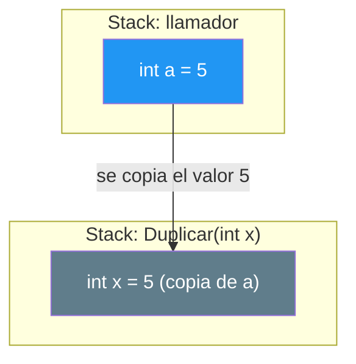

```csharp
void Duplicar(int x)
{
    x = x * 2;   // multiplica SU copia
}

int a = 5;
Duplicar(a);
Console.WriteLine(a);   // 5 — 'a' no se enteró
```

Dentro de la función `x` vale 10, pero al salir esa copia desaparece: `a` seguía con 5 todo el rato.

> 💡 **Analogía:** Es como **fotocopiar** un documento y dar la copia a un compañero. Si él escribe sobre la fotocopia, tu original sigue intacto: son dos papeles distintos.

📌 **Ejemplo real:** En un videojuego, cuando pasas la vida de un personaje a una función `CalcularDanño(int vida)`, la función trabaja sobre una copia: aunque devuelva 0, el personaje no muere hasta que **tú** apliques el resultado a la variable original.

### 2.3.2. Qué guarda una variable de array: una dirección

Un array es un **tipo de referencia**, y ahí cambia todo: la variable **no contiene los elementos**, contiene una **dirección de memoria** (algo así como `0x0040`) que indica **dónde** están guardados. Los elementos viven juntos en un bloque contiguo del **heap (montón)**; la variable que apunta a ellos vive en el **stack (pila)**.

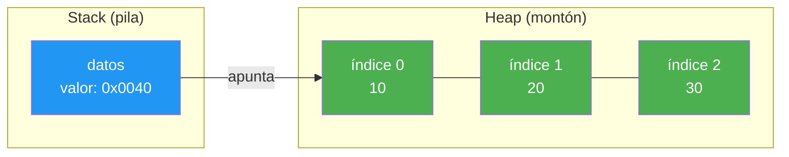

```csharp
int[] datos = { 10, 20, 30 };
// datos   → en el STACK:  la dirección 0x0040
// 0x0040  → en el HEAP:   [10] [20] [30]
Console.WriteLine(datos[0]);   // "sigue la dirección" hasta la celda 0 → 10
```

Cuando escribes `datos[0]`, C# hace exactamente eso: **lee la dirección de `datos`**, salta al bloque del heap y accede a la posición 0. Las direcciones de este ejemplo (`0x0040`) son de mentira —el runtime elige las reales— pero el esquema es este.

> 💡 **Analogía:** La variable es **una nota con la dirección de tu casa**; el array es **la casa con los muebles**. Quien tiene la nota sabe dónde están los muebles, pero no se lleva la casa.

📌 **Ejemplo real:** Tu app de música no duplica millones de canciones cada vez que las usa: guarda **una dirección** (una referencia) a la lista en memoria. La nota pesa unos bytes; la lista puede pesar gigas.

### 2.3.3. Qué se pasa al llamar a una función: la dirección, no los datos

Ahora ya puedes entender qué ocurre cuando haces `ModificarContenido(datos)`. **No se copian los tres elementos** —sería un coste enorme en arrays grandes—: lo que se copia, **por valor**, es **la dirección**. En el stack de la función aparece una variable nueva con **la misma dirección** que la del llamador, y por lo tanto **ambas apuntan al mismo bloque** del heap.

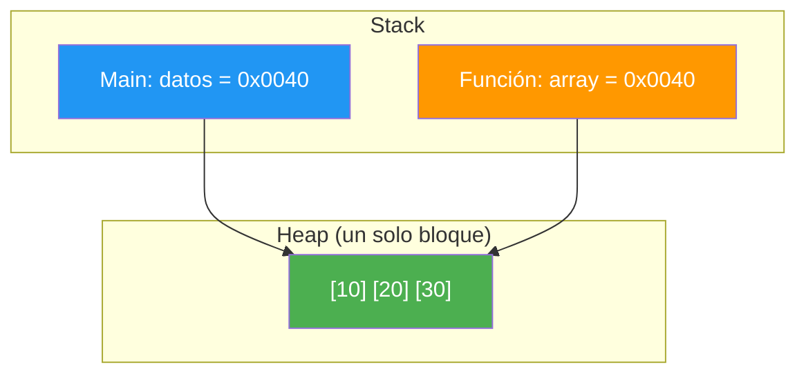

De ahí la primera consecuencia: **escribir en los elementos sí se propaga** al llamador, porque se escribe en la misma caja.

```csharp
void ModificarContenido(int[] array)
{
    array[0] = 999;   // escribe en la MISMA celda que Main
}

int[] arrayOriginal = { 10, 20, 30 };
ModificarContenido(arrayOriginal);
Console.WriteLine(arrayOriginal[0]);   // 999 — ¡también cambió!
```

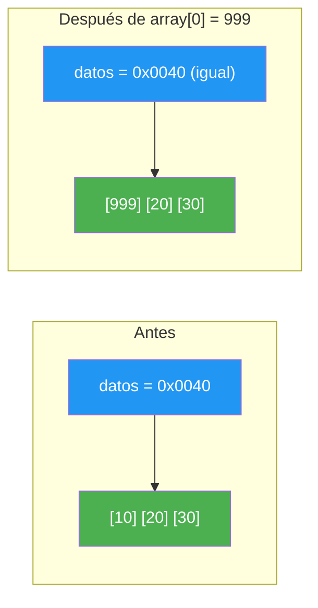

📌 **Ejemplo real:** Cuando editas una canción en una playlist de Spotify, la app modifica la lista directamente: no crea una copia de millones de registros porque sería lento e ineficiente. Todos los sitios que apuntan a esa playlist ven el cambio.

### 2.3.4. Aclarando el mal dicho: los arrays no pasan por referencia

Aquí está el embrollo. De forma popular se dice *«los arrays pasan **por referencia**»*, y es un **mal dicho**: lo que se pasa es **por valor**, pero el **valor que se copia es la dirección** (una referencia). Es decir, se copia *una referencia* al array… no el array, y tampoco la variable. De esa ambigüedad nacen las dos consecuencias que ya conoces:

- **Cambiar el contenido** (un elemento): **sí se ve** fuera — es la misma caja.
- **Reasignar el array** (`array = new int[3]`): **no se ve** fuera — solo cambia la copia local de la dirección.

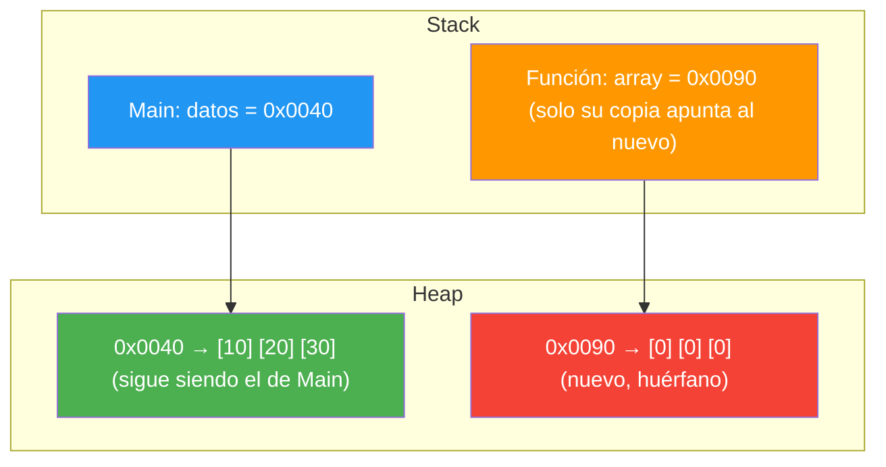

```csharp
// ❌ Sin ref: la reasignación NO llega al llamador
void ReasignarSinRef(int[] datos)
{
    datos = new int[3];   // solo cambia la COPIA local de la dirección
}

int[] serie = { 10, 20, 30 };
ReasignarSinRef(serie);
Console.WriteLine(serie[0]);   // 10 — sigue apuntando al array viejo
```

El array nuevo que creó la función **no lo usa nadie**: cuando la función termina, su copia de la dirección desaparece y el **recolector de basura (GC)** libera ese bloque. La reasignación "se pierde por el camino".

| Operación dentro de la función | ¿Se ve en el llamador? | Motivo |
| :--- | :--- | :--- |
| Escribir un elemento: `v[0] = 9` | ✅ Sí | Ambas direcciones apuntan al mismo bloque |
| Reasignar: `v = new int[…]` | ❌ No | Solo cambia la copia local de la dirección |

📌 **Ejemplo real:** Si dentro de una función "cambias de casa" escribiendo una dirección nueva en **tu** papelito, nadie se entera en casa: en el llamador, el papelito original sigue con la dirección vieja. Para que el cambio se vea, alguien tiene que poder escribir en **el papelito del llamador** — eso es `ref` (siguiente apartado).

### 2.3.5. Con `ref`: cuando la función debe reemplazar el array

Si necesitas que la función **reemplace por completo** el array del llamador —p.ej. redimensionarlo o vaciarlo—, el modificador `ref` cambia lo que se pasa: no se copia la dirección, se pasa **una referencia a la propia variable** del llamador. La función, entonces, puede **reescribir la variable de Main**.

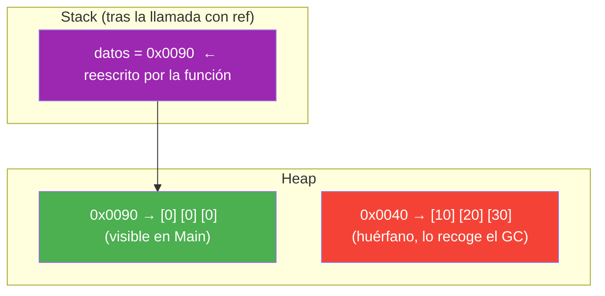

```csharp
// ✅ Con ref: el llamador ve el reemplazo
void ReasignarConRef(ref int[] datos)
{
    datos = new int[3];   // ahora la variable DEL LLAMADOR apunta al nuevo
}

int[] serie = { 10, 20, 30 };
ReasignarConRef(ref serie);
Console.WriteLine(serie[0]);   // 0 — ¡ahora apunta al array nuevo de ceros!
```

📌 **Ejemplo real:** Cuando un juego descarta la partida actual y empieza una nueva, la variable que guarda la partida debe apuntar a **otro** array: eso es un **reemplazo**, no una modificación, y por eso se pasa con `ref`.

> 📝 **Nota:** El caso de uso completo —redimensionar un array— está en la 2.6, en sus dos versiones: procedimiento con `ref` (`Array.Resize(ref array, n)`) y función que devuelve el array nuevo. El ejemplo `05-PasoReferencia` de la unidad muestra las tres formas lado a lado con los mismos datos.

### 2.3.6. Con `in`: cuando la función solo lee el array

Su efecto es concreto y está verificado con el compilador del curso (C# 14 / .NET 10):

- **Reasignar el parámetro → error de compilación CS8331.** Dentro de una función `in`, la instrucción `datos = new int[0];` no compila: *"No se puede asignar a variable… porque es una variable de solo lectura"*.
- **Aviso importante:** `in` protege **la variable**, no **los elementos** del array. Escribir `datos[0] = 999` **compila** —el compilador solo impide reasignar la dirección— y modificaría el array compartido. `in` es una **promesa de solo lectura** que tú debes cumplir: si la función es de lectura, no toques los elementos.

```csharp
int SumarElementos(in int[] datos)
{
    int suma = 0;
    foreach (int e in datos)
        suma += e;

    // datos = new int[0];   // ❌ ERROR CS8331: la variable es de solo lectura
    // datos[0] = 999;       // ⚠️ compila, pero rompe la intención de 'in': no lo hagas
    return suma;
}

int[] valores = { 10, 20, 30 };
Console.WriteLine(SumarElementos(in valores));   // 60
```

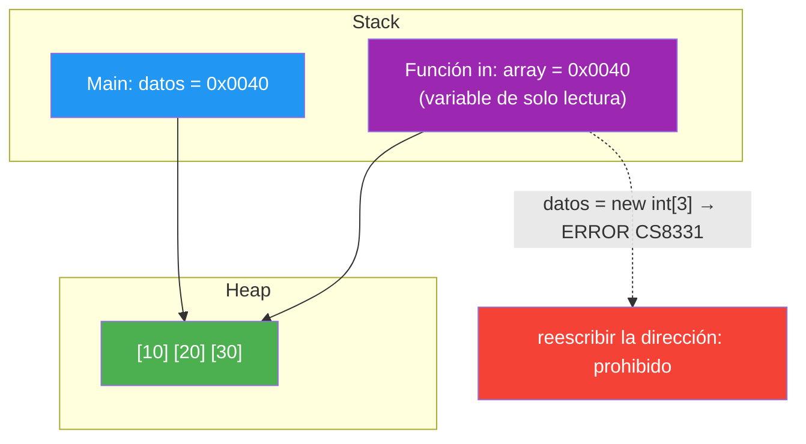

📌 **Ejemplo real:** Las funciones de análisis de los ejemplos de la unidad (`GenerarInforme`, `SumarPosicionesPares`…) reciben el array solo para leerlo; con `in`, la firma dejaría escrito que **nadie debe tocar los datos**.

**Resumen de los tres caminos:**

| Modificador | ¿La función escribe elementos? | ¿La función reemplaza el array? | Mecanismo |
| :--- | :--- | :--- | :--- |
| *(ninguno)* | ✅ Sí, se propaga | ❌ No (aunque compila, se pierde) | Se copia la dirección |
| `ref` | ✅ Sí, se propaga | ✅ Sí, se propaga | Se pasa la variable del llamador |
| `in` | ⚠️ Compila, pero no debe (solo lectura) | ❌ Error CS8331 | Dirección de solo lectura |

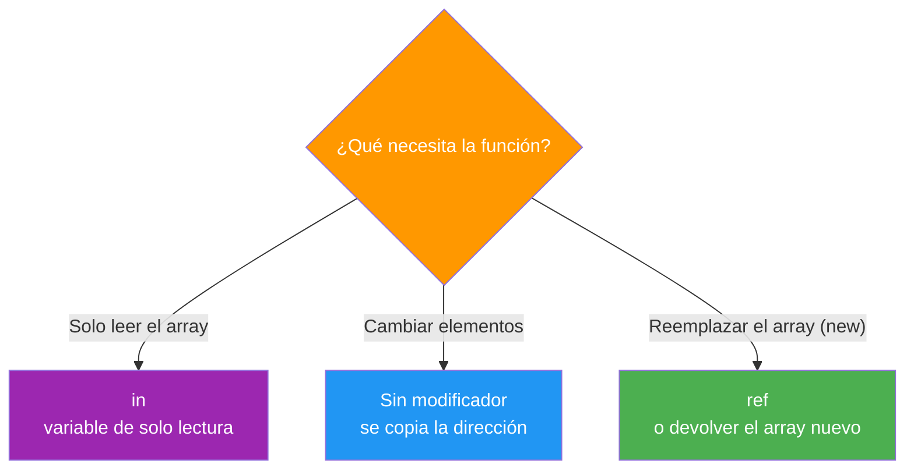

> ⚠️ **Advertencia:** "Pasar por referencia" y `ref` **no son lo mismo**. Sin `ref`, lo que viaja es una **copia de la dirección** (pasado por valor); con `ref`, viaja **la variable misma**. Por eso el dicho popular engaña: el contenido cambia por la copia de la dirección, no por un paso de referencia de verdad.

> 💡 **Consejo: ¿se puede proteger el array de verdad?** Con los modificadores de este punto, **no**: `in` congela la **variable** —la dirección—, no la caja de datos, así que un `datos[0] = 999` dentro de la función sigue compilando y surtiendo efecto. Protecciones más fuertes existen, pero llegan con las colecciones y la POO —otros temas—, y aquí no entramos. Tu defensa en este punto es otra: **leer el contrato de la función**. La firma —`ref`, `in` o sin modificador— y su documentación te dicen qué promete hacer la función con tu array; y si la función es tuya, tu firma es el contrato que ofreces a los demás.

### 2.3.7. Clonación manual para romper la referencia

Para obtener un array **completamente independiente**, debes crear uno nuevo y copiar elemento por elemento (**copia profunda**).

```csharp
int[] Clonar(int[] origen)
{
    int[] clonado = new int[origen.Length];
    for (int i = 0; i < origen.Length; i++)
    {
        clonado[i] = origen[i];  // Copia el valor
    }
    return clonado;
}

int[] arrayA = { 10, 20 };
int[] arrayClon = Clonar(arrayA);

arrayClon[0] = 500;
Console.WriteLine(arrayA[0]);    // 10 — A no cambia
Console.WriteLine(arrayClon[0]); // 500 — C es independiente
```

### 2.3.8. Devolución de arrays

Una función que devuelve un array retorna la **referencia**. La variable que recibe el retorno apunta al mismo objeto.

```csharp
int[] CrearArray(int tamanho)
{
    return new int[tamanho];  // Retorna la referencia
}

int[] miArray = CrearArray(10);
Console.WriteLine(miArray.Length);  // 10
```

> 💡 **Consejo:** Usa comentarios XML `/// <summary>` en funciones que trabajen con arrays. Facilita la comprensión y la depuración del código.

> 📝 **Nota:** A veces necesitas devolver un array **junto con** otros valores (por ejemplo, el array y su suma). En ese caso, usa **tuplas** (que viste en la UD01/UD02):
>
> ```csharp
> (int[] datos, int suma) ProcesarArray(int[] arr)
> {
>     int s = 0;
>     foreach (int x in arr) s += x;
>     return (arr, s);
> }
>
> var (numeros, total) = ProcesarArray(new int[] { 10, 20, 30 });
> Console.WriteLine($"Suma: {total}");  // 60
> ```

## 2.4. Parámetros variables (`params`) y modificador `in`

El modificador **`params`** permite a una función aceptar un número variable de argumentos. Internamente, el compilador los convierte en un **array**.

```csharp
int SumarTodos(params int[] numeros)
{
    int suma = 0;
    foreach (int num in numeros)
    {
        suma += num;
    }
    return suma;
}

// ✅ Llamada con argumentos variables
Console.WriteLine(SumarTodos(1, 2, 3));          // 6
Console.WriteLine(SumarTodos(10, 20, 30, 40));   // 100
```

### El modificador `in` (solo lectura)

`in` se analizó a fondo en la **2.3.6** —con sus diagramas de memoria y con el matiz de qué protege y qué no—; aquí solo el resumen de la firma: la función recibe la dirección del array con la variable **de solo lectura** —puede leerlo y recorrerlo, pero **no puede reasignarla** (reasignarla sería **error CS8331**)—. Así la cabecera de la función ya funciona como una promesa legible: *«esto solo lo leo»*, y conviene usarla donde eso sea cierto: **arrays grandes de solo lectura**.

La tabla comparativa de los tres caminos (`in`, `ref` y sin modificador), el esquema de decisión *"¿qué necesita la función?"* y el ejemplo completo de `SumarElementos(in int[] datos)` están al final de la 2.3.6.

## 2.5. Identidad vs. igualdad (referencia vs. contenido)

| Concepto | Significado | Operador en C# |
| :--- | :--- | :--- |
| **Identidad** | ¿Apuntan a la **misma dirección**? | `==` |
| **Igualdad** | ¿Tienen el **mismo contenido**? | Función manual |

```csharp
bool SonIguales(int[] a, int[] b)
{
    if (a.Length != b.Length) return false;
    for (int i = 0; i < a.Length; i++)
    {
        if (a[i] != b[i]) return false;
    }
    return true;
}

int[] arrayA = { 1 };
int[] arrayB = { 1 };
int[] arrayC = arrayA;  // Misma referencia

Console.WriteLine(arrayA == arrayC);               // true (misma dirección)
Console.WriteLine(arrayA == arrayB);               // false (distinta dirección)
Console.WriteLine(SonIguales(arrayA, arrayB));      // true (mismo contenido)
```

> 🔧 **Truco mnemotecico:** `==` comprueba si son la **misma persona** (misma dirección). `SonIguales` comprueba si son **gemelos** (mismo contenido pero distinta persona).

## 2.6. Copias, clonación y la inmutabilidad del tamaño

La propiedad `.Length` es de **solo lectura**. No puedes cambiar el tamaño de un array existente. Si necesitas más espacio, debes crear uno nuevo y copiar.

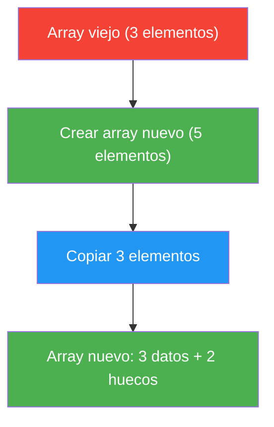

Y si quieres que esa operación viva en su propia función, ahí aparece **`ref`**: el procedimiento no toca elementos, **reasigna la variable** (`datos = nuevo`), y solo con `ref` esa reasignación llega al llamador (las reglas de la 2.3.4 y la 2.3.5).

```csharp
// Procedimiento que redimensiona: crea, copia y REASIGNA — por eso ref
void Redimensionar(ref int[] datos, int nuevoTamano)
{
    int[] nuevo = new int[nuevoTamano];

    for (int i = 0; i < datos.Length; i++)
    {
        nuevo[i] = datos[i];  // copia los elementos existentes
    }

    datos = nuevo;  // EL TRUCO: sin ref, esta línea se perdería
}

int[] arrayAntiguo = { 10, 20, 30 };
Redimensionar(ref arrayAntiguo, 5);

// arrayAntiguo = { 10, 20, 30, 0, 0 }
Console.WriteLine(string.Join(", ", arrayAntiguo));     // 10, 20, 30, 0, 0
Console.WriteLine($"Longitud: {arrayAntiguo.Length}");  // 5
```

**La otra forma: una función que devuelve el array redimensionado.** El procedimiento de arriba reasigna *dentro* (por eso lleva `ref`); si prefieres que la reasignación la haga *el que llama*, la función devuelve el array nuevo y tú lo asignas — en este caso **no hace falta `ref`**, porque el `return` ya trae la referencia.

```csharp
// Función que devuelve el array redimensionado (sin ref)
int[] RedimensionarFuncion(int[] datos, int nuevoTamano)
{
    int[] nuevo = new int[nuevoTamano];

    for (int i = 0; i < datos.Length; i++)
    {
        nuevo[i] = datos[i];  // copia los elementos existentes
    }

    return nuevo;   // devuelve la referencia al array nuevo
}

int[] arrayFuncion = { 10, 20, 30 };
arrayFuncion = RedimensionarFuncion(arrayFuncion, 5);

// arrayFuncion = { 10, 20, 30, 0, 0 }
Console.WriteLine(string.Join(", ", arrayFuncion));     // 10, 20, 30, 0, 0
Console.WriteLine($"Longitud: {arrayFuncion.Length}");  // 5
```

| Estilo | Quién reasigna | Modificador | Lectura |
| :--- | :--- | :--- | :--- |
| `Redimensionar(ref a, 5)` — procedimiento | El procedimiento, **desde dentro** | `ref` necesario | "hazlo tú" |
| `a = RedimensionarFuncion(a, 5)` — función | El llamador, **desde fuera** | ninguno extra | "dámelo hecho" |

En ambos estilos el efecto es idéntico y **en ambos hay una reasignación** (`datos = nuevo` dentro, `array = ...` fuera); lo que cambia es *dónde* vive esa línea y, por tanto, si hace falta `ref`.

> 📝 **Nota:** La **BCL** (*Base Class Library* o Biblioteca de Clases Base: la enorme colección de clases que trae .NET de serie — `Array`, `Console`, `Math`...; la presentaste en la UD01) trae `Array.Resize(ref array, nuevoTamano)`, que hace exactamente esto por ti — y fíjate que su firma **también lleva `ref`**, por la misma razón: internamente crea un array nuevo, copia y reasigna (la BCL eligió el estilo del procedimiento con `ref`). Ojo: es un **método** estático de `Array`, no una propiedad `.Resize()`.

## 2.7. La trampa del alias

Un error muy común es pensar que al hacer `int[] b = a` has creado una copia. En realidad, has creado un **alias** — dos nombres para el mismo array.

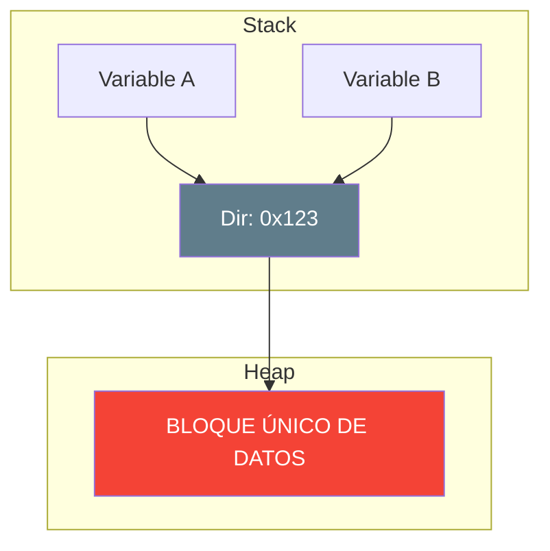

**Consecuencia:** Si cambias `b[0]`, el valor de `a[0]` también cambia. No son dos arrays, son dos nombres para la misma "cajonera".

```csharp
// ❌ ERROR COMÚN: Aliasing
int[] a = { 1, 2, 3 };
int[] b = a;  // b es un ALIAS de a, NO una copia

b[0] = 999;
Console.WriteLine(a[0]);  // 999 — ¡También cambió!

// ✅ CORRECTO: Clonación
int[] c = new int[a.Length];
for (int i = 0; i < a.Length; i++)
    c[i] = a[i];

c[0] = 888;
Console.WriteLine(a[0]);  // 999 — a NO cambia
Console.WriteLine(c[0]);  // 888 — c es independiente
```

> 💡 **Analogía:** Imagina que `a` es la dirección de tu piso. Cuando escribes `b = a`, no estás comprando un piso nuevo, estás dando otra llave al **mismo piso**. Si `b` entra y mueve los muebles, `a` también ve los cambios.

📌 **Ejemplo real:** En un juego como Fortnite, si dos variables apuntan al mismo array de inventario y un jugador usa un objeto, el otro jugador también lo ve. Para evitarlo, el juego crea una **copia profunda** del inventario antes de modificarlo.

### El problema de `==` con arrays

Los arrays son **tipos por referencia**. Esto significa que `==` no compara el contenido, sino si ambas variables apuntan al **mismo objeto en memoria**.

```csharp
// ❌ == NO compara arrays por contenido
int[] a = { 1, 2, 3 };
int[] b = { 1, 2, 3 };
Console.WriteLine(a == b);  // ¡False! Son arrays diferentes

// ✅ Para comparar contenido, usa SequenceEqual()
Console.WriteLine(a.SequenceEqual(b));  // True

// ✅ O un bucle manual
bool iguales = a.Length == b.Length;
for (int i = 0; i < a.Length && iguales; i++)
    if (a[i] != b[i]) iguales = false;
```

> ⚠️ **Advertencia:** Este es uno de los errores más comunes. Si comparas dos arrays con `==`, siempre dará `False` aunque tengan los mismos valores, porque son objetos distintos en memoria.

### El problema de `null` con arrays

Los arrays pueden ser `null`. Si intentas acceder a `.Length` o a un índice de un array `null`, obtienes `NullReferenceException`.

```csharp
int[] numeros = null;

// ❌ Esto falla
Console.WriteLine(numeros.Length);  // NullReferenceException

// ✅ Comprobar antes de usar
if (numeros != null)
    Console.WriteLine(numeros.Length);

// ✅ Con operador ternario
int total = numeros?.Length ?? 0;
```

### Arrays de tipos compuestos

Los arrays no solo almacenan `int`, `string` o `bool`. También puedes guardar **tuplas**, **enums** y **structs** en un array.

#### Arrays de tuplas

Un array de tuplas guarda registros completos sin definir ninguna clase. Decláralo, inicialízalo y recórrelo:

```csharp
// Array de tuplas con nombre
(string nombre, int nota)[] alumnos = 
{
    ("Ana", 8),
    ("Luis", 7),
    ("María", 9)
};

// Recorrer
for (int i = 0; i < alumnos.Length; i++)
    Console.WriteLine($"{alumnos[i].nombre}: {alumnos[i].nota}");
```

#### Arrays de enums

Un array de enums es la forma natural de guardar una colección de días, colores o estados. Fíjate en el recorrido y en la búsqueda secuencial:

```csharp
enum DiaSemana { Lunes, Martes, Miercoles, Jueves, Viernes, Sabado, Domingo }

// Array de enums
DiaSemana[] semana = 
{ 
    DiaSemana.Lunes, 
    DiaSemana.Miercoles, 
    DiaSemana.Viernes 
};

// Recorrer
foreach (DiaSemana dia in semana)
    Console.WriteLine($"Día: {dia}");

// Buscar un valor
for (int i = 0; i < semana.Length; i++)
{
    if (semana[i] == DiaSemana.Viernes)
        Console.WriteLine($"Viernes está en la posición {i}");
}
```

#### Arrays de structs

Con los structs, el array se convierte en una tabla de verdad: cada posición es un registro con todos sus campos:

```csharp
struct Alumno
{
    public int Id;
    public string Nombre;
    public double Nota;
}

// Array de structs
Alumno[] clase = new Alumno[3];
clase[0] = new Alumno { Id = 1, Nombre = "Ana", Nota = 8.5 };
clase[1] = new Alumno { Id = 2, Nombre = "Luis", Nota = 7.0 };
clase[2] = new Alumno { Id = 3, Nombre = "María", Nota = 9.2 };

// Recorrer
for (int i = 0; i < clase.Length; i++)
    Console.WriteLine($"{clase[i].Nombre} (ID {clase[i].Id}): {clase[i].Nota}");

// Con inicialización directa
Alumno[] clase2 = 
{
    new Alumno { Id = 1, Nombre = "Ana", Nota = 8.5 },
    new Alumno { Id = 2, Nombre = "Luis", Nota = 7.0 }
};
```

> 💡 **Nota:** Los structs son tipos de valor, así que cada elemento del array es una **copia independiente**. Si modificas `clase[0].Nota`, no afecta a otros arrays de la misma struct.

> 📌 **Ejemplo real:** Un videojuego almacena un array de structs `Personaje` con campos como `Nombre`, `Nivel`, `Vida`. Cada personaje es un elemento independiente del array.

**Resumen del punto:**

| Concepto | Descripción |
| :--- | :--- |
| **`new tipo[n]`** | Crea un array con n elementos (valores por defecto) |
| **`{ val1, val2 }`** | Inicialización directa con valores |
| **`.Length`** | Número total de elementos (solo lectura) |
| **`for`** | Recorre modificando o accediendo por índice |
| **`foreach`** | Recorre solo leyendo, sin índice |
| **Paso por referencia** | Modificar elementos afecta al original |
| **Clonación manual** | Copia profunda: crear nuevo array + copiar valores |
| **`params`** | Número variable de argumentos (se convierte en array) |
| **`in`** | Paso por referencia de solo lectura |
| **`string[] args`** | El array de argumentos que recibes de serie |
| **Redimensionar arrays** | Dos estilos: con `ref` (procedimiento) o devolviendo el array (función) |
| **`==`** | Compara identidad (misma dirección), no contenido |
| **Alias** | `b = a` crea dos nombres para el mismo array |
| **Tuplas** | `(string, int)[]` — arrays de tuplas |
| **Enums** | `DiaSemana[]` — arrays de enumeraciones |
| **Structs** | `Alumno[]` — arrays de tipos de valor compuestos |

## ¿Qué viene después?

En el siguiente punto veremos cómo funcionan los arrays multidimensionales (matrices): su creación, recorrido y las diferencias clave con los unidimensionales.

## Buenas prácticas

- [ ] Usar `for` cuando necesites modificar o conocer el índice
- [ ] Usar `foreach` cuando solo necesites leer los valores
- [ ] Verificar `null` antes de acceder a `.Length` o a un índice
- [ ] No confundir identidad (`==`) con igualdad (contenido) en arrays
- [ ] Pasar `ref` solo cuando el procedimiento deba REEMPLAZAR el array completo (no para tocar sus elementos)
- [ ] Clonar cada fila manualmente en matrices escalonadas
