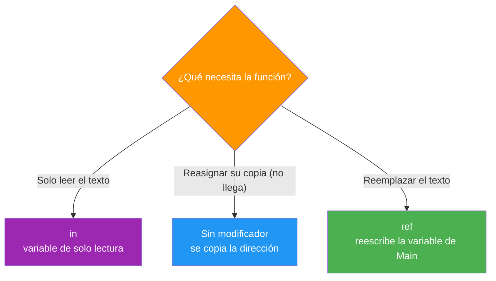

- [5. Cadenas de texto (`string`) y manejo del texto](#5-cadenas-de-texto-string-y-manejo-del-texto)
  - [5.1. Definición, inmutabilidad y tipo de referencia](#51-definición-inmutabilidad-y-tipo-de-referencia)
    - [5.1.1. Pasar un string a una función: sin modificador, `ref` e `in`](#511-pasar-un-string-a-una-función-sin-modificador-ref-e-in)
  - [5.2. Acceso y recorrido de cadenas](#52-acceso-y-recorrido-de-cadenas)
    - [5.2.1. Propiedad `Length` y acceso por índice](#521-propiedad-length-y-acceso-por-índice)
    - [5.2.2. Recorrido con bucles](#522-recorrido-con-bucles)
  - [5.3. Métodos y operadores esenciales](#53-métodos-y-operadores-esenciales)
  - [5.4. `StringBuilder`: Construcción eficiente de texto](#54-stringbuilder-construcción-eficiente-de-texto)
    - [5.4.1. El problema del rendimiento (`+` vs. `StringBuilder`)](#541-el-problema-del-rendimiento--vs-stringbuilder)
    - [5.4.2. Uso correcto de `StringBuilder`](#542-uso-correcto-de-stringbuilder)
  - [5.5. Curiosidad: String Interning (Pool de cadenas)](#55-curiosidad-string-interning-pool-de-cadenas)


# 5. Cadenas de texto (`string`) y manejo del texto

> 💡 **Punto de partida:** ¿Alguna vez has copiado y pegado un texto largo en un editor y has notado que tarda? Eso es porque las cadenas de texto en C# son **inmutables**: cada vez que modificas una cadena, se crea una nueva en memoria. Entender esto es clave para escribir código eficiente.

En este punto aprenderás cómo funcionan las cadenas en C#, sus métodos esenciales y por qué `StringBuilder` es tu mejor aliada para construir textos largos.

**Objetivos de aprendizaje:**

- Entender la inmutabilidad de `string` y sus implicaciones
- Pasar un string a una función (sin modificador, `ref` o `in`)
- Acceder y recorrer caracteres de una cadena
- Usar métodos esenciales (`Split`, `Join`, `Replace`, `Contains`, `Substring`)
- Construir texto eficientemente con `StringBuilder`

## 5.1. Definición, inmutabilidad y tipo de referencia

Una **cadena** (`string`) en C# es una secuencia de caracteres. Es un **tipo de referencia** y, lo más importante, es **inmutable**: una vez creada, no puede modificarse.

```csharp
string saludo = "Hola";
saludo[0] = 'M';  // ❌ ERROR de compilación: los strings son inmutables
// Debes crear un nuevo string: saludo = "Mola";
```

> 💡 **Analogía:** Imagina una cadena como una frase escrita con tinta indeleble en un papel. Puedes leerla, pero no puedes borrar una letra y cambiarla. Si quieres cambiar algo, debes escribir una **copia nueva** en otro papel.

```csharp
string original = "Hola";
string nuevo = original.Replace('H', 'M');

Console.WriteLine(original);  // "Hola" — no cambia
Console.WriteLine(nuevo);     // "Mola" — es una nueva cadena
```

📌 **Ejemplo real:** Instagram almacena los captions de las fotos como strings inmutables. Cuando editas un caption, la app no modifica el original — crea una nueva versión. Esto garantiza que los comentarios antiguos no se corrompan.

### 5.1.1. Pasar un string a una función: sin modificador, `ref` e `in`

Como viste en la 5.1, un `string` es un **tipo de referencia**, así que al llamar a una función pasa lo mismo que con los arrays (2.3): viaja una **copia de la dirección**, no el texto. Para decidir qué quiere hacer la función con **tu variable** están los mismos tres caminos de siempre.

```csharp
// 1) Sin modificador: la función reasigna SU copia → Main no se entera
void ReasignarSinRef(string s) { s = "nuevo"; }

// 2) Con ref: la función reescribe la variable DEL LLAMADOR → llega fuera
void ReasignarConRef(ref string s) { s = "nuevo"; }

// 3) Con in: la variable es de solo lectura → reasignar no compila
void ReasignarIn(in string s)
{
    // s = "nuevo";   // ❌ ERROR CS8331: variable de solo lectura
    Console.WriteLine(s);
}

string original = "hola";
ReasignarSinRef(original);
Console.WriteLine(original);   // "hola" — la reasignación se perdió
ReasignarConRef(ref original);
Console.WriteLine(original);   // "nuevo" — ¡ahora sí cambió!
```

> 📝 **Nota:** Aquí desaparece un matiz que sí había en los arrays: **no existe el caso "escribir en el contenido"**, porque los strings son **inmutables** (5.1). Por eso en strings `in` sí es protección completa: la función no puede reasignar la variable (CS8331) y, además, el texto no admite cambios.

**Resumen de los tres caminos:**

| Camino | ¿La función reasigna la variable? | ¿Puede cambiar el texto? | Mecanismo |
| :--- | :--- | :--- | :--- |
| *(ninguno)* | Sí, pero **se pierde** al salir | No (inmutable) | Se copia la dirección |
| `ref` | Sí, **llega** al llamador | No (inmutable) | Se pasa la variable del llamador |
| `in` | ❌ Error CS8331 | No (inmutable) | Dirección de solo lectura |



> 💡 **Consejo:** En strings, `in` es la opción más cómoda de las tres: al ser el texto inmutable, con `in` ya no queda nada que proteger. Y recuerda lo de arrays (2.3.6): la firma —`ref`, `in` o sin modificador— es el **contrato** que la función ofrece; léelo antes de esperar un efecto, y escríbelo tú si la función es tuya.

## 5.2. Acceso y recorrido de cadenas

### 5.2.1. Propiedad `Length` y acceso por índice

Las cadenas funcionan como arrays de caracteres. Puedes acceder a cada carácter por su índice.

```csharp
string nombre = "DAW";

Console.WriteLine(nombre.Length);       // 3
Console.WriteLine(nombre[0]);          // 'D'
Console.WriteLine(nombre[nombre.Length - 1]);  // 'W'
```

### 5.2.2. Recorrido con bucles

Un string se puede recorrer como si fuera un array de chars. Aquí tienes las dos formas, con cuándo conviene cada una:

```csharp
string mensaje = "Hola, DAW!";

// ✅ Recorrer con for (cuando necesitas el índice)
for (int i = 0; i < mensaje.Length; i++)
{
    Console.Write($"{mensaje[i]} ");
}

// ✅ Recorrer con foreach (solo lectura)
foreach (char c in mensaje)
{
    Console.Write($"{c} ");
}
```

> 💡 **Consejo:** Si necesitas modificar caracteres, convierte la cadena a `char[]` con `.ToCharArray()`, modifica el array y vuelve a crear la cadena.

```csharp
string original = "hola";
char[] caracteres = original.ToCharArray();
caracteres[0] = char.ToUpper(caracteres[0]);
string resultado = new string(caracteres);
Console.WriteLine(resultado);  // "Hola"
```

## 5.3. Métodos y operadores esenciales

| Método | Descripción | Ejemplo |
| :--- | :--- | :--- |
| `.Length` | Número de caracteres | `"DAW".Length` → `3` |
| `.Contains(texto)` | ¿Contiene el texto? | `"Hola".Contains("ol")` → `true` |
| `.Replace(old, new)` | Reemplaza todas las ocurrencias | `"aaba".Replace("a", "x")` → `"xxbx"` |
| `.Substring(start, len)` | Extrae una porción | `"Hola".Substring(1, 2)` → `"ol"` |
| `.Split(sep)` | Divide en array | `"a,b,c".Split(',')` → `{ "a", "b", "c" }` |
| `.Trim()` | Elimina espacios al inicio/final | `" hola ".Trim()` → `"hola"` |
| `.ToUpper()` / `.ToLower()` | Mayúsculas / minúsculas | `"Hola".ToUpper()` → `"HOLA"` |
| `.IndexOf(texto)` | Posición de la primera aparición | `"Hola".IndexOf("la")` → `2` |
| `string.Join(sep, array)` | Une array en cadena | `string.Join("-", "L", "M", "X")` → `"L-M-X"` |
| `$"{var}"` | Interpolación de cadenas | `$"Tengo {edad} años"` |

```csharp
string email = "usuario@ejemplo.com";

// ✅ Validaciones comunes
bool tieneArroba = email.Contains("@");
bool empiezaConU = email.StartsWith("usuario");
bool terminaConCom = email.EndsWith(".com");
int posicionArroba = email.IndexOf("@");

Console.WriteLine($"Tiene @: {tieneArroba}");
Console.WriteLine($"Posición @: {posicionArroba}");
```

📌 **Ejemplo real:** Spotify usa `.Split()` para separar los artistas de una canción cuando tienen varios nombres. Si el campo es `"Artista1, Artista2, Artista3"`, el `.Split(',')` crea un array de 3 artistas que se muestran por separado.

## 5.4. `StringBuilder`: Construcción eficiente de texto

### 5.4.1. El problema del rendimiento (`+` vs. `StringBuilder`)

Como `string` es inmutable, cada concatenación con `+` crea una **nueva cadena**. En bucles largos, esto es extremadamente lento.

| Operación | Complejidad | Descripción |
| :--- | :--- | :--- |
| **Concatenación `+`** | $O(n^2)$ | Cada paso crea una nueva cadena |
| **`StringBuilder.Append()`** | $O(n)$ | Modifica un buffer interno de forma eficiente |

```csharp
// ❌ LENTO: crear 1000 cadenas intermedias
string resultado = "";
for (int i = 0; i < 1000; i++)
{
    resultado += $"Línea {i}\n";  // Cada + crea una nueva cadena
}
```

### 5.4.2. Uso correcto de `StringBuilder`

La alternativa rápida: `StringBuilder` mantiene un buffer interno y va añadiendo sin crear una cadena nueva en cada vuelta:

```csharp
using System.Text;

// ✅ RÁPIDO: modificar un buffer interno
var sb = new StringBuilder();
for (int i = 0; i < 1000; i++)
{
    sb.Append($"Línea {i}\n");
}
string resultado = sb.ToString();
Console.WriteLine($"Longitud: {resultado.Length}");
```

| Método | Descripción |
| :--- | :--- |
| `new StringBuilder()` | Crea un buffer vacío |
| `.Append(valor)` | Añade texto sin crear nuevas cadenas |
| `.ToString()` | Convierte el buffer a `string` final |

> 🔧 **Truco mnemotecico:** Si usas `+` más de **3 veces** en un bucle, cambia a `StringBuilder`. Es como la diferencia entre reescribir toda la carta cada vez que añades una palabra, o escribirla de corrido en un borrador.

📌 **Ejemplo real:** Los servidores de email (Gmail, Outlook) usan `StringBuilder` para construir los headers de miles de emails por segundo. Usar `+` sería tan lento que el servidor se colapsaría.

## 5.5. Curiosidad: String Interning (Pool de cadenas)

¿Sabías que si creas dos variables con el mismo literal, C# las hace apuntar a la **misma dirección** de memoria?

```csharp
string a = "Hola";
string b = "Hola";

Console.WriteLine(object.ReferenceEquals(a, b));  // true — misma referencia
```

Esto funciona porque `string` es inmutable: no hay riesgo de que un cambio en `a` afecte a `b`. El compilador optimiza ahorrando memoria.

> 📝 **Nota:** El *String Interning* es automático para literales. Si creas cadenas con `new string(...)`, cada una tendrá su propia dirección de memoria.

**Resumen del punto:**

| Concepto | Descripción |
| :--- | :--- |
| **Inmutabilidad** | `string` no puede modificarse — cada cambio crea una nueva |
| **Tipo de referencia** | Almacena la dirección, no el valor directamente |
| **Paso a funciones** | Sin modificador: la reasignación se pierde; `ref`: llega; `in`: error CS8331 |
| **Acceso por índice** | `cadena[i]` devuelve el carácter en posición i |
| **Métodos esenciales** | `Contains`, `Replace`, `Split`, `Join`, `Substring` |
| **Interpolación** | `$"texto {variable}"` — forma moderna de concatenar |
| **`StringBuilder`** | Buffer mutable para construir texto eficientemente |
| **String Interning** | Pool de cadenas — literales iguales comparten memoria |

## ¿Qué viene después?

En el siguiente punto veremos las Expresiones Regulares (Regex): patrones de búsqueda y validación de texto, una herramienta poderosa para manipular cadenas de forma avanzada.

## Buenas prácticas

- [ ] Recordar que `string` es inmutable — cada cambio crea una nueva cadena
- [ ] Usar `StringBuilder` cuando concatenes más de 3 veces en un bucle
- [ ] Usar interpolación de cadenas (`$"{variable}"`) en lugar de concatenación
- [ ] Usar `@""` (verbatim string) para expresiones regulares en C#
- [ ] Usar `.ToCharArray()` si necesitas modificar caracteres de una cadena
- [ ] Pasar con `ref` solo cuando la función deba reemplazar el texto, y con `in` cuando solo lo vaya a leer
