- [7. Algoritmos de ordenación y búsqueda](#7-algoritmos-de-ordenación-y-búsqueda)
  - [7.1. ¿Qué es la notación Big O?](#71-qué-es-la-notación-big-o)
  - [7.2. Algoritmos de ordenación (Sorting)](#72-algoritmos-de-ordenación-sorting)
    - [7.2.1. Burbuja (Bubble Sort)](#721-burbuja-bubble-sort)
    - [7.2.2. Selección (Selection Sort)](#722-selección-selection-sort)
    - [7.2.3. Inserción (Insertion Sort)](#723-inserción-insertion-sort)
    - [7.2.4. Shell Sort](#724-shell-sort)
    - [7.2.5. QuickSort](#725-quicksort)
    - [7.2.6. Ordenación por mezcla (Merge Sort)](#726-ordenación-por-mezcla-merge-sort)
  - [7.3. Algoritmos de búsqueda (Searching)](#73-algoritmos-de-búsqueda-searching)
    - [7.3.1. Búsqueda lineal](#731-búsqueda-lineal)
    - [7.3.2. Búsqueda binaria](#732-búsqueda-binaria)
    - [7.3.3. Búsqueda binaria recursiva](#733-búsqueda-binaria-recursiva)
  - [7.4. Tabla comparativa de complejidad](#74-tabla-comparativa-de-complejidad)
  - [7.5. Cuándo usar cada algoritmo](#75-cuándo-usar-cada-algoritmo)


# 7. Algoritmos de ordenación y búsqueda

> 💡 **Punto de partida:** ¿Alguna vez has abierto Netflix y has visto que las películas están ordenadas por "Más populares", "Estrenos recientes" o "Mi lista"? Detrás de ese orden hay algoritmos. Pero, ¿cuál es el mejor? ¿El más rápido siempre es el mejor?

En este punto aprenderás los algoritmos de ordenación más importantes (Burbuja, Selección, Inserción, Shell Sort, QuickSort) y los de búsqueda (Lineal, Binaria y Binaria recursiva), analizando su eficiencia con la notación Big O.

**Objetivos de aprendizaje:**

- Entender la notación Big O y comparar rendimientos
- Implementar los algoritmos de ordenación básicos
- Implementar búsqueda lineal, binaria y binaria recursiva
- Saber cuándo usar cada algoritmo según el contexto

## 7.1. ¿Qué es la notación Big O?

Antes de ver algoritmos, necesitamos una forma de **comparar** cuán rápido es cada uno. La **notación Big O** describe cómo crece el tiempo de ejecución cuando aumentan los datos de entrada.

> 💡 **Analogía:** Imagina que tienes que buscar un libro en una biblioteca. Si la biblioteca tiene 100 libros, puedes tardar poco. Si tiene 1.000.000, tardarás mucho más. Big O te dice **cómo de mucho más** tardarás cuando los datos crezcan.

| Big O | Nombre | Significado | Ejemplo práctico |
| :--- | :--- | :--- | :--- |
| $O(1)$ | **Constante** | Siempre el mismo tiempo, sin importar los datos | Acceder a `array[5]` |
| $O(\log n)$ | **Logarítmico** | Cada paso divide los datos por la mitad | Búsqueda Binaria |
| $O(n)$ | **Lineal** | Recorrer todo una vez | Búsqueda Lineal |
| $O(n \log n)$ | **Lineal-logarítmico** | Bueno para ordenar | QuickSort (promedio) |
| $O(n^2)$ | **Cuadrático** | Doble bucle anidado | Burbuja, Selección |

> 💡 **Truco:** Piensa en $n$ como el número de elementos. Si $n = 1.000.000$:
> - $O(1) = 1$ operación (instantáneo)
> - $O(\log n) ≈ 20$ operaciones (muy rápido)
> - $O(n) = 1.000.000$ operaciones (aceptable)
> - $O(n^2) = 1.000.000.000.000$ operaciones (¡nunca termina!)

**¿Qué significa "Estable"?** Un algoritmo es **estable** si mantiene el orden original de los elementos que tienen el mismo valor. Por ejemplo, si tienes dos películas con rating 5 y la primera aparece antes en la lista, después de ordenar, la primera sigue estando antes. Esto es importante cuando ordenas datos que tienen varios criterios.

📌 **Ejemplo real:** Netflix usa algoritmos estables para ordenar tu lista de favoritos: si dos películas tienen la misma prioridad, mantiene el orden en que las añadiste.

## 7.2. Algoritmos de ordenación (Sorting)

De todos los algoritmos de ordenación, puedes verlos animados **en nuestro [visualizador de algoritmos](visualizador/index.html)**: con el código C# resaltado paso a paso, el diagrama de flujo sincronizado, la pila de llamadas de los recursivos y la curva de comparaciones según el tamaño. También hay visualizadores externos [aquí](https://www.cs.usfca.edu/~galles/visualization/Algorithms.html), [aquí](https://visualgo.net/en/sorting) y [aquí](https://algorithm-visualizer.org/).

### 7.2.1. Burbuja (Bubble Sort)

**Idea:** Imagina que estás en una cola de gente. Si alguien más alto está delante de alguien más bajo, se intercambian. Repites hasta que nadie necesita intercambiarse. Los elementos más grandes "burbujean" hacia el final, como burbujas que suben en el agua.

📌 **Ejemplo real:** En un casting de televisión, los directores ordenan a los actores por altura usando burbuja: comparan dos personas de pie una al lado de la otra, y si el de la izquierda es más alto, cambian de posición.

📐 **Ordinograma:** este es el diagrama de flujo **del código** de abajo. Cada caja es una sentencia real (el número es su línea) y cada rombo, una condición. Fíjate en los **dos bucles anidados** y en el `break` de la línea 15, que corta la ejecución cuando ya no ha habido ningún intercambio.

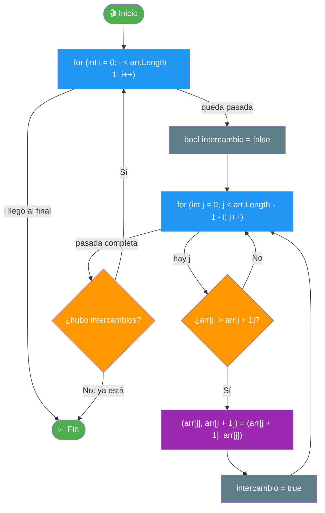

▶️ **Ejemplo paso a paso** con el array `[5, 3, 8, 1]`: mira cómo van cambiando las posiciones en cada pasada hasta llegar a `[1, 3, 5, 8]`.

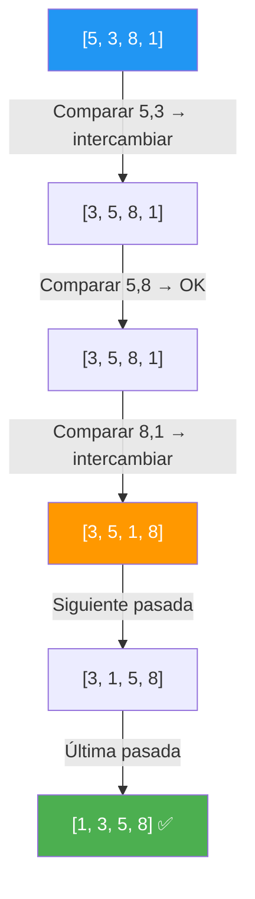

> 🎥 **Visualización del Algoritmo de Burbuja:** https://www.youtube.com/watch?v=lyZQPjUT5B4

```csharp
void Burbuja(int[] arr)
{
    for (int i = 0; i < arr.Length - 1; i++)
    {
        bool intercambio = false;
        for (int j = 0; j < arr.Length - 1 - i; j++)
        {
            if (arr[j] > arr[j + 1])
            {
                (arr[j], arr[j + 1]) = (arr[j + 1], arr[j]);
                intercambio = true;
            }
        }
        // Si no hubo intercambios, ya está ordenado
        if (!intercambio) break;
    }
}
```

> 📝 **Nota:** La versión optimizada incluye un flag `intercambio`. Si en una pasada completa no se intercambia nada, el array ya está ordenado y salimos antes. Con esta optimización, el mejor caso es $O(n)$ (ya ordenado). Sin ella, siempre es $O(n^2)$.

| Aspecto | Evaluación |
| :--- | :--- |
| **Mejor caso** | $O(n)$ — ya ordenado (con optimización) |
| **Peor caso** | $O(n^2)$ — orden inverso |
| **Estable** | ✅ Sí — preserva orden de elementos iguales |
| **Uso** | Didáctico, arrays pequeños |

### 7.2.2. Selección (Selection Sort)

**Idea:** Es como si organizaras un estante de libros: miras todos los libros, encuentras el más pequeño, y lo pones en la primera posición. Luego miras el resto, encuentras el siguiente más pequeño, y lo pones en la segunda posición. Repites hasta que todo esté ordenado.

📌 **Ejemplo real:** Un DJ que ordena sus discos por año de publicación: escanea todos los discos, encuentra el más antiguo, lo pone primero. Luego busca el siguiente más antiguo del resto, y así sucesivamente.

📐 **Ordinograma:** el flujo del código de abajo. En cada pasada se guarda el mínimo de partida (línea 5), se recorre el resto buscando si hay alguno menor (líneas 6-9) y solo al terminar se hace el intercambio (línea 11).

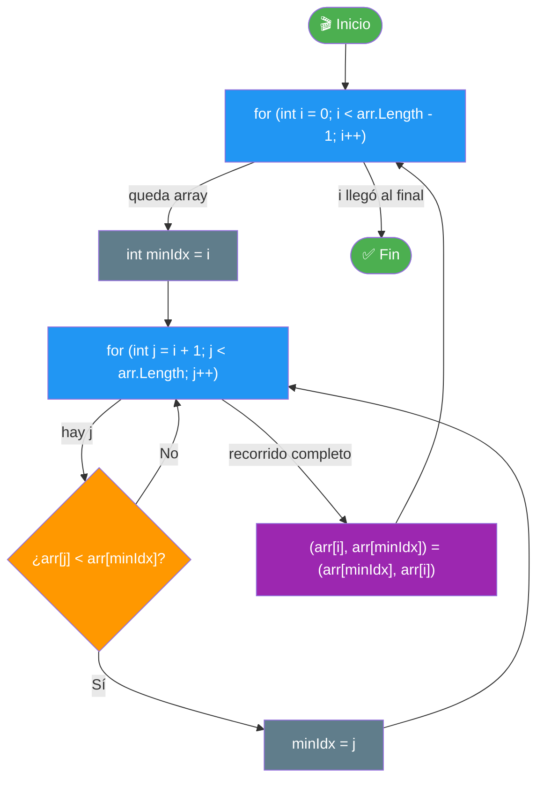

▶️ **Ejemplo paso a paso** con `[5, 3, 8, 1]`: en cada ronda se busca el mínimo del trozo que queda y se intercambia con la primera posición.

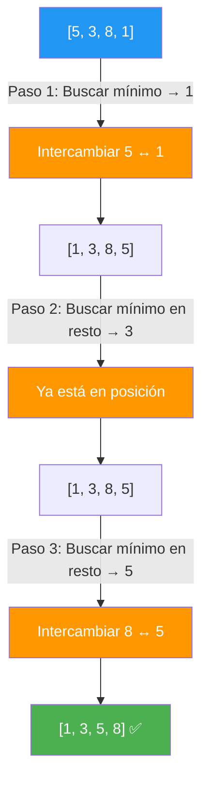

> 🎥 **Visualización del Algoritmo de Selección:** https://www.youtube.com/watch?v=Ns4TPTC8whw

```csharp
void Seleccion(int[] arr)
{
    for (int i = 0; i < arr.Length - 1; i++)
    {
        int minIdx = i;
        for (int j = i + 1; j < arr.Length; j++)
        {
            if (arr[j] < arr[minIdx])
                minIdx = j;
        }
        (arr[i], arr[minIdx]) = (arr[minIdx], arr[i]);
    }
}
```

| Aspecto | Evaluación |
| :--- | :--- |
| **Mejor caso** | $O(n^2)$ — siempre compara todo |
| **Peor caso** | $O(n^2)$ |
| **Estable** | ❌ No — puede cambiar orden de iguales |
| **Uso** | Cuando el intercambio es costoso (pocos intercambios) |

### 7.2.3. Inserción (Insertion Sort)

**Idea:** Es exactamente como ordenar cartas en la mano. Tomas una carta y la **insertas** en su posición correcta entre las que ya tienes ordenadas, desplazando las demás a la derecha.

📌 **Ejemplo real:** Netflix usa Inserción para ordenar tu "Lista de favoritos" cuando añades una sola película — como tiene pocos elementos, es rápido y estable. También es lo que usas cuando ordenas naipes en tu mano durante una partida de poker.

📐 **Ordinograma:** la idea de Inserción es sacar el elemento (línea 5), retroceder con `j` desplazando los mayores (líneas 7-11) y dejarlo en su hueco (línea 12). El `while` de la línea 7 es el que hace el "corrimiento".

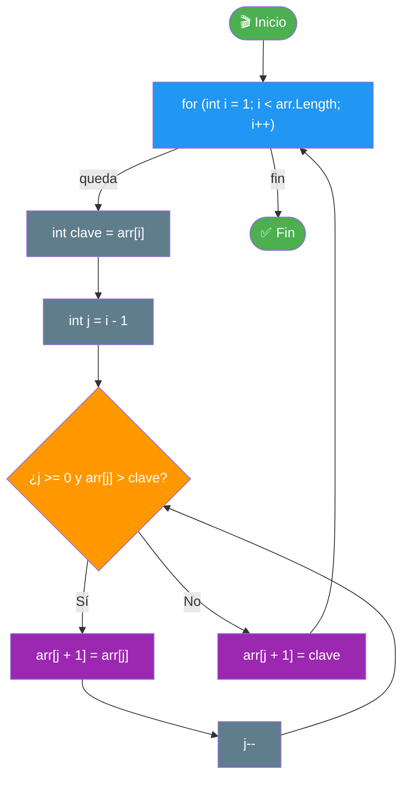

▶️ **Ejemplo paso a paso** con `[5, 3, 8, 1]`: la zona de la izquierda ya está ordenada y vamos encajando cada carta en su sitio.

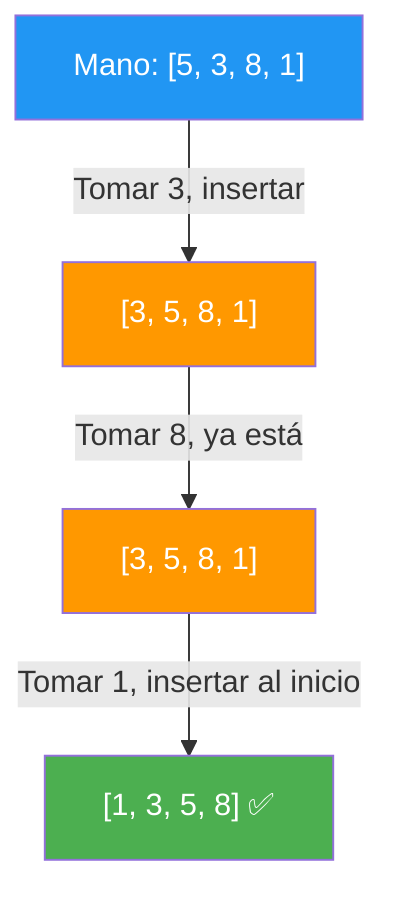

> 🎥 **Visualización del Algoritmo de Inserción:** https://www.youtube.com/watch?v=ROalU379l3U

```csharp
void Insercion(int[] arr)
{
    for (int i = 1; i < arr.Length; i++)
    {
        int clave = arr[i];
        int j = i - 1;
        while (j >= 0 && arr[j] > clave)
        {
            arr[j + 1] = arr[j];
            j--;
        }
        arr[j + 1] = clave;
    }
}
```

| Aspecto | Evaluación |
| :--- | :--- |
| **Mejor caso** | $O(n)$ — casi ordenado |
| **Peor caso** | $O(n^2)$ — orden inverso |
| **Estable** | ✅ Sí |
| **Uso** | Arrays pequeños o casi ordenados |

### 7.2.4. Shell Sort

**Idea:** Una mejora de Inserción. El problema de Inserción es que solo mueve elementos de un en un sitio. Shell Sort dice: "¿por qué no saltar varios sitios a la vez?". Empieza comparando elementos muy separados (con un "gap" grande) y va reduciendo el gap hasta 1 (que es Inserción normal).

> 💡 **Analogía:** Imagina que estás ordenando una fila de personas por altura. Primero comparas personas que están muy separadas (posición 0 con posición 5, posición 1 con posición 6...). Esto mueve a las personas más altas lejos de las más bajas rápidamente. Luego reduces la distancia y refinas. Es como hacer un borrador grueso primero y luego detallar.

📌 **Ejemplo real:** Los motores de bases de datos usan Shell Sort internamente para ordenar pequeños bloques de datos antes de fusionarlos con QuickSort.

📐 **Ordinograma:** Shell es una inserción que salta. El bucle de la línea 4 va reduciendo el `gap` a la mitad; para cada `gap` se recorre el array (línea 6) y cada elemento se desplaza hacia atrás de `gap` en `gap` hasta encontrar su hueco (líneas 10-15).

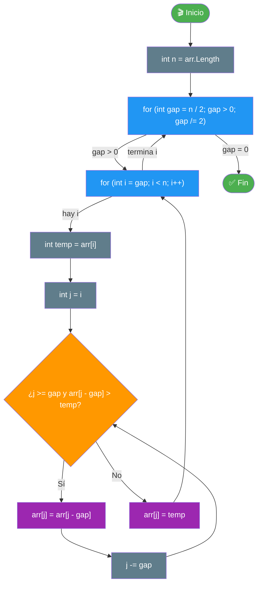

▶️ **Ejemplo paso a paso** con `[8, 5, 9, 3, 2, 7, 1, 6, 4]`: primero se comparan los que están a `gap = 4` posiciones, luego a 2 y por último a 1 (inserción normal).

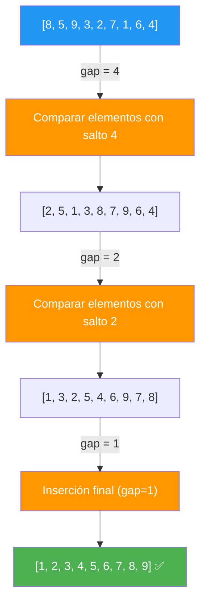

> 🎥 **Visualización del Algoritmo Shell Sort:** https://youtu.be/J-t4OIdqs5c

```csharp
void ShellSort(int[] arr)
{
    int n = arr.Length;
    for (int gap = n / 2; gap > 0; gap /= 2)
    {
        for (int i = gap; i < n; i++)
        {
            int temp = arr[i];
            int j = i;
            while (j >= gap && arr[j - gap] > temp)
            {
                arr[j] = arr[j - gap];
                j -= gap;
            }
            arr[j] = temp;
        }
    }
}
```

| Aspecto | Evaluación |
| :--- | :--- |
| **Mejor caso** | $O(n \log n)$ |
| **Promedio** | $O(n^{1.5})$ — depende de la secuencia de gaps |
| **Peor caso** | $O(n^2)$ dependiendo del gap |
| **Estable** | ❌ No |
| **Uso** | Buen compromiso para arrays medianos |

### 7.2.5. QuickSort

**Idea:** El algoritmo de ordenación por **"Divide y Vencerás"** más utilizado. Es como separar una pila de cartas: eliges una carta como "pivote" (por ejemplo, la del medio). Pones todas las más pequeñas a la izquierda y las más grandes a la derecha. Luego repites con cada subpila. Es recursivo hasta que todo está ordenado.

📌 **Ejemplo real:** El método de ordenación de Google Search usa QuickSort internamente para ordenar millones de resultados por relevancia. Por eso aparecen tan rápido.

> 🎥 **Visualización del Algoritmo QuickSort:** https://www.youtube.com/watch?v=ywWBy6J5gz8

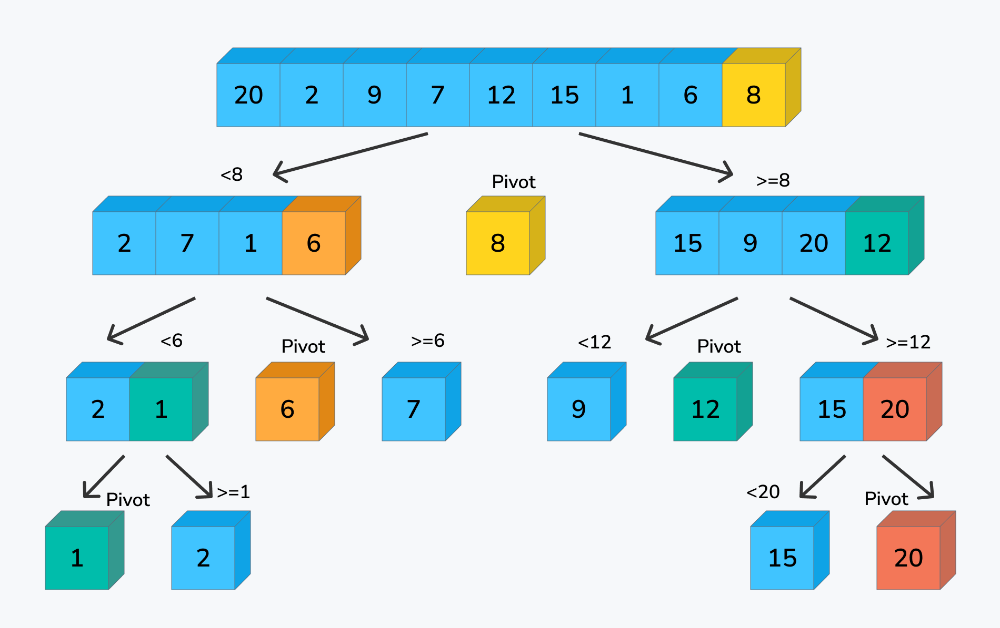

📐 **Ordinograma:** el flujo del código de abajo. Fíjate en que **el caso base NO es el fin del algoritmo**: la línea 3 (`¿bajo < alto?`) se cumple en **cada** llamada, y cuando no se cumple esa llamada simplemente hace `return` — lo que corta es la llamada **inicial**, la que hizo el programa. Por eso el terminal es `↩️ return` y no `✅ Fin`.

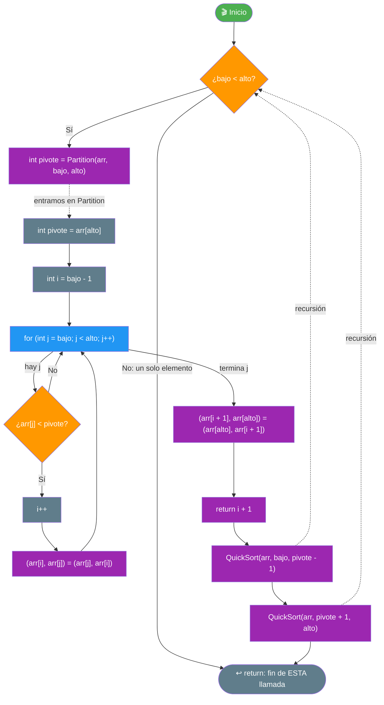

▶️ **Ejemplo paso a paso:** cómo se va partiendo el array hasta dejar cada trozo con un solo elemento.

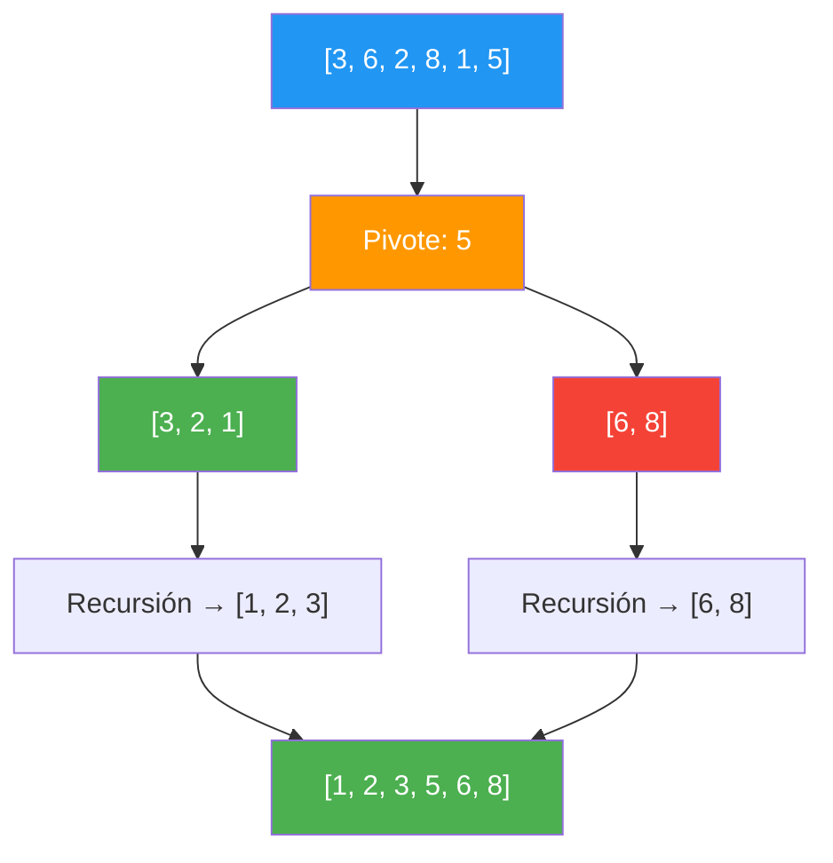

```csharp
void QuickSort(int[] arr, int bajo, int alto)
{
    if (bajo < alto)
    {
        int pivote = Partition(arr, bajo, alto);
        QuickSort(arr, bajo, pivote - 1);
        QuickSort(arr, pivote + 1, alto);
    }
}

int Partition(int[] arr, int bajo, int alto)
{
    int pivote = arr[alto];
    int i = bajo - 1;
    for (int j = bajo; j < alto; j++)
    {
        if (arr[j] < pivote)
        {
            i++;
            (arr[i], arr[j]) = (arr[j], arr[i]);
        }
    }
    (arr[i + 1], arr[alto]) = (arr[alto], arr[i + 1]);
    return i + 1;
}
```

| Aspecto | Evaluación |
| :--- | :--- |
| **Mejor caso** | $O(n \log n)$ |
| **Peor caso** | $O(n^2)$ — pivote mal elegido |
| **Estable** | ❌ No |
| **Uso** | El más rápido en la práctica para grandes volúmenes |

> 💡 **Consejo:** En la práctica, los lenguajes modernos usan variantes optimizadas de QuickSort en sus métodos de ordenación estándar. No necesitas implementarlo a mano, pero entenderlo te ayuda a elegir el mejor algoritmo.

### 7.2.6. Ordenación por mezcla (Merge Sort)

**Idea:** Es el "divide y vencerás" en estado puro. Cortas el array por la mitad una y otra vez hasta quedarte con trozos de **un solo elemento** —que ya están ordenados, porque un elemento consigo mismo siempre lo está— y luego **combinas** esos trozos de dos en dos hasta tener el array entero ordenado.

📌 **Ejemplo real:** Es exactamente lo que hace quien reparte dos mazos de cartas ya ordenados: miras la carta de arriba de cada mazo, te quedas la menor y repites. Cuando un mazo se queda sin cartas, vacías el otro entero tal cual.

> 💡 **Analogía:** Tienes que ordenar la lista de invitados de una boda por apellido. En vez de ordenarla tú solo, le dices a un amigo que ordene la primera mitad y a otro que ordene la segunda; luego vosotros dos **mezcláis** las dos listas ya ordenadas cogiendo siempre el apellido que va antes.

> 🎥 **Visualización del Algoritmo Merge Sort:** https://www.youtube.com/watch?v=HzUrYDdXY-8

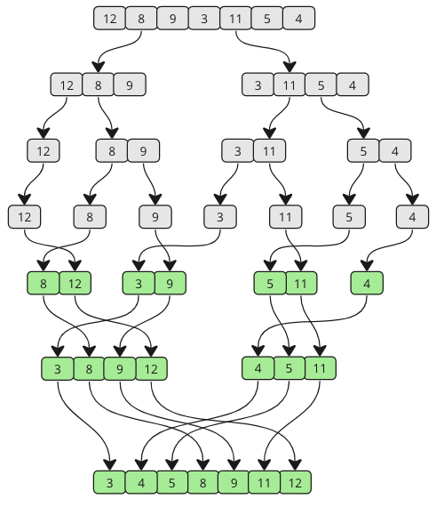

Lo delicado es el paso de **combinar** (`Merge`): se recorren las dos mitades con dos punteros (`i` y `j`), siempre se coge el elemento menor de los dos y se deja en un array auxiliar `tmp`. Al final, `tmp` se devuelve al array original.

📐 **Ordinograma:** el flujo del código de abajo, con las **dos funciones**. Igual que en QuickSort, el caso base (línea 4) **no es el fin del algoritmo**: cada llamada que llega a `izq >= der` simplemente hace `return`. La recursión se ve con las flechas discontinuas que vuelven a la condición.

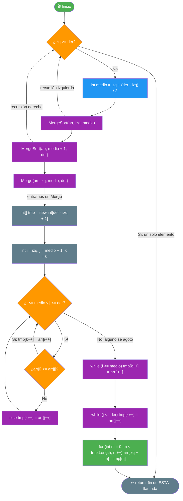

▶️ **Ejemplo paso a paso** con `[8, 3, 5, 1]`: se parte, se ordena cada trozo por separado y luego se van cogiendo los menores de las dos mitades.

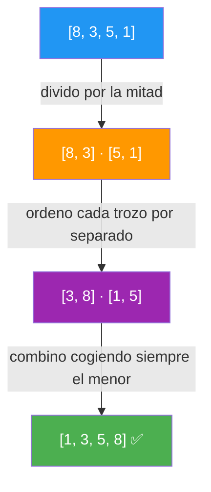

Así queda el código en C#:

```csharp
void MergeSort(int[] arr, int izq, int der)
{
    // Caso base: un solo elemento ya está ordenado
    if (izq >= der) return;
    int medio = izq + (der - izq) / 2;
    MergeSort(arr, izq, medio);
    MergeSort(arr, medio + 1, der);
    Merge(arr, izq, medio, der);
}

void Merge(int[] arr, int izq, int medio, int der)
{
    int[] tmp = new int[der - izq + 1];
    int i = izq, j = medio + 1, k = 0;
    while (i <= medio && j <= der)
    {
        if (arr[i] <= arr[j]) tmp[k++] = arr[i++];
        else tmp[k++] = arr[j++];
    }
    while (i <= medio) tmp[k++] = arr[i++];
    while (j <= der) tmp[k++] = arr[j++];
    for (int m = 0; m < tmp.Length; m++) arr[izq + m] = tmp[m];
}
```

| Aspecto | Evaluación |
| :--- | :--- |
| **Mejor caso** | $O(n \log n)$ |
| **Peor caso** | $O(n \log n)$ — siempre, no depende de los datos |
| **Estable** | ✅ Sí |
| **Espacio** | $O(n)$ — necesita el array auxiliar `tmp` |
| **Uso** | Cuando hace falta $O(n \log n)$ garantizado y estabilidad |

> ⚠️ **Advertencia:** Merge Sort necesita un **array auxiliar** del tamaño del trozo que estás mezclando, así que gasta $O(n)$ de memoria. A cambio es el único de los que hemos visto que **nunca cae por debajo de $O(n \log n)$**: QuickSort puede desplomarse hasta $O(n^2)$ con malas suertes, él no.

> 📝 **Nota:** Por eso es el algoritmo de referencia cuando la **estabilidad** importa. Por ejemplo, ordenar primero por apellido y después por nota sin romper el primer criterio: si dos alumnos empatan en nota, Merge Sort les mantiene el orden de apellidos.

> 🔧 **Truco:** QuickSort gana en la práctica porque trabaja *in place*; Merge Sort gana en **previsibilidad** y en **estabilidad**. Si el examen pregunta "¿cuál es siempre $O(n \log n)$ y estable?", la respuesta es **Merge Sort**.

## 7.3. Algoritmos de búsqueda (Searching)

### 7.3.1. Búsqueda lineal

**Idea:** Es como buscar una palabra en un diccionario **sin** usar el índice: abres la primera página, miras si está. Si no, pasas a la siguiente. Repites hasta encontrarla o llegar al final.

📌 **Ejemplo real:** Cuando buscas un contacto en tu móvil sin usar el buscador, simplemente deslizas hacia abajo mirando cada nombre. Eso es Búsqueda Lineal.

> 🎥 **Visualización de Búsqueda Lineal:** https://www.youtube.com/watch?v=-PuqKbu9K3U

📐 **Ordinograma:** fíjate en que **no hay línea de `i = 0` ni de `i++` sueltas**: todo vive en la cabecera del `for` de la línea 3. El único sitio donde puede salir el bucle sin encontrar nada es la línea 8.

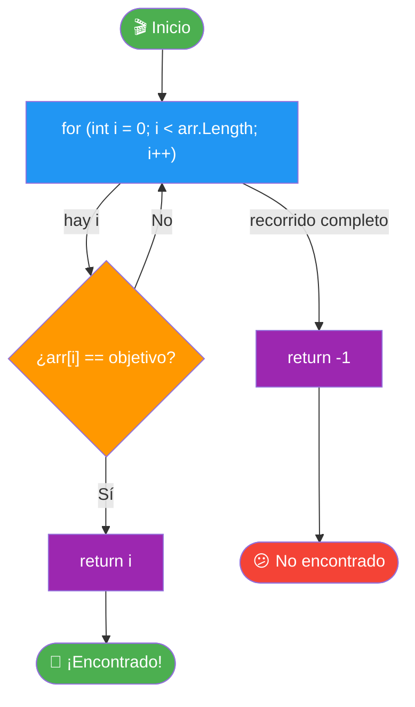

▶️ **Ejemplo paso a paso:** buscamos el `16` en `[4, 8, 15, 16, 23, 42]`. Se mira uno a uno hasta dar con él en la posición 3.

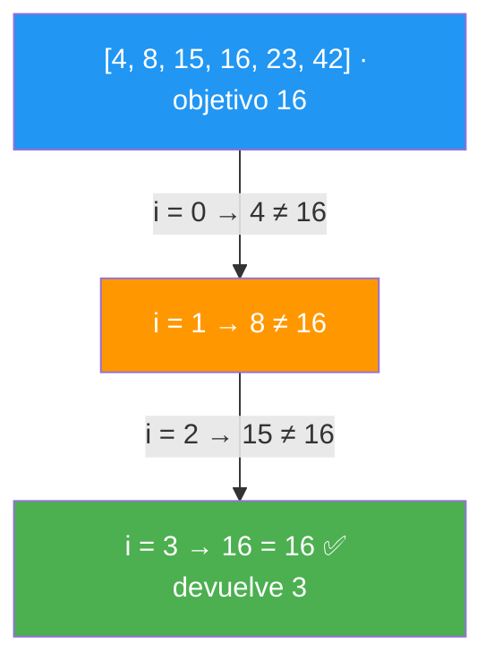

```csharp
int BuscarLineal(int[] arr, int objetivo)
{
    for (int i = 0; i < arr.Length; i++)
    {
        if (arr[i] == objetivo)
            return i;  // Encontrado
    }
    return -1;  // No encontrado
}
```

| Aspecto | Evaluación |
| :--- | :--- |
| **Mejor caso** | $O(1)$ — primer elemento |
| **Peor caso** | $O(n)$ — último o no existe |
| **Requiere ordenación** | ❌ No |
| **Uso** | Arrays pequeños o no ordenados |

### 7.3.2. Búsqueda binaria

**Idea:** Es como buscar una palabra en un diccionario **usando** el índice: abres por la mitad. Si la palabra que buscas va antes, miras en la primera mitad. Si va después, en la segunda. Cada paso elimina la mitad de opciones.

📌 **Ejemplo real:** El buscador de Netflix dentro de su catálogo usa Búsqueda Binaria sobre los títulos ordenados alfabéticamente. Con millones de películas, $O(\log n)$ es mucho más rápido que $O(n)$.

> 🎥 **Visualización de Búsqueda Binaria:** https://www.youtube.com/watch?v=iP897Z5Nerk

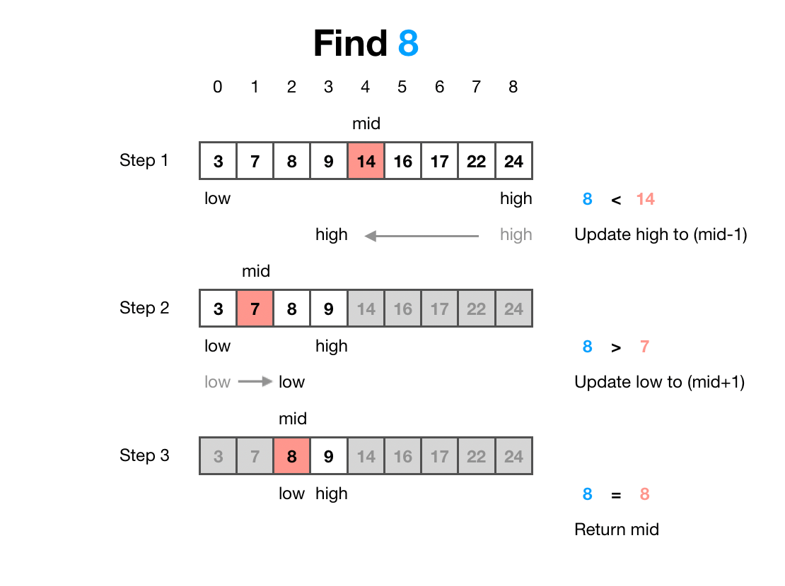

📐 **Ordinograma:** el flujo del código de abajo. El `while` de la línea 4 es el que controla todo; dentro se calcula el medio (línea 8) y se descarta media mitad en cada vuelta. Fíjate en que las líneas 10 y 11 son un `else if` / `else`: **el `if` es el rombo y la acción va en la flecha**.

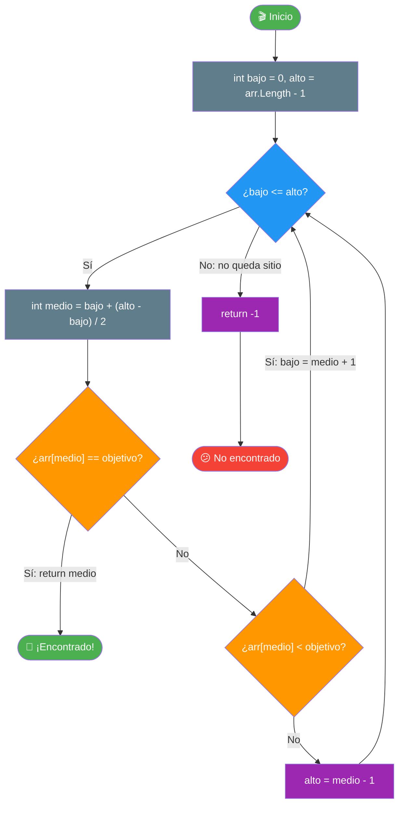

▶️ **Ejemplo paso a paso:** buscamos el `23` en `[2, 5, 8, 12, 16, 23, 38, 56, 72, 91]`. Cada paso descarta la mitad de lo que queda.

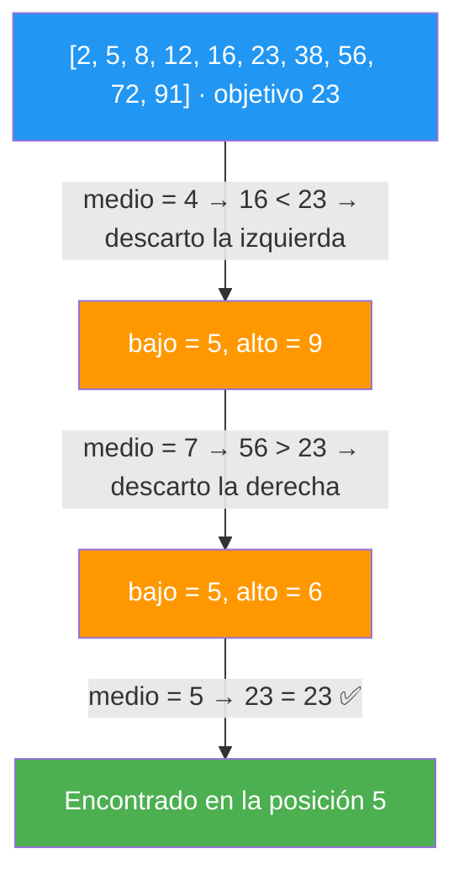

```csharp
int BuscarBinaria(int[] arr, int objetivo)
{
    int bajo = 0, alto = arr.Length - 1;
    while (bajo <= alto)
    {
        // Esta forma evita un posible desbordamiento de entero
        // que ocurriría con (bajo + alto) / 2
        int medio = bajo + (alto - bajo) / 2;
        if (arr[medio] == objetivo) return medio;
        else if (arr[medio] < objetivo) bajo = medio + 1;
        else alto = medio - 1;
    }
    return -1;
}
```

| Aspecto | Evaluación |
| :--- | :--- |
| **Mejor caso** | $O(1)$ — elemento central |
| **Peor caso** | $O(\log n)$ |
| **Requiere ordenación** | ✅ Sí |
| **Uso** | Arrays grandes y ordenados |

> 🔧 **Truco mnemotécnico:**
> - **Búsqueda Lineal** = Revisar cada estantería una por una
> - **Búsqueda Binaria** = Abrir el libro por la mitad y decidir si buscar en la primera o segunda parte

### 7.3.3. Búsqueda binaria recursiva

**Idea:** Es la misma búsqueda binaria de antes, pero **sin `while`**: la función se llama a sí misma con la mitad que todavía puede contener el objetivo. Cada llamada descarta la mitad de lo que queda, exactamente igual que la versión con bucle, hasta llegar al caso base (no queda sitio) o dar con el elemento.

📌 **Ejemplo real:** Es lo que hace un médico de urgencias con el triaje. Pregunta "¿dolor de cabeza o de barriga?" y, según la respuesta, deriva a un especialista que vuelve a preguntar **otra mitad de preguntas**, pero solo sobre ese trozo.

> 💡 **Analogía:** El juego del "mayor o menor". Piensas un número del 1 al 100 y tu amigo pregunta 50. Dices "mayor": a partir de ahí tu amigo **ya no vuelve a preguntar nada del 1 al 50**, se lo queda en la cabeza y sigue con el 51-100. La recursión es ese mismo juego repitiéndose consigo mismo con el rango nuevo.

> 🎥 **Visualización de Búsqueda Binaria Recursiva:** https://www.youtube.com/watch?v=wz7XgKowJIg

La diferencia práctica es que **ya no hay variables de estado viviendo en un bucle**: cada llamada lleva `bajo` y `alto` como parámetros, así que son dos argumentos más que en la versión iterativa.

📐 **Ordinograma:** el flujo del código de abajo. Los tres terminales de este algoritmo **sí son la respuesta final**: `return -1` (no está), `return medio` (está) y los dos `return` de las líneas 9 y 10, que devuelven lo que traiga la llamada hija. Las flechas discontinuas son la recursión.

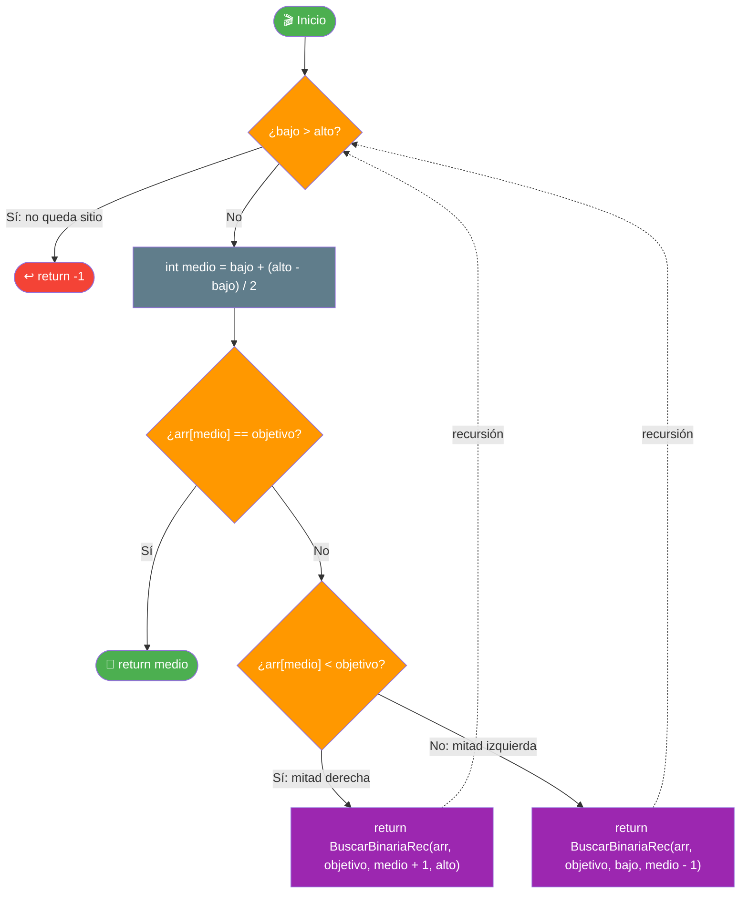

En el diagrama se ve el corazón del asunto: hay un **caso base** (`¿bajo > alto?`) que corta la recursión, y una **llamada recursiva** que vuelve a empezar con un rango más pequeño. Sin el caso base, la función se llamaría a sí misma para siempre.

▶️ **Ejemplo paso a paso:** buscamos el `23` en `[2, 5, 8, 12, 16, 23, 38, 56, 72, 91]`. Cada llamada descarta la mitad, y cuando se encuentra, **el valor vuelve subiendo** por todas las llamadas hasta la primera.

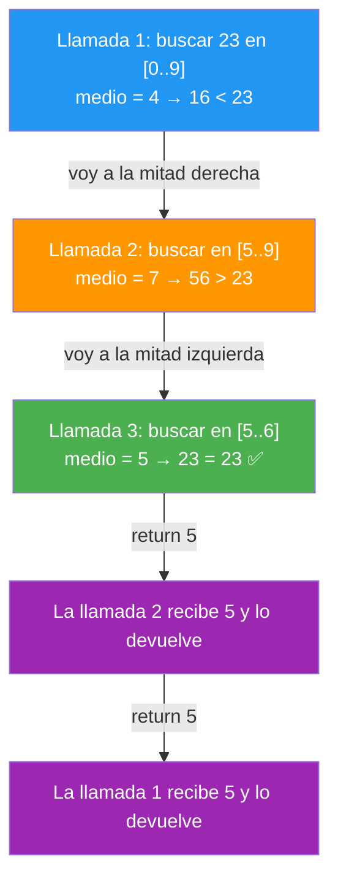

La implementación en C# es esta:

```csharp
int BuscarBinariaRec(int[] arr, int objetivo, int bajo, int alto)
{
    // Caso base: no queda sitio, el objetivo no está
    if (bajo > alto) return -1;
    int medio = bajo + (alto - bajo) / 2;
    if (arr[medio] == objetivo) return medio;
    // ¿En qué mitad puede estar?
    if (arr[medio] < objetivo)
        return BuscarBinariaRec(arr, objetivo, medio + 1, alto);
    return BuscarBinariaRec(arr, objetivo, bajo, medio - 1);
}
```

Fíjate en el `return` delante de cada llamada: **el valor devuelto vuelve subiendo** por todas las llamadas hasta la primera. Eso es lo que la versión con `while` no necesita, porque el `while` ya tiene la variable `resultado` esperando en el mismo sitio.

Las dos versiones hacen exactamente lo mismo, paso a paso:

| Aspecto | Iterativa (`while`) | Recursiva (se llama a sí misma) |
| :--- | :--- | :--- |
| **Rango** | Variables `bajo` y `alto` que se actualizan | `bajo` y `alto` llegan como **parámetros** |
| **Cómo se corta** | `while (bajo <= alto)` deja de cumplirse | Caso base `if (bajo > alto) return -1;` |
| **Memoria** | Un solo marco de pila | Un marco de pila **por cada mitad** que queda |
| **Resultado** | Se guarda en una variable | Se devuelve con `return` y sube por la pila |
| **Complejidad** | $O(\log n)$ | $O(\log n)$ — **idéntica** |

| Aspecto | Evaluación |
| :--- | :--- |
| **Mejor caso** | $O(1)$ — elemento central |
| **Peor caso** | $O(\log n)$ |
| **Requiere ordenación** | ✅ Sí |
| **Uso** | Arrays grandes y ordenados |

> ⚠️ **Advertencia:** cada llamada consume un marco de la pila. Con un array de 1.000.000 de elementos serán unas 20 llamadas apiladas (nada grave), pero una recursión mal planteada —por ejemplo, olvidar el caso base— puede llenar la pila y romper el programa. La versión con `while` no tiene ese riesgo.

> 📝 **Nota:** en C# `Array.BinarySearch()` usa la versión **iterativa**: es más rápida y no gasta pila. La recursiva se ve sobre todo en entrevistas y en problemas que ya son recursivos de por sí (árboles, carpetas, expresiones anidadas).

> 🔧 **Truco para recordarlo:** *iterativa = bucle que repite*, *recursiva = función que se llama*. Si puedes, practica las dos: te enseñan a pensar de formas distintas.

## 7.4. Tabla comparativa de complejidad

| Algoritmo | Mejor Caso | Promedio | Peor Caso | Estable |
| :--- | :---: | :---: | :---: | :---: |
| **Burbuja** | $O(n)$ | $O(n^2)$ | $O(n^2)$ | ✅ Sí |
| **Selección** | $O(n^2)$ | $O(n^2)$ | $O(n^2)$ | ❌ No |
| **Inserción** | $O(n)$ | $O(n^2)$ | $O(n^2)$ | ✅ Sí |
| **Shell Sort** | $O(n \log n)$ | $O(n^{1.5})$ | $O(n^2)$ | ❌ No |
| **QuickSort** | $O(n \log n)$ | $O(n \log n)$ | $O(n^2)$ | ❌ No |
| **Merge Sort** | $O(n \log n)$ | $O(n \log n)$ | $O(n \log n)$ | ✅ Sí |
| **Búsqueda Lineal** | $O(1)$ | $O(n)$ | $O(n)$ | N/A |
| **Búsqueda Binaria** | $O(1)$ | $O(\log n)$ | $O(\log n)$ | N/A |
| **Búsqueda Binaria Recursiva** | $O(1)$ | $O(\log n)$ | $O(\log n)$ | N/A |

> 📝 **Nota:** En C# puedes usar `Array.Sort(arr)` (usa Introsort, una variante de QuickSort) y `Array.BinarySearch(arr, valor)` (Búsqueda Binaria). En la práctica, usa estos métodos estándar en lugar de implementar los algoritmos a mano.

## 7.5. Cuándo usar cada algoritmo

| Situación | Algoritmo Recomendado |
| :--- | :--- |
| **Array pequeño (<20 elementos)** | Inserción |
| **Array casi ordenado** | Inserción |
| **Array grande, sin requisitos especiales** | QuickSort (o `Array.Sort`) |
| **Estabilidad necesaria** | Burbuja, Inserción o Merge Sort |
| **O(n log n) garantizado** | Merge Sort |
| **Búsqueda en array ordenado** | Búsqueda Binaria |
| **Búsqueda en array no ordenado** | Búsqueda Lineal |
| **Problema ya recursivo (árboles, carpetas)** | Búsqueda Binaria Recursiva |
| **Máximo rendimiento** | QuickSort + Búsqueda Binaria |

**Resumen del punto:**

| Concepto | Descripción |
| :--- | :--- |
| **Big O** | Notación para comparar rendimiento de algoritmos |
| **Burbuja** | Compara adyacentes, $O(n^2)$, estable |
| **Selección** | Busca mínimo, $O(n^2)$, no estable |
| **Inserción** | Inserta en posición, $O(n^2)$, estable |
| **Shell Sort** | Inserción con brechas, $O(n^{1.5})$ promedio |
| **QuickSort** | Divide y vencerás, $O(n \log n)$ promedio |
| **Merge Sort** | Divide y combina, $O(n \log n)$ siempre, estable |
| **Búsqueda Lineal** | Recorre todo, $O(n)$ |
| **Búsqueda Binaria** | Divide por la mitad, $O(\log n)$, requiere ordenación |
| **Búsqueda Binaria Recursiva** | Divide por la mitad llamándose a sí misma, $O(\log n)$ |

## ¿Qué viene después?

En el siguiente punto pasamos al **8. Instalación de librerías con NuGet**: cómo meter paquetes de terceros en un proyecto de .NET, tanto desde el Gestor de Paquetes de Visual Studio como desde la CLI de `dotnet`.

## Buenas prácticas

- [ ] Usar `Array.Sort()` y `Array.BinarySearch()` en producción (más optimizados)
- [ ] Conocer la complejidad Big O de cada algoritmo
- [ ] Usar Inserción para arrays pequeños o casi ordenados
- [ ] Usar QuickSort para arrays grandes sin requisitos de estabilidad
- [ ] Recordar que Búsqueda Binaria requiere array ordenado
