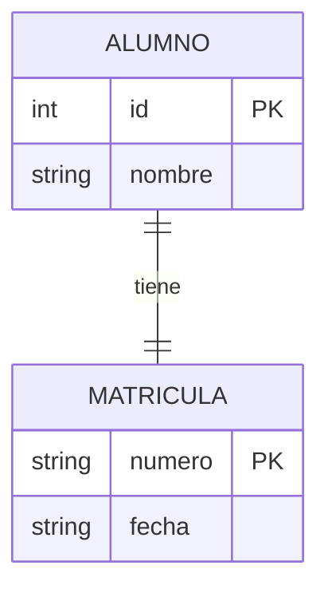
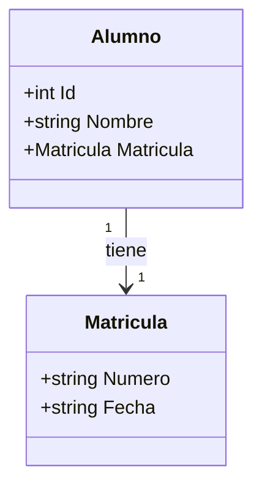
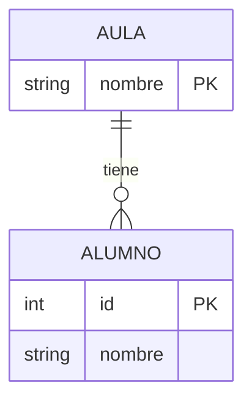
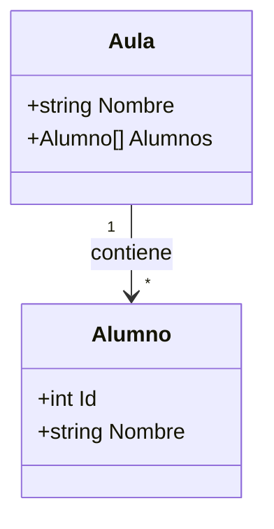
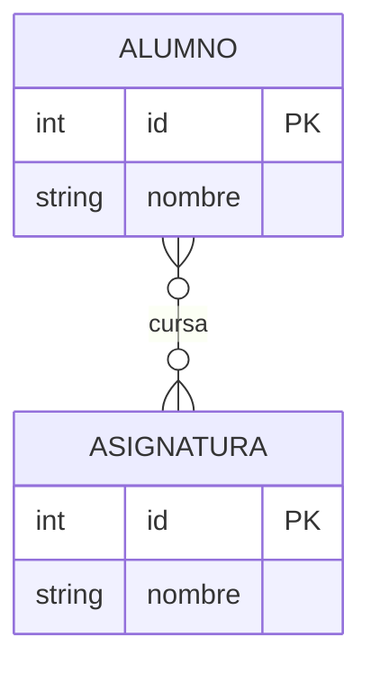
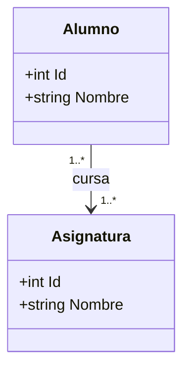

- [9. Diseño orientado a objetos: del diagrama E/R a las clases](#9-diseño-orientado-a-objetos-del-diagrama-er-a-las-clases)
  - [9.1. Del diagrama E/R al modelo de clases](#91-del-diagrama-er-al-modelo-de-clases)
    - [9.1.1. Correspondencia: entidad, atributo y relación](#911-correspondencia-entidad-atributo-y-relación)
    - [9.1.2. La cardinalidad "muchos" es la que rompe el diseño](#912-la-cardinalidad-muchos-es-la-que-rompe-el-diseño)
  - [9.2. Cardinalidad uno a uno (1-1)](#92-cardinalidad-uno-a-uno-1-1)
  - [9.3. Cardinalidad uno a muchos (1-N)](#93-cardinalidad-uno-a-muchos-1-n)
  - [9.4. Cardinalidad muchos a muchos (N-M)](#94-cardinalidad-muchos-a-muchos-n-m)
  - [9.5. ¿Quién pone el enlace? Constructor o setter](#95-quién-pone-el-enlace-constructor-o-setter)
  - [9.6. Errores típicos de diseño](#96-errores-típicos-de-diseño)
  - [¿Qué viene después?](#qué-viene-después)
  - [Buenas prácticas](#buenas-prácticas)


# 9. Diseño orientado a objetos: del diagrama E/R a las clases

> 💡 **Punto de partida:** En bases de datos ya has dibujado un diagrama E/R: entidades, atributos y cardinalidades sobre un papel. Pero llega el momento de programar y el papel no compila. ¿Cómo se traduce cada entidad, cada relación y cada "1 a muchos" del diagrama a código C#? Ese es justo el trabajo de este punto: la fase de **diseño** que va antes del código.

En este punto aprenderás a pasar un diagrama E/R a un modelo de clases equivalente, a diseñar las tres cardinalidades (uno a uno, uno a muchos y muchos a muchos) con el nivel de esta unidad, y a decidir si el enlace entre objetos se pone al crear (constructor) o después (setter), con sus problemas.

**Objetivos de aprendizaje:**

- Traducir entidades y atributos de un diagrama E/R a tipos `struct` y campos en C#
- Diseñar relaciones uno a uno, uno a muchos y muchos a muchos sin colecciones dinámicas
- Entender por qué la cardinalidad "muchos" es la que condiciona todo el diseño
- Decidir si el enlace se pasa por constructor o por setter y anticipar sus problemas
- Representar las relaciones con arrays, matrices y tuplas, a nivel de esta unidad

## 9.1. Del diagrama E/R al modelo de clases

El diagrama E/R es tu **plano de arquitecto**: te dice qué cosas existen (entidades), qué datos las describen (atributos) y cómo se relacionan (cardinalidades). Programar sin ese plano es construir a ciegas. El flujo correcto siempre es el mismo: **análisis → diseño (papel) → codificación**.

La traducción es más directa de lo que parece: cada cosa del diagrama tiene un sitio exacto en el código. En esta unidad modelas con `struct` porque aún no has visto las clases, pero el diseño es idéntico; solo cambia el contenedor.

### 9.1.1. Correspondencia: entidad, atributo y relación

Esta es la tabla de traducción que usarás siempre entre el papel y el teclado:

| En el diagrama E/R | En C# con `struct` (UD03) | En C# con `class` (UD04) |
| :--- | :--- | :--- |
| **Entidad** | Un `struct` (tipo por valor) | Una `class` |
| **Atributo** | Un campo (`public string Nombre;`) | Una propiedad (`string Nombre { get; set; }`) |
| **Clave primaria** | Un campo `Id` que identifica al registro | Una propiedad `Id` |
| **Relación** | Un campo que guarda el enlace: un valor, un array, una matriz... | Un campo de referencia al otro objeto |
| **Cardinalidad** | El **tipo** del campo del enlace: simple, array o tabla | Igual, pero con colecciones (UD07) |

Fíjate en la última fila: la cardinalidad no es solo una anotación bonita en el papel, decide **qué tipo de campo** necesitas en el código. Un "uno" se resuelve con un valor sencillo; un "muchos" obliga a una estructura entera.

> 📝 **Nota:** Los `struct` son tipos por valor: si copias un `Alumno`, copias todos sus datos, incluido su enlace. Cuando en la UD04 pases a `class`, el enlace será una referencia y las cosas cambiarán de verdad. Por eso conviene entender bien el diseño antes de subir el nivel.

### 9.1.2. La cardinalidad "muchos" es la que rompe el diseño

Cambiar una cardinalidad en el diagrama cuesta un segundo: mueves un símbolo. Cambiarla en el código, en cambio, cambia el diseño entero: el lado "muchos" necesita una estructura de datos nueva (un array, una matriz, un array de tuplas), con su tamaño, sus recorridos y sus errores.

Y recuerda: en esta unidad no hay colecciones dinámicas (llegan en la **UD07**), así que todo "muchos" choca con el **tamaño fijo** de los arrays. Diseñar el "muchos" mal es el error de diseño más caro de todos.

> 💡 **Consejo:** Cuando traduzcas un diagrama, pregúntate siempre por el lado "muchos" de cada relación: ¿cuántos caben?, ¿qué pasa si llega uno más?, ¿y si no llega ninguno? Esas tres preguntas te ahorran medio programa de arreglos.

📌 **Ejemplo real:** Netflix modela cada serie con sus episodios: la serie es el "uno" y los episodios el "muchos". Si al diseñar dimensionas el array de episodios a 20 y la serie resulta tener 60, el código fallará en el primer episodio extra. En el papel eso se ve de un vistazo; en código, tarde.

## 9.2. Cardinalidad uno a uno (1-1)

En una relación **uno a uno**, cada elemento de una entidad tiene exactamente un elemento de la otra, y viceversa: ni más ni menos. Es la cardinalidad más sencilla de llevar a código, porque el enlace es un valor único.

Este es el diagrama E/R de un alumno con su matrícula única:



El equivalente en clases es igual de directo: la clase "uno" guarda dentro un campo del tipo de la otra. Un campo, una matrícula:



Y así se ve en C# con `struct`, que es como trabajamos en esta unidad: el enlace es simplemente un campo más dentro del struct.

```csharp
struct Matricula
{
    public string Numero;
    public string Fecha;
}

struct Alumno
{
    public int Id;
    public string Nombre;
    public Matricula Matricula; // el enlace 1-1: cada alumno, SU matrícula
}
```

El enlace se puede poner de dos formas: crear el alumno ya con su matrícula, o crearlo "en pelotas" y asignársela después. Este ejemplo muestra las dos versiones y su consecuencia:

```csharp
// ✅ "Nace completo": el enlace se pone al crear el objeto
Alumno ana = new Alumno
{
    Id = 1,
    Nombre = "Ana",
    Matricula = new Matricula { Numero = "M-1024", Fecha = "12/09/2026" }
};

// ⚠️ "Setter": primero nace sin enlace, después se le pone
Alumno luis = new Alumno { Id = 2, Nombre = "Luis" };
// Aquí luis.Matricula vale default(Matricula): Numero == null
luis.Matricula = new Matricula { Numero = "M-1025", Fecha = "12/09/2026" };
```

> ⚠️ **Advertencia:** Con los `struct`, "olvidar el enlace" **no lanza ningún error**: se crea un valor por defecto (campos `null` y `0`) que parece un dato real. El problema aparece mucho después, cuando alguien intenta usar esa matrícula fantasma.

📌 **Ejemplo real:** En la aplicación de matrícula del centro, cada alumno (1) tiene una matrícula (1). Si el programa crea alumnos sin asignarles matrícula, aparecen "alumnos sin expediente" que no se pueden facturar ni evaluar: un enlace 1-1 olvidado es un registro a medias.

## 9.3. Cardinalidad uno a muchos (1-N)

En una relación **uno a muchos**, un elemento de una entidad se asocia con varios de la otra (cero, uno o muchos), pero cada elemento del lado "muchos" pertenece a uno solo del lado "uno". Aquí empieza lo interesante: el enlace ya no es un valor, es **una colección**.

Este es el diagrama E/R de un aula con sus alumnos:



El símbolo `o{` significa "cero o muchos": un aula puede tener alumnos o no tener ninguno. El equivalente en clases traduce ese "muchos" a un array dentro de la clase "uno":



En C#, cada aula lleva dentro su propio array de alumnos. Fíjate en que el array es el campo que materializa el "muchos" del diagrama:

```csharp
struct Alumno
{
    public int Id;
    public string Nombre;
}

struct Aula
{
    public string Nombre;
    public Alumno[] Alumnos; // el enlace 1-N: un array por cada aula
}
```

Con las dos formas de poner el enlace, el "setter" se complica: hay que acertar con el tamaño del array, y si se olvida, el aula queda sin alumnos de verdad:

```csharp
// ✅ "Nace completo": el aula nace con sus alumnos dentro
Alumno[] clase1 =
{
    new Alumno { Id = 1, Nombre = "Ana" },
    new Alumno { Id = 2, Nombre = "Luis" }
};
Aula aula1 = new Aula { Nombre = "1ºA", Alumnos = clase1 };

// ⚠️ "Setter": se crea el aula y el array se pone después (o no)
Aula aula2 = new Aula { Nombre = "1ºB" };
// aula2.Alumnos == null → quien acceda a aula2.Alumnos[0] estalla
aula2.Alumnos = new Alumno[2]; // array de huecos: todos los Nombre == null
```

Tres problemas típicos viven en el 1-N, y los tres ya los conoces de los apartados anteriores:

- **Nulo olvidado:** sin el `setter`, `aula2.Alumnos` es `null` y el primer acceso lanza `NullReferenceException`.
- **Tamaño fijo:** el array se crea con `new Alumno[2]`; si en octubre entra un tercer alumno, no cabe.
- **Alias:** `Aula copia = aula1;` copia el struct, pero **no** el array: ambas apuntan al mismo sitio y cambiar uno cambia al otro.

> 🔧 **Truco:** Antes de dar por bueno un 1-N, comprueba tres cosas: que el enlace no sea `null`, que el array tenga sitio de sobra y que nadie esté compartiendo el mismo array sin querer.

📌 **Ejemplo real:** En Instagram, cada usuario (1) publica muchas fotos (N). Si la app almacenara las fotos en un array fijo creado al abrir la cuenta, el usuario que sube la foto número 101 se quedaría sin poder publicar: el "muchos" mal dimensionado se rompe en producción, no en el diseño.

## 9.4. Cardinalidad muchos a muchos (N-M)

En una relación **muchos a muchos**, ambos lados tienen "muchos": cada alumno cursa varias asignaturas y cada asignatura tiene varios alumnos. Es la cardinalidad más difícil de las tres, y la que más diseños arruina.

Este es el diagrama E/R de la matrícula de un alumno en asignaturas:



En el papel, la relación N-M es una simple línea con rombos. En el equivalente de clases, en cambio, la relación **no puede vivir dentro de una sola de las dos clases**: hace falta una estructura intermedia que diga quién cursa qué.



Esa estructura intermedia, en esta unidad, se resuelve de dos formas: una **matriz** de booleanos (fila = alumno, columna = asignatura) o un **array de tuplas** que hace de tabla de relación. Este ejemplo muestra las dos opciones:

```csharp
// Opción A: matriz de booleanos — fila = alumno, columna = asignatura
string[] alumnos = { "Ana", "Luis", "María" };
string[] asignaturas = { "Mates", "Lengua" };
bool[,] cursa = new bool[3, 2];

cursa[0, 0] = true; // Ana cursa Mates
cursa[1, 1] = true; // Luis cursa Lengua
cursa[2, 0] = true; // María cursa Mates
```

Y esta es la misma relación como array de tuplas, que es literalmente la tabla intermedia del E/R dibujada con datos:

```csharp
// Opción B: array de tuplas — la "tabla de relación" del E/R
(int IdAlumno, string Asignatura)[] matriculas =
{
    (1, "Mates"),
    (1, "Lengua"),
    (2, "Lengua")
};
```

Los problemas del N-M son los del "muchos" multiplicados por dos: la matriz se dimensiona para el máximo de filas y columnas (sobra hueco y sobran límites), y el array de tuplas tiene capacidad fija: cuando se llena, no entra ni una relación más. Sin colecciones dinámicas, el N-M siempre termina estrellándose contra el tamaño fijo. Ese es precisamente el puente hacia la **UD07**.

> 💡 **Consejo:** Regla práctica para el examen: si la relación tiene "muchos" en **los dos** lados, en el código hará falta una estructura intermedia. En bases de datos será una tabla; aquí, una matriz o un array de tuplas. Un solo campo nunca puede guardar un "muchos a muchos".

📌 **Ejemplo real:** En Spotify, cada usuario sigue a muchos artistas y cada artista tiene muchos seguidores. Esa relación no está ni en la tabla de usuarios ni en la de artistas: vive en una tabla aparte (`seguidores`), justo la tabla intermedia que aquí representas con tuplas.

## 9.5. ¿Quién pone el enlace? Constructor o setter

El diagrama E/R te dice **qué** relación hay; falta decidir **cuándo** recibe el objeto su enlace. Aquí hay dos candidatos, y elegir mal es el origen de media docena de errores:

- **Constructor:** el código que se ejecuta cuando creas el objeto. En esta unidad, "crear el objeto ya completo" es el inicializador (`new Aula { ... }`); en la **UD04** verás los constructores de verdad (`public Aula(string nombre)`).
- **Setter:** el código que pone un valor **después** de creado el objeto. Aquí es una asignación normal (`aula.Alumnos = ...`); en la UD04 será la propiedad `set`, que además puede validar antes de aceptar el valor.

La comparación, con sus problemas incluidos:

| | El enlace se pone... | Ventaja | Problema |
| :--- | :--- | :--- | :--- |
| **Constructor** | Al crear el objeto | Nace completo: nada queda a medias | Hay que saber los datos al crear; si llegan después, hay que recrear el objeto |
| **Setter** | Después, cuando llegan los datos | Completa el objeto cuando tengas la información | Si olvidas llamarlo, queda `null` o `default`: estado a medias |

En la práctica, la elección la dicta la naturaleza del enlace:

```csharp
// ✅ Enlace estable (no cambia nunca): mejor al crear
//    La matrícula de un alumno se asigna una vez y para siempre
Alumno ana = new Alumno
{
    Id = 1,
    Nombre = "Ana",
    Matricula = new Matricula { Numero = "M-1024", Fecha = "12/09/2026" }
};

// ⚠️ Enlace que llega después: setter, pero con comprobación detrás
Aula aula = new Aula { Nombre = "1ºC" };
if (aula.Alumnos == null)
    aula.Alumnos = new Alumno[0]; // nunca lo dejes sin definir
```

Los problemas de cada opción, resumidos para que los tengas claros:

- **Problemas del setter:** nadie te obliga a llamarlo (olvido → `null` silencioso); el objeto pasa por un estado a medias entre que nace y se completa; y quien lo recibe debe usarlo **en el orden correcto** (acoplamiento temporal).
- **Problemas del constructor:** obliga a conocer los datos y los tamaños en el momento de crear; con arrays de tamaño fijo, si los datos llegan después, no puedes crear el objeto "bien" desde el primer momento.

> 📝 **Nota:** La pregunta "¿constructor o setter?" no la resuelve el lenguaje, la resuelve el **diseño**: si el enlace es estable y nace con el objeto, va en el constructor; si puede cambiar o llegar tarde, va en un setter con validación detrás. En la UD04 aplicarás este mismo criterio con clases, constructores y propiedades.

✅ **Buena práctica:** Nunca entregues un objeto a medias: o lo creas completo, o compruebas el enlace (`if (x == null)`) antes de usarlo. Ese独一无nto hábito evita la mayoría de las `NullReferenceException` de tus programas.

📌 **Ejemplo real:** En Glovo, un pedido nace con su dirección y su importe (constructor), pero el repartidor se le asigna después (setter) cuando alguien lo acepta. Si ningún repartidor lo acepta y nadie comprueba ese "setter", el pedido circula sin repartidor: el estado a medias, en una app real, es un pedazo de pan.

## 9.6. Errores típicos de diseño

Estos son los fallos que aparecen una y otra vez al pasar del diagrama E/R al código, con su arreglo:

| Error | Por qué está mal | Cómo evitarlo |
| :--- | :--- | :--- |
| **No traducir el lado "muchos"** | Tamaños de array improvisados a última hora | Decidir en el diseño el tipo del enlace: valor, array, matriz o tuplas |
| **Crear el objeto sin su enlace** | `null` o `default` silencioso que parece un dato | Crear el objeto completo o comprobar el enlace antes de usarlo |
| **Dimensionar el array "a ojo"** | Un elemento más y `IndexOutOfRangeException` | Dejar margen en el diseño y planear el paso a colecciones (UD07) |
| **Compartir el array entre dos structs** | Alias: cambiar uno cambia al otro sin querer | Clonar el array cuando el enlace deba ser independiente |
| **Modelar un N-M con un solo campo** | Un valor simple no puede guardar "muchos a muchos" | Usar una estructura intermedia: matriz o array de tuplas |
| **Saltarse el diseño en papel** | Codificar a ciegas y rehacer la estructura entera | Seguir el flujo: análisis → diseño → codificación |

---

**Resumen del punto:**

| Concepto | Descripción |
| :--- | :--- |
| **Entidad → `struct` / `class`** | Cada entidad del E/R se convierte en un tipo del código |
| **Atributo → campo / propiedad** | Cada atributo pasa a ser un dato interno del tipo |
| **Cardinalidad → tipo del enlace** | El "uno" es un valor simple; el "muchos" exige una estructura |
| **1-1** | Un campo dentro del struct: cada alumno, su matrícula |
| **1-N** | Un array dentro del struct: cada aula, sus alumnos |
| **N-M** | Estructura intermedia: matriz de booleanos o array de tuplas |
| **La cardinalidad "muchos"** | Condiciona todo el diseño y choca con el tamaño fijo de los arrays |
| **Constructor** | El enlace se pone al crear: el objeto nace completo |
| **Setter** | El enlace se pone después: riesgo de olvido y de estado a medias |
| **Aliasing** | Dos structs compartiendo el mismo array: cambiar uno cambia al otro |

## ¿Qué viene después?

En el siguiente punto cerraremos la unidad con un resumen completo: mapa conceptual, errores comunes, checklist de supervivencia y glosario de términos clave. Y ya de camino a la **UD04: Programación orientada a objetos**, estos diseños se convertirán en clases, constructores y propiedades de verdad.

## Buenas prácticas

- [ ] Dibujar siempre el diagrama E/R antes de escribir la primera línea de código
- [ ] Traducir cada entidad a un tipo y cada atributo a un campo, sin inventarse nada
- [ ] Revisar el lado "muchos" de cada relación antes de programar: ¿cuántos caben?
- [ ] Decidir en el diseño si el enlace va en el constructor o en el setter
- [ ] Nunca dejar un objeto a medias: crearlo completo o comprobar el enlace antes de usarlo
- [ ] Comprobar `null` antes de recorrer cualquier array que llegue de un enlace
- [ ] Clonar el array cuando dos objetos no deban compartir los mismos datos
