<div class="flex items-center gap-4 w-full">
  
  <span class="ud-pill">Programación · 1DAW · Curso 2026-2027</span>
</div>

# Almacenamiento estático y cadenas

### Creando programas con tus primeras colecciones estáticas

<div class="mt-10 flex items-end justify-between w-full">
  <div class="text-left">
    <b class="text-lg">José Luis González Sánchez</b><br/>
    <span class="opacity-70">IES Luis Vives · Leganés · <a href="https://joseluisgs.dev">joseluisgs.dev</a></span>
  </div>
  <PacMan :size="54" label="Cargando ideas..." />
</div>

---

## 📦 Materiales de la unidad

Todo el material de la UD03 está publicado en el repositorio de GitHub, organizado por carpetas:

<div class="grid grid-cols-2 gap-6 items-start">
<div>

- 📚 **9 puntos** — teoría, ejemplos reales y resúmenes
- 📝 **Prácticas** — ejercicios graduados en `practicas/`
- 💻 **Soluciones** — más de 25 programas C# resueltos
- 🖼️ **Imágenes y recursos** — diagramas y esquemas en `images/`
- 🎬 **Vídeos** — lista de reproducción en YouTube

</div>
<div class="flex flex-col items-center justify-center gap-4 pt-4">

<RepoBadge caption="Repositorio con materiales de la unidad" />

<div class="text-sm opacity-75 text-center max-w-55">

Clónalo, forquéalo o descárgalo en zip: el material siempre está a un clic.

</div>

</div>
</div>

---

## 📚 Índice: los 9 puntos del tema

<div class="grid grid-cols-3 gap-3 text-sm">

<TopicCard :num="1" title="Introducción a los arrays" desc="Qué es un array y por qué es rápido" />
<TopicCard :num="2" title="Arrays unidimensionales" desc="Crear, recorrer, pasar y clonar" />
<TopicCard :num="3" title="Arrays multidimensionales" desc="Matrices rectangulares y escalonadas" />
<TopicCard :num="4" title="Técnica de doble búfer" desc="Evitar el parpadeo con dos arrays" />
<TopicCard :num="5" title="Cadenas de texto" desc="Inmutabilidad, métodos y StringBuilder" />
<TopicCard :num="6" title="Expresiones regulares" desc="Buscar patrones en cadenas" />
<TopicCard :num="7" title="Ordenación y búsqueda" desc="Quicksort, mergesort y búsqueda binaria" />
<TopicCard :num="8" title="NuGet" desc="Instalar librerías de terceros" />
<TopicCard :num="9" title="Resumen" desc="Mapa, errores y checklist" />

</div>

<div class="ud-card mt-4 flex items-center justify-between gap-4 px-4 py-2">

<span class="text-sm">📦 <b>Materiales:</b> los 9 puntos, prácticas, soluciones y vídeos de la unidad</span>

<RepoBadge />

</div>

---

## 🎯 Resultados de aprendizaje y criterios

<RaaCcee
  code="RA 6"
  title="Escribe programas que manipulen información seleccionando y utilizando tipos avanzados de datos."
  :letters="['a', 'g']"
  :ccee="[
    'Se han escrito programas que utilicen matrices (arrays).',
    'Se han utilizado expresiones regulares en la búsqueda de patrones en cadenas de texto.',
  ]"
/>

---
layout: section
---

<div class="ud-section-number">01</div>

# Arrays. Introducción

<div class="opacity-70">Qué es un array, cómo se indexa y por qué es tan rápido</div>

---

## 1 · Punto de partida

<div class="grid grid-cols-2 gap-5 items-start">
<div>

<TipBox type="consejo" title="Punto de partida">

¿Alguna vez has abierto Netflix y has visto que te muestra 50 *thumbnails* de películas en una fila? ¿O Spotify que carga tu lista de 200 canciones favoritas? Detrás de todas esas colecciones de datos hay una estructura que las almacena de forma eficiente: el **array**.

</TipBox>

</div>
<div>

<Objetivos
  :items="[
    'Definir qué es un array y por qué es fundamental en programación',
    'Entender la diferencia entre indexación basada en cero y basada en uno',
    'Comprender la ventaja de rendimiento de los arrays (localidad de referencia)',
    'Conocer cuándo usar arrays frente a otras estructuras',
  ]"
/>

</div>
</div>

---

## Un array: una cajonera de elementos del mismo tipo

Un **array** es una estructura de datos **estática** que almacena una colección **ordenada** de elementos del **mismo tipo**.

<div class="grid grid-cols-2 gap-5 items-start">
<div>

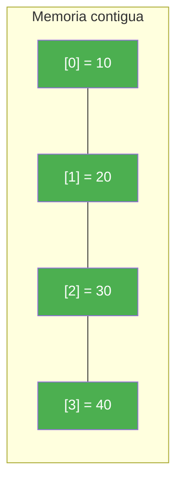

<RealExample app="Spotify">

Spotify almacena tu lista de reproducción como un array de canciones. Cada canción tiene un índice (posición 0, 1, 2...) y todas son del mismo tipo. Cuando pulsas «siguiente», simplemente accede al siguiente índice.

</RealExample>

</div>
<div>

Es como una cajonera: todos los cajones son del mismo tamaño y están pegados unos a otros.

<TipBox type="analogia">

Un array es como una **hilera de casas** en una calle. Cada casa tiene un número (índice) y están pegadas unas a otras. Si sabes el número de tu casa, llegas directamente sin preguntar a nadie.

</TipBox>

</div>
</div>

---

## Las cinco características clave

<div class="grid grid-cols-2 gap-5 items-start">
<div>

| Característica | Qué significa |
|---|---|
| **Homogeneidad** | Todos del mismo tipo (`int[]`, `string[]`) |
| **Tamaño fijo** | Se define al crear y **no cambia** |
| **Contigüidad** | Elementos **pegados** en memoria |
| **Acceso por índice** | Se accede por su posición |
| **Eficiencia** | Acceso constante: **O(1)** |

<TipBox type="nota">

Si necesitas más espacio, tienes que crear un array **nuevo** y copiar: el tamaño de un array **no se puede cambiar**.

</TipBox>

</div>
<div>

<div class="flex justify-center">
  
</div>

</div>
</div>

---

## Indexación basada en cero: el primer elemento es el 0

El primer elemento está en el **índice 0**. La convención se basa en el **cálculo directo de la dirección de memoria**: el índice es el **desplazamiento** (*offset*) desde la dirección de inicio, y el primer elemento no tiene desplazamiento.

<div class="grid grid-cols-2 gap-5 items-start">
<div>

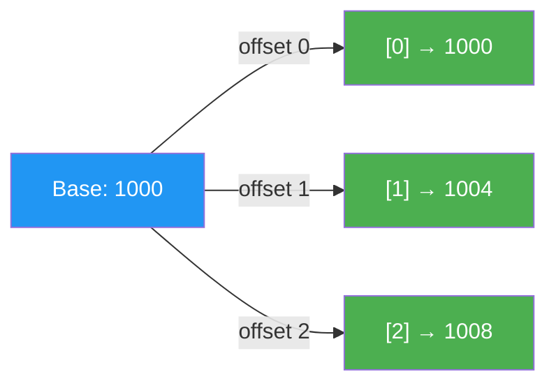

Este enfoque lo siguen **C, C++, Java, JavaScript, Python, Kotlin y C#**.

</div>
<div>

**Fórmula:**

```
Dirección(A[i]) = Base + (índice × Tamaño del Tipo)
```

- `Dirección Base`: dirección del primer elemento (índice 0)
- `índice`: posición del elemento buscado
- `Tamaño del Tipo`: bytes que ocupa el tipo (4 bytes para `int`)

</div>
</div>

---

## Indexación basada en uno: el primer elemento es el 1

En algunos lenguajes (**Fortran, MATLAB, Lua, Pascal**) el primer elemento está en el **índice 1**.

<div class="grid grid-cols-2 gap-5 items-start">
<div>

**Fundamento:** el índice representa la **posición ordinal**, más intuitiva para el ser humano, pero que complica el cálculo de memoria.

```
Dirección(A[i]) = Base + ((índice - 1) × Tamaño)
```

</div>
<div>

<TipBox type="advertencia">

Si vienes de lenguajes como Pascal o Visual Basic, cuidado: en C# el primer índice es **siempre 0**. Acceder a `array[array.Length]` lanza `IndexOutOfRangeException`.

</TipBox>

<TipBox type="consejo">

Piensa así: si tienes 5 elementos, van del 0 al 4. Nunca del 1 al 5. El último siempre es `Length - 1`.

</TipBox>

</div>
</div>

---

## Arrays en C#: la indexación es cero-basada

Si accedes a un índice negativo o a uno mayor o igual al tamaño, se produce un `IndexOutOfRangeException`.

<div class="grid grid-cols-2 gap-5 items-start">
<div>

```csharp
int[] edades = { 25, 30, 35, 40, 45 };

// ✅ BUENO: acceso válido
Console.WriteLine(edades[0]);   // 25 (primer elemento)
Console.WriteLine(edades[4]);   // 45 (último)

// ❌ MALO: IndexOutOfRangeException
Console.WriteLine(edades[5]);   // Error: no existe
Console.WriteLine(edades[-1]);  // Error: índice negativo
```

</div>
<div>

<RealExample app="YouTube">

YouTube usa arrays internamente para almacenar los comentarios de un vídeo. Cuando hay 1000 comentarios, están en los índices 0 a 999. Si alguien intenta acceder al índice 1000, el sistema lanza una excepción para evitar leer memoria que no le pertenece.

</RealExample>

</div>
</div>

---

## ¿Cuándo usar un array?

<div class="grid grid-cols-2 gap-5 items-start">
<div>

**✅ Usa un array cuando:**

1. Conozcas el **tamaño máximo** de antemano
2. Necesites **acceso rápido** por posición
3. No añadas ni elimines elementos frecuentemente
4. Iteres **secuencialmente** (`for` / `foreach`)

</div>
<div>

**🔄 Usa `List<T>` cuando:**

1. Necesitas **añadir/quitar** elementos frecuentemente
2. No conoces el **tamaño final**
3. Solo necesitas **acceso secuencial**

> 📝 **Nota:** Las **colecciones dinámicas** (`List<T>`, `Dictionary<K,V>`) resuelven el problema del tamaño fijo, pero los arrays siguen siendo más rápidos para el acceso por índice.

</div>
</div>

---

## El primer array que ya estás usando: `string[] args`

<div class="grid grid-cols-2 gap-5 items-start">
<div>

¿Has visto alguna vez esto en tu `Program.cs`?

```csharp
// Program.cs con Top-Level Statements
Console.WriteLine($"Argumentos recibidos: {args.Length}");
for (int i = 0; i < args.Length; i++)
{
    Console.WriteLine($"  args[{i}] = {args[i]}");
}
```

`args` es un **`string[]`**: un array unidimensional de cadenas. El sistema operativo te pasa los argumentos de línea de comandos como un array.

</div>
<div>

```bash
dotnet run -- "Hola" "Mundo"
```

Entonces `args` contiene `{ "Hola", "Mundo" }` y `args.Length` es `2`.

<TipBox type="consejo">

`string[] args` es tu primer contacto real con un array. Aprovéchalo para entender cómo se accede a los elementos por índice y cómo se recorre con `for`.

</TipBox>

</div>
</div>

---

## El secreto de la velocidad: localidad de referencia

¿Por qué usamos arrays si son tan rígidos? Por el **hardware**.

<div class="grid grid-cols-2 gap-5 items-start">
<div>

```csharp
int[] numeros = { 10, 20, 30, 40, 50,
                  60, 70, 80, 90, 100 };

// ✅ Acceso SECUENCIAL (rápido: el procesador
//    carga todo el bloque junto)
for (int i = 0; i < numeros.Length; i++)
    Console.WriteLine(numeros[i]);

// ❌ Acceso ALEATORIO (más lento: hay que
//    cargar bloques diferentes)
Console.WriteLine(numeros[0]);
Console.WriteLine(numeros[9]);
Console.WriteLine(numeros[5]);
```

</div>
<div>

Al estar los datos **contiguos**, cuando el procesador lee `[0]`, el sistema carga también los siguientes en la **Memoria Caché**.

<RealExample app="Netflix">

Netflix precarga las miniaturas de las siguientes 5-10 películas mientras ves la actual. Como están en un array contiguo, el procesador las carga todas a la vez en caché. Si estuvieran dispersas en memoria, la app iría lenta.

</RealExample>

</div>
</div>

---

## Por qué los arrays son rápidos: la jerarquía de memoria

<div class="grid grid-cols-2 gap-5 items-start">
<div>

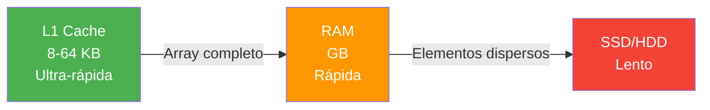

</div>
<div>

El procesador **carga datos en bloques**: si accedes a datos cercanos, ya están en caché. Si saltas a posiciones lejanas, ese bloque ya no sirve y hay que volver a cargarlo desde la RAM, que es más lenta.

<TipBox type="consejo">

**Recorre los arrays secuencialmente** (`for`/`foreach`): el procesador carga los datos en bloques, así que si saltas a posiciones lejanas hay que volver a cargarlos desde la RAM.

</TipBox>

</div>
</div>

---

## Lo que ya sabes (UD02) y lo que vas a aprender (UD03)

<div class="grid grid-cols-2 gap-5 items-start">
<div>

| UD02 (lo que sabes) | UD03 (lo que aprenderás) |
|---------------------|--------------------------|
| Bucles `for` y `foreach` | Recorrer arrays con esos bucles |
| Funciones y procedimientos | Pasar arrays a funciones |
| `ref`, `out` e `in` | `ref` e `in` aplicados a arrays |
| Tuplas, enums y structs | Arrays de tuplas, enums y structs |
| Control de excepciones | `IndexOutOfRangeException` |

</div>
<div>

<TipBox type="nota">

Esta unidad usa **C# 14** sobre **.NET 10**, con `LangVersion` 14 en el `.csproj`.

</TipBox>

<TipBox type="consejo">

El `for` que aprendiste en la UD02 era «el bucle natural para recorrer colecciones»: esta unidad te da la colección con la que usarlo.

</TipBox>

</div>
</div>

---

## Resumen del punto 1

<div class="grid grid-cols-2 gap-5 items-start">
<div>

| Concepto | Descripción |
|----------|-------------|
| **Array** | Estructura estática, elementos del mismo tipo, tamaño fijo |
| **Indexación basada en cero** | Primer elemento en índice 0 (C#, Java, Python) |
| **Indexación basada en uno** | Primer elemento en índice 1 (Fortran, MATLAB, Pascal) |
| **Contigüidad** | Elementos pegados en memoria → acceso O(1) |
| **Localidad de referencia** | El procesador carga en caché los datos cercanos |
| **IndexOutOfRangeException** | Error al acceder a un índice fuera de límites |
</div>
<div>

<ConceptCard icon="✅" title="Buenas prácticas" accent="green">

- Usa arrays cuando conozcas el tamaño exacto
- Usa `List<T>` cuando añadas o quites elementos
- Recuerda: los arrays se indexan desde **0**, no desde 1
- Verifica el `null` antes de acceder a un array anulable

</ConceptCard>

<div class="mt-3">

**⏭️ ¿Qué viene después?** En el **punto 2** veremos cómo se crean y manipulan los arrays unidimensionales en C#: definición, creación, recorrido y paso por referencia.

</div>

</div>
</div>

---
layout: section
---

<div class="ud-section-number">02</div>

# Arrays unidimensionales

<div class="opacity-70">Crear, recorrer, pasar y clonar</div>

---

## 2 · Punto de partida

<div class="grid grid-cols-2 gap-5 items-start">
<div>

<Objetivos
  :items="[
    'Declarar y crear arrays unidimensionales en C#',
    'Conocer los valores por defecto según el tipo de dato',
    'Recorrer arrays con `for` y `foreach`',
    'Entender el paso por referencia y la clonación',
    'Diferenciar identidad (`==`) de igualdad (contenido)',
    'Usar los modificadores `params` e `in`',
    'Trabajar con `string[] args` y redimensionar arrays con `ref`',
  ]"
/>

</div>
<div>

<TipBox type="consejo" title="Punto de partida">

Cuando abres tu lista de reproducción de Spotify, ¿te has fijado en que cada canción tiene un número de posición? La canción 0, la 1, la 2... Eso es un array: una lista ordenada donde cada elemento tiene una posición fija. Pero, ¿cómo se crea? ¿Cómo se recorre? ¿Qué pasa si quieres hacer una copia?

</TipBox>

</div>
</div>

---

## Crear un array: tres formas

<div class="grid grid-cols-2 gap-5 items-start">
<div>

| Característica | Detalle | Sintaxis C# |
|---|---|---|
| **Tamaño fijo** | Se define al crear y **no puede cambiarse** | `int[] numeros = new int[10];` |
| **Homogeneidad** | Todos los elementos del mismo tipo | `var dias = new string[] { "Lun", "Mar" };` |
| **Inicialización directa** | Asignar valores al crear | `int[] pares = { 2, 4, 6 };` |

</div>
<div>

```csharp
// ✅ Creación con tamaño fijo (valores por defecto: 0)
int[] edades = new int[5];

// ✅ Creación con valores iniciales
string[] frutas = { "Manzana", "Pera", "Naranja" };

// ✅ Creación explícita
double[] precios = new double[] { 9.99, 19.99, 29.99 };
```

<div class="mt-3 flex justify-center">
  
</div>

</div>
</div>

---

## Los valores por defecto de cada tipo

Cuando creas un array solo con su tamaño, C# lo rellena automáticamente:

<div class="grid grid-cols-2 gap-5 items-start">
<div>

| Tipo de array | Valor por defecto | Ejemplo |
|---|---|---|
| **Numérico** (`int[]`, `double[]`) | `0` / `0.0` | `new int[3]` → `{ 0, 0, 0 }` |
| **Booleano** (`bool[]`) | `false` | `new bool[2]` → `{ false, false }` |
| **Cadena** (`string[]`) | `null` | `new string[2]` → `{ null, null }` |
| **Anulable** (`int?[]`) | `null` | `new int?[2]` → `{ null, null }` |

</div>
<div>

<TipBox type="advertencia">

`string[]` se inicializa a `null`, **no** a `""`. Si intentas acceder a un método de un elemento sin verificar, obtendrás `NullReferenceException`.

</TipBox>

<TipBox type="nota">

Un tipo anulable (`int?`) permite guardar `null` además de números. Lo verás en detalle en la UD04, sobre POO.

</TipBox>

</div>
</div>

---

## Cuidado con los `null` dentro del array

<div class="grid grid-cols-2 gap-5 items-start">
<div>

```csharp
int?[] numerosOpcionales = new int?[3];
numerosOpcionales[0] = 5;

// ❌ Peligro: acceder a un null
// Console.WriteLine(numerosOpcionales[1] + 1);

// ✅ Solución 1: coalescencia
Console.WriteLine(
    $"Con coalescencia: {(numerosOpcionales[1] ?? 0) + 1}");

// ✅ Solución 2: comprobación explícita
if (numerosOpcionales[1] != null)
    Console.WriteLine($"Con if: {numerosOpcionales[1] + 1}");
else
    Console.WriteLine("Valor nulo, no se puede operar");
```

</div>
<div>

<RealExample app="Netflix">

Netflix usa arrays de perfiles. Si un usuario solo tiene 2 perfiles pero el array tiene 5 posiciones, las 3 restantes son `null`. Cuando intentas acceder a un perfil vacío, la app verifica el `null` antes de mostrar datos.

</RealExample>

</div>
</div>

---

## `string[] args`: el array que ya usas

Con **Top-Level Statements**, **`args` existe sin que tú lo crees**: es un `string[]` con los argumentos que pasas por línea de comandos.

<div class="grid grid-cols-2 gap-5 items-start">
<div>

```bash
dotnet run miapp.cs -- Hola Mundo
```

`args` contiene `{ "Hola", "Mundo" }`, su `.Length` es 2 y lo recorres con `for` o `foreach` como cualquier otro array de cadenas. Si no pasas ningún argumento, `args.Length` es 0: un array **vacío**, no `null`.

</div>
<div>

<TipBox type="consejo">

`args` es un array normal, así que puedes pasarlo a tus funciones (`ImprimirArgumentos(args)`) y procesarlo con todas las herramientas de este punto.

</TipBox>

<RealExample app="Git">

Cuando ejecutas `git commit -m "mensaje"`, Git recibe `commit` y el mensaje como argumentos de línea de comandos: internamente es lo mismo — un array de cadenas que otro programa recorre.

</RealExample>

</div>
</div>

---

## `.Length`: el tamaño del array

La propiedad `.Length` devuelve el número total de elementos. Es la forma fiable de conocer el límite del array.

<div class="grid grid-cols-2 gap-5 items-start">
<div>

```csharp
string[] colores = { "Rojo", "Verde", "Azul" };
Console.WriteLine($"Longitud: {colores.Length}");  // 3
Console.WriteLine($"Último: {colores.Length - 1}");  // 2
```

</div>
<div>

<TipBox type="consejo">

El último elemento siempre está en `array.Length - 1`. Si accedes a `array[array.Length]`, obtienes `IndexOutOfRangeException`.

</TipBox>

<TipBox type="nota">

`.Length` es de **solo lectura**: no puedes cambiar el tamaño de un array existente.

</TipBox>

</div>
</div>

---

## Recorrer con `for`: modificar o conocer el índice

El bucle `for` se usa cuando necesitas **modificar** elementos o conocer el **índice** actual.

<div class="grid grid-cols-2 gap-5 items-start">
<div>

```csharp
int[] calificaciones = new int[5];

// ✅ Recorrer y modificar con for
for (int i = 0; i < calificaciones.Length; i++)
{
    calificaciones[i] = i * 10;
    Console.WriteLine($"[{i}] = {calificaciones[i]}");
}
// Salida: 0, 10, 20, 30, 40
```

</div>
<div>

<RealExample app="YouTube">

YouTube usa un bucle `for` para cargar los 50 primeros comentarios de un vídeo. Cada comentario se accede por su índice y se muestra en pantalla.

</RealExample>

</div>
</div>

---

## El bucle `for` por dentro

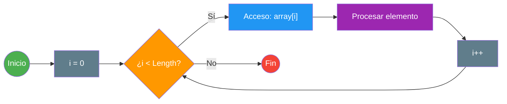

<TipBox type="nota">

Tres pasos en cada vuelta: **comprobar** la condición, **acceder** al elemento (`array[i]`) e **incrementar** el índice. La condición es la que decide cuándo termina el bucle.

</TipBox>

---

## Recorrer con `foreach`: solo lectura

El `foreach` se usa cuando solo necesitas **leer** los valores. Es más seguro porque no puedes equivocarte con el índice.

<div class="grid grid-cols-2 gap-5 items-start">
<div>

```csharp
string[] diasSemana = { "L", "M", "X", "J",
                        "V", "S", "D" };

// ✅ Recorrer con foreach (solo lectura)
foreach (string dia in diasSemana)
{
    Console.WriteLine($"Día: {dia}");
}
```

</div>
<div>

| Bucle | Cuándo usarlo | Ventaja |
|---|---|---|
| `for` | Modificar o conocer el índice | Acceso directo por posición |
| `foreach` | Solo leer cada elemento | Más seguro y legible |

</div>
</div>

---

## Recorrer un array con nulos: filtrar antes de usar

Para arrays de tipos anulables, debes verificar `null` antes de usar cada elemento.

<div class="grid grid-cols-2 gap-5 items-start">
<div>

```csharp
string?[] nombres = new string?[3];
nombres[0] = "Ana";
nombres[2] = "Luis";

// ✅ Filtrado con foreach + if
foreach (string? nombre in nombres)
{
    if (nombre != null)
        Console.WriteLine($"Usuario: {nombre}");
    else
        Console.WriteLine("Posición vacía");
}
```

</div>
<div>

**Alternativa más concisa con coalescencia:**

```csharp
foreach (string? nombre in nombres)
{
    Console.WriteLine($"Usuario: {nombre ?? "vacío"}");
}
```

<TipBox type="consejo">

Verificar el `null` **antes** de usar el elemento: en los arrays de tipos anulables no es opcional.

</TipBox>

</div>
</div>

---

## Recorrer con nulos: `is { } x`

El patrón `is { } x` **comprueba y extrae en un paso**: pregunta «¿`x` tiene valor?» y, si lo tiene, lo deja guardado en `x`. Es el atajo del `if (x != null)` manual y funciona con cualquier tipo anulable:

<div class="grid grid-cols-2 gap-5 items-start">
<div>

```csharp
foreach (string? nombre in nombres)
{
    if (nombre is { } n)   // n ya tiene el valor
        Console.WriteLine(
            $"{n}: longitud {n.Length}");
    else
        Console.WriteLine("Posición vacía");
}
```

</div>
<div>

<TipBox type="nota">

Dentro del `if` ya puedes usar `n` sin comprobar nada más: el compilador sabe que no es `null`. Fuera, sigue valiendo `nombre` (y sigue pudiendo ser `null`).

</TipBox>

</div>
</div>

---

## Acceso condicional: `x?.Propiedad`

Cuando solo quieres **consultar algo puntual** sin montar un bloque, `?.` comprueba la nulidad por ti: si el elemento es `null`, **no accede a la propiedad** y la expresión vale `null`, en vez de lanzar una `NullReferenceException`:

<div class="grid grid-cols-2 gap-5 items-start">
<div>

```csharp
foreach (string? nombre in nombres)
{
    Console.WriteLine(nombre?.Length);

    if (nombre?.Length > 3)
        Console.WriteLine(
            $"{nombre} tiene más de 3 caracteres");
}
```

</div>
<div>

<TipBox type="nota">

Se combina con la coalescencia: `nombre?.Length ?? 0` te da un `0` cuando no hay valor.

</TipBox>

<TipBox type="consejo">

El array puede estar lleno de huecos `null` y el programa sigue en pie.

</TipBox>

</div>
</div>

---

## Antes de los arrays: cómo se pasa un `int`

Los tipos de valor (`int`, `double`, `bool`, `char`) guardan **el dato dentro de la propia variable**. Al llamar a una función, C# hace una **copia literal** de ese dato.

<div class="grid grid-cols-2 gap-5 items-start">
<div>

```csharp
void Duplicar(int x)
{
    x = x * 2;   // multiplica SU copia
}

int a = 5;
Duplicar(a);
Console.WriteLine(a);   // 5 — 'a' no se enteró
```

Dentro de la función `x` vale 10, pero al salir esa copia desaparece: `a` seguía con 5 todo el rato.

</div>
<div>


<TipBox type="analogia">

Es como **fotocopiar** un documento y dar la copia a un compañero. Si él escribe sobre la fotocopia, tu original sigue intacto.

</TipBox>

</div>
</div>

---

## Un array es un tipo de referencia: guarda una dirección

Un array es un **tipo de referencia**: la variable **no contiene los elementos**, contiene una **dirección de memoria** (algo así como `0x0040`) que indica **dónde** están guardados.

<div class="grid grid-cols-2 gap-5 items-start">
<div>

```csharp
int[] datos = { 10, 20, 30 };
// datos   → en el STACK:  la dirección 0x0040
// 0x0040  → en el HEAP:   [10] [20] [30]
Console.WriteLine(datos[0]);   // 10
```

Cuando escribes `datos[0]`, C# **lee la dirección de `datos`**, salta al bloque del heap y accede a la posición 0.

</div>
<div>

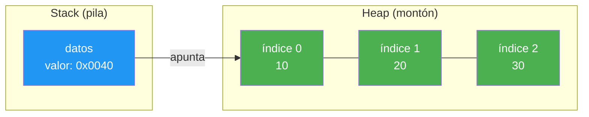

<TipBox type="analogia">

La variable es **una nota con la dirección de tu casa**; el array es **la casa con los muebles**. Quien tiene la nota sabe dónde están los muebles, pero no se lleva la casa.

</TipBox>

</div>
</div>

---

## Al llamar a una función se copia la dirección, no los datos

**No se copian los tres elementos** —sería un coste enorme en arrays grandes—: lo que se copia, **por valor**, es **la dirección**.

<div class="grid grid-cols-2 gap-5 items-start">
<div>

```csharp
void ModificarContenido(int[] array)
{
    array[0] = 999;   // escribe en la MISMA celda
}

int[] arrayOriginal = { 10, 20, 30 };
ModificarContenido(arrayOriginal);
Console.WriteLine(arrayOriginal[0]);  // 999 (¡también!)
```

<TipBox type="nota">

De ahí la primera consecuencia: **escribir en los elementos sí se propaga** al llamador, porque se escribe en la misma caja.

</TipBox>

</div>
<div>

<RealExample app="Spotify">

Cuando editas una canción en una playlist, la app modifica la lista directamente: no crea una copia de millones de registros porque sería lento e ineficiente. Todos los sitios que apuntan a esa playlist ven el cambio.

</RealExample>

</div>
</div>

---

## El mal dicho: «los arrays pasan por referencia»

De forma popular se dice *«los arrays pasan **por referencia**»*, y es un **malendido**: lo que se pasa es **por valor**, pero el **valor que se copia es la dirección** (una referencia). Se copia *una referencia* al array… no el array, y tampoco la variable.

<div class="grid grid-cols-2 gap-5 items-start">
<div>

| Operación dentro de la función | ¿Se ve en el llamador? | Motivo |
|---|---|---|
| Escribir un elemento: `v[0] = 9` | ✅ Sí | Apuntan al mismo bloque |
| Reasignar: `v = new int[…]` | ❌ No | Solo cambia la copia local |

<TipBox type="nota">

El array nuevo que creó la función **no lo usa nadie**: cuando la función termina, el **recolector de basura (GC)** libera ese bloque.

</TipBox>

</div>
<div>

```csharp
// ❌ Sin ref: la reasignación NO llega al llamador
void ReasignarSinRef(int[] datos)
{
    datos = new int[3];   // solo la COPIA local
}

int[] serie = { 10, 20, 30 };
ReasignarSinRef(serie);
Console.WriteLine(serie[0]);   // 10 — sigue el viejo
```

</div>
</div>

---

## Con `ref`: cuando la función debe reemplazar el array

Si necesitas que la función **reemplace por completo** el array del llamador, el modificador `ref` cambia lo que se pasa: no se copia la dirección, se pasa **una referencia a la propia variable** del llamador.

<div class="grid grid-cols-2 gap-5 items-start">
<div>

```csharp
// ✅ Con ref: el llamador ve el reemplazo
void ReasignarConRef(ref int[] datos)
{
    datos = new int[3];   // ahora apunta al nuevo
}

int[] serie = { 10, 20, 30 };
ReasignarConRef(ref serie);
Console.WriteLine(serie[0]);   // 0 — ¡el nuevo!
```

<RealExample app="Videojuegos">

Cuando un juego descarta la partida actual y empieza una nueva, la variable que guarda la partida debe apuntar a **otro** array: eso es un **reemplazo**, no una modificación, y por eso se pasa con `ref`.

</RealExample>

</div>
<div>

<TipBox type="nota">

El caso de uso completo —redimensionar un array— está en el apartado de copias y cambio de tamaño, con sus dos versiones: procedimiento con `ref` y función que devuelve el array nuevo.

</TipBox>

</div>
</div>

---

## Con `in`: cuando la función solo lee el array

<div class="grid grid-cols-2 gap-5 items-start">
<div>

```csharp
int SumarElementos(in int[] datos)
{
    int suma = 0;
    foreach (int e in datos)
        suma += e;

    // datos = new int[0];   // ❌ ERROR CS8331
    return suma;
}

int[] valores = { 10, 20, 30 };
Console.WriteLine(SumarElementos(in valores));   // 60
```

</div>
<div>

- **Reasignar el parámetro → error de compilación CS8331**: dentro de una función `in`, la variable es de solo lectura.
- **Aviso importante:** `in` protege **la variable**, no **los elementos**. Escribir `datos[0] = 999` **compila** y modificaría el array compartido.

<TipBox type="advertencia">

`in` es una **promesa de solo lectura** que tú debes cumplir: si la función es de lectura, no toques los elementos.

</TipBox>

</div>
</div>

---

## Los tres caminos: sin modificador, `ref` e `in`

<div class="grid grid-cols-2 gap-5 items-start">
<div>

| Modificador | ¿Escribe elementos? | ¿Reemplaza el array? | Mecanismo |
|---|---|---|---|
| *(ninguno)* | ✅ Sí, se propaga | ❌ No (se pierde) | Se copia la dirección |
| `ref` | ✅ Sí, se propaga | ✅ Sí, se propaga | Se pasa la variable del llamador |
| `in` | ⚠️ Compila, pero no debe | ❌ Error CS8331 | Dirección de solo lectura |

<TipBox type="advertencia">

«Pasar por referencia» y `ref` **no son lo mismo**. Sin `ref` viaja una **copia de la dirección**; con `ref`, viaja **la variable misma**.

</TipBox>

</div>
<div>

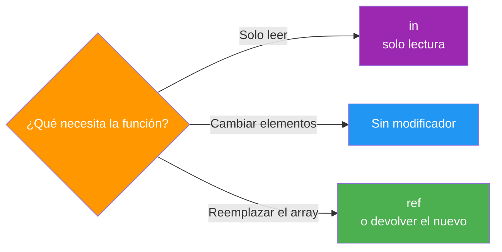

</div>
</div>

---

## Copia superficial y copia profunda

**Copiar** crea un array nuevo con los mismos elementos; ojo, `int[] b = a` **no copia nada**, solo añade otro nombre. **Clonar** es lo mismo, pidiéndoselo al propio array. Lo que hay que mirar es **qué se copia de verdad**:

<div class="grid grid-cols-2 gap-5 items-start">
<div>

<ConceptCard icon="📄" title="Copia superficial (shallow)" accent="blue">

Se copian los **elementos**. En un `int[]` son los datos completos; en arrays de tipos de referencia se copian las **direcciones**: original y copia apuntarían a los mismos objetos.

</ConceptCard>

</div>
<div>

<ConceptCard icon="📦" title="Copia profunda (deep)" accent="green">

Se copian los elementos **y** cada objeto al que apuntan: cada array queda con lo suyo. Con arrays de `int`, copiar elemento a elemento ya es una copia completa.

</ConceptCard>

</div>
</div>

<TipBox type="nota">

📌 **Ejemplo real:** Al preparar un informe de notas suele copiarse el array original para ordenarlo a su gusto: el listado del profesor sigue en su orden original y los datos no se alteran.

</TipBox>

---

## Tu función de copiar

**El destino lo crea quien llama** (a diferencia de `Clonar`, que lo crea la función):

<div class="grid grid-cols-2 gap-5 items-start">
<div>

```csharp
void Copiar(int[] origen, int[] destino)
{
    for (int i = 0; i < origen.Length; i++)
        destino[i] = origen[i];  // uno a uno
}
```

</div>
<div>

```csharp
int[] original = { 10, 20, 30 };
int[] copia = new int[original.Length];
Copiar(original, copia);

copia[0] = 99;
Console.WriteLine(original[0]);  // 10
Console.WriteLine(copia[0]);     // 99
```

</div>
</div>

<TipBox type="nota">

El **original queda intacto**: cambiar la copia no lo toca. Esa es la diferencia con el alias (`int[] b = a`), que no crea nada nuevo.

</TipBox>

---

## Clonación manual: la copia profunda

Para obtener un array **completamente independiente**, debes crear uno nuevo y copiar elemento por elemento.

<div class="grid grid-cols-2 gap-5 items-start">
<div>

```csharp
int[] Clonar(int[] origen)
{
    int[] clonado = new int[origen.Length];
    for (int i = 0; i < origen.Length; i++)
    {
        clonado[i] = origen[i];  // Copia el valor
    }
    return clonado;
}
```

</div>
<div>

```csharp
int[] arrayA = { 10, 20 };
int[] arrayClon = Clonar(arrayA);

arrayClon[0] = 500;
Console.WriteLine(arrayA[0]);    // 10 — A no cambia
Console.WriteLine(arrayClon[0]); // 500 — independiente
```

<TipBox type="nota">

Fíjate en el contrato de las dos funciones: en **copiar**, el destino lo pone quien llama (como hará `Array.Copy`); en **clonar**, el array nuevo lo crea la función (como hará `Clone()`).

</TipBox>

</div>
</div>

---

## Devolver un array desde una función

Una función que devuelve un array retorna la **referencia**. La variable que recibe el retorno apunta al mismo objeto.

<div class="grid grid-cols-2 gap-5 items-start">
<div>

```csharp
int[] CrearArray(int tamano)
{
    return new int[tamano];  // Retorna la referencia
}

int[] miArray = CrearArray(10);
Console.WriteLine(miArray.Length);  // 10
```

</div>
<div>

**A veces necesitas devolver el array junto con otros valores** (el array y su suma). En ese caso, usa **tuplas**:

```csharp
(int[] datos, int suma) ProcesarArray(int[] arr)
{
    int s = 0;
    foreach (int x in arr) s += x;
    return (arr, s);
}

var (numeros, total) = ProcesarArray(new int[] { 10, 20, 30 });
Console.WriteLine($"Suma: {total}");  // 60
```

</div>
</div>

---

## `params`: número variable de argumentos

El modificador **`params`** permite a una función aceptar un número variable de argumentos. Internamente, el compilador los convierte en un **array**.

<div class="grid grid-cols-2 gap-5 items-start">
<div>

```csharp
int SumarTodos(params int[] numeros)
{
    int suma = 0;
    foreach (int num in numeros)
    {
        suma += num;
    }
    return suma;
}

// ✅ Llamada con argumentos variables
Console.WriteLine(SumarTodos(1, 2, 3));         // 6
Console.WriteLine(SumarTodos(10, 20, 30, 40));  // 100
```

</div>
<div>

<TipBox type="nota">

Lo que escribes como argumentos sueltos, el compilador lo empaqueta en un `int[]` que es lo que recibe la función: por eso `params` es la puerta de entrada al array.

</TipBox>

</div>
</div>

---

## Identidad frente a igualdad: `==` no compara contenido

<div class="grid grid-cols-2 gap-5 items-start">
<div>

| Concepto | Significado | Operador en C# |
|---|---|---|
| **Identidad** | ¿Apuntan a la misma dirección? | `==` |
| **Igualdad** | ¿Tienen el mismo contenido? | Función manual |

```csharp
int[] arrayA = { 1 };
int[] arrayB = { 1 };
int[] arrayC = arrayA;  // Misma referencia

Console.WriteLine(arrayA == arrayC);  // true (misma)
Console.WriteLine(arrayA == arrayB);  // false (distinta)
```

</div>
<div>

```csharp
bool SonIguales(int[] a, int[] b)
{
    if (a.Length != b.Length) return false;
    for (int i = 0; i < a.Length; i++)
    {
        if (a[i] != b[i]) return false;
    }
    return true;
}

Console.WriteLine(SonIguales(arrayA, arrayB));  // true
```

<TipBox type="truco">

`==` comprueba si son la **misma persona** (misma dirección). `SonIguales` comprueba si son **gemelos** (mismo contenido, distinta persona).

</TipBox>

</div>
</div>

---

## Las dos trampas: `==` y `null` con arrays

<div class="grid grid-cols-2 gap-4 items-start">
<div>

**❌ `==` NO compara arrays por contenido**

```csharp
int[] a = { 1, 2, 3 };
int[] b = { 1, 2, 3 };
Console.WriteLine(a == b);  // ¡False! Distintas

// ✅ Para comparar contenido, usa SequenceEqual()
Console.WriteLine(a.SequenceEqual(b));  // True
```

<TipBox type="advertencia">

Si comparas dos arrays con `==`, siempre dará `False` aunque tengan los mismos valores, porque son objetos distintos en memoria.

</TipBox>

</div>
<div>

**❌ Un array puede ser `null`**

```csharp
int[] numeros = null;

// ❌ Esto falla
Console.WriteLine(numeros.Length);  // NullReferenceException

// ✅ Comprobar antes de usar
if (numeros != null)
    Console.WriteLine(numeros.Length);

// ✅ Con operador ternario
int total = numeros?.Length ?? 0;
```

</div>
</div>

---

## La trampa del alias: `b = a` no es una copia

Un error muy común es pensar que al hacer `int[] b = a` has creado una copia. En realidad has creado un **alias**: dos nombres para el mismo array.

<div class="grid grid-cols-2 gap-5 items-start">
<div>

```csharp
// ❌ ERROR COMÚN: Aliasing
int[] a = { 1, 2, 3 };
int[] b = a;  // b es un ALIAS de a, NO una copia

b[0] = 999;
Console.WriteLine(a[0]);  // 999 — ¡También cambió!

// ✅ CORRECTO: Clonación
int[] c = new int[a.Length];
for (int i = 0; i < a.Length; i++)
    c[i] = a[i];

c[0] = 888;
Console.WriteLine(a[0]);  // 999 — a NO cambia
Console.WriteLine(c[0]);  // 888 — c es independiente
```

</div>
<div>

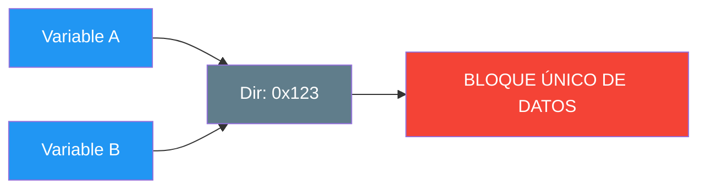

<TipBox type="analogia">

Imagina que `a` es la dirección de tu piso. Cuando escribes `b = a`, no estás comprando un piso nuevo: estás dando otra llave al **mismo piso**. Si `b` entra y mueve los muebles, `a` también ve los cambios.

</TipBox>

</div>
</div>

---

## El tamaño no se puede cambiar: redimensionar

El tamaño de un array es **inmutable**. Para «cambiarlo» hay que crear uno nuevo y copiar. Es el **acordeón**: el array no se estira ni se encoge, se **sustituye** por otro de mayor o menor tamaño —y así la memoria que ocupas se acerca a la que de verdad necesitas.

| Estilo | Quién reasigna | Modificador | Lectura |
|---|---|---|---|
| `Redimensionar(ref a, 5)` | El procedimiento, **desde dentro** | `ref` necesario | «hazlo tú» |
| `a = RedimensionarFuncion(a, 5)` | El llamador, **desde fuera** | ninguno extra | «dámelo hecho» |

<div class="grid grid-cols-2 gap-4 mt-4 items-start">
<div>

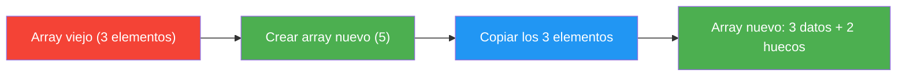

</div>
<div>

<TipBox type="analogia">

📌 **Ejemplo real:** El historial de Netflix no sabe si tendrás 10 o 10.000 títulos: cuando el espacio se llena lo amplían por bloques y cuando se vacía lo reducen, sin reajustarlo en cada título. Ese crecer y encoger por bloques es el patrón del acordeón.

</TipBox>

</div>
</div>

---

## Redimensionar con `ref`: el procedimiento

<div class="grid grid-cols-2 gap-5 items-start">
<div>

```csharp
// Procedimiento que redimensiona: crea, copia y
// REASIGNA — por eso ref
void Redimensionar(ref int[] datos, int nuevoTamano)
{
    int[] nuevo = new int[nuevoTamano];

    // Copia solo los que quepan: vale para ampliar y reducir
    int n = Math.Min(datos.Length, nuevo.Length);
    for (int i = 0; i < n; i++)
        nuevo[i] = datos[i];  // copia los existentes

    datos = nuevo;  // EL TRUCO: sin ref se perdería
}
```

</div>
<div>

```csharp
int[] arrayAntiguo = { 10, 20, 30 };
Redimensionar(ref arrayAntiguo, 5);

// arrayAntiguo = { 10, 20, 30, 0, 0 } — crece

// También REDUCE: solo se copian los que quepan
Redimensionar(ref arrayAntiguo, 2);

// arrayAntiguo = { 10, 20 } — lo que no cupo se descartó
Console.WriteLine(string.Join(", ", arrayAntiguo));  // 10, 20
```

<TipBox type="consejo">

El patrón es siempre el mismo: **crear** el array nuevo, **copiar** lo que quepa, **reasignar** la variable. Al ampliar, los huecos se rellenan con el valor por defecto (`0`); al reducir, **lo que no quepa se descarta**.

</TipBox>

</div>
</div>

---

## Redimensionar devolviendo el array: la función

<div class="grid grid-cols-2 gap-5 items-start">
<div>

```csharp
// Función que devuelve el array redimensionado (sin ref)
int[] RedimensionarFuncion(int[] datos, int nuevoTamano)
{
    int[] nuevo = new int[nuevoTamano];

    // Copia solo los que quepan: vale para ampliar y reducir
    int n = Math.Min(datos.Length, nuevo.Length);
    for (int i = 0; i < n; i++)
        nuevo[i] = datos[i];  // copia los existentes

    return nuevo;   // devuelve la referencia
}
```

</div>
<div>

```csharp
int[] arrayFuncion = { 10, 20, 30 };
arrayFuncion = RedimensionarFuncion(arrayFuncion, 5);

// arrayFuncion = { 10, 20, 30, 0, 0 } — crece
arrayFuncion = RedimensionarFuncion(arrayFuncion, 2);

// arrayFuncion = { 10, 20 } — reduce
Console.WriteLine(string.Join(", ", arrayFuncion));  // 10, 20
```

<TipBox type="nota">

La **BCL** trae `Array.Resize(ref array, nuevoTamano)`, que hace exactamente esto por ti — y fíjate que su firma **también lleva `ref`**, por la misma razón: crea un array nuevo, copia y reasigna.

</TipBox>

</div>
</div>

---

## Funciones del sistema: `Array.Copy` y `Clone()`

La **BCL** (las clases que trae .NET de serie) hace el mismo trabajo que tus funciones de la 2.6.1, pero escritas, probadas y optimizadas por Microsoft:

<div class="grid grid-cols-2 gap-5 items-start">
<div>

**`Array.Copy(origen, destino, cantidad)`** — rellena un array destino que ya existe:

```csharp
int[] original = { 10, 20, 30 };
int[] copia = new int[original.Length];

Array.Copy(original, copia, original.Length);
// original.CopyTo(copia, 0);   // igual

copia[0] = 99;
Console.WriteLine(original[0]); // 10
Console.WriteLine(copia[0]);    // 99
```

</div>
<div>

**`original.Clone()`** — el array se clona a sí mismo; devuelve `object`:

```csharp
int[] original = { 10, 20, 30 };
int[] clon = (int[])original.Clone();

clon[0] = 99;
Console.WriteLine(original[0]); // 10
Console.WriteLine(clon[0]);      // 99
```

</div>
</div>

---

## `Array.Resize`: el acordeón, hecho función

<div class="grid grid-cols-2 gap-5 items-start">
<div>

```csharp
int[] datos = { 10, 20, 30 };

Array.Resize(ref datos, 5);  // crece:  { 10, 20, 30, 0, 0 }
Array.Resize(ref datos, 2);  // reduce: { 10, 20 }

Console.WriteLine(string.Join(", ", datos));  // 10, 20
Console.WriteLine(datos.Length);              // 2
```

<TipBox type="nota">

`Array.Resize` es el `ref` de la 2.6.2 hecho función: internamente crea el array nuevo, copia y reasigna el que le pasas. Ojo: es un **método estático** de `Array`, no una propiedad `.Resize()`.

</TipBox>

</div>
<div>

| Función | Quién crea el destino | Efecto |
|---|---|---|
| `Array.Copy(a, b, n)` | tú (`b` ya existe) | `void`: rellena `b` |
| `a.Clone()` | el propio array | devuelve `object` |
| `Array.Resize(ref a, n)` | la función | `void`: **reasigna** `a` |

<TipBox type="nota">

Conviene conocer las tres: las verás en cualquier proyecto.

</TipBox>

</div>
</div>

---

## Arrays de tipos compuestos: tuplas y enums

Los arrays no solo almacenan `int`, `string` o `bool`. También puedes guardar **tuplas**, **enums** y **structs**.

<div class="grid grid-cols-2 gap-5 items-start">
<div>

**Array de tuplas**: guarda registros completos sin definir ninguna clase.

```csharp
// Array de tuplas con nombre
(string nombre, int nota)[] alumnos =
{
    ("Ana", 8),
    ("Luis", 7),
    ("María", 9)
};

// Recorrer
for (int i = 0; i < alumnos.Length; i++)
    Console.WriteLine(
        $"{alumnos[i].nombre}: {alumnos[i].nota}");
```

</div>
<div>

**Array de enums**: la forma natural de guardar una colección de días, colores o estados.

```csharp
enum DiaSemana { Lunes, Martes, Miercoles, Jueves,
                 Viernes, Sabado, Domingo }

// Array de enums
DiaSemana[] semana = {
    DiaSemana.Lunes,
    DiaSemana.Miercoles,
    DiaSemana.Viernes
};

// Recorrer
foreach (DiaSemana dia in semana)
    Console.WriteLine($"Día: {dia}");
```

</div>
</div>

---

## Arrays de structs: el array como tabla

Con los structs, el array se convierte en una tabla de verdad: cada posición es un registro con todos sus campos.

<div class="grid grid-cols-2 gap-5 items-start">
<div>

```csharp
struct Alumno
{
    public int Id;
    public string Nombre;
    public double Nota;
}

// Array de structs
Alumno[] clase = new Alumno[3];
clase[0] = new Alumno { Id = 1, Nombre = "Ana", Nota = 8.5 };
clase[1] = new Alumno { Id = 2, Nombre = "Luis", Nota = 7.0 };
clase[2] = new Alumno { Id = 3, Nombre = "María", Nota = 9.2 };
```

</div>
<div>

```csharp
// Recorrer
for (int i = 0; i < clase.Length; i++)
    Console.WriteLine($"{clase[i].Nombre}" +
                      $" (ID {clase[i].Id}):" +
                      $" {clase[i].Nota}");
```

<TipBox type="nota">

Los structs son tipos de valor, así que cada elemento del array es una **copia independiente**. Si modificas `clase[0].Nota`, no afecta a otros arrays de la misma struct.

</TipBox>

</div>
</div>

---

## Resumen del punto 2

| Concepto | Descripción |
|----------|-------------|
| **`new tipo[n]`** | Crea un array con n elementos (valores por defecto) |
| **`{ val1, val2 }`** | Inicialización directa con valores |
| **`.Length`** | Número total de elementos (solo lectura) |
| **`for` / `foreach`** | Recorrer modificando / solo leyendo |
| **`params`** | Número variable de argumentos (se convierte en array) |
| **`ref` / `in`** | Reemplazar el array / solo lectura |
| **`==`** | Compara identidad (misma dirección), no contenido |
| **Alias** | `b = a` crea dos nombres para el mismo array |
| **Copiar / Clonar** | Copia **superficial** (los elementos) o **profunda** (los objetos) |
| **Redimensionar** | El acordeón: crear → copiar → reasignar (`ref`) |
| **`is { }` / `?.`** | Recorrer arrays con `null` sin estrellarte |

---

## Buenas prácticas del punto 2

<div class="grid grid-cols-2 gap-5 items-start">
<div>

<ConceptCard icon="✅" title="Buenas prácticas" accent="green">

- `for` para modificar o conocer el índice
- `foreach` para solo leer los valores
- Verifica `null` antes de acceder a `.Length`
- `ref` solo si el procedimiento **reemplaza** el array
- Recorre arrays con `null` usando `is { }` o `?.`
- Clona cada fila manualmente en matrices escalonadas

</ConceptCard>

</div>
<div>

<div class="mt-3">

**⏭️ ¿Qué viene después?** En el **punto 3** veremos cómo funcionan los arrays multidimensionales (matrices): su creación, recorrido y las diferencias clave con los unidimensionales.

</div>

</div>
</div>
---
layout: section
---

<div class="ud-section-number">03</div>

# Arrays multidimensionales

<div class="opacity-70">Matrices rectangulares y escalonadas</div>

---

## 3 · Punto de partida

<div class="grid grid-cols-2 gap-5 items-start">
<div>

<TipBox type="consejo" title="Punto de partida">

¿Alguna vez has visto un tablero de ajedrez? Tiene 8 filas y 8 columnas — 64 casillas. Para acceder a una casilla concreta necesitas dos coordenadas: fila y columna. Eso es exactamente una **matriz**: un array con dos o más dimensiones.

</TipBox>

</div>
<div>

<Objetivos
  :items="[
    'Declarar matrices rectangulares y escalonadas',
    'Recorrer matrices con bucles anidados (`for` y `foreach`)',
    'Entender la diferencia entre copia superficial y copia profunda',
    'Conocer el impacto del orden de los índices en el rendimiento',
  ]"
/>

</div>
</div>

---

## Dos tipos de matrices

<div class="grid grid-cols-2 gap-5 items-start">
<div>

| Tipo | Descripción | Ejemplo |
|---|---|---|
| **Rectangular** | Todas las filas tienen el mismo número de columnas | `int[3, 4]` — 3 filas × 4 columnas |
| **Escalonada (Jagged)** | Cada fila puede tener distinto número de columnas | `int[3][]` — 3 filas de tamaño variable |

</div>
<div>

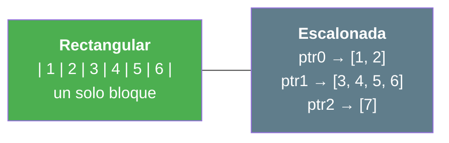

</div>
</div>

---

## Matriz rectangular: un único bloque contiguo

Una matriz rectangular (`int[3, 4]`) se almacena como **un único bloque continuo** en memoria, como si fuera un vector largo. Los elementos se guardan **por filas**: primero la fila 0 completa, luego la fila 1, etc.

<div class="grid grid-cols-2 gap-5 items-start">
<div>

<TipBox type="analogia">

Imagina un libro de 3 capítulos con 4 páginas cada uno. El libro se imprime como un bloque de 12 páginas seguidas: páginas 0-3 (capítulo 0), páginas 4-7 (capítulo 1), páginas 8-11 (capítulo 2). No hay saltos ni pausas entre capítulos.

</TipBox>

</div>
<div>

**¿Cómo encuentra el procesador cada elemento?**

```
Dirección(A[i,j]) = Base + ((i × Cols + j) × Tamaño)
```

- `Base`: dirección del primer elemento (`[0,0]`)
- `i`: índice de la fila
- `j`: índice de la columna
- `Cols`: número de columnas de la matriz
- `Tamaño`: bytes que ocupa el tipo (4 bytes para `int`)

</div>
</div>

---

## Un ejemplo: dónde está cada elemento

Para una `int[3,4]` (4 bytes por `int`) con Base = 1000:

| Acceso | Cálculo | Dirección |
|---|---|---|
| `[0,0]` | 1000 + (0×4 + 0) × 4 | **1000** |
| `[0,3]` | 1000 + (0×4 + 3) × 4 | **1012** |
| `[1,0]` | 1000 + (1×4 + 0) × 4 | **1016** |
| `[2,3]` | 1000 + (2×4 + 3) × 4 | **1040** |

<TipBox type="nota">

Es exactamente igual que en un array unidimensional, pero con un paso extra: multiplicar `i × NumColumnas` para «saltar» filas completas.

</TipBox>

---

## Así queda en la memoria

Los elementos se guardan **por filas**, unas detrás de otras:

| Fila | Direcciones | Valores |
|---|---|---|
| **Fila 0** | 1000 · 1004 · 1008 · 1012 | 1 · 2 · 3 · 4 |
| **Fila 1** | 1016 · 1020 · 1024 · 1028 | 5 · 6 · 7 · 8 |
| **Fila 2** | 1032 · 1036 · 1040 · 1044 | 9 · 10 · 11 · 12 |

La fila 1 empieza justo donde termina la fila 0 (dirección **1016**): no hay huecos ni saltos entre filas.

---

## Matriz escalonada: un array de arrays

Una matriz escalonada (`int[3][]`) es **un array que contiene otros arrays**. Cada fila es un array independiente que se almacena en un sitio diferente de memoria.

<div class="grid grid-cols-2 gap-5 items-start">
<div>

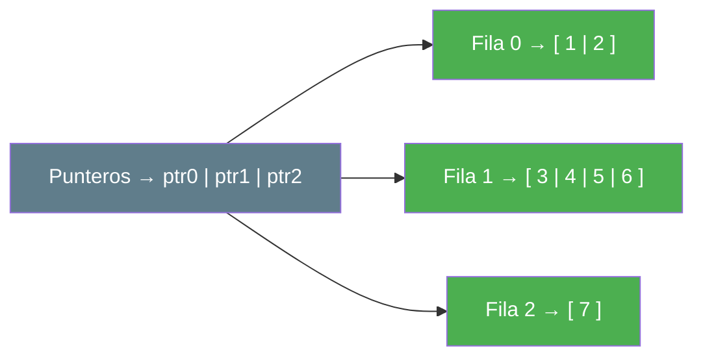

**¿Cómo se accede?**

```
Dirección(A[i][j]) = Dir. de la fila i + (j × Tamaño)
```

Primero se busca el puntero de la fila, y luego se accede al elemento dentro de esa fila.

</div>
<div>

<TipBox type="analogia">

Un edificio de oficinas: la planta 0 tiene 2 despachos, la planta 1 tiene 4 y la planta 2 tiene 1. Cada planta es un array independiente, y el edificio es el array de plantas. Las plantas no están pegadas: cada una está en su sitio.

</TipBox>

</div>
</div>

---

## Rectangular frente a escalonada

<div class="grid grid-cols-2 gap-5 items-start">
<div>

| Aspecto | Rectangular | Escalonada |
|---|---|---|
| **Memoria** | Un bloque contiguo | Varios bloques dispersos |
| **Fórmula acceso** | `Base + (i × Cols + j) × Tamaño` | `Ptr[i] + j × Tamaño` |
| **Velocidad** | Más rápida (cache-friendly) | Un poco más lenta (dos saltos) |
| **Flexibilidad** | Todas las filas igual tamaño | Filas de tamaño variable |
| **Clonación** | `Clone()` es profunda | `Clone()` es superficial |

</div>
<div>

<TipBox type="consejo">

La rectangular es más rápida porque el procesador carga un bloque de memoria y lo aprovecha entero. La escalonada gana en **flexibilidad**: cada fila puede medir lo que necesite.

</TipBox>

</div>
</div>

---

## Crear una matriz rectangular

La matriz rectangular es la más usada: todas las filas tienen el mismo número de columnas.

<div class="grid grid-cols-2 gap-5 items-start">
<div>

```csharp
// ✅ Creación con tamaño fijo (valores por defecto: 0)
int[,] matriz = new int[3, 4];  // 3 filas × 4 columnas

// ✅ Inicialización directa
int[,] notas = {
    { 5, 6, 7, 8 },   // Fila 0
    { 9, 10, 8, 7 },  // Fila 1
    { 6, 7, 9, 10 }   // Fila 2
};

// ✅ Acceso por índices
Console.WriteLine(notas[0, 2]);  // 7 (fila 0, columna 2)
```

</div>
<div>

```csharp
// ✅ Dimensiones
// GetLength(0) → filas;  GetLength(1) → columnas
Console.WriteLine($"Filas: {notas.GetLength(0)}");
Console.WriteLine($"Columnas: {notas.GetLength(1)}");
```

<div class="mt-2 flex justify-center">
  
</div>

</div>
</div>

---

## Crear una matriz escalonada (jagged)

Cuando cada fila necesita un tamaño distinto, se usa una matriz escalonada: un array de arrays donde cada fila se crea por separado.

<div class="grid grid-cols-2 gap-5 items-start">
<div>

```csharp
// ✅ Cada fila tiene distinto tamaño
int[][] escalonada = new int[3][];
escalonada[0] = new int[] { 1, 2 };
escalonada[1] = new int[] { 3, 4, 5 };
escalonada[2] = new int[] { 6, 7, 8, 9 };

// ✅ Acceso (fila 1, columna 2)
Console.WriteLine(escalonada[1][2]);  // 5
```

</div>
<div>

<RealExample app="Battleship">

Un tablero de Battleship es una matriz rectangular `char[10,10]` donde cada posición contiene un carácter como `'A'` (Agua), `'B'` (Barco) o `'D'` (Disparo). El juego necesita acceder rápidamente a cualquier casilla por sus coordenadas.

</RealExample>

</div>
</div>

---

## Recorrer una matriz con `for`: bucles anidados

<div class="grid grid-cols-2 gap-5 items-start">
<div>

```csharp
int[,] matriz = { { 1, 2, 3 }, { 4, 5, 6 } };

// ✅ Recorrer por filas y columnas
for (int i = 0; i < matriz.GetLength(0); i++)
{
    for (int j = 0; j < matriz.GetLength(1); j++)
    {
        Console.Write($"{matriz[i,j]} ");
    }
    Console.WriteLine();
}
// Salida:
// 1 2 3
// 4 5 6
```

</div>
<div>

**`GetLength(0)`** devuelve el número de **filas** y **`GetLength(1)`** el de **columnas**: por eso una matriz no tiene un `.Length` único, sino uno por dimensión.

<TipBox type="nota">

El bucle **interno** se ejecuta **completo** por cada vuelta del externo: 3 × 4 = 12 accesos.

</TipBox>

</div>
</div>

---

## El bucle anidado, por dentro

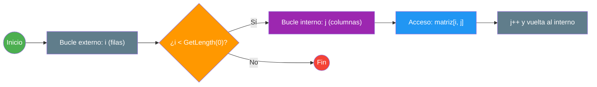

<TipBox type="consejo">

Dos bucles, dos índices y dos dimensiones: `i` recorre las **filas** y `j` las **columnas**. El orden de esos dos bucles es lo que decide la velocidad, como veremos al final del punto.

</TipBox>

---

## Recorrer una matriz con `foreach`

El `foreach` recorre la matriz entera en orden de filas sin que te preocupes de los índices, pero **solo sirve para leer**.

<div class="grid grid-cols-2 gap-5 items-start">
<div>

```csharp
int[,] matriz = { { 1, 2, 3 }, { 4, 5, 6 } };

// ✅ foreach recorre en orden de filas (row-major)
foreach (int elemento in matriz)
{
    Console.Write($"{elemento} ");
}
// Salida: 1 2 3 4 5 6
```

</div>
<div>

<TipBox type="advertencia">

Con `foreach` **no puedes modificar** los elementos ni conocer la posición (índice). Solo sirve para lectura. Si necesitas modificar, usa `for`.

</TipBox>

</div>
</div>

---

## En las matrices también hay alias

Al igual que los arrays unidimensionales, las matrices son **tipos de referencia**. `matrizB = matrizA` crea un alias, no una copia.

<div class="grid grid-cols-2 gap-5 items-start">
<div>

```csharp
int[,] original = { { 1, 2 }, { 3, 4 } };
int[,] copia = original;  // Alias — misma referencia

copia[0, 0] = 999;
Console.WriteLine(original[0, 0]);  // 999 — ¡también!
```

</div>
<div>

<TipBox type="truco">

Piensa en las matrices como un edificio de apartamentos. `matrizB = matrizA` es como darle a alguien la llave del **mismo** apartamento. Si mueve los muebles, tú también lo ves.

</TipBox>

</div>
</div>

---

## `==` con matrices: compara referencias, no contenido

<div class="grid grid-cols-2 gap-5 items-start">
<div>

```csharp
// ❌ == NO compara matrices por contenido
int[,] a = { { 1, 2 }, { 3, 4 } };
int[,] b = { { 1, 2 }, { 3, 4 } };
Console.WriteLine(a == b);  // ¡False! Distintas
```

</div>
<div>

**✅ Para comparar contenido, usa un bucle:**

```csharp
bool SonIguales(int[,] x, int[,] y)
{
    if (x.GetLength(0) != y.GetLength(0) ||
        x.GetLength(1) != y.GetLength(1))
        return false;

    for (int i = 0; i < x.GetLength(0); i++)
        for (int j = 0; j < x.GetLength(1); j++)
            if (x[i, j] != y[i, j]) return false;

    return true;
}
```

</div>
</div>

---

## Pasar y devolver matrices

<div class="grid grid-cols-2 gap-5 items-start">
<div>

Las matrices se pasan a funciones por referencia: cualquier modificación dentro de la función afecta al original.

```csharp
void ModificarMatriz(int[,] matriz)
{
    matriz[0, 0] = 555;  // Modifica el original
}

int[,] miMatriz = { { 1, 2 }, { 3, 4 } };
ModificarMatriz(miMatriz);
Console.WriteLine(miMatriz[0, 0]);  // 555
```

</div>
<div>

Para devolver una matriz desde una función, se retorna la referencia:

```csharp
int[,] CrearMatriz(int filas, int columnas)
{
    return new int[filas, columnas];
}

int[,] nueva = CrearMatriz(3, 4);
Console.WriteLine($"{nueva.GetLength(0)}x" +
                  $"{nueva.GetLength(1)}");  // 3x4
```

</div>
</div>

---

## Copia superficial o copia profunda

<div class="grid grid-cols-2 gap-5 items-start">
<div>

| Tipo de copia | Mecanismo | Resultado |
|---|---|---|
| **Referencia** | `matrizB = matrizA` | Total dependencia — mismo objeto |
| **Superficial** | Clonar solo el array exterior | Dependencia parcial — filas compartidas |
| **Profunda** | Clonar exterior **Y** cada fila | Total independencia |

</div>
<div>

**En las rectangulares, `Clone()` SÍ crea una copia profunda** (porque es un bloque contiguo en memoria):

```csharp
int[,] original = { { 1, 2 }, { 3, 4 } };
int[,] clonada = (int[,])original.Clone();

clonada[0, 0] = 999;
Console.WriteLine(original[0, 0]);  // 1 — NO cambia
```

</div>
</div>

---

## ⚠️ Con matrices escalonadas, `Clone()` no basta

Con matrices **escalonadas** (`int[][]`), `Clone()` solo clona el array exterior. Las filas internas se comparten: debes clonar cada fila manualmente.

<div class="grid grid-cols-2 gap-5 items-start">
<div>

```csharp
// ✅ CLONACIÓN PROFUNDA de matriz escalonada
int[][] ClonarMatriz(int[][] origen)
{
    int[][] clonada = new int[origen.Length][];
    for (int i = 0; i < origen.Length; i++)
    {
        clonada[i] = new int[origen[i].Length];
        for (int j = 0; j < origen[i].Length; j++)
        {
            clonada[i][j] = origen[i][j];
        }
    }
    return clonada;
}
```

</div>
<div>

<TipBox type="advertencia">

`Clone()` en una matriz escalonada es una **copia superficial**: las filas siguen siendo las mismas. Si modificas `clonada[0][0]`, cambias también `origen[0][0]`.

</TipBox>

</div>
</div>

---

## El tamaño de una matriz también es inmutable

El tamaño de una matriz es **inmutable**. Para «cambiarlo», debes crear una nueva y copiar.

<div class="grid grid-cols-2 gap-5 items-start">
<div>

```csharp
int[,] original = { { 1, 2, 3 }, { 4, 5, 6 } };

// Ampliar de 2x3 a 4x5
int[,] nueva = new int[4, 5];
for (int i = 0; i < original.GetLength(0); i++)
{
    for (int j = 0; j < original.GetLength(1); j++)
    {
        nueva[i, j] = original[i, j];
    }
}
// nueva = { {1,2,3,0,0}, {4,5,6,0,0}, {0,0,0,0,0}, ... }
```

</div>
<div>

<RealExample app="Photoshop">

Cuando escalas una imagen en Photoshop, internamente el programa crea una nueva matriz de píxeles con el tamaño ampliado y copia los valores originales, rellenando los huecos con interpolación.

</RealExample>

</div>
</div>

---

## ¿Cómo se aplana una matriz en la memoria?

La memoria es **unidimensional** (una línea de casillas), pero la matriz es **bidimensional** (una tabla). C# usa **row-major order** (por filas): primero la fila completa, luego la siguiente.

<div class="grid grid-cols-2 gap-5 items-start">
<div>

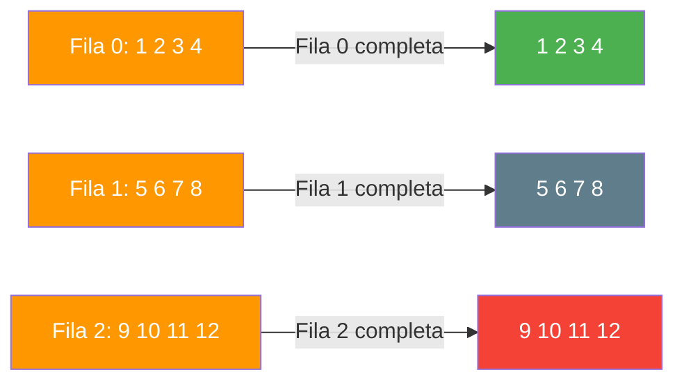

</div>
<div>

Es como si leyeras un libro: lees la fila de izquierda a derecha y, cuando terminas, saltas a la siguiente fila.

> ⚠️ **Advertencia:** No todos los lenguajes funcionan igual. **Fortran, MATLAB, R y Julia** almacenan por **columnas** (*column-major order*): primero la columna completa, luego la siguiente.

</div>
</div>

---

## Recorrer por filas (rápido) o por columnas (lento)

Imagina una matriz de notas de 3 alumnos × 4 exámenes. En memoria (row-major) se almacena así:

| Fila | Posiciones en memoria | Valores |
|---|---|---|
| **Alumno 0** | 0 · 1 · 2 · 3 | 5 · 6 · 7 · 8 |
| **Alumno 1** | 4 · 5 · 6 · 7 | 9 · 10 · 8 · 7 |
| **Alumno 2** | 8 · 9 · 10 · 11 | 6 · 7 · 9 · 10 |

<div class="grid grid-cols-2 gap-4 mt-3 items-start">
<div>

**✅ Por FILAS (rápido — cache-friendly)**

```csharp
// Primer bucle: i = 0 (Alumno 0)
for (int j = 0; j < 4; j++)
    Console.Write(notas[0, j]);  // 0,1,2,3 → CONTIGUO
```

</div>
<div>

**❌ Por COLUMNAS (lento — cache misses)**

```csharp
// Primer bucle: j = 0 (examen 0)
for (int i = 0; i < 3; i++)
    Console.Write(notas[i, 0]);  // 0, 4, 8 → SALTO
```

</div>
</div>

---

## Por qué la caché lo cambia todo

La **caché** es una memoria pequeña y muy rápida del procesador. Cuando accedes a una posición, el procesador no carga solo ese valor, sino un **bloque contiguo** completo (típicamente 64 bytes). Si los siguientes accesos están en ese bloque, son **hits**; si están en otro, son **misses**.

<div class="grid grid-cols-2 gap-5 items-start">
<div>

| Recorrido | Bloques cargados | Hits | Misses | Velocidad |
|---|---|---|---|---|
| **Por filas** | 3 bloques (4 posiciones c/u) | 12 | 0 | ✅ Rápido |
| **Por columnas** | 12 bloques (1 posición c/u) | 3 | 9 | ❌ Lento (4x) |

<TipBox type="consejo">

En C#, **siempre** el bucle externo debe ser `i` (filas) y el interno `j` (columnas). Si cambias de lenguaje, recuerda: Fortran y MATLAB usan el orden contrario.

</TipBox>

</div>
<div>

<RealExample app="Netflix">

Netflix procesa millones de calificaciones en una matriz `usuarios × películas`. Si recorre por usuarios (filas), cada bloque de caché contiene las 5-10 calificaciones de ese usuario → rápido. Si recorre por películas (columnas), salta de usuario en usuario → lento. Por eso los motores de recomendación optimizan el orden de recorrido.

</RealExample>

</div>
</div>

---

## Matrices de enums y de structs

<div class="grid grid-cols-2 gap-5 items-start">
<div>

**Matriz de enums**: cada casilla guarda un estado del dominio.

```csharp
enum EstadoCasilla { Vacía, Árbol, Ardiente }

EstadoCasilla[,] tablero = new EstadoCasilla[4, 4];

tablero[0, 0] = EstadoCasilla.Árbol;
tablero[1, 2] = EstadoCasilla.Ardiente;
```

</div>
<div>

**Matriz de structs**: cada celda es un registro completo.

```csharp
struct Alumno
{
    public string Nombre;
    public double Nota;
}

Alumno[,] notas = new Alumno[3, 4];
notas[0, 0] = new Alumno { Nombre = "Ana", Nota = 8.5 };
```

<TipBox type="nota">

Cada celda de la matriz contiene una **copia** del struct. Si modificas `notas[0,0].Nota`, no afecta a otras celdas ni a otras matrices.

</TipBox>

</div>
</div>

---

## Resumen del punto 3

<div class="grid grid-cols-2 gap-5 items-start">
<div>

| Concepto | Descripción |
|----------|-------------|
| **Matriz rectangular** | `int[filas, columnas]` — todas las filas igual tamaño |
| **Matriz escalonada** | `int[filas][]` — filas de tamaño variable |
| **`.GetLength(n)`** | Devuelve el tamaño de la dimensión n |
| **Recorrido por filas** | Más rápido — memoria contigua (cache-friendly) |
| **Copia profunda** | Clonar exterior + cada fila (escalonadas) |
| **Cambio de tamaño** | Crear nueva matriz + copiar elementos |
| **`Clone()`** | Seguro para rectangulares, peligroso para escalonadas |
| **Enums y structs** | `EstadoCasilla[,]` y `Alumno[,]` |

</div>
<div>

<ConceptCard icon="✅" title="Buenas prácticas" accent="green">

- Rectangular si todas las filas tienen el mismo tamaño
- Recorre siempre por filas (índice `i` externo)
- Clona cada fila manualmente en matrices escalonadas
- No uses `Clone()` en escalonadas sin clonar las filas

</ConceptCard>

<div class="mt-3">

**⏭️ ¿Qué viene después?** En el **punto 4** veremos la técnica del **Doble Búfer** (*Double Buffering*), un patrón de diseño que utiliza arrays para evitar el parpadeo en animaciones y juegos.

</div>

</div>
</div>

---
layout: section
---

<div class="ud-section-number">04</div>

# Doble búfer

<div class="opacity-70">Dos búferes, un swap y cero parpadeo</div>

---

## 4 · Punto de partida

<div class="grid grid-cols-2 gap-5 items-start">
<div>

<TipBox type="consejo" title="Punto de partida">

¿Alguna vez has jugado a un videojuego y has notado que la imagen se ve «rota» o parpadea? Eso es el **tearing**: el monitor muestra parte de un frame antiguo y parte de uno nuevo al mismo tiempo. La solución es una técnica llamada Doble Búfer.

</TipBox>

</div>
<div>

<Objetivos
  :items="[
    'Entender qué es el Doble Búfer y por qué existe',
    'Comprender el mecanismo de Swap (intercambio de referencias)',
    'Conocer la aplicación en desarrollo web y videojuegos',
  ]"
/>

</div>
</div>

---

## La idea: dos búferes en lugar de uno

El **Doble Búfer** es un patrón de diseño que utiliza **dos arrays** (búferes) para evitar el parpadeo. Mientras se muestra un búfer en pantalla, se prepara el siguiente en segundo plano.

<div class="grid grid-cols-2 gap-5 items-start">
<div>

| Búfer | Función |
|---|---|
| **Front Buffer** | El que se muestra en pantalla (visible) |
| **Back Buffer** | El que se está preparando (oculto) |

Cuando el Back Buffer está listo, se **intercambian** (swap) y el Back pasa a ser Front, y viceversa.

<TipBox type="analogia">

Un pintor con **dos lienzos**: mientras el público mira el Lienzo A (terminado), el pintor trabaja en el Lienzo B (preparando la siguiente escena). Cuando B está listo, los intercambian.

</TipBox>

</div>
<div>

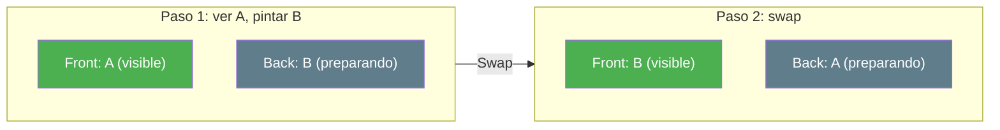

</div>
</div>

---

## El mecanismo de intercambio (Swap)

El Swap **no copia datos** — solo intercambia las **referencias** de los dos búferes. Por eso es constante: tiempo **O(1)**, sin importar el tamaño del array.

<div class="grid grid-cols-2 gap-5 items-start">
<div>

```csharp
// ✅ Swap: intercambiar referencias
int[] front = { 1, 2, 3 };
int[] back = { 4, 5, 6 };

// Solo intercambiar las referencias
(front, back) = (back, front);

// Ahora front = {4,5,6} y back = {1,2,3}
Console.WriteLine($"Front: [{string.Join(", ", front)}]");
Console.WriteLine($"Back: [{string.Join(", ", back)}]");
```

<TipBox type="advertencia">

Si en lugar de Swap haces una **copia** de los datos (`Array.Copy`), la operación pasa de **O(1)** a **O(n)** — mucho más lenta. El Swap es la clave de la eficiencia.

</TipBox>

</div>
<div>

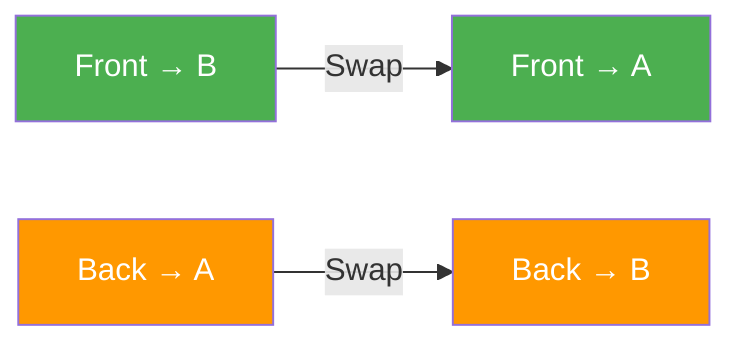

</div>
</div>

---

## Propagación de estado: calcular el siguiente sin tocar el actual

El Doble Búfer se usa para simular la **propagación de estado**: calcular el siguiente estado basándose en el actual, sin modificarlo mientras se calcula.

<div class="grid grid-cols-2 gap-5 items-start">
<div>

```csharp
int[] actual = { 0, 1, 1, 0, 1 };
int[] siguiente = new int[actual.Length];

// Calcular siguiente estado basándose en el actual
for (int i = 1; i < actual.Length - 1; i++)
{
    int vecinas = actual[i - 1] + actual[i + 1];
    siguiente[i] = vecinas == 2 ? 1 : 0;
}

// Swap cuando esté todo calculado
(actual, siguiente) = (siguiente, actual);
```

</div>
<div>

<RealExample app="Juego de la Vida">

En el juego de la Vida de Conway, cada célula se muere o nace según sus vecinas. El Doble Búfer asegura que todos los cálculos se hagan sobre el estado actual, y solo después se actualice el siguiente.

</RealExample>

</div>
</div>

---

## ¿Por qué es vital en desarrollo web? El *tearing*

Sin Doble Búfer, el navegador dibuja la página directamente en el buffer visible. Si el usuario hace scroll mientras se está dibujando, ve una imagen **a medio pintar** (tearing).

<div class="grid grid-cols-2 gap-5 items-start">
<div>

Con Doble Búfer:

1. El navegador prepara el siguiente frame en el **Back Buffer**
2. Cuando está listo, hace **Swap**
3. El usuario ve un frame **completo**, nunca uno a medio pintar

</div>
<div>

<TipBox type="nota">

En desarrollo web, el navegador gestiona el Doble Búfer automáticamente a través de la **GPU**. Los navegadores preparan el siguiente frame en un buffer oculto mientras tú ves el actual; por eso el scroll y las animaciones se ven fluidas.

</TipBox>

</div>
</div>

---

## Doble búfer completo: la propagación de una onda

Dos arrays alternan el papel de pantalla y de trabajo:

```csharp
// ✅ Doble búfer: propagación de una onda
int[] front = { 0, 0, 0, 0, 0, 0, 0, 0 };
int[] back = new int[front.Length];
front[front.Length / 2] = 1;   // Fuente en el centro
for (int frame = 0; frame < 5; frame++)
{
    Console.WriteLine($"Frame {frame}: " +
                      $"[{string.Join(", ", front)}]");
    // Calcular el siguiente estado en el búfer oculto
    for (int i = 1; i < front.Length - 1; i++)
    {
        int suma = front[i - 1] + front[i] + front[i + 1];
        back[i] = suma / 3;   // división entera
    }
    // Swap: intercambiar referencias (O(1))
    (front, back) = (back, front);
}
```

---

## Resumen del punto 4

<div class="grid grid-cols-2 gap-5 items-start">
<div>

| Concepto | Descripción |
|----------|-------------|
| **Doble Búfer** | Dos arrays: uno visible, otro preparándose |
| **Front Buffer** | El que se muestra en pantalla |
| **Back Buffer** | El que se está calculando |
| **Swap** | Intercambio de referencias — O(1) |
| **Tearing** | Imagen rota por mostrar frames a medio pintar |
| **Propagación de estado** | Calcular el siguiente sin modificar el actual |

</div>
<div>

<ConceptCard icon="✅" title="Buenas prácticas" accent="green">

- Usa **Swap** en lugar de copiar datos
- Calcula el siguiente estado sobre el actual
- Recuerda que es **O(1)**: solo referencias
- Aplícala en animaciones, juegos y desarrollo web

</ConceptCard>

<div class="mt-3">

**⏭️ ¿Qué viene después?** En el **punto 5** veremos las **cadenas de texto** en C#: su inmutabilidad, métodos esenciales y cómo construir textos eficientemente con `StringBuilder`.

</div>

</div>
</div>

<!-- FIN PARTE A -->

---
layout: section
---

<div class="ud-section-number">05</div>

# Cadenas de texto (string)

<div class="opacity-70">Inmutabilidad, métodos esenciales y construcción eficiente de texto</div>

---

## 5 · Punto de partida

<div class="grid grid-cols-2 gap-5 items-start">
<div>

<TipBox type="consejo" title="Punto de partida">

¿Alguna vez has copiado y pegado un texto largo en un editor y has notado que tarda? Eso es porque las cadenas de texto en C# son **inmutables**: cada vez que modificas una cadena, se crea una nueva en memoria. Entender esto es clave para escribir código eficiente.

</TipBox>

</div>
<div>

<Objetivos
  :items="[
    'Entender la inmutabilidad de `string` y sus implicaciones',
    'Pasar un string a una función (sin modificador, `ref` o `in`)',
    'Acceder y recorrer los caracteres de una cadena',
    'Usar los métodos esenciales (`Contains`, `Replace`, `Split`, `Join`)',
    'Construir texto eficientemente con `StringBuilder`',
    'Formatear números y fechas con `F2`, `C2` y `CultureInfo`',
  ]"
/>

</div>
</div>

---

## `string`: un tipo de referencia inmutable

Una **cadena** (`string`) es una secuencia de caracteres. Es un **tipo de referencia** y, lo más importante, es **inmutable**: una vez creada, no puede modificarse.

<div class="grid grid-cols-2 gap-5 items-start">
<div>

```csharp
string saludo = "Hola";
saludo[0] = 'M';  // ❌ ERROR: es inmutable
// Para cambiarlo, crea una nueva:
// saludo = "Mola";

string original = "Hola";
string nuevo = original.Replace('H', 'M');

Console.WriteLine(original);  // "Hola" — no cambia
Console.WriteLine(nuevo);     // "Mola" — cadena nueva
```

</div>
<div>

<TipBox type="analogia">

Imagina una cadena como una frase escrita con tinta indeleble en un papel. Puedes leerla, pero no puedes borrar una letra y cambiarla. Si quieres cambiar algo, debes escribir una **copia nueva** en otro papel.

</TipBox>

<RealExample app="Instagram">

Instagram almacena los captions de las fotos como strings inmutables. Cuando editas un caption, la app no modifica el original: crea una nueva versión. Así los comentarios antiguos no se corrompen.

</RealExample>

</div>
</div>

---

## Pasar un string a una función: los tres caminos

Un `string` es un **tipo de referencia**: al llamar a una función viaja una **copia de la dirección**, no el texto. Igual que con los arrays, hay tres caminos.

<div class="grid grid-cols-2 gap-5 items-start">
<div>

```csharp
// 1) Sin modificador: reasigna SU copia
void SinRef(string s) { s = "nuevo"; }

// 2) Con ref: reescribe la DEL LLAMADOR
void ConRef(ref string s) { s = "nuevo"; }

// 3) Con in: solo lectura → reasignar no compila
void ConIn(in string s)
{
    // s = "nuevo";  // ❌ ERROR CS8331
    Console.WriteLine(s);
}
```

</div>
<div>

```csharp
string original = "hola";

SinRef(original);
Console.WriteLine(original);  // "hola" — se perdió

ConRef(ref original);
Console.WriteLine(original);  // "nuevo" — ¡ahora sí!
```

<TipBox type="nota">

En los strings **no existe** el caso "escribir en el contenido": son inmutables. Por eso aquí `in` es protección completa.

</TipBox>

</div>
</div>

---

## Los tres caminos, resumidos

<div class="grid grid-cols-2 gap-5 items-start">
<div>

| Camino | ¿Reasigna la variable? | ¿Cambia el texto? | Mecanismo |
|---------|------------------------|-------------------|-----------|
| *(ninguno)* | Sí, pero **se pierde** | No (inmutable) | Copia la dirección |
| `ref` | Sí, **llega** | No (inmutable) | Pasa la variable |
| `in` | ❌ Error CS8331 | No (inmutable) | Dirección de solo lectura |

</div>
<div>

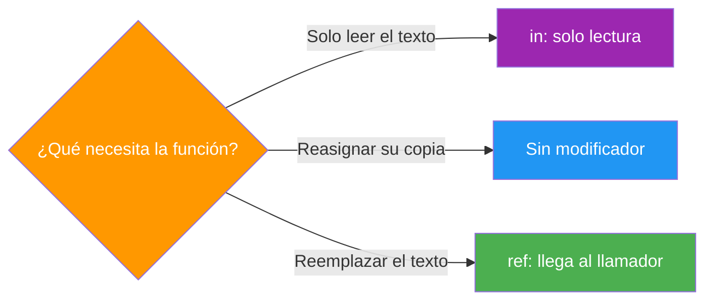

</div>
</div>

---

## Acceso y recorrido: como un array de caracteres

Las cadenas funcionan como arrays de caracteres: puedes acceder a cada carácter por su índice y recorrerla con bucles.

<div class="grid grid-cols-2 gap-5 items-start">
<div>

```csharp
string nombre = "DAW";

Console.WriteLine(nombre.Length);   // 3
Console.WriteLine(nombre[0]);      // 'D'
Console.WriteLine(nombre[nombre.Length - 1]);  // 'W'
```

```csharp
string mensaje = "Hola, DAW!";

// ✅ Con for (cuando necesitas el índice)
for (int i = 0; i < mensaje.Length; i++)
    Console.Write($"{mensaje[i]} ");

// ✅ Con foreach (solo lectura)
foreach (char c in mensaje)
    Console.Write($"{c} ");
```

</div>
<div>

<TipBox type="consejo">

Si necesitas **modificar** caracteres, convierte la cadena a `char[]` con `.ToCharArray()`, modifica el array y vuelve a crear la cadena.

</TipBox>

```csharp
string original = "hola";
char[] caracteres = original.ToCharArray();
caracteres[0] = char.ToUpper(caracteres[0]);
string resultado = new string(caracteres);
Console.WriteLine(resultado);  // "Hola"
```

</div>
</div>

---

## Los métodos que usarás todos los días

Los métodos de `string` son atajos que te ahorran horas de código manual.

| Método | Qué hace | Ejemplo |
|---|---|---|
| `.Length` | Número de caracteres | `"DAW".Length` → `3` |
| `.Contains(t)` | ¿Contiene el texto? | `"Hola".Contains("ol")` → `true` |
| `.Replace(a, b)` | Reemplaza todas | `"aaba".Replace("a","x")` → `"xxbx"` |
| `.Substring(i, n)` | Extrae una porción | `"Hola".Substring(1,2)` → `"ol"` |
| `.Split(s)` | Divide en array | `"a,b,c".Split(',')` → 3 partes |
| `.IndexOf(t)` | Posición | `"Hola".IndexOf("la")` → `2` |

---

## Los mismos métodos, en acción

<div class="grid grid-cols-2 gap-5 items-start">
<div>

```csharp
string email = "usuario@ejemplo.com";

bool tieneArroba = email.Contains("@");
bool empiezaConU = email.StartsWith("usuario");
bool terminaConCom = email.EndsWith(".com");
int posicionArroba = email.IndexOf("@");

Console.WriteLine($"Tiene @: {tieneArroba}");
Console.WriteLine($"Posición @: {posicionArroba}");
```

</div>
<div>

<TipBox type="nota">

`$"texto {variable}"` es la **interpolación**: la forma moderna de concatenar.

</TipBox>

<TipBox type="truco">

`Contains`, `StartsWith` y `EndsWith` devuelven `bool`: se usan casi siempre dentro de un `if`.

</TipBox>

</div>
</div>

---

## Dividir y unir: `Split` y `Join`

Cuando un texto trae varios datos separados, `Split` los parte en un array; `Join` hace el camino inverso.

<div class="grid grid-cols-2 gap-5 items-start">
<div>

```csharp
string lista = "Luna,Marta,Ana";

// Divide en un array de 3 partes
string[] nombres = lista.Split(',');
Console.WriteLine(nombres.Length);  // 3

// Une un array en una sola cadena
string unido = string.Join("-", "L", "M", "X");
Console.WriteLine(unido);           // "L-M-X"
```

</div>
<div>

<RealExample app="Spotify">

Spotify usa `.Split()` para separar los artistas de una canción cuando tienen varios nombres. Si el campo es `"Artista1, Artista2, Artista3"`, el `.Split(',')` crea un array de 3 artistas que se muestran por separado.

</RealExample>

<TipBox type="nota">

`Split` devuelve un **array** de cadenas (los arrays del punto 2) y `Join` vuelve a convertirlas en **una sola cadena**.

</TipBox>

</div>
</div>

---

## El problema: `+` en un bucle crea una cadena nueva

Como `string` es inmutable, cada concatenación con `+` crea una **nueva cadena**. En bucles largos, esto es extremadamente lento.

<div class="grid grid-cols-2 gap-5 items-start">
<div>

```csharp
// ❌ LENTO: crea 1000 cadenas intermedias
string resultado = "";
for (int i = 0; i < 1000; i++)
{
    resultado += $"Línea {i}\n";  // cada + crea otra
}
```

</div>
<div>

| Operación | Complejidad | Descripción |
|---|---|---|
| **Concatenación `+`** | `O(n²)` | Cada paso crea una cadena nueva |
| **`StringBuilder.Append()`** | `O(n)` | Modifica un buffer interno |

<TipBox type="analogia">

Es como reescribir toda la carta cada vez que añades una palabra... o escribirla de corrido en un borrador.

</TipBox>

</div>
</div>

---

## `StringBuilder`: la solución

`StringBuilder` mantiene un **buffer interno** y va añadiendo sin crear una cadena nueva en cada vuelta.

<div class="grid grid-cols-2 gap-5 items-start">
<div>

```csharp
using System.Text;

// ✅ RÁPIDO: modificar un buffer interno
var sb = new StringBuilder();
for (int i = 0; i < 1000; i++)
{
    sb.Append($"Línea {i}\n");
}
string resultado = sb.ToString();
Console.WriteLine($"Longitud: {resultado.Length}");
```

| Método | Qué hace |
|---|---|
| `new StringBuilder()` | Crea un buffer vacío |
| `.Append(valor)` | Añade texto sin crear cadenas |
| `.ToString()` | Convierte el buffer a `string` |

</div>
<div>

<TipBox type="truco">

Si usas `+` más de **3 veces** en un bucle, cambia a `StringBuilder`.

</TipBox>

<RealExample app="Gmail">

Los servidores de email (Gmail, Outlook) usan `StringBuilder` para construir los headers de miles de emails por segundo. Usar `+` sería tan lento que el servidor se colapsaría.

</RealExample>

</div>
</div>

---

## Curiosidad: el pool de cadenas (String Interning)

Si creas dos variables con el mismo **literal**, C# hace que apunten a la **misma dirección** de memoria.

<div class="grid grid-cols-2 gap-5 items-start">
<div>

```csharp
string a = "Hola";
string b = "Hola";

Console.WriteLine(
    object.ReferenceEquals(a, b));  // true
```

</div>
<div>

<TipBox type="nota">

Esto funciona porque `string` es **inmutable**: no hay riesgo de que un cambio en `a` afecte a `b`. El compilador optimiza ahorrando memoria.

</TipBox>

<TipBox type="nota">

El *String Interning* es automático para los **literales**. Si creas cadenas con `new string(...)`, cada una tendrá su propia dirección de memoria.

</TipBox>

</div>
</div>

---

## Formato de números: `F2` y `N2`

Los datos guardados en el programa no son presentables tal cual: `6.5` no es un precio de tienda. El **formato** lo convierte en algo legible.

<div class="grid grid-cols-2 gap-5 items-start">
<div>

```csharp
double precio = 1234.5678;
double nota = 7.6666;

// F2: dos decimales fijos (redondea)
Console.WriteLine(precio.ToString("F2"));  // 1234,57
Console.WriteLine($"{nota:F2}");           // 7,67

// N2: dos decimales + separador de miles
Console.WriteLine(precio.ToString("N2"));  // 1.234,57
```

</div>
<div>

| Especificador | Qué muestra | Ejemplo |
|---|---|---|
| `F2` | Dos decimales fijos | `7,67` |
| `N2` | Con separador de miles | `1.234,57` |

<TipBox type="consejo">

Usa `F2` cuando el número es el dato exacto (una nota, un precio) y `N2` cuando además quieras que se lean bien las cantidades grandes (facturas, estadísticas).

</TipBox>

</div>
</div>

---

## Moneda y cultura: `C2` y `CultureInfo`

La **cultura** decide el símbolo, el separador decimal y el formato de fecha: con `es-ES`, `6.5` se escribe `6,50 €`; con `en-US`, `$6.50`.

<div class="grid grid-cols-2 gap-5 items-start">
<div>

```csharp
using System.Globalization;

var es = new CultureInfo("es-ES");

double precio = 6.5;
double total = 1250.8;

// C (o C2): moneda según la cultura
Console.WriteLine(precio.ToString("C2", es));  // 6,50 €
Console.WriteLine(total.ToString("C", es));  // 1.250,80 €
```

</div>
<div>

<TipBox type="consejo">

Fija siempre la cultura con `CultureInfo`. Si te la saltas, el resultado depende del ordenador donde se ejecute.

</TipBox>

<RealExample app="La app del cine">

La práctica del cine imprime cada entrada con `precio.ToString("C2", Configuracion.Locale)`: por eso en la consola sale `6,50 €` y no `6.5`. Si mañana lo ejecuta un compañero con el equipo en inglés, seguirá saliendo `6,50 €` porque la cultura va en el código.

</RealExample>

</div>
</div>

---

## Fechas con formato

Las fechas se formatean igual que los números: `ToString(formato, cultura)`, donde el formato es una plantilla de letras.

<div class="grid grid-cols-2 gap-5 items-start">
<div>

```csharp
using System.Globalization;

var es = new CultureInfo("es-ES");
DateTime fecha = new(2026, 12, 25, 18, 30, 0);

Console.WriteLine(fecha.ToString("dd/MM/yyyy", es));
Console.WriteLine(fecha.ToString("dd-MM-yyyy HH:mm", es));
Console.WriteLine(fecha.ToString("g", es));
// 25/12/2026 · 25-12-2026 18:30 · 25/12/2026 18:30
```

</div>
<div>

| Formato | Qué significa |
|---|---|
| `dd` | Día con dos dígitos |
| `MM` | Mes |
| `yyyy` | Año |
| `HH` | Hora en 24 horas |

<TipBox type="advertencia">

Cuidado con el orden: `dd/MM/yyyy` es el formato europeo (día primero) y `MM/dd/yyyy` el americano (mes primero). Sin darse cuenta, un `05/12` puede leerse como el 5 de diciembre o como el 12 de mayo.

</TipBox>

</div>
</div>

---

## Resumen del punto 5

<div class="grid grid-cols-2 gap-5 items-start">
<div>

| Concepto | Descripción |
|---|---|
| **Inmutabilidad** | `string` no se puede modificar: cada cambio crea una nueva |
| **Tipo de referencia** | Guarda la dirección, no el valor |
| **Paso a funciones** | Sin modificador: se pierde · `ref`: llega · `in`: error CS8331 |
| **Acceso por índice** | `cadena[i]` devuelve el carácter de la posición i |
| **Métodos esenciales** | `Contains`, `Replace`, `Split`, `Join`, `Substring` |
| **`StringBuilder`** | Buffer mutable para construir texto eficientemente |
| **String Interning** | Literales iguales comparten memoria |
| **`F2` / `N2` / `C2`** | Formato de números y moneda con `CultureInfo` |

</div>
<div>

<ConceptCard icon="✅" title="Buenas prácticas" accent="green">

- Recuerda que `string` es **inmutable**
- `StringBuilder` si concatenas más de 3 veces en un bucle
- Interpolación `$"{variable}"` en vez de `+`
- Fija siempre la **cultura** al formatear

</ConceptCard>

<div class="mt-3">

**⏭️ ¿Qué viene después?** En el **punto 6**: las **expresiones regulares** — patrones para validar y buscar texto.

</div>

</div>
</div>

---
layout: section
---

<div class="ud-section-number">06</div>

# Expresiones regulares (Regex)

<div class="opacity-70">Patrones de búsqueda y validación de texto</div>

---

## 6 · Punto de partida

<div class="grid grid-cols-2 gap-5 items-start">
<div>

<TipBox type="consejo" title="Punto de partida">

¿Alguna vez has tenido que validar si un email es correcto, si un teléfono tiene 9 dígitos o si un DNI tiene el formato adecuado? Hacerlo con `if` y `.Contains()` es tedioso y propenso a errores. Las **expresiones regulares** resuelven esto con un solo patrón.

</TipBox>

</div>
<div>

<Objetivos
  :items="[
    'Entender qué es una expresión regular y para qué sirve',
    'Conocer los metacaracteres esenciales',
    'Usar `Regex` para validar, buscar, extraer y sustituir texto',
    'Crear patrones comunes (email, teléfono, DNI, fecha)',
  ]"
/>

</div>
</div>

---

## ¿Qué es una expresión regular?

Una **expresión regular** (regex) es un **patrón de búsqueda** que describe un conjunto de cadenas de texto. Se usa para validar, buscar, extraer y sustituir texto de forma declarativa.

<div class="grid grid-cols-2 gap-5 items-start">
<div>

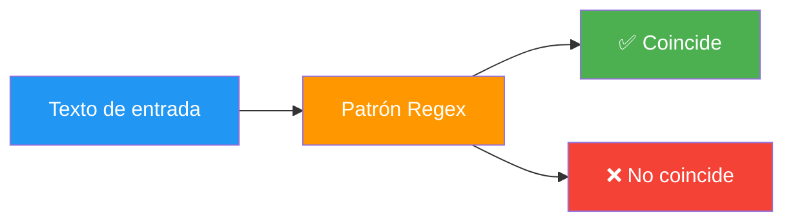

<TipBox type="analogia">

Si buscar "texto" en Google es como usar `.Contains()`, una regex es como decir "quiero un email que empiece por letras, tenga una @, después un dominio y termine en .com".

</TipBox>

</div>
<div>

<RealExample app="Instagram">

Instagram usa expresiones regulares para validar usernames. Cuando escribes un nombre de usuario, la app verifica con una regex que solo contenga letras, números, puntos y guiones bajos, y que tenga entre 3 y 30 caracteres.

</RealExample>

</div>
</div>

---

## Los metacaracteres esenciales

Los metacaracteres son los símbolos especiales que le dan sentido al patrón.

<div class="grid grid-cols-2 gap-4 items-start">
<div>

| Metacarácter | Significado | Ejemplo |
|---|---|---|
| `.` | Cualquier carácter | `a.c` → "abc", "a1c" |
| `\d` | Dígito (0-9) | `\d\d` → "42" |
| `\w` | Letra, dígito o `_` | `\w+` → "hola_123" |
| `\s` | Espacio en blanco | `a\sb` → "a b" |
| `+` | Una o más veces | `a+` → "a", "aa" |
| `*` | Cero o más veces | `a*` → "", "a", "aa" |

</div>
<div>

| Metacarácter | Significado | Ejemplo |
|---|---|---|
| `?` | Cero o una vez | `colou?r` → "color" |
| `{n}` | Exactamente n veces | `\d{3}` → "123" |
| `{n,m}` | Entre n y m veces | `\d{2,4}` → "12" |
| `^` | Inicio de cadena | `^Hola` → "Hola mundo" ✅ |
| `$` | Fin de cadena | `mundo$` → "Hola mundo" ✅ |
| `[abc]` | Cualquier carácter del conjunto | `[aeiou]` → vocal |
| `(abc)` | Grupo de captura | `(http\|https)` |

</div>
</div>

---

## Regex en C#: siempre con `@""`

En C# los patrones se escriben como **verbatim strings** (`@"..."`), porque los metacaracteres empiezan por `\`.

<div class="grid grid-cols-2 gap-5 items-start">
<div>

```csharp
using System.Text.RegularExpressions;

// ✅ Validar 3 dígitos exactos
string patron = @"^\d{3}$";

Console.WriteLine(Regex.IsMatch("123", patron));  // true
Console.WriteLine(Regex.IsMatch("12", patron));   // false
Console.WriteLine(Regex.IsMatch("1234", patron)); // false
```

</div>
<div>

<TipBox type="advertencia">

Usa `@""` para las regex. Sin ella, `\d` causa un **error de compilación** ("Unrecognized escape sequence").

</TipBox>

<TipBox type="nota">

El `^` ancla el patrón al **inicio** y el `$` al **fin**: sin ellos, "123" también estaría dentro de "12345".

</TipBox>

</div>
</div>

---

## Validar: `Regex.IsMatch`

`IsMatch` responde `true` o `false` a la pregunta "¿este texto cumple el patrón?".

<div class="grid grid-cols-2 gap-5 items-start">
<div>

```csharp
using System.Text.RegularExpressions;

// ✅ Email básico (versión simplificada)
string patronEmail =
    @"^[a-z0-9._%+-]+@[a-z0-9.-]+\.[a-z]{2,}$";

string email = "usuario@ejemplo.com";

bool esValido = Regex.IsMatch(email, patronEmail);
Console.WriteLine($"'{email}' es válido: {esValido}");
// 'usuario@ejemplo.com' es válido: True
```

</div>
<div>

<TipBox type="nota">

Un **patrón** no es más que una cadena de texto con los metacaracteres dentro: puedes construirlo por partes o guardarlo en una constante.

</TipBox>

</div>
</div>

---

## Buscar: `Match` y `Matches`

Cuando el texto cumple el patrón y quieres sacar lo encontrado: `Match` devuelve la **primera** coincidencia y `Matches`, **todas**.

<div class="grid grid-cols-2 gap-5 items-start">
<div>

```csharp
string texto =
    "Mi número es 612-345-678 y otro es 911-222-333";

// ✅ Primera coincidencia
Match primera = Regex.Match(texto, @"\d{3}-\d{3}-\d{3}");
if (primera.Success)
    Console.WriteLine($"Primero: {primera.Value}");
// Primero: 612-345-678
```

</div>
<div>

```csharp
// ✅ Todas las coincidencias
MatchCollection todas =
    Regex.Matches(texto, @"\d{3}-\d{3}-\d{3}");

foreach (Match m in todas)
    Console.WriteLine($"Encontrado: {m.Value}");
```

<TipBox type="nota">

`Match` y `Matches` devuelven **objetos**, no cadenas: por eso se consulta `.Success` y `.Value`.

</TipBox>

</div>
</div>

---

## Extraer datos: los grupos de captura

Los **paréntesis** `()` definen **grupos de captura**: cada paréntesis captura una parte del texto y se accede con `Groups[1]`, `Groups[2]`... (el grupo 0 es la coincidencia completa).

<div class="grid grid-cols-2 gap-5 items-start">
<div>

```csharp
string log = "ERROR 2024-01-15: Archivo no encontrado";

// Grupo 1: año · Grupo 2: mes · Grupo 3: día
Match c = Regex.Match(log, @"(\d{4})-(\d{2})-(\d{2})");

if (c.Success)
{
    Console.WriteLine($"Año: {c.Groups[1].Value}"); // 2024
    Console.WriteLine($"Mes: {c.Groups[2].Value}"); // 01
    Console.WriteLine($"Día: {c.Groups[3].Value}"); // 15
}
```

</div>
<div>

<TipBox type="nota">

El **grupo 0** es la coincidencia entera; los grupos numerados empiezan en el **1**.

</TipBox>

</div>
</div>

---

## Sustituir: `Regex.Replace`

En el segundo argumento de `Replace`, `$1` se sustituye por el contenido del primer grupo de captura, `$2` por el segundo, y así sucesivamente.

<div class="grid grid-cols-2 gap-5 items-start">
<div>

```csharp
string texto =
    "La fruta (manzana) y la verdura (lechuga) son sanas.";

// ✅ Eliminar el contenido entre paréntesis
string limpio = Regex.Replace(texto, @"\s*\(.*?\)", "");
Console.WriteLine(limpio);
// La fruta y la verdura son sanas.

// ✅ Enmascarar un teléfono: $1, $2, $3
string conMascara = Regex.Replace(
    "612345678", @"(\d{3})(\d{3})(\d{3})", "$1-$2-$3");
Console.WriteLine(conMascara);   // 612-345-678
```

</div>
<div>

<TipBox type="truco">

El patrón `.*?` (con `?` al final) es **no codicioso**: captura lo mínimo. Aquí es justo lo que quieres para eliminar el primer paréntesis.

</TipBox>

</div>
</div>

---

## La tabla maestra: patrones que usarás siempre

Estos son los patrones que se repiten en cualquier validación.

| Objetivo | Patrón | Explicación |
|---|---|---|
| **Solo dígitos** | `@"^\d+$"` | Una o más cifras |
| **Teléfono (9 dígitos)** | `@"^\d{9}$"` | Exactamente 9 cifras |
| **DNI (8 números + letra)** | `@"^\d{8}[A-Za-z]$"` | 8 dígitos + letra |
| **Email básico** | `@"^[a-z0-9._%+-]+@[a-z0-9.-]+\.[a-z]{2,}$"` | local@dominio.tld |
| **Fecha (DD/MM/AAAA)** | `@"^\d{2}/\d{2}/\d{4}$"` | 2d / 2d / 4d |
| **URL (HTTP/HTTPS)** | `@"^(http\|https)://\w+\.\w+"` | protocolo://dominio |
| **Código postal (5 cifras)** | `@"^\d{5}$"` | 5 dígitos |

<RealExample app="Amazon">

Amazon usa regex para validar direcciones de envío: verifica que el código postal tenga exactamente 5 dígitos antes de aceptarlo.

</RealExample>

---

## La codicia: cuidado con `+` y `*`

Por defecto, los cuantificadores (`+`, `*`) son **codiciosos**: intentan capturar la mayor cantidad de texto posible.

<div class="grid grid-cols-2 gap-5 items-start">
<div>

```csharp
string html = "<div>Hola</div>";

// ❌ Captura TODO (codicioso)
string codicioso = Regex.Match(html, @"<.*>").Value;
Console.WriteLine(codicioso);  // <div>Hola</div>

// ✅ Captura solo el primer tag (lazy)
string lazy = Regex.Match(html, @"<.*?>").Value;
Console.WriteLine(lazy);       // <div>
```

</div>
<div>

<TipBox type="consejo">

Siempre usa `?` después de `+` o `*` cuando valides HTML o XML. Sin él, la regex captura demasiado texto.

</TipBox>

</div>
</div>

---

## Resumen del punto 6

<div class="grid grid-cols-2 gap-5 items-start">
<div>

| Concepto | Descripción |
|---|---|
| **Expresión regular** | Patrón de búsqueda y validación de texto |
| **Metacaracteres** | `\d`, `\w`, `+`, `*`, `^`, `$`, `[]` |
| **`Regex.IsMatch()`** | `true` si el texto cumple el patrón |
| **`Regex.Match()`** | Devuelve la primera coincidencia |
| **`Regex.Matches()`** | Devuelve todas las coincidencias |
| **`Regex.Replace()`** | Sustituye el texto que cumple el patrón |
| **Greediness** | `+`/`*` son codiciosos: añade `?` para hacerlos *lazy* |
| **Verbatim string** | Siempre `@""` para las regex en C# |

</div>
<div>

<ConceptCard icon="✅" title="Buenas prácticas" accent="green">

- Siempre `@""` para los patrones
- Ancla con `^` y `$` para evitar coincidencias parciales
- `?` después de `+` o `*` para hacer la regex *lazy*
- Prueba las regex con casos **válidos e inválidos**
- No abuses de regex: `.Contains()` o `.StartsWith()` si basta

</ConceptCard>

<div class="mt-3">

**⏭️ ¿Qué viene después?** En el **punto 7**: los **algoritmos de ordenación y búsqueda** y la notación Big O.

</div>

</div>
</div>

---
layout: section
---

<div class="ud-section-number">07</div>

# Algoritmos de ordenación y búsqueda

<div class="opacity-70">Big O, algoritmos de ordenación y de búsqueda</div>

---

## 7 · Punto de partida

<div class="grid grid-cols-2 gap-5 items-start">
<div>

<TipBox type="consejo" title="Punto de partida">

¿Alguna vez has abierto Netflix y has visto que las películas están ordenadas por "Más populares", "Estrenos recientes" o "Mi lista"? Detrás de ese orden hay algoritmos. Pero, ¿cuál es el mejor? ¿El más rápido siempre es el mejor?

</TipBox>

</div>
<div>

<Objetivos
  :items="[
    'Entender la notación Big O y comparar rendimientos',
    'Implementar los algoritmos de ordenación básicos',
    'Implementar búsqueda lineal, binaria y binaria recursiva',
    'Saber cuándo usar cada algoritmo según el contexto',
  ]"
/>

</div>
</div>

---

## Big O: cómo comparar el rendimiento

Antes de ver algoritmos necesitamos una forma de **comparar** cuán rápido es cada uno. La **notación Big O** describe cómo crece el tiempo de ejecución cuando aumentan los datos de entrada.

<div class="grid grid-cols-2 gap-5 items-start">
<div>

| Big O | Nombre | Significado | Ejemplo |
|---|---|---|---|
| `O(1)` | Constante | Siempre el mismo tiempo | Acceder a `array[5]` |
| `O(log n)` | Logarítmico | Cada paso divide por la mitad | Búsqueda Binaria |
| `O(n)` | Lineal | Recorrer todo una vez | Búsqueda Lineal |
| `O(n log n)` | Lineal-logarítmico | Bueno para ordenar | QuickSort (promedio) |
| `O(n²)` | Cuadrático | Doble bucle anidado | Burbuja, Selección |

</div>
<div>

<TipBox type="truco">

Piensa en `n` como el número de elementos. Con `n = 1.000.000`: `O(1)` = 1 operación, `O(log n)` ≈ 20, `O(n)` = un millón, `O(n²)` = un billón (¡nunca termina!).

</TipBox>

<TipBox type="analogia">

Es como buscar un libro en una biblioteca: si tiene 100 libros tardas poco; si tiene 1.000.000, tardas mucho más. Big O dice **cuánto más**.

</TipBox>

</div>
</div>

---

## Un algoritmo "estable" mantiene el orden de los iguales

Un algoritmo es **estable** si mantiene el orden original de los elementos que tienen el mismo valor: si tienes dos películas con rating 5 y la primera aparece antes en la lista, después de ordenar la primera sigue estando antes.

<div class="grid grid-cols-2 gap-5 items-start">
<div>

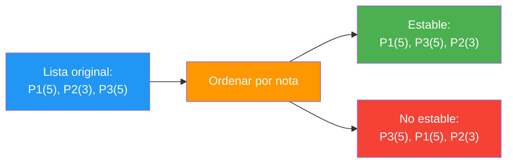

</div>
<div>

<RealExample app="Netflix">

Netflix usa algoritmos estables para ordenar tu lista de favoritos: si dos películas tienen la misma prioridad, mantiene el orden en que las añadiste.

</RealExample>

<TipBox type="nota">

La estabilidad importa cuando ordenas por **varios criterios**: primero por apellido y luego por nota, sin romper el primer criterio.

</TipBox>

</div>
</div>

---

## Burbuja (Bubble Sort)

Compara elementos **adyacentes** y los intercambia si están desordenados. Los mayores "burbujean" hacia el final, como burbujas que suben en el agua.

<div class="grid grid-cols-2 gap-5 items-start">
<div>

```csharp
void Burbuja(int[] arr)
{
    for (int i = 0; i < arr.Length - 1; i++)
    {
        bool intercambio = false;
        for (int j = 0; j < arr.Length - 1 - i; j++)
            if (arr[j] > arr[j + 1])
            {
                (arr[j], arr[j + 1]) = (arr[j + 1], arr[j]);
                intercambio = true;
            }
        // Sin intercambios: ya está ordenado
        if (!intercambio) break;
    }
}
```

</div>
<div>

| Aspecto | Evaluación |
|---|---|
| **Mejor caso** | `O(n)` — ya ordenado (con optimización) |
| **Peor caso** | `O(n²)` — orden inverso |
| **Estable** | ✅ Sí — preserva el orden de los iguales |
| **Uso** | Didáctico, arrays pequeños |

<RealExample app="Casting de televisión">

En un casting, los directores ordenan a los actores por altura usando burbuja: comparan dos personas de pie una al lado de la otra, y si el de la izquierda es más alto, cambian de posición.

</RealExample>

</div>
</div>

---

## Selección (Selection Sort)

Es como si organizaras un estante de libros: miras todos los libros, encuentras el más pequeño y lo pones en la primera posición. Luego repites con el resto.

<div class="grid grid-cols-2 gap-5 items-start">
<div>

```csharp
void Seleccion(int[] arr)
{
    for (int i = 0; i < arr.Length - 1; i++)
    {
        int minIdx = i;
        for (int j = i + 1; j < arr.Length; j++)
        {
            if (arr[j] < arr[minIdx])
                minIdx = j;
        }
        (arr[i], arr[minIdx]) = (arr[minIdx], arr[i]);
    }
}
```

</div>
<div>

| Aspecto | Evaluación |
|---|---|
| **Mejor caso** | `O(n²)` — siempre compara todo |
| **Peor caso** | `O(n²)` |
| **Estable** | ❌ No — puede cambiar el orden de los iguales |
| **Uso** | Cuando el intercambio es costoso (pocos intercambios) |

<RealExample app="Un DJ">

Un DJ que ordena sus discos por año de publicación: escanea todos los discos, encuentra el más antiguo, lo pone primero. Luego busca el siguiente más antiguo del resto.

</RealExample>

</div>
</div>

---

## Inserción (Insertion Sort)

Es exactamente como ordenar cartas en la mano: tomas una carta y la **insertas** en su posición correcta entre las que ya tienes ordenadas, desplazando las demás a la derecha.

<div class="grid grid-cols-2 gap-5 items-start">
<div>

```csharp
void Insercion(int[] arr)
{
    for (int i = 1; i < arr.Length; i++)
    {
        int clave = arr[i];
        int j = i - 1;
        while (j >= 0 && arr[j] > clave)
        {
            arr[j + 1] = arr[j];
            j--;
        }
        arr[j + 1] = clave;
    }
}
```

</div>
<div>

| Aspecto | Evaluación |
|---|---|
| **Mejor caso** | `O(n)` — casi ordenado |
| **Peor caso** | `O(n²)` — orden inverso |
| **Estable** | ✅ Sí |
| **Uso** | Arrays pequeños o casi ordenados |

<RealExample app="Netflix">

Netflix usa Inserción para ordenar tu "Lista de favoritos" cuando añades una sola película: como tiene pocos elementos, es rápido y estable.

</RealExample>

</div>
</div>

---

## Shell Sort: inserción con brechas

Una mejora de Inserción: el problema de Inserción es que mueve elementos de uno en uno. Shell Sort dice "¿por qué no saltar varios sitios a la vez?" y va reduciendo el *gap* hasta 1.

<div class="grid grid-cols-2 gap-5 items-start">
<div>

```csharp
void ShellSort(int[] arr)
{
    int n = arr.Length;
    for (int gap = n / 2; gap > 0; gap /= 2)
        for (int i = gap; i < n; i++)
        {
            int temp = arr[i];
            int j = i;
            while (j >= gap && arr[j - gap] > temp)
            {
                arr[j] = arr[j - gap];
                j -= gap;
            }
            arr[j] = temp;
        }
}
```

</div>
<div>

| Aspecto | Evaluación |
|---|---|
| **Mejor caso** | `O(n log n)` |
| **Promedio** | `O(n^1.5)` — depende de la secuencia de gaps |
| **Peor caso** | `O(n²)` según el gap |
| **Estable** | ❌ No |
| **Uso** | Buen compromiso para arrays medianos |

<RealExample app="Motores de bases de datos">

Los motores de bases de datos usan Shell Sort internamente para ordenar pequeños bloques de datos antes de fusionarlos con QuickSort.

</RealExample>

</div>
</div>

---

## QuickSort: divide y vencerás

El algoritmo de ordenación por **"Divide y Vencerás"** más utilizado: eliges una carta como **pivote**, pones las menores a la izquierda y las mayores a la derecha, y repites con cada subpila.

<div class="grid grid-cols-2 gap-5 items-start">
<div>

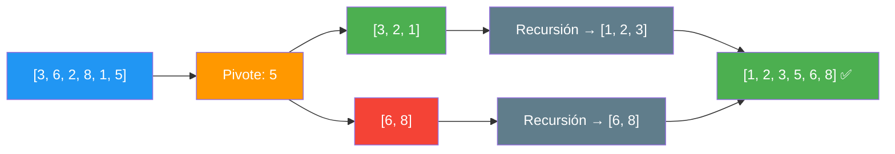

</div>
<div>

<RealExample app="Google Search">

El método de ordenación de Google Search usa QuickSort internamente para ordenar millones de resultados por relevancia. Por eso aparecen tan rápido.

</RealExample>

```csharp
void QuickSort(int[] arr, int bajo, int alto)
{
    if (bajo < alto)
    {
        int pivote = Partition(arr, bajo, alto);
        QuickSort(arr, bajo, pivote - 1);
        QuickSort(arr, pivote + 1, alto);
    }
}
```

</div>
</div>

---

## QuickSort: el código

La parte que hace el trabajo pesado es `Partition`: coloca el pivote en su sitio final.

<div class="grid grid-cols-2 gap-5 items-start">
<div>

```csharp
int Partition(int[] arr, int bajo, int alto)
{
    int pivote = arr[alto];
    int i = bajo - 1;
    for (int j = bajo; j < alto; j++)
    {
        if (arr[j] < pivote)
        {
            i++;
            (arr[i], arr[j]) = (arr[j], arr[i]);
        }
    }
    (arr[i + 1], arr[alto]) = (arr[alto], arr[i + 1]);
    return i + 1;
}
```

</div>
<div>

<TipBox type="nota">

El **caso base no es el fin**: si `bajo < alto` no se cumple, la llamada hace `return`.

</TipBox>

</div>
</div>

---

## QuickSort: complejidad

<div class="grid grid-cols-2 gap-5 items-start">
<div>


</div>
<div>

| Aspecto | Evaluación |
|---|---|
| **Mejor caso** | `O(n log n)` |
| **Peor caso** | `O(n²)` — pivote mal elegido |
| **Estable** | ❌ No |
| **Uso** | El más rápido en la práctica |

</div>
</div>

---

## Merge Sort: divide y combina

Es el "divide y vencerás" en estado puro: cortas el array por la mitad hasta quedarte con trozos de **un solo elemento** y luego **combinas** esos trozos de dos en dos.


<div class="grid grid-cols-2 gap-4 mt-4 items-start">
<div>

<TipBox type="analogia">

Tienes que ordenar la lista de invitados de una boda por apellido. En vez de ordenarla tú solo, le dices a un amigo que ordene la primera mitad y a otro la segunda; luego **mezcláis** las dos listas ya ordenadas cogiendo siempre el apellido que va antes.

</TipBox>

</div>
<div>

<RealExample app="Dos mazos de cartas">

Es exactamente lo que hace quien reparte dos mazos de cartas ya ordenados: miras la carta de arriba de cada mazo, te quedas la menor y repites. Cuando un mazo se queda sin cartas, vacías el otro entero tal cual.

</RealExample>

</div>
</div>

---

## Merge Sort: el código

Lo delicado es el paso de **combinar** (`Merge`): se recorren las dos mitades con dos punteros, siempre se coge el elemento menor y se deja en un array auxiliar.

<div class="grid grid-cols-2 gap-5 items-start">
<div>

```csharp
void MergeSort(int[] arr, int izq, int der)
{
    // Caso base: un solo elemento ya está ordenado
    if (izq >= der) return;
    int medio = izq + (der - izq) / 2;
    MergeSort(arr, izq, medio);
    MergeSort(arr, medio + 1, der);
    Merge(arr, izq, medio, der);
}
```

</div>
<div>

```csharp
void Merge(int[] arr, int izq, int medio, int der)
{
    int[] tmp = new int[der - izq + 1];
    int i = izq, j = medio + 1, k = 0;
    while (i <= medio && j <= der)
    {
        if (arr[i] <= arr[j]) tmp[k++] = arr[i++];
        else tmp[k++] = arr[j++];
    }
    while (i <= medio) tmp[k++] = arr[i++];
    while (j <= der) tmp[k++] = arr[j++];
    for (int m = 0; m < tmp.Length; m++)
        arr[izq + m] = tmp[m];
}
```

</div>
</div>

---

## Merge Sort: cuándo elegirlo

<div class="grid grid-cols-2 gap-5 items-start">
<div>


| Aspecto | Evaluación |
|---|---|
| **Mejor caso** | `O(n log n)` |
| **Peor caso** | `O(n log n)` — siempre, no depende de los datos |
| **Estable** | ✅ Sí |
| **Espacio** | `O(n)` — necesita el array auxiliar `tmp` |

</div>
<div>

<TipBox type="advertencia">

Merge Sort necesita un **array auxiliar** del tamaño del trozo que mezclas: gasta `O(n)` de memoria. A cambio es el único de los que has visto que **nunca cae por debajo de `O(n log n)`**.

</TipBox>

<TipBox type="truco">

QuickSort gana en la práctica porque trabaja *in place*; Merge Sort gana en **previsibilidad** y en **estabilidad**. Si el examen pregunta "¿cuál es siempre `O(n log n)` y estable?", la respuesta es **Merge Sort**.

</TipBox>

</div>
</div>

---

## Búsqueda lineal

Es como buscar una palabra en un diccionario **sin** usar el índice: abres la primera página, miras si está, y si no pasas a la siguiente.

<div class="grid grid-cols-2 gap-5 items-start">
<div>

```csharp
int BuscarLineal(int[] arr, int objetivo)
{
    for (int i = 0; i < arr.Length; i++)
    {
        if (arr[i] == objetivo)
            return i;  // Encontrado
    }
    return -1;  // No encontrado
}
```

</div>
<div>

| Aspecto | Evaluación |
|---|---|
| **Mejor caso** | `O(1)` — primer elemento |
| **Peor caso** | `O(n)` — último o no existe |
| **Requiere ordenación** | ❌ No |
| **Uso** | Arrays pequeños o no ordenados |

<RealExample app="La lista de contactos del móvil">

Cuando buscas un contacto en tu móvil sin usar el buscador, simplemente deslizas hacia abajo mirando cada nombre. Eso es Búsqueda Lineal.

</RealExample>

</div>
</div>

---

## Búsqueda binaria

Es como buscar en un diccionario **usando** el índice: siempre descartas la mitad.

<div class="grid grid-cols-2 gap-5 items-start">
<div>

```csharp
int BuscarBinaria(int[] arr, int objetivo)
{
    int bajo = 0, alto = arr.Length - 1;
    while (bajo <= alto)
    {
        // Evita el desbordamiento de (bajo + alto) / 2
        int medio = bajo + (alto - bajo) / 2;
        if (arr[medio] == objetivo) return medio;
        else if (arr[medio] < objetivo) bajo = medio + 1;
        else alto = medio - 1;
    }
    return -1;
}
```

<RealExample app="Netflix">

El buscador de Netflix usa Búsqueda Binaria sobre los títulos ordenados: `O(log n)` es más rápido.

</RealExample>

</div>
<div>


| Aspecto | Evaluación |
|---|---|
| **Mejor caso** | `O(1)` — elemento central |
| **Peor caso** | `O(log n)` |
| **Requiere ordenación** | ✅ Sí |
| **Uso** | Arrays grandes y ordenados |

</div>
</div>

---

## Búsqueda binaria recursiva

Es la misma búsqueda, pero **sin `while`**: la función se llama a sí misma con la mitad que todavía puede contener el objetivo.

<div class="grid grid-cols-2 gap-5 items-start">
<div>

```csharp
int BuscarBinariaRec(int[] arr, int obj, int bajo, int alto)
{
    // Caso base: no queda sitio, el objetivo no está
    if (bajo > alto) return -1;
    int medio = bajo + (alto - bajo) / 2;
    if (arr[medio] == obj) return medio;
    // ¿En qué mitad puede estar?
    if (arr[medio] < obj)
        return BuscarBinariaRec(arr, obj, medio + 1, alto);
    return BuscarBinariaRec(arr, obj, bajo, medio - 1);
}
```

</div>
<div>

| Aspecto | Iterativa (`while`) | Recursiva |
|---|---|---|
| **Rango** | Variables que se actualizan | Llegan como **parámetros** |
| **Cómo se corta** | `while (bajo <= alto)` | `if (bajo > alto) return -1;` |
| **Memoria** | Un marco de pila | Uno **por cada mitad** |
| **Complejidad** | `O(log n)` | `O(log n)` — **idéntica** |

<TipBox type="nota">

El `return` delante de cada llamada es la clave: el valor **vuelve subiendo** por todas las llamadas hasta la primera.

</TipBox>

</div>
</div>

---

## La tabla comparativa de complejidad

Todos los algoritmos de la unidad, con su coste y si son estables:

| Algoritmo | Mejor caso | Promedio | Peor caso | Estable |
|---|---|---|---|---|
| **Burbuja** | `O(n)` | `O(n²)` | `O(n²)` | ✅ Sí |
| **Selección** | `O(n²)` | `O(n²)` | `O(n²)` | ❌ No |
| **Inserción** | `O(n)` | `O(n²)` | `O(n²)` | ✅ Sí |
| **Shell Sort** | `O(n log n)` | `O(n^1.5)` | `O(n²)` | ❌ No |
| **QuickSort** | `O(n log n)` | `O(n log n)` | `O(n²)` | ❌ No |
| **Merge Sort** | `O(n log n)` | `O(n log n)` | `O(n log n)` | ✅ Sí |
| **Búsqueda Lineal** | `O(1)` | `O(n)` | `O(n)` | N/A |
| **Búsqueda Binaria** | `O(1)` | `O(log n)` | `O(log n)` | N/A |
| **Búsqueda Binaria Recursiva** | `O(1)` | `O(log n)` | `O(log n)` | N/A |

---

## ¿Cuándo uso cada algoritmo?

<div class="grid grid-cols-2 gap-5 items-start">
<div>

| Situación | Algoritmo recomendado |
|---|---|
| **Array pequeño (<20 elementos)** | Inserción |
| **Array casi ordenado** | Inserción |
| **Array grande, sin requisitos especiales** | QuickSort (o `Array.Sort`) |
| **Estabilidad necesaria** | Burbuja, Inserción o Merge Sort |
| **`O(n log n)` garantizado** | Merge Sort |

</div>
<div>

| Situación | Algoritmo recomendado |
|---|---|
| **Búsqueda en array ordenado** | Búsqueda Binaria |
| **Búsqueda en array no ordenado** | Búsqueda Lineal |
| **Problema ya recursivo (árboles, carpetas)** | Búsqueda Binaria Recursiva |
| **Máximo rendimiento** | QuickSort + Búsqueda Binaria |

<TipBox type="nota">

En C# puedes usar `Array.Sort(arr)` (usa Introsort, una variante de QuickSort) y `Array.BinarySearch(arr, valor)`. En la práctica, usa estos métodos estándar en lugar de implementar los algoritmos a mano.

</TipBox>

</div>
</div>

---

## Resumen del punto 7

<div class="grid grid-cols-2 gap-5 items-start">
<div>

| Concepto | Descripción |
|---|---|
| **Big O** | Notación para comparar el rendimiento |
| **Burbuja** | Compara adyacentes, `O(n²)`, estable |
| **Selección** | Busca el mínimo, `O(n²)`, no estable |
| **Inserción** | Inserta en posición, `O(n²)`, estable |
| **Shell Sort** | Inserción con brechas, `O(n^1.5)` promedio |
| **QuickSort** | Divide y vencerás, `O(n log n)` promedio |
| **Merge Sort** | Divide y combina, `O(n log n)` siempre, estable |
| **Búsqueda Lineal** | Recorre todo, `O(n)` |
| **Búsqueda Binaria** | Divide por la mitad, `O(log n)`, exige ordenación |

</div>
<div>

<ConceptCard icon="✅" title="Buenas prácticas" accent="green">

- `Array.Sort()` y `Array.BinarySearch()` en producción
- Conoce la **complejidad Big O** de cada algoritmo
- Inserción para arrays pequeños o casi ordenados
- La búsqueda binaria **exige** array ordenado

</ConceptCard>

<div class="mt-3">

**⏭️ ¿Qué viene después?** En el **punto 8**: la **instalación de librerías con NuGet** — logging y consolas con color.

</div>

</div>
</div>

---
layout: section
---

<div class="ud-section-number">08</div>

# Instalación de librerías con NuGet

<div class="opacity-70">Paquetes, logging y consolas con color</div>

---

## 8 · Punto de partida

<div class="grid grid-cols-2 gap-5 items-start">
<div>

<TipBox type="consejo" title="Punto de partida">

¿De dónde salen los colores de una tabla en consola o los mensajes "con estilo" de un programa? No los escribes a mano: se **instalan**. C# viene de serie con una biblioteca estándar enorme, pero para casi todo lo demás —logging serio, consolas con color, validaciones— se usan **paquetes NuGet**.

</TipBox>

</div>
<div>

<Objetivos
  :items="[
    'Entender qué es NuGet y añadir paquetes con `dotnet add package`',
    'Configurar las fuentes de paquetes en `nuget.config`',
    'Entender qué es un log y sus niveles (Trace → Critical)',
    'Configurar y usar `Microsoft.Extensions.Logging` y Serilog',
    'Embellecer la consola con `Spectre.Console`',
  ]"
/>

</div>
</div>

---

## NuGet: el gestor de paquetes de .NET

Un "paquete" es código ya escrito, empaquetado y publicado por alguien que tú descargas y referencias en tu proyecto en lugar de reinventarlo.

<div class="grid grid-cols-2 gap-5 items-start">
<div>

- La galería oficial es [nuget.org](https://www.nuget.org): buscas el paquete, lees su descripción, sus **versiones**, sus dependencias y su licencia **antes** de instalarlo.
- Al añadir un paquete, .NET lo descarga a una **caché local** y escribe una referencia en el `.csproj`.
- Esa línea es **la instalación hecha y versionada**: quien clone el proyecto restaurará esa misma versión.

</div>
<div>

<RealExample app="Rider">

El editor **Rider** tiene una ventana gráfica de NuGet para instalar con un clic, pero en el ámbito profesional se prefiere la CLI: queda en los `scripts`, en la documentación y en los pipelines de integración continua sin depender de un IDE.

</RealExample>

<TipBox type="nota">

La versión del paquete se fija en el `.csproj`: se usa la versión con la que se probó el código.

</TipBox>

</div>
</div>

---

## Los comandos de NuGet

Todos se ejecutan **dentro de la carpeta del proyecto** (la que contiene el `.csproj`).

<div class="grid grid-cols-2 gap-5 items-start">
<div>

```bash
# Añadir un paquete: escribe la referencia en el .csproj
dotnet add package Spectre.Console

# Añadir una versión concreta
dotnet add package Serilog.Sinks.File --version 6.1.1

# Restaurar: descarga a la caché lo que pide el .csproj
dotnet restore
```

</div>
<div>

```bash
# Listar los paquetes instalados con sus versiones
dotnet list package

# Truco: ver si hay versiones más nuevas
dotnet list package --outdated

# Quitar un paquete: borra la referencia del .csproj
dotnet remove package Serilog.Sinks.File
```

<TipBox type="consejo">

Tras añadir un paquete, compila de inmediato (`dotnet build`). Si el paquete no existe o la versión es errónea, el error aparece en el **restore**, no en el código.

</TipBox>

</div>
</div>

---

## Lo que se escribe en el `.csproj`

```xml
<ItemGroup>
  <PackageReference Include="Spectre.Console" Version="0.53.0" />
  <PackageReference Include="Serilog.Sinks.Console" Version="6.1.1" />
</ItemGroup>
```

<div class="grid grid-cols-2 gap-5 items-start">
<div>

<TipBox type="nota">

`dotnet add package` **es** "instalar": modifica tu `.csproj` añadiendo la `PackageReference`. Ojo dónde lo ejecutas: si no estás en la carpeta del proyecto, la referencia va donde no toca.

</TipBox>

</div>
<div>

<TipBox type="nota">

`dotnet restore` no instala nada nuevo: **descarga** a la caché lo que el `.csproj` ya pide. Lo lanza automáticamente cada `dotnet build`, pero conviene ejecutarlo a mano tras clonar un proyecto.

</TipBox>

</div>
</div>

---

## Configuración: el fichero `nuget.config`

Es un fichero **XML** que le dice a NuGet **de dónde** sacar los paquetes (sus *fuentes*). Es **por usuario** y su ruta cambia según el sistema operativo.

<div class="grid grid-cols-2 gap-5 items-start">
<div>

| Sistema | Ruta del `nuget.config` |
|---|---|
| **Windows** | `C:\Users\…\AppData\Roaming\NuGet\NuGet.Config` |
| **Linux** | `~/.config/NuGet/NuGet.Config` |
| **macOS** | `~/.config/NuGet/NuGet.Config` |

</div>
<div>

```bash
# Ver qué fuentes tienes configuradas
dotnet nuget list source
```

<TipBox type="advertencia">

Si el fichero ya existe, **no lo reescribas a ciegas**: añade tus líneas dentro de `<packageSources>` sin borrar la de `nuget.org`.

</TipBox>

</div>
</div>

```xml
<?xml version="1.0" encoding="utf-8"?>
<configuration>
  <packageSources>
    <add key="nuget.org" value="https://api.nuget.org/v3/index.json" protocolVersion="3" />
  </packageSources>
</configuration>
```

---

## NuGet en Rider

Instalar un paquete desde **Rider** es lo mismo que por CLI, solo que con ratón: el IDE escribe la misma línea en tu `.csproj`.

<div class="grid grid-cols-2 gap-5 items-start">
<div>

1. Abre la ventana **NuGet** de Rider (`View → Tool Windows → NuGet`): muestra los paquetes instalados y te deja **buscar** en nuget.org.
2. Elige el paquete y la versión y pulsa **Install**: Rider añade la `PackageReference` al `.csproj` y lanza el *restore*.
3. El resultado es **idéntico** al de `dotnet add package`: misma línea en el `.csproj`, mismos archivos en la caché.

</div>
<div>

<TipBox type="consejo">

Usa la ventana NuGet para **explorar** (versiones, dependencias) y la CLI para **instalar en clase o en equipo**: el comando queda documentado y todos instalamos exactamente lo mismo.

</TipBox>

<TipBox type="nota">

Rider tiene terminal integrada (`Alt+F12`) con exactamente los comandos de la CLI, y respeta el mismo `nuget.config` de usuario.

</TipBox>

</div>
</div>

---

## ¿Qué es un log y sus niveles?

Un **log** (o bitácora) es un **registro cronológico** de lo que hace un programa: fecha y hora, un **nivel** y un mensaje.

<div class="grid grid-cols-2 gap-4 items-start">
<div>

| Nivel | Cuándo se usa | Ejemplo |
|---|---|---|
| **Trace** | Detalle extremo | "Entrando en CalcularPrecio()" |
| **Debug** | Información al depurar | "Leídos 120 registros" |
| **Information** | Hechos normales | "Servidor arrancado en el puerto 5000" |
| **Warning** | Algo raro, pero sigue | "Quedan 3 reintentos antes de fallar" |

</div>
<div>

| Nivel | Cuándo se usa | Ejemplo |
|---|---|---|
| **Error** | Una operación falló | "No se pudo enviar el email a ana@..." |
| **Critical** | Fallo grave | "Sin conexión a la base de datos: imposible continuar" |

<TipBox type="nota">

En **desarrollo** puedes dejar `Debug` o `Trace`; en **producción** se muestra `Information` o superior, para que el log no se llene de ruido.

</TipBox>

</div>
</div>

---

## `Microsoft.Extensions.Logging`: el logger oficial

Ofrece una abstracción común (`ILogger`) sobre la que se montan distintos destinos (consola, fichero...). En consola se usa con el paquete `Microsoft.Extensions.Logging.Console`.

<div class="grid grid-cols-2 gap-5 items-start">
<div>

```csharp
using Microsoft.Extensions.Logging;

// Crear la fábrica de logs con destino consola
using var loggerFactory =
    LoggerFactory.Create(builder => builder.AddConsole());
var logger = loggerFactory.CreateLogger<Program>();

// Seis niveles, de menos a más grave
logger.LogTrace("Mensaje de traza");
logger.LogDebug("Mensaje de depuración");
logger.LogInformation("Hola, mensaje informativo.");
logger.LogWarning("¡Cuidado! Algo puede estar mal.");
logger.LogError("Ha ocurrido un error.");
logger.LogCritical("Error crítico, puede caerse.");
```

</div>
<div>

<TipBox type="nota">

`using var loggerFactory = ...` — la fábrica implementa `IDisposable`; el `using` la cierra al salir y **vuelca** lo que quede pendiente.

</TipBox>

<TipBox type="nota">

Los mensajes admiten **marcadores de posición**: `logger.LogInformation("Usuario {Usuario} hizo login", usuario)` deja el texto estructurado.

</TipBox>

</div>
</div>

---

## Serilog: logging estructurado

Es el estándar *de facto* en el ecosistema .NET: más flexible y extensible que el oficial, con mensajes enriquecidos, formato coloreado en consola y múltiples **destinos (sinks)**.

<div class="grid grid-cols-2 gap-5 items-start">
<div>

```csharp
using Serilog;

// Configurar Serilog (una sola vez)
Log.Logger = new LoggerConfiguration()
    .WriteTo.Console()
    .CreateLogger();

// Niveles de Serilog (Fatal es el más grave)
Log.Information("Mensaje informativo con Serilog.");
Log.Warning("¡Cuidado! Algo puede estar mal.");
Log.Error("Ha ocurrido un error.");
Log.Fatal("Error crítico, el sistema puede caerse.");

// Al terminar: vuelca y libera el logger
Log.CloseAndFlush();
```

</div>
<div>

<TipBox type="consejo">

Para añadir un segundo destino basta encadenar `.WriteTo.File("app.log")`. Los **sinks** se combinan: consola *y* fichero a la vez sin duplicar código.

</TipBox>

<RealExample app="Stack Overflow">

Serilog es el estándar *de facto* en el ecosistema .NET. Plataformas como **Stack Overflow** o múltiples servicios en Azure lo usan para guardar en fichero y en base de datos lo que ocurre en producción, con campos consultables.

</RealExample>

</div>
</div>

---

## Spectre.Console: consolas con estilo

No hace logging: hace que tu consola se vea **bien**. Tablas con bordes, texto con color mediante *markup*, menús interactivos, barras de progreso.

<div class="grid grid-cols-2 gap-5 items-start">
<div>

```csharp
using Spectre.Console;

// Texto con color con etiquetas [color]...[/]
AnsiConsole.MarkupLine("[green]Aprobados:[/] 4 de 5");

// Una tabla con bordes y cabeceras
var tabla = new Table()
    .Border(TableBorder.Rounded)
    .AddColumn(new TableColumn("Alumno").Centered())
    .AddColumn(new TableColumn("Nota").Centered());
tabla.AddRow("Lucía", "7,5");
AnsiConsole.Write(tabla);
```

</div>
<div>

<TipBox type="advertencia">

Detalle crítico: el usuario puede escribir **corchetes** en sus entradas; si van a imprimirse con `Markup`, escápalo con `Markup.Escape(valor)` o el motor de estilos fallará.

</TipBox>

<RealExample app="dotnet ef">

Herramientas como `dotnet ef` o el propio instalador de **Rider** usan consolas enriquecidas parecidas; con Spectre obtienes ese acabado (colores, iconos, tablas) en tus propios programas.

</RealExample>

</div>
</div>

---

## Las tres librerías, comparadas

| Aspecto | Microsoft.Extensions.Logging | Serilog | Spectre.Console |
|---|---|---|---|
| **Para qué sirve** | Traza y diagnóstico | Traza y diagnóstico | Presentación en consola |
| **API** | Builder (`LoggerFactory`) | API fluida (`LoggerConfiguration`) | Estática (`AnsiConsole`) |
| **Destinos (sinks)** | Consola, fichero… | Consola, fichero, BD… | La propia consola |
| **Niveles** | Trace → Critical | Verbose → Fatal | No aplica |
| **Versiones en los ejemplos** | `9.0.10` | `6.1.1` / `7.0.0` | `0.53.0` |

<TipBox type="nota">

Las dos primeras **no compiten**: las dos loguean (y pueden usarse juntas), mientras que Spectre es de **presentación**. Son complementarias: primero registras lo que pasa, luego lo muestras bonito.

</TipBox>

---

## Errores comunes al instalar paquetes

<div class="grid grid-cols-2 gap-4 items-start">
<div>

| Error | Cómo evitarlo |
|---|---|
| **`NU1101`: no se encuentra el paquete** | Revisa el nombre y ejecuta `dotnet restore` |
| **Versión incompatible con el framework** | Comprueba la versión en `dotnet list package` |
| **Olvidar el `using`** | Añade `using Spectre.Console;` (o el equivalente) |

</div>
<div>

| Error | Cómo evitarlo |
|---|---|
| **Instalar en la carpeta equivocada** | Ejecuta los comandos dentro de la carpeta del proyecto |
| **Mezclar loggers a lo loco** | Elige **un** logger por proyecto |

<TipBox type="advertencia">

El error más caro no compila: **instalar en la carpeta equivocada**. El `.csproj` tocado es el de otro proyecto y el error aparece más tarde, en el `build`.

</TipBox>

</div>
</div>

---

## Resumen del punto 8

<div class="grid grid-cols-2 gap-5 items-start">
<div>

| Concepto | Descripción |
|---|---|
| **NuGet** | Gestor de paquetes de .NET |
| **`nuget.config`** | XML con las fuentes de paquetes |
| **Log y niveles** | Registro filtrable: Trace → Critical |
| **Microsoft.Extensions.Logging** | Logger oficial de .NET |
| **Serilog** | Logging estructurado con *sinks* |
| **Spectre.Console** | Consola enriquecida: `Table`, `MarkupLine` |

</div>
<div>

<ConceptCard icon="✅" title="Buenas prácticas" accent="green">

- Instala por **CLI** (`dotnet add package`), no solo desde el IDE
- Fija versiones en el `.csproj`
- Elige **un** logger por proyecto
- Cierra siempre: `using` y `Log.CloseAndFlush()`
- Serilog/Microsoft registran, Spectre decora la consola

</ConceptCard>

<div class="mt-3">

**⏭️ ¿Qué viene después?** En el **punto 9**: el **resumen general** de la unidad y la checklist de supervivencia.

</div>

</div>
</div>

---
layout: section
---

<div class="ud-section-number">09</div>

# Resumen y conclusiones

<div class="opacity-70">Cierre del tema</div>

---

## Mapa conceptual del tema

```mermaid
graph LR
    A[1-3. Arrays<br>Unidimensionales<br>y matrices] --> B[4. Doble búfer]
    B --> C[5-6. Cadenas<br>y regex]
    C --> D[7-8. Ordenación<br>y librerías]
    D --> E[9. Resumen ✅]

    style A fill:#2196F3,color:#fff
    style B fill:#4CAF50,color:#fff
    style C fill:#FF9800,color:#fff
    style D fill:#9C27B0,color:#fff
    style E fill:#4CAF50,color:#fff
```

<TipBox type="nota">

**Patrón universal:** una aplicación **guarda** datos (arrays), **los describe** (cadenas), **los filtra** (regex), **los ordena y busca** (algoritmos) y **los registra** (logging).

</TipBox>

---

## Errores comunes a evitar

<div class="grid grid-cols-2 gap-4 items-start">
<div>

| Error | Cómo evitarlo |
|---|---|
| Acceder a `array[array.Length]` | Usa `Length - 1` para el último |
| `b = a` y pensar que es copia | Clonación manual o `.Clone()` |
| Concatenar con `+` en bucle | Usa `StringBuilder` |
| Olvidar `@""` en regex | Siempre usa `@""` |
| Recorrer matriz por columnas | Recorre por filas (índice `i` primero) |

</div>
<div>

| Error | Cómo evitarlo |
|---|---|
| Usar `foreach` para modificar | Usa `for` con índice |
| Olvidar verificar `null` en strings | Usa `??` o `if (x != null)` |
| Regex sin `^` y `$` | Ancla siempre con `^` y `$` |
| Clonar solo el array exterior en escalonadas | Clona cada fila manualmente |

<TipBox type="advertencia">

El error que **no avisa** es concatenar con `+` dentro de un bucle: el programa funciona, pero su rendimiento se desploma a `O(n²)`.

</TipBox>

</div>
</div>

---

## Checklist de supervivencia

<div class="grid grid-cols-2 gap-5 items-start">
<div>

<ConceptCard icon="🧠" title="¿Lo tienes claro?" accent="accent">

- [ ] ¿Entiendo la **inmutabilidad** de `string` y por qué usar `StringBuilder`?
- [ ] ¿Recuerdo por qué recorrer una matriz por filas es más rápido?
- [ ] ¿Conozco la **complejidad Big O** de cada algoritmo?
- [ ] ¿Sé crear un patrón regex básico y validar con `IsMatch`?

</ConceptCard>

</div>
<div>

<ConceptCard icon="🧰" title="¿Lo sabes hacer?" accent="blue">

- [ ] ¿Sé recorrer un array con `for` y `foreach`?
- [ ] ¿Sé hacer una **clonación profunda** de un array?
- [ ] ¿Implemento la **búsqueda binaria** y sé que exige array ordenado?
- [ ] ¿Instalo un paquete con **`dotnet add package`**?

</ConceptCard>

</div>
</div>

<TipBox type="truco">

La mejor forma de aprender es **practicar**: abre el IDE, prueba cada ejemplo, **rómpelos y arréglalos**.

</TipBox>

---

## ¿Qué viene después?

<div class="grid grid-cols-2 gap-5 items-start">
<div>

```mermaid
graph LR
    A[UD01 ✅<br>Introducción] --> B[UD02 ✅<br>Estructurada<br>y modular]
    B --> C[UD03 ✅<br>Almacenamiento<br>y cadenas]
    C --> D[UD04<br>POO]

    style A fill:#4CAF50,color:#fff
    style B fill:#4CAF50,color:#fff
    style C fill:#4CAF50,color:#fff
    style D fill:#9C27B0,color:#fff
```

</div>
<div>

<ConceptCard icon="🚀" title="UD04: Programación Orientada a Objetos" accent="green">

Aprenderás a organizar el código en **clases** y **objetos**, usando **encapsulación**. Los arrays de esta unidad serán la base para almacenar colecciones de objetos.

</ConceptCard>

<TipBox type="nota">

Los arrays serán las **colecciones de objetos** de la UD04 y las cadenas con regex su **validación de datos**: los dos hilos de esta unidad se juntan en la siguiente.

</TipBox>

</div>
</div>

<!-- FIN PUNTOS -->
---
layout: center
---

<div class="flex flex-col items-center gap-3 w-full text-center">

<PacMan :size="64" />

# ¡Hasta el próximo deploy! <span class="ud-emoji">👋</span>

<b class="text-lg">Tema 03: Almacenamiento estático y cadenas</b>

<span class="ud-pill">Programación · 1DAW · Curso 2026-2027</span>

<RepoBadge caption="📦 Materiales, prácticas y soluciones" size="lg" />

<div class="flex flex-wrap items-center justify-center gap-x-6 gap-y-3 text-sm">

<a class="ud-pill ud-pill-link" href="https://joseluisgs.dev" target="_blank">🌐 joseluisgs.dev</a>
<a class="ud-pill ud-pill-link" href="https://github.com/joseluisgs" target="_blank">🐙 GitHub</a>
<a class="ud-pill ud-pill-link" href="https://www.linkedin.com/in/JoseLuisGSDev" target="_blank">💼 LinkedIn</a>
<a class="ud-pill ud-pill-link" href="https://www.youtube.com/@joseluisgs" target="_blank">🎬 YouTube</a>
<a class="ud-pill ud-pill-link" href="https://x.com/JoseLuisGSDev" target="_blank">🐦 X</a>
<a class="ud-pill ud-pill-link" href="https://www.instagram.com/joseluisgs.dev/" target="_blank">📸 Instagram</a>

</div>

</div>
