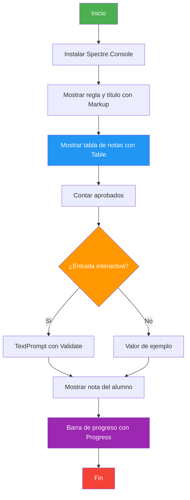
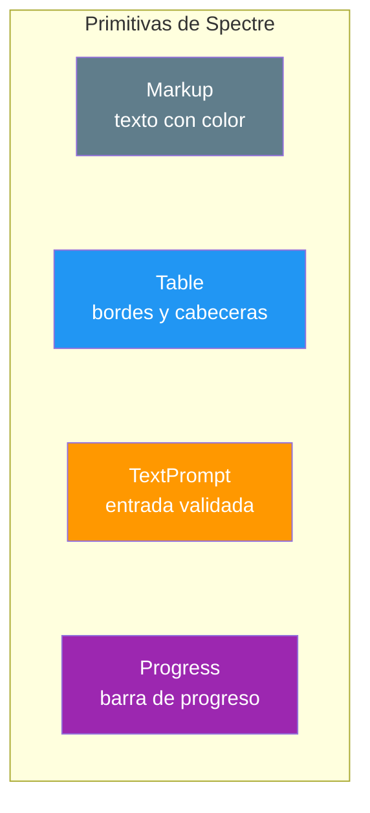

# 01. Primeros pasos con Spectre.Console

## Enunciado

Crea un programa de **gestión de notas** que muestre los datos de forma vistosa en consola usando la librería **Spectre.Console**. Este es el ejemplo más básico de la unidad para tomar contacto con las librerías NuGet antes de ver las más complejas (`Serilog`, `Microsoft.Extensions.Logging`, etc.).

1. **Tabla**: mostrar alumno, nota y estado (aprobado/suspenso) en una `Table` con bordes y cabeceras.
2. **Recuento**: contar los aprobados y mostrarlos con color mediante `Markup`.
3. **Entrada validada**: preguntar un alumno con `TextPrompt`, validando que exista (Spectre repite la pregunta hasta que sea correcta).
4. **Barra de progreso**: simular un proceso con `Progress`, actualizando la barra en vivo.

## Conceptos Clave

- **Instalación NuGet**: `dotnet add package Spectre.Console`
- **`AnsiConsole`**: punto de entrada de Spectre para escribir en consola
- **`Markup`**: texto con etiquetas de estilo `[blue]...[/]`, `[bold]...[/]`
- **`Table` / `TableBorder`**: tablas formateadas con títulos y columnas centradas
- **`TextPrompt<T>` + `Validate`**: entrada del usuario que no continúa hasta validar
- **`Markup.Escape()`**: imprescindible para que los corchetes del dato del usuario no se interpreten como estilo
- **`Progress`**: barra de progreso con columnas configurables
- **Entrada interactiva**: `TextPrompt` lee tecla a tecla; si la entrada está redirigida (`Console.IsInputRedirected`), se usa un valor de ejemplo

## Solución

1. **Instalación**: se añade `Spectre.Console` al `.csproj` con `dotnet add package Spectre.Console`.

2. **Título**: `new Rule(...).LeftJustified()` dibuja una línea con encabezado; `AnsiConsole.MarkupLine` imprime texto con color.

3. **Tabla** (`MostrarTablaNotas`): se construye una `Table` con `.Border(TableBorder.Rounded)` y se le añaden columnas y filas; el estado se colorea con `[green]` o `[red]` según la nota.

4. **Recuento** (`ContarAprobados`): acumulador clásico con `for`.

5. **Entrada** (`TextPrompt`): `AnsiConsole.Prompt` lanza el prompt; el `.Validate` devuelve `ValidationResult.Success()` o `.Error(...)` — mientras falle, Spectre no deja continuar. Se protege con `Console.IsInputRedirected` para poder ejecutarlo también en tuberías/CI.

6. **Progreso** (`SimularProcesoAnalisis`): `AnsiConsole.Progress().Columns(...).Start(...)` con un `TaskDescriptionColumn`, `ProgressBarColumn`, `PercentageColumn` y `RemainingTimeColumn`.

## Diagrama

> 💡 **Consejo:** Escapa siempre los datos del usuario con `Markup.Escape()`. Si un alumno se llamara `[bold]`, sin escaparlo Spectre lo interpretaría como etiqueta de estilo y fallaría.
