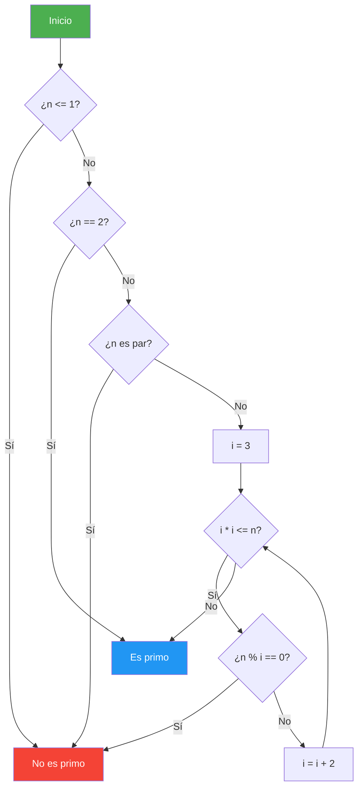

# 03. Argumentos y Números Primos

## Enunciado
Crea un programa que:

1. Lea y muestre los argumentos de línea de comandos (`args`).
2. Si se pasa exactamente un argumento numérico, verifique si es primo.
3. Pida al usuario un número entero positivo y compruebe si es primo.
4. Pida un límite y liste todos los números primos hasta ese límite.
5. Pida dos números y verifique si son **primos gemelos** (diferencia de 2 y ambos primos).
6. Pida un límite y liste todas las parejas de primos gemelos hasta ese límite.

El algoritmo de primalidad debe estar optimizado: solo verifica hasta `√n`, saltando pares.

## Conceptos Clave
- `args[]` — argumentos de línea de comandos
- `int.TryParse()` — validación de entrada numérica
- Algoritmo de primalidad optimizado (`i*i <= n`, incremento de 2 en 2)
- `Math.Abs()` — valor absoluto para diferencia entre primos
- Modular arithmetic — `%` para comprobar divisibilidad
- `for` con condición `i * i <= n` (evita calcular `Math.Sqrt`)

## Solución

### Algoritmo `IsPrime(n)`
1. Si `n <= 1` → no es primo.
2. Si `n == 2` → es primo.
3. Si `n` es par (`n % 2 == 0`) → no es primo.
4. Bucle desde `i = 3` hasta `i * i <= n`, incrementando de 2 en 2. Si `n % i == 0`, no es primo.
5. Si no se encontró divisor, es primo.

### Primos gemelos
Dos números `a` y `b` son primos gemelos si ambos son primos y `|a - b| == 2`.

### Listado de primos gemelos
Se recorre de 2 a `límite`. Para cada `i`, si `IsPrime(i)` e `IsPrime(i+2)`, se imprime la pareja `(i, i+2)`.

## Diagrama

