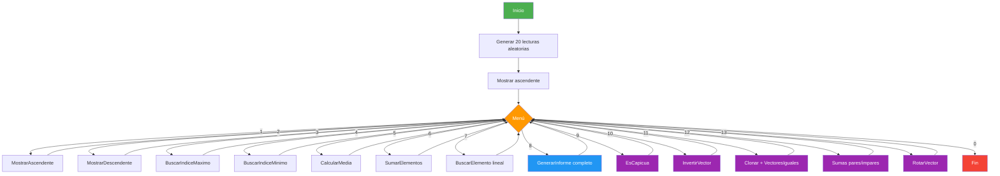
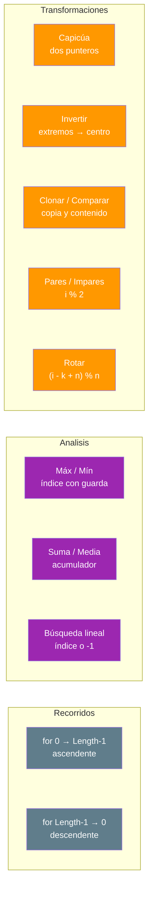

# 04. Analizador de lecturas de sensores (Vector)

## Enunciado

Desarrolla un analizador de lecturas de sensores sobre un vector unidimensional de **20 enteros** generados aleatoriamente (rango 10-99). Cada operación debe vivir en su **propia función** (SRP). El programa ofrece un menú:

1. **Mostrar ascendente**: recorre el vector del índice 0 al `Length - 1`.
2. **Mostrar descendente**: recorre el vector del índice `Length - 1` al 0.
3. **Buscar máximo**: devuelve el índice del valor más alto y lo muestra con su posición.
4. **Buscar mínimo**: devuelve el índice del valor más bajo y lo muestra con su posición.
5. **Calcular media**: media aritmética de las lecturas.
6. **Sumar elementos**: acumulador con la suma total.
7. **Buscar un elemento**: búsqueda lineal que devuelve el índice o `-1` si no existe.
8. **Informe completo**: llama a todas las funciones y añade cuántas lecturas superan la media.
9. **Comprobar capicúa**: compara los extremos hacia el centro (dos punteros convergentes) y lo demuestra con un vector de prueba sí capicúa.
10. **Invertir vector**: intercambia los extremos hacia el centro **sin array auxiliar**; el vector original queda invertido.
11. **Clonar y comparar**: copia profunda, comparación por contenido y contraste con el `==` de referencias.
12. **Suma posiciones pares/impares**: suma los elementos de índice par (0, 2, 4…) e impar (1, 3, 5…), con un total de control.
13. **Rotar vector**: rota N posiciones a la izquierda con módulo (`%`) y devuelve un vector **nuevo** (el original intacto; hay que reasignarlo).

## Conceptos Clave

- `int[]` como vector de lecturas (2.1, 2.2)
- Recorrido `for` en ambos sentidos: creciente (`0 → Length-1`) y decreciente (`Length-1 → 0`)
- `.Length` para conocer el tamaño y delimitar los bucles
- Búsqueda lineal: recorrer comparando y devolver el índice o `-1`
- Acumuladores para suma y media (cuidado con la división entera: se castea a `double`)
- **Capicúa e invertir**: dos punteros (`izquierda`/`derecha`) que convergen hacia el centro; el capicúa solo lee, el inversor intercambia
- **Copia profunda**: clonar manualmente elemento a elemento para tener un array independiente
- **Identidad vs. igualdad**: el `==` de los arrays compara *referencias*; para comparar *contenido* hace falta una función propia
- **Posiciones pares/impares**: con el operador módulo `%` (`i % 2 == 0`) o avanzando `i += 2`
- **Rotación**: recorrido con desplazamiento y módulo (`(i - k + n) % n`); se devuelve un array **nuevo** y el Main decide reasignarlo
- Paso por valor de un array a una función (el array no se reasigna, solo se lee)
- Un único `Random` compartido por todas las funciones que generan datos

## Solución

1. **Generación**: `GenerarLecturas()` rellena `int[20]` con valores aleatorios usando un solo `Random`.

2. **Menú (`do-while`)**: `LeerOpcionMenu()` valida la entrada (entero del 0 al 13) y un `switch` llama a la función correspondiente.

3. **Funciones de análisis** (una responsabilidad cada una):
   - `MostrarAscendente()` / `MostrarDescendente()`: dos bucles `for` con distinto sentido.
   - `BuscarIndiceMaximo()` / `BuscarIndiceMinimo()`: guardan el índice del extremo y lo actualizan al encontrar algo mejor.
   - `CalcularMedia()` / `SumarElementos()`: acumulador; la media devuelve `(double)suma / Length`.
   - `BuscarElemento()`: búsqueda lineal; devuelve `i` al encontrar, `-1` al agotar el recorrido.

4. **Capicúa e inversión** (dos punteros que convergen):
   - `EsCapicua()`: compara `datos[izquierda]` con `datos[derecha]` y avanza ambos punteros hacia el centro.
   - `InvertirVector()`: mismo esquema, pero intercambiando los extremos con una variable auxiliar; el original queda invertido.

5. **Copias y comparación**:
   - `ClonarVector()`: devuelve un array **nuevo e independiente** (copia profunda, elemento a elemento).
   - `VectoresIguales()`: compara tamaño y contenido; el demo deja claro que `==` compara *referencias* y la función, *contenido*.

6. **Paridades y rotación** (módulo y recorrido desplazado):
   - `SumarPosicionesPares()` / `SumarPosicionesImpares()`: recorrido `for` avanzando `i += 2`, empezando en 0 y en 1 respectivamente; el `%` también sirve como filtro (`i % 2`).
   - `RotarVector()`: recoloca cada elemento en `(i - k + n) % n`, normaliza `k` para evitar vueltas de más y devuelve un array **nuevo**; `DemostrarRotacion()` devuelve el resultado para que el Main haga `lecturas = ...`.

7. **Informe**: `GenerarInforme()` orquesta todo y añade `ContarMayoresQue()` para el dato extra sobre la media.

## Diagrama

