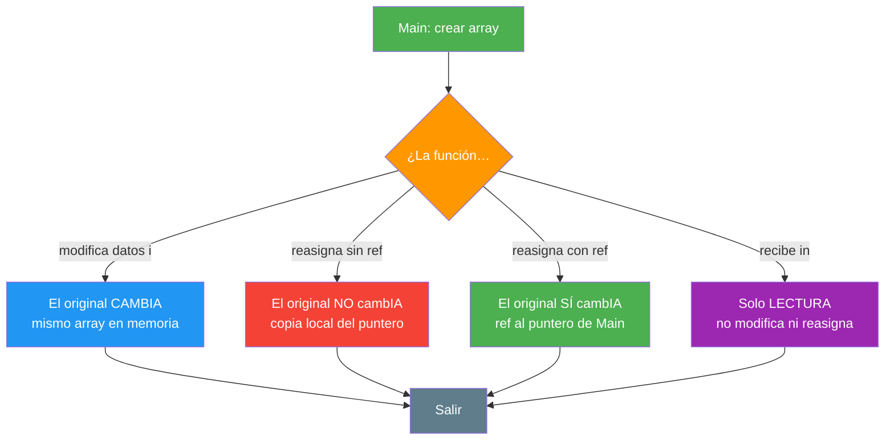
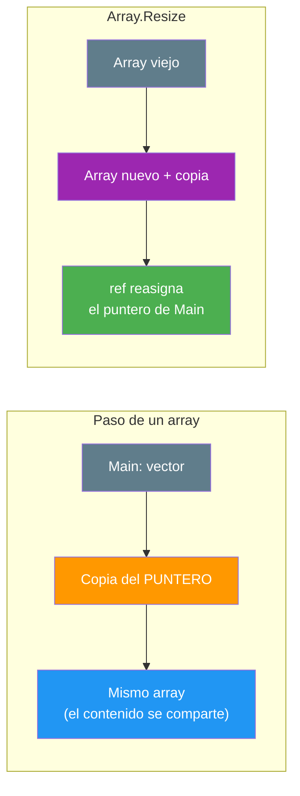

# 05. Paso por referencia, ref, redimensionado e `in`

## Enunciado

Crea una demostración **conceptual** de cómo se pasan los arrays (vectores y matrices) a las funciones. El objetivo es ver con claridad la diferencia entre **tocar el contenido** (que afecta al original) y **reasignar la referencia** (que se pierde sin `ref`), además del uso de `ref`, del redimensionado y del modificador `in`. Cada concepto en su **propia función** (SRP).

1. **Contenido compartido**: la función modifica los elementos y el original cambia (el array es tipo de referencia).
2. **Reasignar sin `ref`**: la función apunta a otro array, pero el original **no** cambia (el parámetro es una copia del puntero).
3. **Reasignar con `ref`**: la función recibe una referencia al puntero del llamador, así que su reasignación **sí** llega fuera.
4. **Redimensionar un vector**: `Array.Resize(ref …)` crea un array nuevo, copia lo que cabe y reasigna con `ref`.
5. **Redimensionar una matriz**: no existe `Resize` para `[,]`, así que se crea la matriz nueva y se copia el solape a mano.
6. **`in` en un vector**: paso por referencia de **solo lectura**; la función lee los elementos pero no puede reasignar ni modificar.
7. **`in` en una matriz**: mismo principio de solo lectura sobre un array bidimensional.

## Conceptos Clave

- **Identidad vs. contenido**: un array es un **tipo de referencia**; el parámetro recibe una copia del puntero, no del array
- Cambiar `datos[i]` afecta al original (misma "caja"); reasignar `datos = new …` no (solo la copia local)
- **`ref`**: pasa una referencia al **puntero** del llamador; la reasignación de la función llega fuera
- **`Array.Resize(ref, n)`**: necesita `ref` porque crea un array nuevo y reasigna; al ampliar, lo nuevo vale `0`; al reducir, el sobrante se pierde
- **Redimensionar matrices a mano**: `new int[filas, columnas]` + copia del solape (`Math.Min`)
- **`in`** (2.4): paso por referencia pero **prohíbe modificar**; ideal para arrays grandes de solo lectura

## Solución

1. **`ModificarContenido()`**: recorre y duplica cada elemento; el original cambia porque comparten el mismo array.

2. **`ReasignarSinRef()` / `ReasignarConRef(ref …)`**: la primera apunta a otro array y el cambio se pierde; la segunda, con `ref`, reasigna el puntero del llamador.

3. **`Array.Resize(ref vector, n)`**: se amplía (las nuevas posiciones a `0`) y se reduce (el sobrante se pierde).

4. **`RedimensionarMatriz()`**: crea una matriz nueva y copia solo el solape con `Math.Min` en filas y columnas.

5. **`SumarContenido(in int[])` / `SumarMatriz(in int[,])`**: reciben el array con `in`; leen todo pero no pueden modificar (las líneas prohibidas quedan comentadas como referencia).

## Diagrama

> 💡 **Consejo:** Dibuja en papel la "caja" del array y el "puntero" que apunta a ella. Cuando la función toca la caja, se ve en Main; cuando mueve su puntero (sin `ref`), Main sigue apuntando a la de antes.
