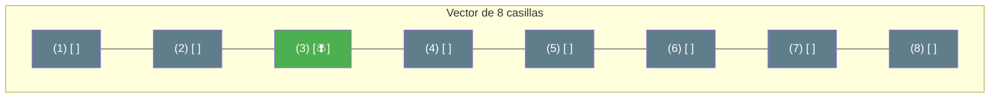
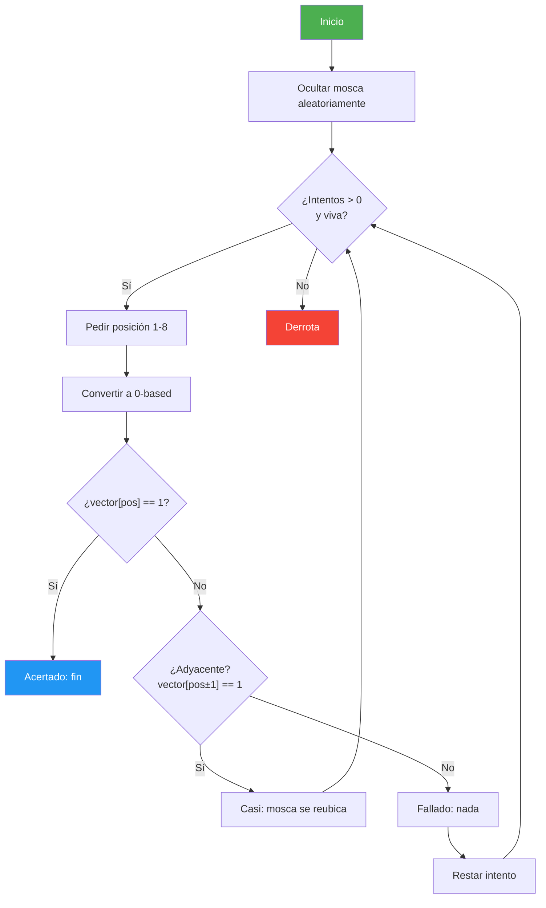

# 06. ¿Dónde está la Mosca? (Vector)

## Enunciado
Crea el juego **"¿Dónde está la mosca?"** en un vector unidimensional de 8 casillas:

1. La mosca se oculta aleatoriamente en una posición del vector.
2. El jugador tiene **5 intentos** para encontrarla.
3. En cada intento, el jugador elige una posición (1-8, se convierte a 0-based internamente).
4. Se analiza el golpeo:
   - **Acertado** (`TipoGolpeo.Acertado`): La mosca muere → fin del juego.
   - **Casi** (`TipoGolpeo.Casi`): La posición es adyacente a la mosca → la mosca revolotea y se reubica aleatoriamente.
   - **Fallado** (`TipoGolpeo.Fallado`): No hay mosca cerca → nada ocurre.
5. Se muestra el vector al final para ver dónde estaba la mosca.

## Conceptos Clave
- `int[]` como tablero (0 = vacío, 1 = mosca)
- `enum TipoGolpeo` con valores `Acertado`, `Fallado`, `Casi`
- Comprobación de límites del vector (`posicion > 0`, `posicion < length - 1`)
- Regex dinámica `"^[1-" + size + "]$" ` — construir patrón según el tamaño
- Conversión 1-based ↔ 0-based — el usuario ve 1-8, internamente 0-7

## Solución

1. **Inicialización**: Se crea `int[8]` y se rellena con 0. Se elige una posición aleatoria y se pone a 1 (mosca).

2. **Bucle del juego** (`do-while`):
   - Se pide posición con validación regex dinámica `^[1-8]$`.
   - Se convierte a 0-based: `posicion - 1`.
   - Se llama a `AnalizarGolpeo()`:
     - Si `vector[pos] == 1` → `Acertado`.
     - Si `vector[pos-1] == 1` o `vector[pos+1] == 1` → `Casi`.
     - Si no → `Fallado`.
   - En caso de `Casi`, se reubica la mosca con `SortearPosicionMosca()`.
   - Se repite hasta `Acertado` o agotar intentos.

3. **Resultado**: Victoria si `Acertado`, derrota si se agotan los intentos.

## Diagrama

