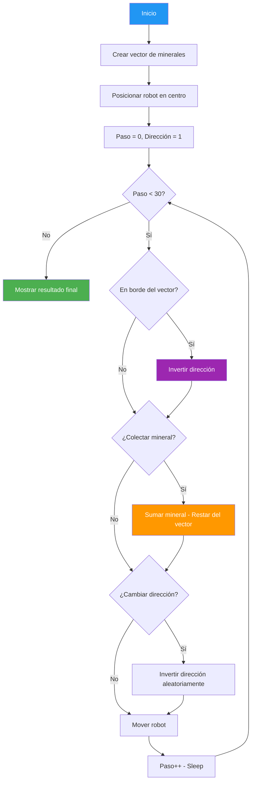

# 07. Minerales Vector

## Enunciado

Simula un robot explorando un vector unidimensional de depósitos minerales. El robot se desplaza por el vector en una dirección (izquierda o derecha), colecta minerales de forma probabilística (no siempre recoge el mineral que encuentra), cambia de dirección aleatoriamente en algunos pasos, y rebota al llegar a los bordes del vector. La exploración tiene un máximo de 30 pasos de tiempo.

## Conceptos Clave

- **`int[]`**: Arreglo unidimensional que representa los depósitos minerales (cada posición tiene una cantidad de mineral).
- **`do-while`**: Bucle principal que se ejecuta hasta agotar los 30 pasos o condiciones de salida.
- **`Thread.Sleep`**: Pausa entre pasos para observar el movimiento del robot en tiempo real.
- **Decisiones probabilísticas**: Uso de `Random` para determinar si el robot colecta el mineral (probabilidad < 1.0) y si cambia de dirección.
- **Lógica de inversión de dirección**: Cuando el robot llega a posición 0 o al final del vector, invierte su dirección de movimiento.
- **Comprobación de límites**: Validar que la posición del robot esté dentro del rango `[0, vector.Length - 1]`.

## Solución

1. **Inicializar vector**: Crear `int[]` con valores aleatorios representando minerales en cada posición.
2. **Posicionar robot**: Empezar en una posición inicial (ej: centro del vector).
3. **Definir dirección**: `int direccion = 1` (derecha) o `-1` (izquierda).
4. **Bucle `do-while`** (máximo 30 pasos):
   - Mostrar posición actual del robot y mineral disponible.
   - **Comprobar rebote**: Si `posicion == 0` o `posicion == vector.Length - 1`, invertir dirección.
   - **Decidir coleccionar**: Generar número aleatorio; si es menor que la probabilidad, recoger mineral y restarlo del vector.
   - **Decidir cambio de dirección**: Con cierta probabilidad, invertir dirección aleatoriamente.
   - **Mover robot**: `posicion += direccion`.
   - Mostrar estado actualizado.
   - `Thread.Sleep(500)` para observar cada paso.
5. **Mostrar resultado final**: Total de minerales coleccionados y posición final del robot.

