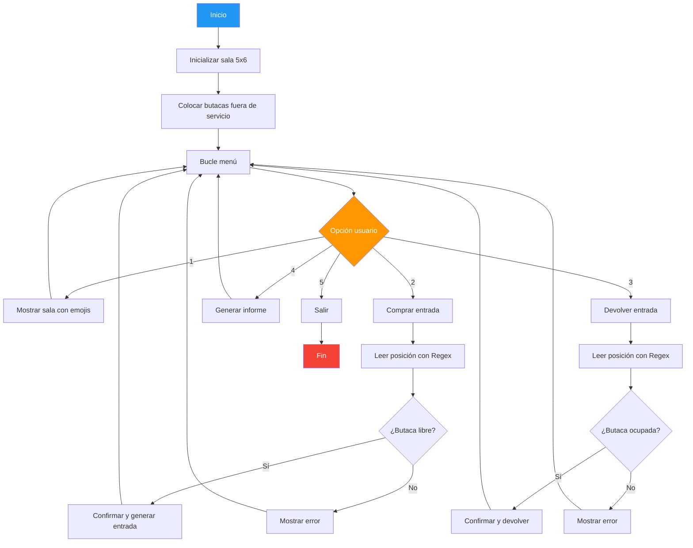

# 10. Cine

## Enunciado

Desarrolla una aplicación de gestión de butacas de cine que utiliza una matriz 2D para representar la sala. El programa debe permitir al usuario comprar y devolver entradas por posición (formato "B:3"), visualizar el tablero con emojis, mostrar una barra de progreso de ocupación con colores ANSI, y generar un informe estadístico con entradas vendidas, recaudación y porcentaje de ocupación. Algunas butacas estarán fuera de servicio de forma aleatoria.

## Conceptos Clave

- Matriz 2D de structs (`Butaca[,]`)
- Enums: `Estado` (Libre, Ocupada, FueraServicio) y `MenuOpcion`
- Structs: `Butaca`, `Posicion`, `Entrada`
- Expresiones regulares (`Regex`) para validar entrada de usuario (formato "A-E:1-6")
- `switch expressions` para determinar el emoji de cada butaca
- Tipo `decimal` para manejo de dinero con precisión
- Barra de progreso con secuencias de color ANSI (`\u001b[32m`, `\u001b[33m`, `\u001b[31m`)
- `CultureInfo("es-ES")` para formato de moneda y fechas en español
- Conversión de caracteres a índices con aritmética Unicode (`letra - 'A'`)

## Solución

**Inicialización:**

1. Crear una matriz 5x6 de structs `Butaca`, cada una con posición, precio y estado `Libre`.
2. Colocar 3 butacas aleatorias como `FueraServicio`.

**Bucle principal del menú:**

1. Mostrar barra de progreso de ocupación.
2. Leer opción del menú y validarla con Regex `^[1-5]$`.
3. Según la opción:
   - **Mostrar:** Recorrer la matriz y dibujar emojis (🔴 ocupada, 🚫 fuera de servicio, 💺 libre).
   - **Comprar:** Leer posición con Regex `^([A-E]):([1-6])$`, verificar que esté libre, confirmar compra, generar entrada con fecha y precio.
   - **Devolver:** Leer posición, verificar que esté ocupada, confirmar devolución, liberar butaca y mostrar importe.
   - **Informe:** Contar butacas por estado, calcular recaudación y porcentaje de ocupación.
   - **Salir:** Terminar el bucle.

**Funciones auxiliares:**

- `ObtenerIndiceFila`: Convierte letra a índice (`'A' - 'A' = 0`).
- `ObtenerLetraFila`: Convierte índice a letra (`'A' + indice`).
- `DibujarBarraProgreso`: Barra visual de 30 caracteres con colores ANSI según porcentaje.

## Diagrama

