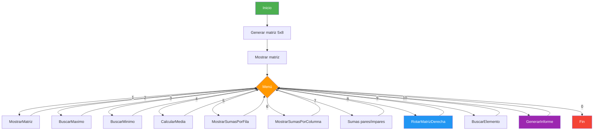
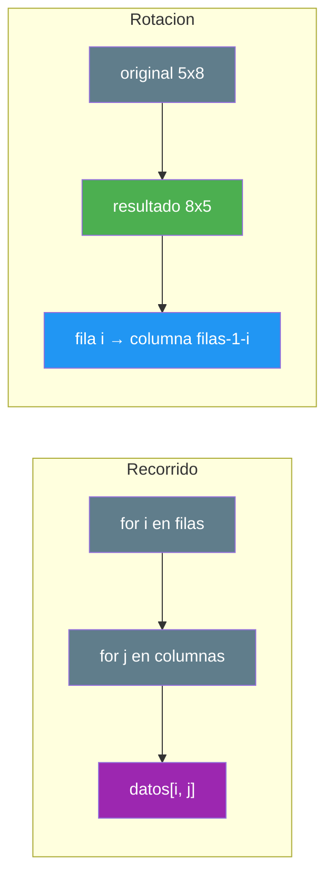

# 11. Analizador de matriz de sensores

## Enunciado

Desarrolla un analizador de una **matriz rectangular de sensores** de `5x8` (5 filas × 8 columnas) con lecturas enteras aleatorias entre 10 y 99. Cada operación debe vivir en su **propia función** (SRP). El programa ofrece un menú:

1. **Mostrar matriz**: tabla formateada con etiquetas de fila (`F0…`) y columna (`C0…`).
2. **Buscar máximo**: devuelve valor y coordenadas (fila y columna).
3. **Buscar mínimo**: devuelve valor y coordenadas (fila y columna).
4. **Media global**: media aritmética de todas las celdas.
5. **Suma por filas**: vector horizontal con la suma de cada fila.
6. **Suma por columnas**: lista vertical con la suma de cada columna.
7. **Suma posiciones pares/impares**: suma por tipo de casilla del tablero de ajedrez (`i+j` par o impar).
8. **Rotar 90° a la derecha**: genera una **matriz nueva** (las dimensiones se intercambian: 5x8 → 8x5) y la reasigna.
9. **Buscar un elemento**: búsqueda con coordenadas (fila, columna) o `(-1, -1)` si no está.
10. **Informe completo**: llama a todas las funciones de análisis.

## Conceptos Clave

- `int[,]`: matriz rectangular con **dos dimensiones** (3.1)
- `.GetLength(0)` para filas y `.GetLength(1)` para columnas
- **Recorrido anidado** (`for` dentro de `for`): filas por fuera, columnas por dentro
- Sumas por fila y por columna con **dos bucles separados** (uno fija la fila, otro la columna)
- **Posiciones pares/impares** del tablero de ajedrez con `(i + j) % 2`
- **Rotación 90°**: la fila `i` pasa a ser la columna `(filas-1-i)`; el resultado tiene las dimensiones **intercambiadas**
- **Tuplas nombradas** `(int Valor, int Fila, int Columna)` para devolver varias salidas de una vez (repaso UD01)
- Búsqueda que devuelve **coordenadas** en vez de un índice lineal

## Solución

1. **Generación**: `GenerarMatriz()` rellena `int[filas, columnas]` con un doble `for` y un único `Random`.

2. **Mostrar**: `MostrarMatriz()` imprime la cabecera de columnas y una línea por fila con su etiqueta, usando formato alineado.

3. **Máximo y mínimo**: `BuscarMaximo()` / `BuscarMinimo()` recorren toda la matriz con guarda y devuelven una **tupla** con el valor y sus coordenadas.

4. **Sumas**: `SumarFila()` y `SumarColumna()` reciben el índice a fijar; `MostrarSumasPorFila()` y `MostrarSumasPorColumna()` las orquestan para todas las filas/columnas.

5. **Paridades**: `SumarPosicionesPares()` / `SumarPosicionesImpares()` filtran con `(i + j) % 2` (casillas blancas/negras del tablero).

6. **Rotación**: `RotarMatrizDerecha()` crea `new int[columnas, filas]` y coloca `resultado[j, filas-1-i] = datos[i, j]`; en el `switch` se **reasigna** (`matriz = RotarMatrizDerecha(matriz)`).

7. **Búsqueda**: `BuscarElemento()` recorre las celdas y devuelve `(i, j)` al encontrar o `(-1, -1)` si no está.

8. **Informe**: `GenerarInforme()` orquesta todo: dimensiones, máximo/mínimo con coordenadas, media, paridades y sumas por filas/columnas.

## Diagrama

