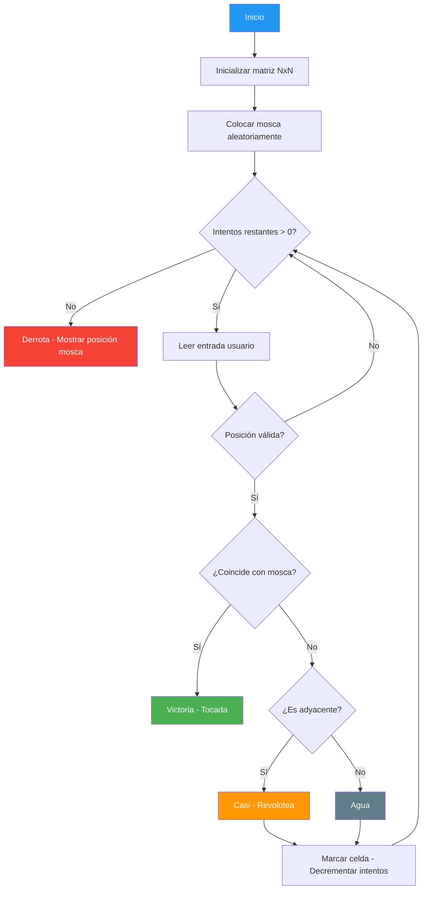
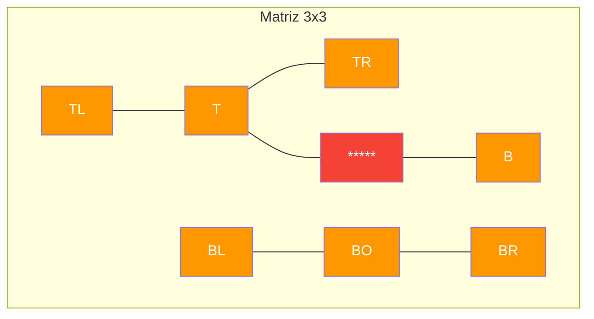

# 12. Mosca en la Matriz

## Enunciado

Juego "¿Dónde está la mosca?" en una matriz NxN. La mosca se coloca en una posición aleatoria de la cuadrícula. El jugador tiene un número limitado de intentos para adivinar su posición introduciendo coordenadas (fila, columna). En cada intento, el juego responde con uno de tres estados:
- **Tocada**: la posición coincide exactamente con la mosca.
- **Casi (revolotea)**: la posición es adyacente a la mosca (una de las 8 celdas vecinas).
- **Agua**: la posición está lejos de la mosca.

Se usan enums (`Celda`, `Golpeo`) y structs (`Posicion`, `Configuracion`) para modelar el dominio del juego.

## Conceptos Clave

- **Matriz `Celda[,]`**: Arreglo bidimensional que representa el tablero de juego.
- **Enums `Celda` y `Golpeo`**: Tipos enumerados para estados del tablero (Vacía, Mosca, Marcada) y resultados de golpeo (Agua, Casi, Tocada).
- **Structs `Posicion` y `Configuracion`**: Tipos valor para encapsular datos inmutables (coordenadas y configuración del juego).
- **`Regex`**: Expresiones regulares para validar y parsear la entrada del usuario (formato "fila,columna").
- **`switch` en enums**: Uso de sentencias `switch` para manejar los diferentes estados de las enumeraciones.
- **Comprobación 3x3 de adyacencia**: Verificación de las 8 celdas vecinas para determinar si la mosca está "casi" en la posición indicada.

## Solución

1. Leer argumentos de línea de comandos (tamaño matriz, intentos máximos) o usar valores por defecto.
2. Inicializar matriz `Celda[,]` con todas las celdas en estado `Vacía`.
3. Generar posición aleatoria de la mosca y marcar esa celda como `Mosca`.
4. Bucle de intentos:
   - Leer entrada del usuario y parsear con `Regex` para extraer fila y columna.
   - Validar que la posición esté dentro de los límites de la matriz.
   - Si coincide con la mosca → `Golpeo.Tocada`, mostrar Victoria y salir.
   - Si alguna de las 8 celdas adyacentes contiene la mosca → `Golpeo.Casi` ("revolotea").
   - Si no hay adyacencia → `Golpeo.Agua`.
   - Marcar la celda como `Marcada` para evitar repetir intentos.
   - Decrementar intentos restantes.
5. Si se agotan los intentos → mostrar Derrota y la posición de la mosca.

### Diagrama de adyacencia 3x3

