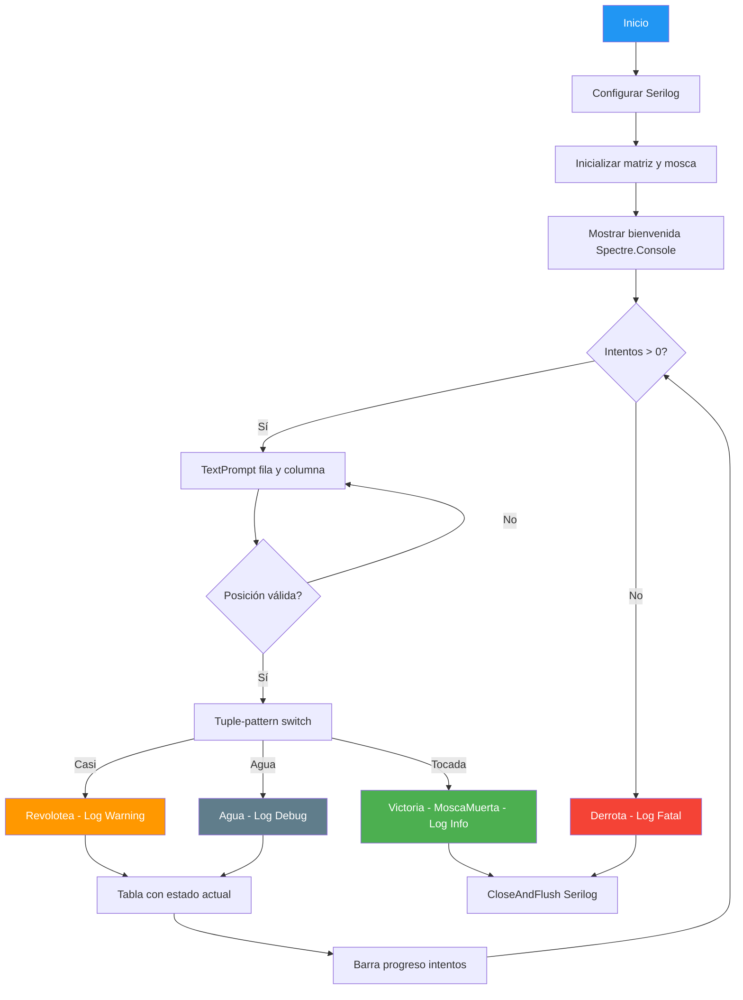

# 13. Mosca en la Matriz - Advanced

## Enunciado

Versión mejorada del juego "¿Dónde está la mosca?" (ejemplo 12) que incorpora funcionalidades profesionales:

- **Serilog**: Logging estructurado a archivo y consola para registrar cada intento, resultado y eventos del juego.
- **Spectre.Console**: Interfaz de usuario rica con prompts con colores, tablas estilizadas, separadores (`Rule`) y markup para texto enriquecido.
- **Barra de progreso**: Muestra visual de los fallos restantes usando barra de progreso de Spectre.Console.
- **Nuevo estado `MoscaMuerta`**: Extiende el enum `Golpeo` con un tercer estado para cuando se acierta la posición.

Se mantiene la lógica base del ejemplo 12 (matriz, enums, structs, Regex, adyacencia 3x3) y se le añade toda esta capa de presentación y persistencia.

## Conceptos Clave

- **Todo lo del ejemplo 12**: Matriz `Celda[,]`, enums (`Celda`, `Golpeo`), structs (`Posicion`, `Configuracion`), Regex, comprobación de adyacencia.
- **Serilog**: Configuración con `LoggerConfiguration`, sinks (`WriteTo.Console()`, `WriteTo.File()`), niveles de log y logging estructurado.
- **Spectre.Console**: `AnsiConsole.Prompt` para entrada validada, `TextPrompt<T>` para tipos específicos, `Table` para tablas con bordes, `Rule` para separadores, `Markup` para texto con formato.
- **Nuevo valor de enum**: `MoscaMuerta` en el enum `Golpeo` para distinguirVictoria de intentos fallidos anteriores.
- **Tuple-pattern switch**: Uso de patrones de tupla en `switch` para combinar múltiples condiciones de forma concisa (ej: `(Golpeo.Tocada, _)`).

## Solución

1. **Configurar Serilog**:
   - `new LoggerConfiguration().MinimumLevel.Debug().WriteTo.Console().WriteTo.File("mosca.log").CreateLogger()`.
   - Registrar cada evento: intento, resultado, Victoria/Derrota.

2. **Inicializar juego** (similar al ejemplo 12):
   - Crear matriz, colocar mosca, configurar intentos.

3. **Interfaz con Spectre.Console**:
   - Usar `TextPrompt<int>` para leer fila y columna con validación.
   - Mostrar tablero actualizado con `Table` después de cada intento.
   - Usar `Rule` para separar secciones visualmente.
   - Barra de progreso para intentos restantes.

4. **Bucle de juego**:
   - Leer entrada → parsear → comprobar adyacencia → actualizar estado → log resultado.
   - Usar tuple-pattern switch: `switch (golpeo) { (Golpeo.Tocada, _) => ..., (Golpeo.Casi, _) => ... }`.

5. **Cierre**: Flush de Serilog con `Log.CloseAndFlush()`.

