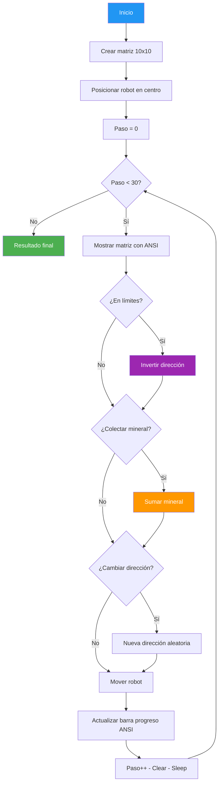

# 14. Minerales Matriz

## Enunciado

Extiende la exploración mineral del ejemplo 18 de un vector unidimensional a una matriz bidimensional 10x10. El robot ahora se mueve en 8 direcciones posibles (Norte, Sur, Este, Oeste, NE, NO, SE, SO), colecta minerales de forma probabilística, y se muestra una barra de progreso visual usando códigos de escape ANSI para indicar el avance de la exploración.

## Conceptos Clave

- **`int[,]`**: Arreglo bidimensional 10x10 que representa el campo de minerales.
- **Structs `Posicion` y `Direccion`**: Tipos valor para encapsular coordenadas (fila, columna) y dirección de movimiento (delta Fila, delta Columna).
- **Movimiento 8-direccional**: El robot puede desplazarse en cualquiera de las 8 direcciones del compás, incluyendo diagonales.
- **`Console.Clear()`**: Limpia la pantalla en cada paso para mostrar el estado actualizado del mapa.
- **Códigos de escape ANSI**: Secuencias como `\x1b[...m` para colorear la salida de consola, dibujar la barra de progreso y posicionar el cursor.
- **`switch` para dirección**: Sentencia `switch` que mapea las 8 direcciones a sus deltas correspondientes (fila ±1, columna ±1).

## Solución

1. **Inicializar matriz 10x10**: Valores aleatorios representando minerales.
2. **Definir struct `Posicion`**: `{ int Fila, int Columna }` con métodos de igualdad.
3. **Definir struct `Direccion`**: `{ int DeltaFila, int DeltaColumna }` con las 8 direcciones como valores estáticos.
4. **Posicionar robot**: Centro de la matriz (5, 5).
5. **Barra de progreso ANSI**: Usar códigos de escape para dibujar barra que muestra paso actual / 30.
6. **Bucle principal** (máximo 30 pasos):
   - Mostrar matriz con colores ANSI (mineral = verde, vacío = gris, robot = amarillo).
   - **Comprobar límites**: Si el robot sale de la matriz, invertir dirección.
   - **Colectar mineral**: Con probabilidad, recoger y restar del vector.
   - **Cambiar dirección**: Aleatoriamente entre las 8 direcciones.
   - **Mover robot**: Aplicar delta de dirección a posición actual.
   - Actualizar barra de progreso con ANSI.
   - `Console.Clear()` y `Thread.Sleep(500)`.

### Modelo de movimiento 8-direccional

| Dirección | Delta Fila | Delta Columna |
|-----------|-----------|---------------|
| Norte | -1 | 0 |
| Sur | +1 | 0 |
| Este | 0 | +1 |
| Oeste | 0 | -1 |
| NE | -1 | +1 |
| NO | -1 | -1 |
| SE | +1 | +1 |
| SO | +1 | -1 |

