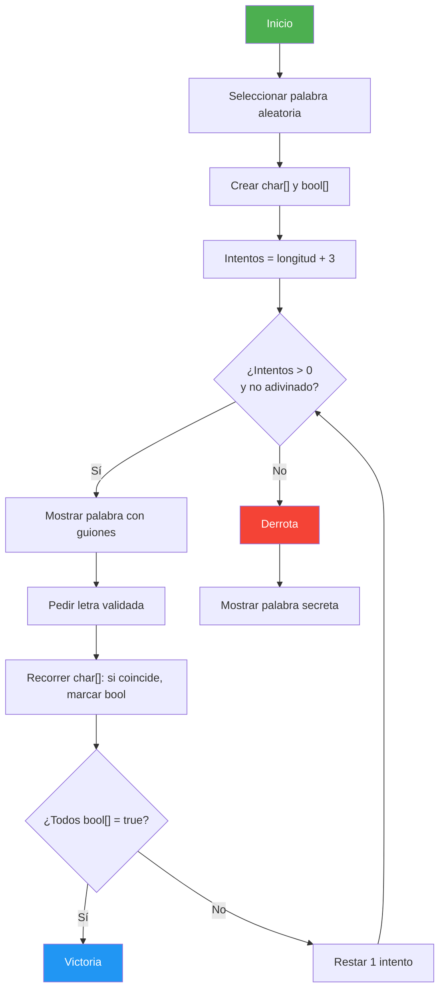

# 22. Juego del Ahorcado

## Enunciado
Crea el juego del ahorcado clásico:

1. Se selecciona una palabra aleatoria de un diccionario predefinido.
2. Se inicializan las vidas = longitud de la palabra + 3.
3. En cada turno se muestra la palabra con letras adivinadas y guiones bajos (`_`) para las no adivinadas.
4. El jugador introduce una letra (validada con regex).
5. Si la letra está en la palabra, se revelan todas sus posiciones.
6. Se comprueba si todas las letras han sido adivinadas.
7. El juego termina cuando se adivina la palabra o se acaban las vidas.

Se usan **arrays paralelos** `char[]` (letras) y `bool[]` (reveladas) para el tracking.

## Conceptos Clave
- Arrays paralelos: `char[]` + `bool[]` — dos arrays del mismo tamaño sincronizados
- `string.ToCharArray()` o conversión manual a `char[]`
- `Random.Next(0, length)` — selección aleatoria del índice
- `Regex` con patrón `^[a-zA-Z]$` — validación de una sola letra
- Bucle `do-while` — game loop principal
- `char.ToLower()` — normalización de entrada

## Solución

1. **Inicialización**: Se elige una palabra aleatoria del diccionario. Se crea `char[]` con las letras y `bool[]` con `false` en todas las posiciones.

2. **Bucle del juego** (`do-while`):
   - Se imprime la palabra: si `bool[i] == true`, muestra `char[i]`; si no, muestra `_`.
   - Se pide una letra validada con regex `^[a-zA-Z]$`.
   - Se recorre `char[]`: si `char[i] == letra`, se marca `bool[i] = true`.
   - Se comprueba si todos los `bool[]` son `true` → palabra adivinada.
   - Se decrementa el contador de intentos.

3. **Fin**: Si se adivinó → victoria con número de intentos. Si no → derrota mostrando la palabra.

## Diagrama

