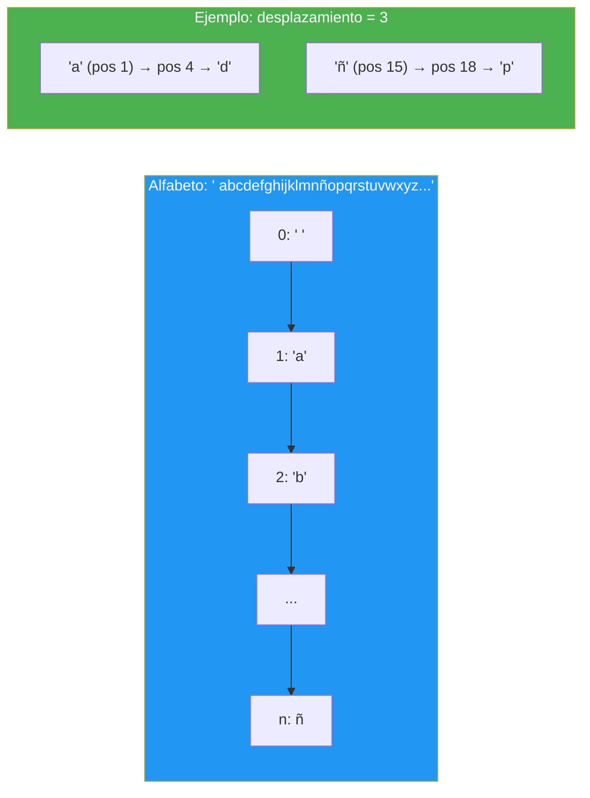
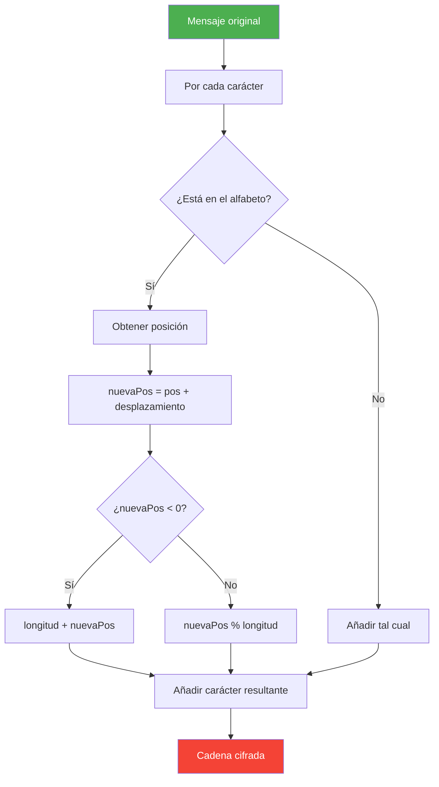

# 23. Cifrado César con Alfabeto Extendido

## Enunciado
Implementa el cifrado César clásico pero con un **alfabeto extendido** que incluya:

- Espacio, letras (incluida la Ñ), números y símbolos de puntuación
- Tildes y caracteres especiales (á, é, í, ó, ú, ñ, ç, etc.)

El programa genera un desplazamiento aleatorio, cifra un mensaje, luego lo descifra aplicando el desplazamiento negativo. Los caracteres que no estén en el alfabeto se mantienen sin modificar.

## Conceptos Clave
- `StringBuilder` — construcción eficiente de la cadena cifrada/descifrada
- `string.IndexOf()` — posición de un carácter en el alfabeto
- Aritmética modular `%` — envolver el desplazamiento alrededor del alfabeto
- `foreach` sobre `string` — iterar carácter a carácter
- `Random.Next(1, length)` — desplazamiento aleatorio
- Desplazamiento negativo → descifrado (revertir la operación)

## Solución

### Algoritmo de cifrado `CifrarCesar(mensaje, desplazamiento)`
1. Se define el alfabeto completo como `string` (espacio, a-z, A-Z, Ñ, números, símbolos).
2. Se calcula `desplazamientoEfectivo = desplazamiento % alfabeto.Length` para reducir desplazamientos grandes.
3. Para cada carácter del mensaje:
   - Se busca su posición con `IndexOf()`.
   - Si no está en el alfabeto (`posicion == -1`), se añade tal cual.
   - Si está, se calcula `nuevaPosicion = posicion + desplazamientoEfectivo`.
   - Se aplica módulo para envolver: si es negativo, se suma la longitud del alfabeto; si es positivo, `% alfabeto.Length`.
4. Se devuelve el `StringBuilder` como string.

### Cifrado ↔ Descifrado
- Cifrar con `+desplazamiento`.
- Descifrar con `-desplazamiento` (misma función, desplazamiento negativo).

## Diagrama

