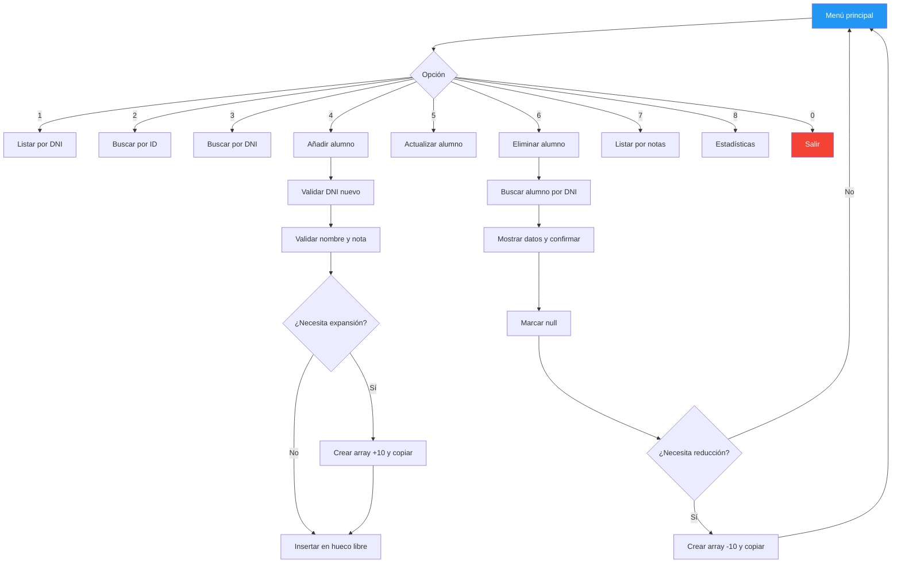

# 24. Base de Datos Alumnado

## Enunciado

Desarrolla una aplicación CRUD de gestión de base de datos de alumnos utilizando un array nullable `Alumno?[].` El programa debe permitir listar alumnos (ordenados por DNI o por nota), buscar por ID o DNI, añadir, actualizar y eliminar alumnos con validación completa de DNI (letra de control módulo 23). El array debe auto-redimensionarse: expandirse al 80% de ocupación y reducirse al 50%. Implementar ordenación con Bubble Sort y estadísticas (tasa de aprobado, nota media). Usar Serilog para logging.

## Conceptos Clave

- Structs nullable (`Alumno?[]`) para almacenar alumnos con huecos (null)
- Redimensión dinámica del array con `ref` (expansión +80%, reducción -50%)
- CRUD completo: Create, Read, Update, Delete
- Validación de DNI español: formato Regex `^\d{8}[A-Z]$` + letra de control con `letrasDni[numero % 23]`
- `Regex` para validación de entrada de usuario
- Bubble Sort con swap de tuplas: `(a, b) = (b, a)`
- `CultureInfo("es-ES")` para formato de números decimales
- Serilog para logging (`Log.Information`, `Log.Warning`, `Log.Debug`)
- Sobrecarga de métodos (`BuscarAlumnoPorDni`, `BuscarAlumnoPorId`)
- Pattern matching: `is { } alumno`, `?.` null-conditional, `.HasValue`
- `ref` para pasar referencias de arrays que pueden ser reasignados

## Solución

**Estructura de datos:**

- Array `Alumno?[]` con tamaño inicial 10. Cada posición puede contener un `Alumno` (struct con Id, Dni, NombreCompleto, Nota) o `null`.
- Contador `numAlumnos` para saber cuántos hay activos.

**Operaciones del menú:**

1. **Listar todos:** Extraer datos no nulos a un vector compacto, ordenar con Bubble Sort por DNI, imprimir en tabla.
2. **Buscar por ID/DNI:** Leer entrada validada, buscar índice con bucle lineal, mostrar resultado con pattern matching `is { } alumno`.
3. **Añadir:** Validar DNI (formato + letra + que no exista), validar nombre con Regex, validar nota (0-10). Redimensionar si necesario. Insertar en primer hueco libre (`null`).
4. **Actualizar:** Buscar alumno existente, mostrar datos actuales, pedir nuevos datos con confirmación, aplicar cambios.
5. **Eliminar:** Buscar alumno, mostrar datos, pedir confirmación, marcar posición como `null`, reducir array si necesario.
6. **Listar por notas:** Igual que listar pero ordenando por nota descendente.
7. **Estadísticas:** Recorrer array, contar aprobados (≥5.00) y suspensos, calcular nota media.

**Redimensión:**

- Expansión: Si `numAlumnos * 100 / length ≥ 80`, crear nuevo array de `length + 10` y copiar datos no nulos.
- Reducción: Si `numAlumnos * 100 / length < 50` y `length > 10`, crear nuevo array de `length - 10` (mínimo 10).

## Diagrama

