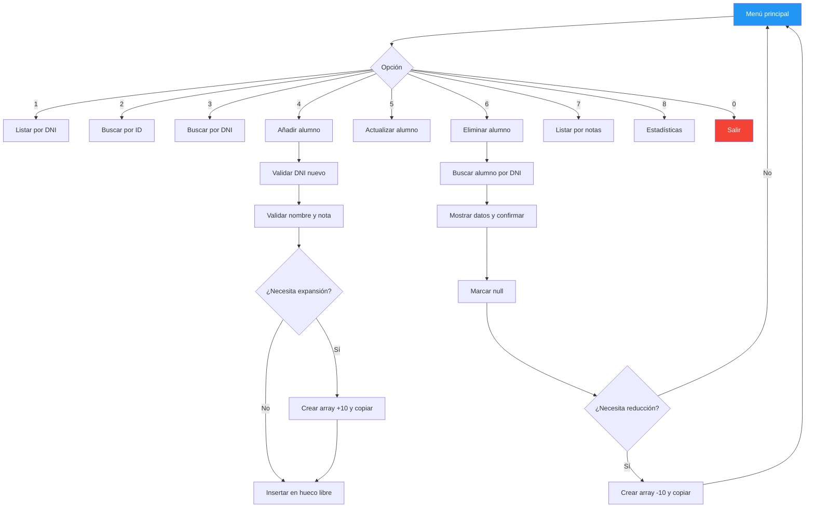
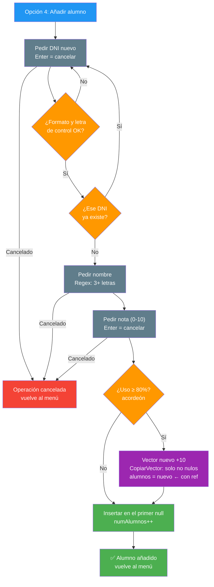
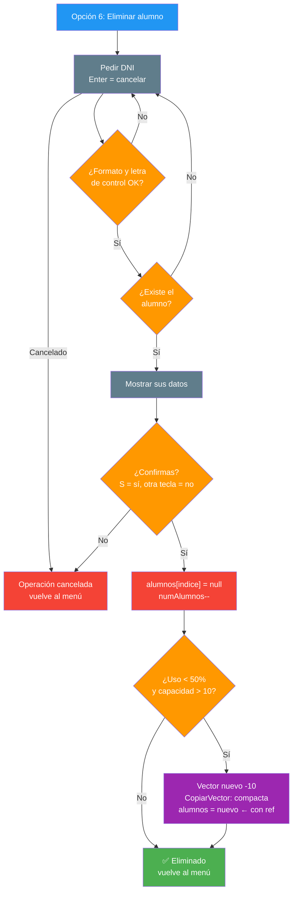

# 24. Base de Datos Alumnado

## Enunciado

Desarrolla una aplicación CRUD de gestión de base de datos de alumnos utilizando un array nullable `Alumno?[].` El programa debe permitir listar alumnos (ordenados por DNI o por nota), buscar por ID o DNI, añadir, actualizar y eliminar alumnos con validación completa de DNI (letra de control módulo 23). El array debe auto-redimensionarse: expandirse al 80% de ocupación y reducirse al 50%. Implementar ordenación con Bubble Sort y estadísticas (tasa de aprobado, nota media). Usar Serilog para logging.

## Conceptos Clave

- Structs nullable (`Alumno?[]`) para almacenar alumnos con huecos (null)
- Redimensión dinámica del array con `ref` (expansión +80%, reducción -50%)
- CRUD completo: Create, Read, Update, Delete
- Validación de DNI español: formato Regex `^\d{8}[A-Z]$` + letra de control con `letrasDni[numero % 23]`
- `Regex` para validación de entrada de usuario
- Bubble Sort con swap de tuplas: `(a, b) = (b, a)`
- `CultureInfo("es-ES")` para formato de números decimales
- Serilog para logging (`Log.Information`, `Log.Warning`, `Log.Debug`)
- Sobrecarga de métodos (`BuscarAlumnoPorDni`, `BuscarAlumnoPorId`)
- Pattern matching: `is { } alumno`, `?.` null-conditional, `.HasValue`
- `ref` para pasar referencias de arrays que pueden ser reasignados

## Solución

**Estructura de datos:**

- Array `Alumno?[]` con tamaño inicial 10. Cada posición puede contener un `Alumno` (struct con Id, Dni, NombreCompleto, Nota) o `null`.
- Contador `numAlumnos` para saber cuántos hay activos.

**Operaciones del menú:**

1. **Listar todos:** Extraer datos no nulos a un vector compacto, ordenar con Bubble Sort por DNI, imprimir en tabla.
2. **Buscar por ID/DNI:** Leer entrada validada, buscar índice con bucle lineal, mostrar resultado con pattern matching `is { } alumno`.
3. **Añadir:** Validar DNI (formato + letra + que no exista), validar nombre con Regex, validar nota (0-10). Redimensionar si necesario. Insertar en primer hueco libre (`null`).
4. **Actualizar:** Buscar alumno existente, mostrar datos actuales, pedir nuevos datos con confirmación, aplicar cambios.
5. **Eliminar:** Buscar alumno, mostrar datos, pedir confirmación, marcar posición como `null`, reducir array si necesario.
6. **Listar por notas:** Igual que listar pero ordenando por nota descendente.
7. **Estadísticas:** Recorrer array, contar aprobados (≥5.00) y suspensos, calcular nota media.

**Redimensión:**

- Expansión: Si `numAlumnos * 100 / length ≥ 80`, crear nuevo array de `length + 10` y copiar datos no nulos.
- Reducción: Si `numAlumnos * 100 / length < 50` y `length > 10`, crear nuevo array de `length - 10` (mínimo 10).

## Diagrama



## Flujo: crear alumno

Caso de uso **Create** del CRUD: cada campo se valida antes de tocar el vector y en cualquier momento se puede cancelar con Enter.



## Flujo: eliminar alumno

Caso de **Delete**: borra lógicamente (deja un `null` en la posición) y después decide si el acordeón encoge.



## El vector es un acordeón: tamaño fijo, nulls y memoria real

### ¿Qué es el acordeón?

El array es **estático**: `new Alumno?[10]` reserva diez posiciones en el momento del `new` y esa capacidad **no cambia sola** — un array no se puede estirar ni encoger: es como una caja de zapatos, o le cabe lo que le cabe o te haces otra.

El "acordeón" es lo que hacemos **nosotros** para simular esa elasticidad: cuando el vector se queda corto o le sobra sitio, **no lo modificamos: lo sustituimos por otro** de `length + 10` o `length - 10` y trasladamos dentro solo lo que hay de verdad —los **no nulos**—. Por eso el programa "respira": crece y encoge en bloques de 10, como un acordeón con sus gajos fijos.

Mientras tanto, el estado del vector se mide con dos números y su diferencia:

- `alumnos.Length` es la **capacidad**: las posiciones reservadas (siempre ≥ 10).
- `numAlumnos` son los **alumnos reales**: los que de verdad tienen datos.
- La diferencia son los **huecos `null`**: posiciones reservadas sin alumno dentro. Un `null` no guarda datos, pero sí ocupa su hueco del vector.

### ¿Por qué debemos hacerlo?

No es un capricho: sin el acordeón, el programa se rompe o gasta de más.

1. **Si no crece, no se puede crear.** Con el vector lleno y sin crecer no hay sitio para un alumno más: la búsqueda del primer hueco libre no encontraría nada y el alta fallaría —el programa incluso tiene preparado el aviso: *«No se pudo encontrar un hueco libre»*—. Como no podemos "añadir posiciones" a un array, la única salida es hacer otro vector más grande.
2. **Si no encoge, desperdicias memoria.** Tras eliminar casi todos los alumnos, el vector seguiría reservando sus posiciones con solo unos pocos alumnos dentro: **capacidad reservada no es memoria útil**. Al encoger, `CopiarVector` deja el vector **compacto** —solo no nulos, sin huecos—, la capacidad vuelve a acercarse a `numAlumnos` y el vector viejo —con todos sus huecos— lo recoge el **recolector de basura**: esa memoria queda libre para otros objetos.
3. **No podemos adivinar el tamaño final.** Es un programa interactivo: no sabemos si habrá 5 alumnos o 500. Empezar con un vector enorme sería guardar memoria "por si acaso" desde el primer día. El acordeón paga **la memoria justa, en el momento justo**: crece cuando hace falta y devuelve sitio cuando sobra.

### Por qué al 80 % y al 50 %, y en bloques de 10

Cada redimensión **cuesta trabajo**: crear el vector nuevo, copiar uno por uno los no nulos y esperar a que el recolector de basura recoja el anterior. Si el acordeón se moviera en cada alta y cada baja, estarías copiando el vector sin parar (alta, baja, alta, baja…). Por eso las reglas tienen juego:

- Se espera al **80 %** de uso para crecer y a bajar del **50 %** para encoger: entre ambos umbrales hay margen y el vector **no oscila**.
- Los saltos son de **10 posiciones**: pocos movimientos grandes, en vez de un montón de movimientos de un solo hueco.
- El mínimo es **10**: el acordeón nunca se cierra del todo y siempre queda sitio para una alta antes de volver a crecer.

> 💡 **Analogía:** Es como una mochila con gajos: si viene muy llena le añades uno y si vuelve casi vacía se lo quitas. No puedes estirar la mochila que tienes: te haces otra con el tamaño justo y trasladas lo que llevas dentro.

## El truco de `ref`: intercambiar el vector

**Esto es lo importante de este ejercicio.** Redimensionar no es "añadir huecos" al array: es crear **otro array distinto** y conseguir que la variable `alumnos` —la del `Main`, la que usan todas las funciones— apunte al nuevo:

```csharp
void RedimensionarSiNecesario(ref Alumno?[] alumnos, int total) {
    // ...
    alumnos = nuevoVector;   // ← sin ref, esta línea se pierde
}
```

- **Sin `ref`:** el parámetro sería una **copia** de la referencia; `alumnos = nuevoVector` cambiaría solo esa copia local. Al volver al menú, el programa seguiría mirando el array **viejo**: los datos copiados al nuevo se perderían de vista y la capacidad no habría cambiado de verdad.
- **Con `ref`:** el parámetro es un **alias de la variable del llamador**; al asignar, todos los que usan `alumnos` (menú, añadir, buscar, eliminar) pasan a ver el array nuevo. La asignación "viaja" hasta el `Main`.

> 📝 Lo mismo vale para `ReducirSiNecesario` y para el `ref numAlumnos`: sin `ref`, el contador de alumnos tampoco se actualizaría fuera de la función.

## Entradas y salidas saneadas (formularios en terminal)

No hay formulario gráfico: el "formulario" es texto en la terminal y se sanea con las mismas reglas que un formulario web — **un único punto de validación por campo y nada se confía de lo que se teclea**.

**Entradas (los "campos" del formulario):**

- `LeerDniValido`: formato (`^\d{8}[A-Z]$`) + letra de control (módulo 23) + existencia/unicidad. Si falla la letra, enseña la correcta; admite cancelar con Enter (o `0`).
- `LeerCadenaValidada`: campo genérico validado con su Regex (nombre, ID), cancelable con Enter.
- `LeerNotaValida`: rango 0.00–10.00 con coma o punto decimal, cancelable con Enter.
- `PedirConfirmacion`: el "botón" del formulario: `S` confirma, cualquier otra tecla cancela.

**Salidas (lo que se muestra):**

- `ImprimirInfoAlumno` e `ImprimirListado`: columnas alineadas con ancho fijo (`-10`, `-25`), notas con `"F2"` y `CultureInfo("es-ES")` (coma decimal y moneda).
- Mensajes para **el usuario** en consola con emojis (`✅`, `❌`) y **log para el programador** con Serilog (`Log.Warning`, `Log.Debug`): dos canales que no se mezclan.

> 💡 **Consejo:** Si un campo admite varios formatos válidos (la nota con coma o punto), la regla es una sola: valida en la entrada, normaliza justo después y el resto del programa solo ve un formato.
