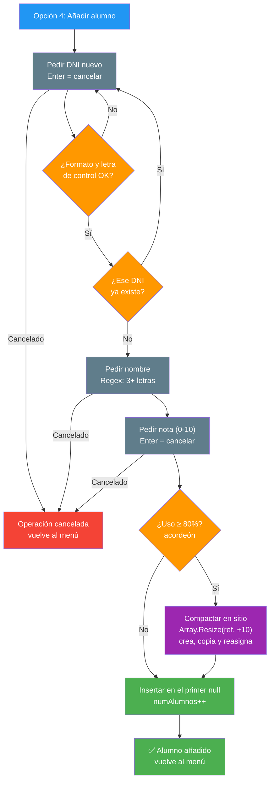
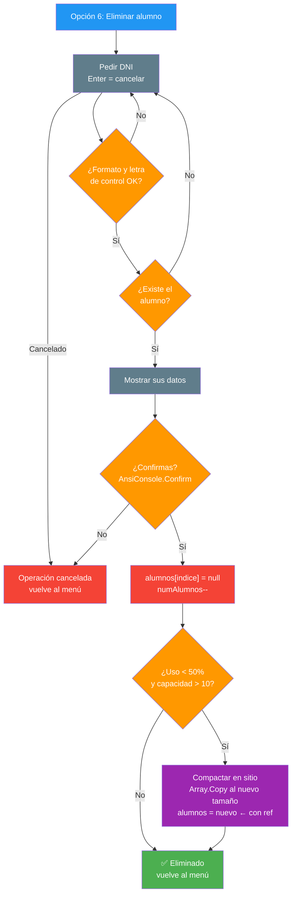

# 25. Base de datos alumnado advanced

## Enunciado

Versión mejorada de la base de datos de alumnado (ejemplo 24) incorporando la librería **Spectre.Console** para una interfaz de consola enriquecida. Toda la salida de texto se realiza con `AnsiConsole.MarkupLine`, las confirmaciones usan `AnsiConsole.Confirm`, las entradas validadas emplean `AnsiConsole.Prompt` con `TextPrompt<T>` y `ValidationResult`, y los listados se presentan en formato tabular con `Table`. Se mantiene la misma lógica CRUD y validación de DNI del ejemplo anterior; la redimensión y las copias del vector se resuelven ahora con las **funciones del sistema** (`Array.Resize`, `Array.Copy` y `Clone()`).

## Conceptos clave

- Todo lo del ejemplo 24 (CRUD, structs nullable, Regex, Bubble Sort, Serilog, redimensión, ref)
- **Spectre.Console**: `AnsiConsole.MarkupLine` para salida con markup
- `AnsiConsole.Confirm` para preguntas sí/no con estilo
- `TextPrompt<T>` con `ValidationRule` para entrada validada tipada
- `Table` de Spectre para formato tabular con columnas alineadas
- `ValidationResult` para errores de validación en prompts
- `Prompt` con pattern de validación integrado
- Separación de responsabilidades: misma lógica, diferente presentación
- **Gestión del vector con funciones del sistema**: `Array.Resize` (expandir), `Array.Copy` (reducir) y `Clone()` (copiar sin tocar el original), con la helper propia `CompactarEnSitu` que deja los datos válidos al principio

## Solución

La lógica CRUD es la misma que en el ejemplo 24; los cambios se centran en dos sitios: la capa de presentación (Spectre) y la gestión del vector, que aquí usa las funciones del sistema en lugar del código a mano:

**Cambios principales:**

- `Console.WriteLine` → `AnsiConsole.MarkupLine` con formato Spectre (ej: `[bold green]...[/]`).
- `Console.ReadKey` + confirmación manual → `AnsiConsole.Confirm("¿Mensaje?")` que retorna `bool`.
- Lectura de DNI/nombre/nota → `AnsiConsole.Prompt(new TextPrompt<string>("DNI: ").Validate(...))`.
- Listado en tabla → `new Table().Border(TableBorder.Rounded).AddColumn(...)` con filas formateadas.
- Mensajes de error → `AnsiConsole.MarkupLine("[red]ERROR: ...[/]")`.
- Mensajes de éxito → `AnsiConsole.MarkupLine("[green]OK: ...[/]")`.
- Redimensión y copias → funciones del sistema: `Array.Resize(ref, n)`, `Array.Copy` y `Clone()`, con `CompactarEnSitu` (a mano) para juntar los datos válidos antes de copiar.

**Estructura de un prompt con Spectre:**

```
var dni = AnsiConsole.Prompt(
    new TextPrompt<string>("Introduce el DNI:")
        .Validate(dni => ValidarDniCompleto(dni)
            ? ValidationResult.Success()
            : ValidationResult.Error("DNI inválido"))
);
```

**Estructura de una tabla con Spectre:**

```
var table = new Table().Border(TableBorder.Rounded);
table.AddColumn("ID").AddColumn("DNI").AddColumn("Nombre").AddColumn("Nota");
foreach (var a in alumnos)
    table.AddRow(a.Id.ToString(), a.Dni, a.NombreCompleto, a.Nota.ToString("F2"));
AnsiConsole.Write(table);
```

## Diagrama

La lógica es idéntica al ejemplo 24: mismos flujos de crear y eliminar, cambiando solo la interfaz (`Console` → `Spectre.Console`). Ahí van los dos casos de uso:

## Flujo: crear alumno

Caso de uso **Create** del CRUD: cada campo se valida antes de tocar el vector y en cualquier momento se puede cancelar con Enter (gracias a `.AllowEmpty()` en el `TextPrompt`).



## Flujo: eliminar alumno

Caso de **Delete**: borra lógicamente (deja un `null` en la posición) y después decide si el acordeón encoge. La confirmación es un `AnsiConsole.Confirm` de Spectre.



## El vector es un acordeón: tamaño fijo, nulls y memoria real

### ¿Qué es el acordeón?

El array es **estático**: `new Alumno?[10]` reserva diez posiciones en el momento del `new` y esa capacidad **no cambia sola** — un array no se puede estirar ni encoger: es como una caja de zapatos, o le cabe lo que le cabe o te haces otra.

El "acordeón" es lo que hacemos **nosotros** para simular esa elasticidad: cuando el vector se queda corto o le sobra sitio, **no lo modificamos: lo sustituimos por otro** de `length + 10` o `length - 10` y trasladamos dentro solo lo que hay de verdad —los **no nulos**—. Por eso el programa "respira": crece y encoge en bloques de 10, como un acordeón con sus gajos fijos.

Mientras tanto, el estado del vector se mide con dos números y su diferencia:

- `alumnos.Length` es la **capacidad**: las posiciones reservadas (siempre ≥ 10).
- `numAlumnos` son los **alumnos reales**: los que de verdad tienen datos.
- La diferencia son los **huecos `null`**: posiciones reservadas sin alumno dentro. Un `null` no guarda datos, pero sí ocupa su hueco del vector.

### ¿Por qué debemos hacerlo?

No es un capricho: sin el acordeón, el programa se rompe o gasta de más.

1. **Si no crece, no se puede crear.** Con el vector lleno y sin crecer no hay sitio para un alumno más: la búsqueda del primer hueco libre no encontraría nada y el alta fallaría —el programa incluso tiene preparado el aviso: *«No se pudo encontrar un hueco libre»*—. Como no podemos "añadir posiciones" a un array, la única salida es hacer otro vector más grande.
2. **Si no encoge, desperdicias memoria.** Tras eliminar casi todos los alumnos, el vector seguiría reservando sus posiciones con solo unos pocos alumnos dentro: **capacidad reservada no es memoria útil**. Al encoger, `CompactarEnSitu` deja el vector **compacto** —solo no nulos, sin huecos—, la capacidad vuelve a acercarse a `numAlumnos` y el vector viejo —con todos sus huecos— lo recoge el **recolector de basura**: esa memoria queda libre para otros objetos.
3. **No podemos adivinar el tamaño final.** Es un programa interactivo: no sabemos si habrá 5 alumnos o 500. Empezar con un vector enorme sería guardar memoria "por si acaso" desde el primer día. El acordeón paga **la memoria justa, en el momento justo**: crece cuando hace falta y devuelve sitio cuando sobra.

### Por qué al 80 % y al 50 %, y en bloques de 10

Cada redimensión **cuesta trabajo**: compactar, crear el vector nuevo, copiar los datos y esperar a que el recolector de basura recoja el anterior (aquí el trabajo pesado lo hacen `Array.Resize` y `Array.Copy` por nosotros). Si el acordeón se moviera en cada alta y cada baja, estarías copiando el vector sin parar (alta, baja, alta, baja…). Por eso las reglas tienen juego:

- Se espera al **80 %** de uso para crecer y a bajar del **50 %** para encoger: entre ambos umbrales hay margen y el vector **no oscila**.
- Los saltos son de **10 posiciones**: pocos movimientos grandes, en vez de un montón de movimientos de un solo hueco.
- El mínimo es **10**: el acordeón nunca se cierra del todo y siempre queda sitio para una alta antes de volver a crecer.

> 💡 **Analogía:** Es como una mochila con gajos: si viene muy llena le añades uno y si vuelve casi vacía se lo quitas. No puedes estirar la mochila que tienes: te haces otra con el tamaño justo y trasladas lo que llevas dentro.

## El truco de `ref`: intercambiar el vector

**Esto es lo importante de este ejercicio.** Redimensionar no es "añadir huecos" al array: es crear **otro array distinto** y conseguir que la variable `alumnos` —la del `Main`, la que usan todas las funciones— apunte al nuevo. En esta versión, la expansión lo hace `Array.Resize` por dentro y la reducción lo hacemos nosotros:

```csharp
void RedimensionarSiNecesario(ref Alumno?[] alumnos, int total) {
    // ...
    CompactarEnSitu(alumnos);
    Array.Resize(ref alumnos, nuevoTamano);  // ← sin ref, la reasignación se perdería
}
```

- **Sin `ref`:** el parámetro sería una **copia** de la referencia; tanto `alumnos = nuevoVector` (en la reducción) como la reasignación que hace `Array.Resize` por dentro (en la expansión) cambiarían solo esa copia local. Al volver al menú, el programa seguiría mirando el array **viejo**: los datos copiados al nuevo se perderían de vista y la capacidad no habría cambiado de verdad.
- **Con `ref`:** el parámetro es un **alias de la variable del llamador**; al reasignar, todos los que usan `alumnos` (menú, añadir, buscar, eliminar) pasan a ver el array nuevo. La asignación "viaja" hasta el `Main`.

> 📝 Lo mismo vale para `ReducirSiNecesario` y para el `ref numAlumnos`: sin `ref`, el contador de alumnos tampoco se actualizaría fuera de la función.

## Entradas y salidas saneadas (formularios en terminal)

No hay formulario gráfico: el "formulario" es texto en la terminal y se sanea con las mismas reglas que un formulario web — **un único punto de validación por campo y nada se confía de lo que se teclea**. En esta versión, la capa de presentación la pone Spectre.Console:

**Entradas (los "campos" del formulario):**

- `LeerDniValido`: `TextPrompt` con `.Validate(...)` que comprueba formato (`^\d{8}[A-Z]$`), letra de control (módulo 23) y existencia/unicidad; si falla la letra, el propio error enseña la correcta. `.AllowEmpty()` hace que Enter **cancele**.
- `LeerCadenaValidada`: campo genérico validado con su Regex (nombre, ID), cancelable con Enter.
- `LeerNotaValida`: rango 0.00–10.00 con coma o punto decimal, cancelable con Enter.
- `AnsiConsole.Confirm`: el "botón" del formulario: devuelve `true` o `false` con estilo (equivalente al `PedirConfirmacion` con `ReadKey` de la versión normal).

**Salidas (lo que se muestra):**

- `AnsiConsole.MarkupLine` con marcas `[bold green]...[/]`: mensajes de éxito y error con color.
- Listados con `Table` de Spectre (`TableBorder.Rounded`): columnas alineadas y notas con `"F2"` y `CultureInfo("es-ES")`.
- **Log para el programador** con Serilog (`Log.Warning`, `Log.Debug`): separado de lo que ve el usuario.

> 💡 **Consejo:** Si un campo admite varios formatos válidos (la nota con coma o punto), la regla es una sola: valida en la entrada, normaliza justo después y el resto del programa solo ve un formato.
