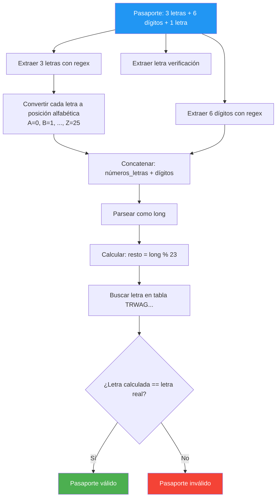

# 26. Validador de DNI y Pasaporte Español

## Enunciado
Crea un programa que valide documentos de identidad españoles:

1. **DNI español**: 8 dígitos + 1 letra de verificación. La letra se calcula como la posición en la tabla `TRWAGMYFPDXBNJZSQVHLCKE` del resto de dividir los 8 dígitos entre 23.

2. **Pasaporte español**: 3 letras + 6 dígitos + 1 letra de verificación. Las 3 letras se convierten a su posición alfabética (A=0, B=1, ..., Z=25), se concatenan con los 6 dígitos formando un número largo, y se aplica módulo 23 sobre la tabla de letras.

## Conceptos Clave
- `Regex` con grupos nombrados `(?<nombre>...)` — extracción de partes del documento
- `StringBuilder` — construcción eficiente de cadenas
- `long.Parse()` — parsing de números grandes (concatenación de letras + dígitos)
- Módulo aritmético `%` — cálculo de la letra de verificación
- Operador `?.` (null-conditional) y `??` (null-coalescing)
- `string.ToUpper()` — normalización de entrada
- `string.IndexOf()` — posición de un carácter en una cadena

## Solución

### Validación del DNI
1. Se valida el formato con regex `^\d{8}[TRWAGMYFPDXBNJZSQVHLCKE]$`.
2. Se extraen los 8 dígitos y se convierten a `int`.
3. Se calcula `numero % 23` como índice en la tabla `TRWAGMYFPDXBNJZSQVHLCKE`.
4. Se compara la letra calculada con la letra del DNI.

### Validación del Pasaporte
1. Se valida con regex `^(?<tresletras>[A-Z]{3})(?<numero>[0-9]{6})(?<letra>[TRWAGMYFPDXBNJZSQVHLCKE])$`.
2. Se extraen los 3 grupos: letras, número y letra.
3. Se convierten las 3 letras a números (posición alfabética: A=0, B=1...) y se concatenan con los 6 dígitos.
4. Se parsea el resultado como `long` y se aplica `% 23`.
5. Se compara la letra calculada con la letra del pasaporte.

## Diagrama

