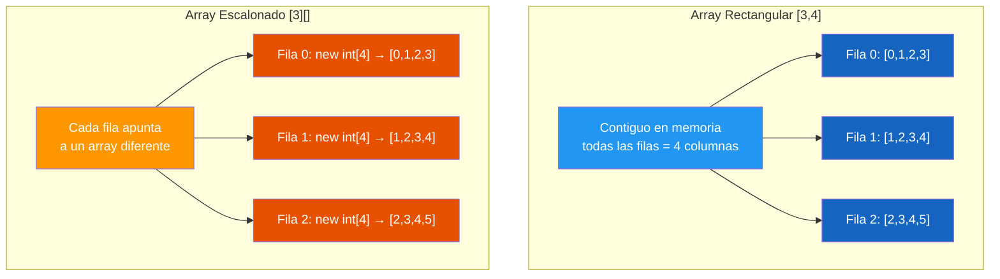

# 27. Arrays Multidimensionales, Expresiones Regulares y Enums

## Enunciado
Crea un tutorial interactivo que cubra tres temas fundamentales de C#:

1. **Arrays multidimensionales**: Crea un array rectangular `[3,4]` y uno escalonado `[3][]`, muéstralos por consola y muestra sus propiedades (`Length`, `Rank`, `GetLength()`).

2. **Expresiones regulares con grupos**: Valida un DNI español usando regex sin grupos y luego con grupos de captura (posicionales y nombrados), extracción del número y la letra.

3. **Enums**: Crea un enum `DiasSemana` con valores personalizados (Viernes = 12), practica casting entre `int` y enum, usa `nameof()`, `Enum.Parse()`, y crea arrays de enums con valores aleatorios.

## Conceptos Clave
- `int[,]` — array rectangular (matriz)
- `int[][]` — array escalonado (jagged)
- `Array.Length`, `Array.Rank`, `Array.GetLength(dim)`
- `Regex.Match()` con grupos de captura `(?<nombre>...)` y posicionales `(...)`
- `match.Groups["nombre"].Value` — extracción por nombre de grupo
- `enum` con valores personalizados y tipo subyacente
- `(EnumType)intValue` — casting int → enum
- `Enum.Parse(typeof(EnumType), string)` — conversión string → enum
- `nameof(EnumType.Member)` — nombre del miembro como string

## Solución

### Arrays
1. **Rectangular**: Se crea `new int[3,4]`, se rellena con `i+j`, se accede con `array[i,j]`. Se muestra `GetLength(0)` (filas) y `GetLength(1)` (columnas).
2. **Escalonado**: Se crea `new int[3][]`, se inicializa cada fila con `new int[4]` en un bucle. Se accede con `array[i][j]`. Se muestra `array[i].Length` por fila.

### Regex
1. **Sin grupos**: Se valida con `^\d{8}[A-Z]$`, luego se extraen número y letra con `Substring` e índice.
2. **Con grupos**: Se usa `^(\d{8})([A-Z])$` o con alias `^(?<numero>\d{8})(?<letra>[A-Z])$`. Se extraen con `match.Groups[1]` o `match.Groups["numero"]`.

### Enums
1. Se declara `DiasSemana` con `Lunes=0, Martes=1, ..., Viernes=12, Sabado=13, Domingo=14`.
2. Se practica casting: `(DiasSemana)1` → `Martes`, `(DiasSemana)10` → `10` (no existe).
3. Se usa `nameof(DiasSemana.Lunes)` → `"Lunes"`.
4. Se usa `Enum.Parse(typeof(DiasSemana), "Lunes")` → `DiasSemana.Lunes`.

## Diagrama

