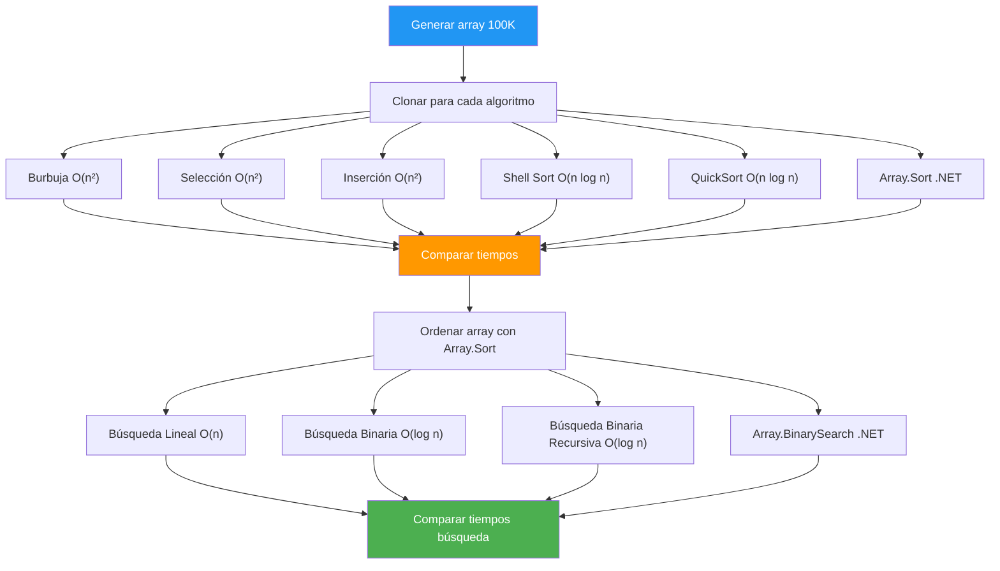

# 28. Ordenación y Búsqueda

## Enunciado

Desarrolla un programa que genere un array de 100.000 enteros aleatorios y realice un benchmark comparativo de algoritmos de ordenación (Burbuja, Selección, Inserción, Shell Sort, QuickSort y `Array.Sort` de .NET). Mide el tiempo de ejecución de cada algoritmo con `Stopwatch`. A continuación, realiza un benchmark de algoritmos de búsqueda (búsqueda lineal, búsqueda binaria manual —iterativa y recursiva— y `Array.BinarySearch` de .NET) sobre el array ordenado, midiendo el tiempo en nanosegundos.

## Conceptos Clave

- Arrays 1D de enteros
- `Stopwatch` para medición de tiempo (`Start`, `Stop`, `Restart`, `ElapsedMilliseconds`)
- Clonación de arrays con `Clone()` para preservar el original en cada prueba
- Funciones locales (local functions) para implementar cada algoritmo
- Complejidad temporal: O(n²) vs O(n log n)
- Búsqueda lineal O(n) vs búsqueda binaria O(log n), en versión iterativa y recursiva
- Recursión: caso base y llamada recursiva en la búsqueda binaria
- Lógica de intercambio (swap) con variable auxiliar
- Conversión de ticks a nanosegundos con `Stopwatch.Frequency`

## Solución

**Fase 1 — Ordenación:**

1. Generar un array de 100.000 enteros aleatorios con `Random`.
2. Para cada algoritmo de ordenación:
   - Clonar el array original con `Clone()` para que cada algoritmo trabaje con datos idénticos.
   - Iniciar `Stopwatch`, ejecutar el algoritmo, detener `Stopwatch`.
   - Mostrar el tiempo en milisegundos.
3. Comparar los tiempos obtenidos.

**Fase 2 — Búsqueda:**

1. Clonar y ordenar el array con `Array.Sort`.
2. Seleccionar un elemento aleatorio que exista en el array.
3. Para cada algoritmo de búsqueda:
   - Iniciar `Stopwatch`, ejecutar la búsqueda, detener `Stopwatch`.
   - Convertir los ticks a nanosegundos.
   - Mostrar el resultado.

**Algoritmos implementados:**

- **Burbuja:** Dos bucles anidados, compara elementos adyacentes y los intercambia si están desordenados.
- **Selección:** Busca el mínimo en el subarray no ordenado y lo intercambia con la primera posición.
- **Inserción:** Inserta cada elemento en su posición correcta dentro del subarray ya ordenado.
- **Shell Sort:** Variación de inserción con saltos decrecientes (h = 3*h + 1).
- **QuickSort:** Divide el array usando un pivote, ordena recursivamente cada mitad.
- **Búsqueda lineal:** Recorre el array elemento a elemento hasta encontrar el valor.
- **Búsqueda binaria:** Divide el array por la mitad en cada paso, descartando la mitad que no contiene el objetivo.
- **Búsqueda binaria recursiva:** La misma idea, pero la función se llama a sí misma con la mitad que queda; se corta con el caso base `if (left > right) return -1;`.

## Diagrama

