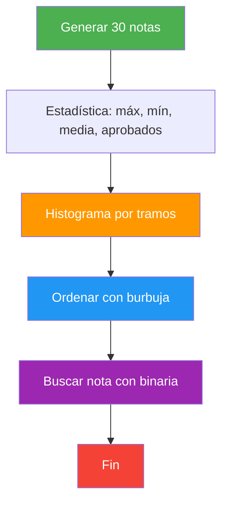
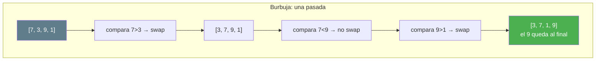
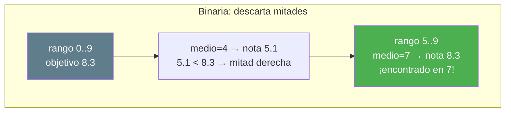

# 29. Informe de notas de la clase

## Enunciado

Desarrolla un informe de notas para una clase de **30 alumnos**, con notas aleatorias de `0.0` a `10.0` (un decimal). El programa debe calcular la estadística, dibujar un histograma, **ordenar** las notas con **burbuja** y localizar una nota con **búsqueda binaria** sobre el array ya ordenado. Cada operación en su propia función (SRP).

1. **Estadística**: máximo, mínimo, media y nº de aprobados (≥ 5).
2. **Histograma**: 4 tramos (0-4.9, 5-6.9, 7-8.9, 9-10) con una barra de texto proporcional.
3. **Ordenación por burbuja**: modifica el array original de menor a mayor.
4. **Búsqueda binaria**: localiza una nota aleatoria del array sobre el ordenado (con tolerancia, por ser `double`).

## Conceptos Clave

- `double[]` para notas con decimales
- Generar decimales "exactos": entero aleatorio `0-100` dividido entre `10.0`
- **Burbuja**: comparar vecinos e intercambiar; `n-1` pasadas + optimización del banderín
- **Búsqueda binaria**: `izquierda`, `derecha`, `medio`; descarta la mitad en cada paso
- La binaria **exige orden previo** — por eso se ordena antes de buscar
- Comparar `double` con **tolerancia** (`Math.Abs(a - b) <= Tolerancia`) en vez de `==`
- Histograma con contadores por tramos

## Solución

1. **Generación**: `GenerarNotas()` rellena `double[30]` con un decimal aleatorio.

2. **Estadística**: `CalcularMaximo()`, `CalcularMinimo()`, `CalcularMedia()` y `ContarAprobados()` — bucles con guarda o acumulador.

3. **Histograma**: `MostrarHistograma()` cuenta los 4 tramos con `if / else if` y `ImprimirBarra()` dibuja una fila de `█` (uno por alumno).

4. **Ordenar y buscar**:
   - `OrdenarPorBurbuja()` modifica el array original (paso por referencia implícita) usando intercambio de vecinos, con banderín de optimización.
   - `BuscarBinaria()` trabaja sobre el array ordenado: calcula el `medio`, compara con tolerancia y descarta mitades hasta encontrar o agotar el rango.

## Diagrama

