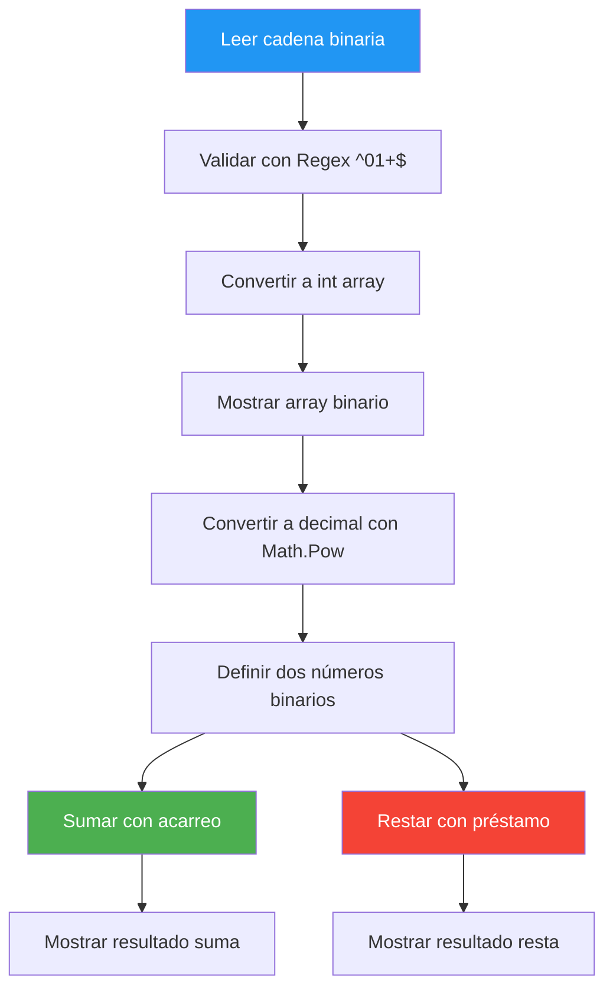
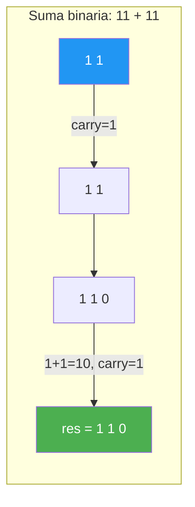

# 32. Binarios

## Enunciado

Desarrolla una calculadora de números binarios que permita al usuario introducir cadenas binarias, validarlas con expresiones regulares, convertirlas a arrays de enteros, y realizar operaciones de suma binaria con acarreo y resta con préstamo. También debe convertir arrays binarios a su equivalente decimal utilizando notación posicional.

## Conceptos Clave

- Arrays de enteros como representación de dígitos binarios (`int[]`)
- Validación con Regex `^[01]+$` para cadenas binarias
- Conversión binario → decimal con `Math.Pow(2, posición)` (notación posicional)
- Suma binaria con acarreo (`carry`)
- Resta binaria con préstamo (`borrow`)
- Redimensión/padding de arrays con ceros a la izquierda
- `Clone()` para crear copias inmutables antes de modificar
- Conversión de cadena a array de enteros con `int.Parse(char.ToString())`
- Iteración de derecha a izquierda para procesar dígitos desde el menos significativo

## Solución

**Lectura y validación:**

1. Pedir cadena al usuario en bucle hasta que sea válida (solo contiene '0' y '1').
2. Validar con `Regex.IsMatch(line, "^[01]+$")`.
3. Convertir la cadena a `int[]` parseando cada carácter.

**Conversión binario a decimal:**

1. Recorrer el array de izquierda a derecha.
2. Para cada posición `i`, calcular `num[i] * 2^(length-1-i)` y acumular el resultado.

**Suma binaria:**

1. Clonar los arrays originales.
2. Igualar longitudes con padding de ceros a la izquierda.
3. Crear resultado de tamaño `max + 1` (para posible acarreo final).
4. Recorrer de derecha a izquierda: `suma = n1[i] + n2[i] + carry`.
5. `carry = suma > 1 ? 1 : 0`, `resultado[i+1] = suma % 2`.
6. Si queda acarreo al final, poner `res[0] = 1`.

**Resta binaria:**

1. Clonar y igualar longitudes.
2. Recorrer de derecha a izquierda: `diff = n1[i] - n2[i] - borrow`.
3. Si `diff < 0`: `borrow = 1`, `res[i] = |diff + 2| % 2`.
4. Si `diff ≥ 0`: `borrow = 0`, `res[i] = diff`.

## Diagrama

