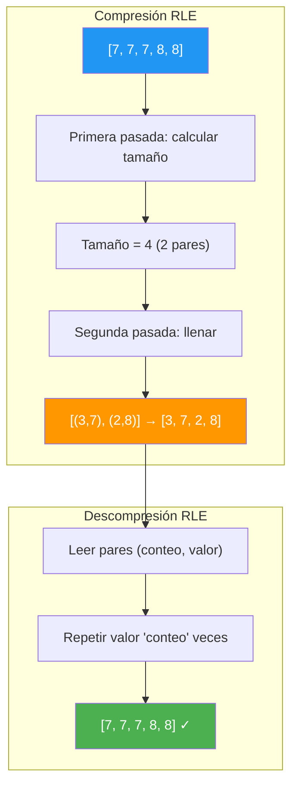

# 33. Compresor Descompresor

## Enunciado

Desarrolla un programa que implemente el algoritmo de compresión **Run-Length Encoding (RLE)** y su descompresión sobre arrays de enteros. Los elementos consecutivos iguales se almacenan como pares `(conteo, valor)`. El programa debe ejecutar 5 casos de prueba verificando la integridad del ciclo compresión → descompresión (el array descomprimido debe ser idéntico al original).

## Conceptos Clave

- Algoritmo Run-Length Encoding (RLE): compresión por repetición consecutiva
- **Dos pasadas** en la compresión: primera para calcular el tamaño, segunda para llenar
- Arrays de enteros como entrada y salida
- `while` con gestión de índice para recorrer secuencias
- Expresiones de colección modernas: `[0, 1, 2]`
- Patrón de casos de prueba: verificar que `Descomprimir(Comprimir(array)) == array`
- `string.Join` para impresión formateada de arrays

## Solución

**Compresión (RLE):**

1. **Primera pasada — Calcular tamaño:** Recorrer el array. Por cada grupo de elementos consecutivos iguales, sumar 2 al tamaño del array comprimido (un par `(conteo, valor)`).
2. **Segunda pasada — Llenar:** Recorrer de nuevo. Para cada grupo, almacenar el conteo y el valor en el array comprimido. Avanzar el índice `i` hasta el siguiente grupo diferente.

**Descompresión:**

1. **Primera pasada — Calcular tamaño:** Recorrer el array comprimido de 2 en 2. El primer elemento de cada par es el conteo; sumar todos los conteos para obtener el tamaño original.
2. **Segunda pasada — Llenar:** Recorrer de 2 en 2. Por cada par `(count, value)`, escribir `value` repetido `count` veces en el array descomprimido.

**Caso de prueba:**

- Ejecutar 5 arrays diferentes (sin repetidos, con repetidos, uno solo elemento, todos iguales, múltiples secuencias).
- Para cada uno: mostrar original, comprimido y descomprimido.
- Verificar que descomprimido == original.

## Diagrama

