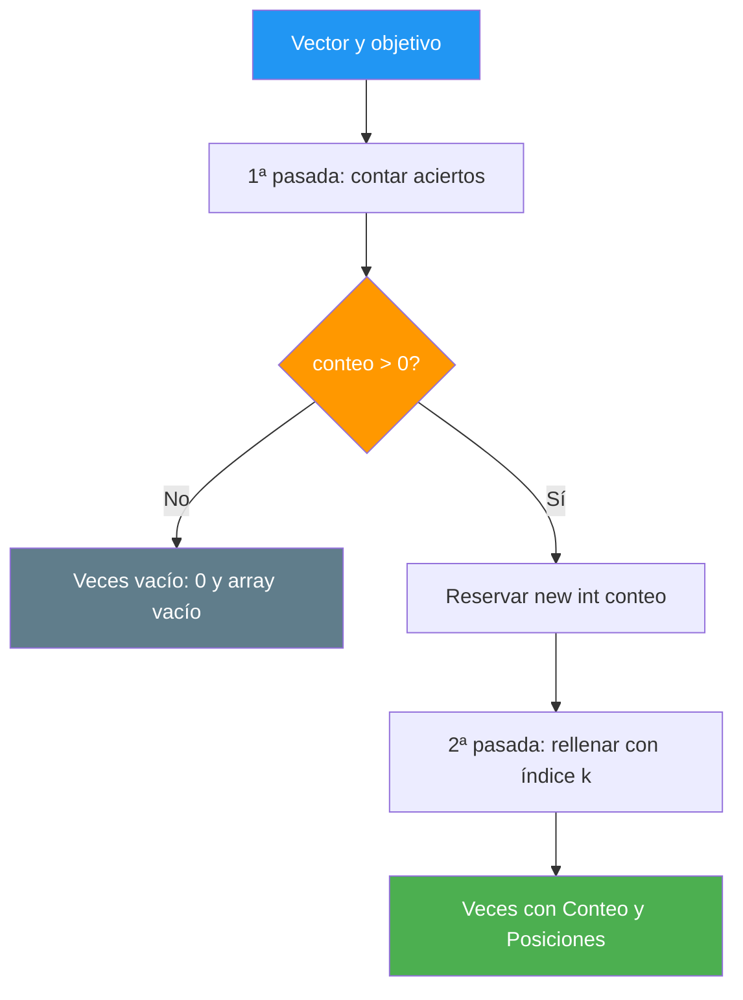

# 34. Veces en un vector

## Enunciado

Dado un vector de enteros y un número, decir **cuántas veces aparece** y **en qué posiciones**. Las dos respuestas se agrupan en un struct `Veces` que contiene un entero (el contador) y un array de tantas posiciones como el contador.

## Conceptos clave

- `int[]` y recorrido completo con `for` — tema 2.2
- Struct como contenedor de **varios resultados** a la vez
- **Dos pasadas** sobre el mismo vector: primero contar, después rellenar
- Reserva de array con el **tamaño exacto** (`new int[conteo]`)
- Índice de **escritura** (`k`) separado del índice de **lectura** (`i`)
- `Early Return` cuando no hay nada que buscar
- Paso de un array a funciones sin modificar el original

## Solución

La clave del ejercicio es que **un array en C# no crece**. No podemos ir añadiendo posiciones a medida que encontramos el número, porque no existe un `Add` en los arrays: habría que reasignar el array entero dentro del bucle, lo que convertiría un trabajo lineal en uno cuadrático.

La salida limpia es partir el problema en dos pasadas:

1. **Primera pasada — contar.** Recorremos el vector entero y solo incrementamos un contador. Al final sabemos cuántos huecos necesitamos.
2. **Reserva exacta.** Con ese contador creamos el array: `new int[conteo]`. Ni un hueco de más ni de menos.
3. **Segunda pasada — rellenar.** Recorremos el vector otra vez y, cada vez que hay un acierto, guardamos el índice en el hueco que toca.

En la segunda pasada conviene usar **dos índices distintos**: `i` avanza siempre (porque hay que mirar todo), mientras que `k` avanza solo cuando hay un acierto (porque es el que dice en qué hueco del array de resultado escribir). Confundirlos es el error clásico de este ejercicio.

📌 Ejemplo real: esto es lo que hace un **informe de errores de un despliegue**. El contador es el número de incidencias; el array de posiciones son los instantes exactos en los que ocurrieron. Sin el contador no sabes cuánta memoria reservar; sin las posiciones no sabes cuándo pasó.

## Diagrama

