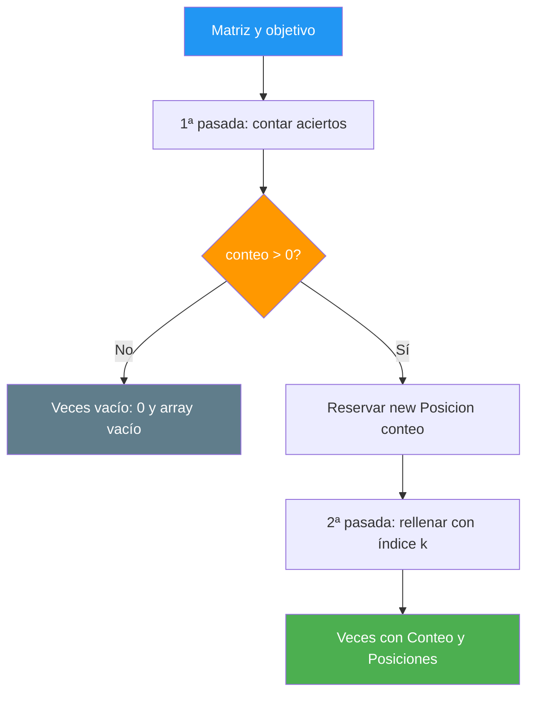

# 35. Veces en una matriz

## Enunciado

Dado una matriz de enteros y un número, decir **cuántas veces aparece** y **en qué celdas aparece**. Como una celda se identifica con dos índices, la posición se guarda en un struct `Posicion` (fila y columna), y el resultado entero viaja dentro de un struct `Veces` que contiene el contador y el array de posiciones.

## Conceptos clave

- `int[,]` y acceso por dos índices
- `GetLength(0)` para las filas y `GetLength(1)` para las columnas
- Recorrido por filas con **dos bucles anidados**
- **Struct anidado**: `Posicion[]` dentro de `Veces`
- **Dos pasadas** sobre la misma matriz: contar y luego rellenar
- Reserva de array con el **tamaño exacto** (`new Posicion[conteo]`)
- El **orden del recorrido** decide el orden de las posiciones devueltas

## Solución

Este ejercicio es el mismo que el del vector (ejemplo 34) con una diferencia que lo cambia todo: **una celda necesita dos números para identificarse**. En el vector bastaba un entero porque es unidimensional; aquí la posición es `(fila, columna)`.

Esa diferencia obliga a meter la posición en un struct `Posicion`. La alternativa —dos arrays paralelos, `filas[]` y `columnas[]`— funciona, pero es una trampa: se pueden desincronizar, hay que mantener dos tamaños iguales y el código que las lee se vuelve ilegible. Un struct agrupa lo que siempre va junto.

El algoritmo conserva la misma estructura de dos pasadas:

1. **Primera pasada — contar.** Recorremos la matriz entera con dos bucles anidados y solo incrementamos un contador.
2. **Reserva exacta.** Creamos el array de `Posicion` con ese contador.
3. **Segunda pasada — rellenar.** Cada acierto guarda una `Posicion` nueva en el hueco que toca.

En la segunda pasada se usan **tres índices**: `i` y `j` recorren la matriz (avanzan siempre), mientras que `k` avanza solo cuando hay acierto y dice en qué hueco del array de resultado escribir.

📌 Ejemplo real: es lo que hace un **buscaminas** al revelar cuántas minas rodean una celda, o un **mapa de calor** de una tienda online mostrando en qué estanterías del plano se repiten más los productos. El contador es el total; el array de `Posicion` son las coordenadas exactas del plano.

> 💡 **Consejo:** usa una matriz **no cuadrada** (por ejemplo 5×7) mientras pruebes. Si usas una cuadrada, los errores de límite pasan desapercibidos porque `GetLength(0)` y `GetLength(1)` dan el mismo número y todo "cuadra" por casualidad.

## Diagrama

