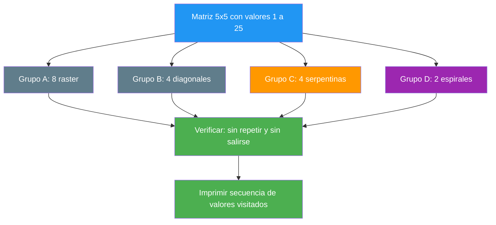

# 36. Recorridos de una matriz

## Enunciado

Recorrer una matriz de enteros jugando con los índices de los dos bucles anidados, implementando cada variante como **una función independiente**: 8 recorridos raster (filas/columnas ascendentes y descendentes en todas las combinaciones), 4 diagonales de las esquinas, 4 serpentinas y 2 espirales — **18 en total**.

## Conceptos clave

- `int[,]` y acceso por dos índices
- `GetLength(0)` para las filas y `GetLength(1)` para las columnas
- Dos bucles anidados: el **externo** decide el eje y el **interno** la dirección dentro de ese eje
- Un recorrido recto = 2 (eje externo) × 2 (su dirección) × 2 (dirección del interno) = **8 combinaciones**
- `while` con dos condiciones de parada para las diagonales
- Marco de cuatro límites (`arriba`, `abajo`, `izquierda`, `derecha`) para la espiral
- `struct Posicion` como resultado de un recorrido y `HashSet` para validar
- Matriz **cuadrada** (5×5): 25 celdas, el patrón de cada recorrido se lee de un vistazo

## Solución

### Los 8 raster: tres decisiones y nada más

Todos los recorridos rectos tienen el mismo esqueleto, dos bucles anidados. Lo único que cambia son tres decisiones:

1. **¿Qué eje es el bucle externo?** ¿filas o columnas?
2. **¿Hacia dónde va ese bucle externo?** ¿`i++` o `i--`?
3. **¿Hacia dónde va el bucle interno?** ¿`j++` o `j--`?

2 × 2 × 2 = 8. Los ocho que enumeraste son exactamente esas ocho combinaciones: ninguno sobra, ninguno falta.

📌 Ejemplo real: al leer un **CSV o un Excel** decides si lo procesas fila a fila (normal) o columna a columna (para calcular totales por columna). Es el mismo conjunto de celdas en otro orden.

### Las 4 diagonales: un solo `while`

Aquí ya no hay dos bucles anidados. Hay **un bucle `while`** que avanza en dos direcciones a la vez: una fila para arriba o abajo, y una columna para el lado contrario. El bucle termina cuando uno de los dos índices se queda fuera de la matriz.

| Recorrido | Esquina de salida | Avance | Constante |
|-----------|-------------------|--------|-----------|
| **09.** izq→der ascendente | inferior izquierda | `i--`, `j++` | `i + j` (secundaria `/`) |
| **10.** izq→der descendente | superior izquierda | `i++`, `j++` | `i - j` (principal `\`) |
| **11.** der→izq ascendente | inferior derecha | `i--`, `j--` | `i - j` (principal `\`) |
| **12.** der→izq descendente | superior derecha | `i++`, `j--` | `i + j` (secundaria `/`) |

> 📝 **Nota:** cada uno de estos cuatro recorre **una sola diagonal** completa. El ejercicio de "recorrer todas las diagonales" es una variante distinta, con `filas + columnas - 1` diagonales por familia.

### Las 4 serpentina: el raster que se zigzaguea

Mismo esqueleto que el raster, con **una sola diferencia**: dentro del bucle externo, el bucle interno **cambia de dirección** cuando el índice externo es impar.

```csharp
if (i % 2 == 0)
    for (int j = 0; j < columnas; j++)          // ← izq a der
        ...
else
    for (int j = columnas - 1; j >= 0; j--)     // ← der a izquierda
        ...
```

Esa alternancia es todo el truco. Hay 4 variantes: por filas o por columnas × sentido inicial.

### Las 2 espiral: un marco que se estrecha

Se mantienen cuatro límites vivos — `arriba`, `abajo`, `izquierda`, `derecha` — que forman un marco alrededor de lo que queda por visitar. En cada vuelta se **consume un borde entero** y el marco se encoge. Cuando los límites se cruzan, ya no queda nada.

Los dos `if` con guardia (`if (arriba <= abajo)` y `if (izquierda <= derecha)`) son la parte delicada: sin ellos, cuando en el marco **ya queda una sola fila o una sola columna**, se recorre ese borde dos veces y se repiten celdas.

## ¿Por qué son importantes la serpentina y la espiral?

Los 8 raster y las diagonales son el **alfabeto**: te enseñan a mover los índices. La serpentina y la espiral son las **primeras palabras** con sentido, porque son las que aparecen fuera de los apuntes.

### La serpentina: el mundo real no va en línea recta

📌 Ejemplo real: **una impresora**.

Cuando una impresora de inyección de tinta imprime una página, la cabeza no va de izquierda a derecha, vuelve al principio, y otra vez de izquierda a derecha. **Eso desperdiciaría la mitad del tiempo** viajando en vacío. En su lugar, imprime de izquierda a derecha, baja una línea y sigue de derecha a izquierda, y así sucesivamente. La serpentina es exactamente ese zigzag.

📌 Ejemplo real: **un tractor arando un campo**.

Un tractor arando una parcela rectangular no vuelve al principio por el camino más largo: ara la franja 1 en un sentido, da la vuelta en el extremo y ara la franja 2 en el contrario. Se llama *boustrophedon* (del griego "como el buey gira"): es el recorrido óptimo para cubrir una superficie **sin repetir ni saltarse nada, minimizando el desplazamiento muerto**.

📌 Ejemplo real: **un escáner y un lector de código de barras**.

Un escáner de documentos barre la imagen línea a línea alternando el sentido. Un lector de código de barras sobre una cinta transportadora hace lo mismo. Y una **impresora láser** barre la página con el mismo patrón.

**¿Y en DAW?** Es el mismo patrón de una **tabla HTML** al renderizar celda a celda, o de un **canvas** al pintar píxeles. Y, sobre todo, es el patrón que usa cualquier algoritmo que **cubra una superficie por franjas**: mapas de calor, generación de terreno, relleno de áreas.

**Lo que la hace importante para ti:** es la combinación de tus propios 8 raster. Si entiendes los 8, la serpentina te sale de gratis — solo tienes que alternar el tercero. Es "el noveno recorrido que no sabías que te faltaba", y el que separa a quien sabe mover índices de quien sabe resolver problemas.

### La espiral: el clásico de examen y de entrevista

📌 Ejemplo real: **la pregunta "Spiral Matrix"**.

Es una de las preguntas más pedidas en entrevistas técnicas y en exámenes de programación. En LeetCode tiene más de 8.000 votos positivos y aparece en las listas de "las 100 preguntas imprescindibles". Si vas a una entrevista de programación en Java, C# o Python, hay una probabilidad alta de que te la planteen.

**¿Por qué les gusta tanto?** Porque en una sola pregunta comprueba **cinco cosas a la vez**:

1. **Control de los dos índices.** No basta con saber moverlos: hay que mantener cuatro límites coordinados.
2. **Manejo de casos límite.** Matrices de 1×1, 1×N, N×1, no cuadradas. Si no pones las guardias, se rompe.
3. **Pensamiento incremental.** La solución no es "predecir el camino entero", es "recorrer un borde y encoger el marco". Eso es abstracción.
4. **Disciplina de estructuras de datos.** La solución ingenua (marcar cada celda visitada en una matriz auxiliar) funciona; la buena (cuatro límites) no necesita memoria extra.
5. **Capacidad de depurar.** Un fallo en la espiral produce celdas repetidas o celdas saltadas, y encontrar cuál de las cuatro guardias falla es depurar de verdad.

📌 Ejemplo real: **la interfaz de un juego**.

En muchos juegos, la cámara o el cursor recorren la pantalla en espiral al buscar objetivos, y los **menús circulares** (como el radial de un videojuego) se navegan girando. También la ves en **mapas del minimapa** al explorar, y en algoritmos de **búsqueda de área**.

📌 Ejemplo real: **compresión de imágenes**.

Los algoritmos de compresión (JPEG, por ejemplo) trabajan en bloques de 8×8 píxeles, y el orden en que se procesan los coeficientes de cada bloque sigue un patrón fijo de barrido. Entender que **el orden de recorrido es una decisión de diseño**, y no un detalle, es justo lo que te lleva de "sé escribir bucles" a "sé diseñar algoritmos".

**Lo que la hace importante para ti:** es el recorrido que **más se parece a un problema real**. Los raster son mecánicos; la espiral te obliga a mantener un estado (los cuatro límites) que cambia en cada vuelta, y a pensar qué pasa cuando el estado se agota. Eso es programación, no solo sintaxis.

> 💡 **Consejo:** para el examen, practica dibujando la espiral en papel sobre una matriz 5×5 **antes de escribir código**. Primero el algoritmo en papel, después la codificación. Si sabes decir en qué orden se visitan las celdas, el código es casi transcribirlo.

## Verificación

El programa no solo imprime los 18 recorridos: **comprueba cada uno**. Un recorrido es válido cuando:

- ninguna celda se sale de los límites de la matriz,
- ninguna celda se visita dos veces,
- si el recorrido promete cobertura completa, visita exactamente `filas × columnas` celdas.

Para eso usa un `HashSet<Posicion>`: los structs comparan **por valor**, así que `Add` devuelve `false` en cuanto una celda ya estaba. El recorrido 01 y el 17 visitan las mismas 25 celdas, pero en órdenes totalmente distintos — la comprobación es la que valida el orden.

## Diagrama


