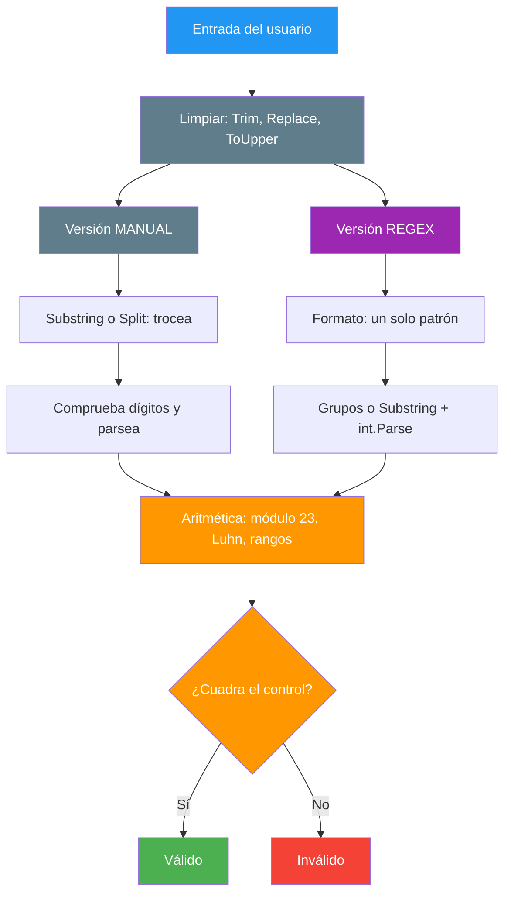

# 37. Validadores de DNI, NIE, matrícula, tarjeta y fecha: manual contra regex

## Enunciado

Validar cinco documentos reales de dos formas distintas: primero **a mano** con funciones de cadena (`if`, `for`, `foreach`, `Substring`, `Split`, aritmética de caracteres) y después con **expresiones regulares**. Los cinco casos son:

1. **DNI / NIF**: 8 números y una letra, donde la letra la dice el resto de dividir entre 23.
2. **NIE**: una inicial `X`, `Y` o `Z`, 7 números y la misma letra de control.
3. **Matrícula española**: `NNNNLLL`, con un conjunto cerrado de 20 letras.
4. **Tarjeta de crédito**: 16 cifras con prefijo Visa o Mastercard y dígito de control Luhn.
5. **Fecha**: `dd-mm-yyyy` o `dd/mm/yyyy`, con rangos de día, mes y año.

La batería de pruebas corre los 56 casos sola y marca con ⚠️ a cualquier validador que se aparte de lo esperado.

## Conceptos clave

- `Length`, acceso por índice, `Substring`, `Split`, `Trim`, `Replace`, `ToUpper`
- `IndexOf` para buscar un carácter dentro de una lista de los admitidos
- Aritmética de caracteres: `c - '0'` convierte un dígito en su valor numérico
- `int.Parse` y lo que hace por dentro (el parser de un número)
- Regex: anclas `^` y `$`, `\d`, `{n}`, clases `[...]`, operador `|` (o)
- **Grupos de captura con nombre**: `(?<dia>\d{2})` y `match.Groups["dia"]`
- **Límite de la regex**: valida el formato, no puede hacer aritmética
- Módulo 23, algoritmo Luhn y tablas de consulta
- Batería de pruebas con resultado esperado declarado

## La regla de cada documento

### El módulo 23 del DNI

El Ministerio del Interior lo define en el artículo 12 del Real Decreto 255/2025: se divide el número entre 23 y **el resto elige la letra** en esta tabla.

| Resto | 0 | 1 | 2 | 3 | 4 | 5 | 6 | 7 | 8 | 9 | 10 | 11 |
|-------|---|---|---|---|---|---|---|---|---|---|----|----|
| **Letra** | T | R | W | A | G | M | Y | F | P | D | X | B |

| Resto | 12 | 13 | 14 | 15 | 16 | 17 | 18 | 19 | 20 | 21 | 22 |
|-------|----|----|----|----|----|----|----|----|----|----|----|
| **Letra** | N | J | Z | S | Q | V | H | L | C | K | E |

En el código eso es una sola cadena de 23 caracteres, donde **el índice ya es el resto**:

```csharp
const string LetrasDni = "TRWAGMYFPDXBNJZSQVHLCKE";

var esperada = LetrasDni[numero % 23].ToString();   // resto 14 -> 'Z'
```

📌 Ejemplo real: para el número `12345678`, `12345678 % 23 = 14`, y la posición 14 de la tabla es la **Z**. Es el ejemplo que publica el propio Ministerio: `12345678Z`.

> 💡 **Consejo:** no escribas la tabla como un `switch` con 23 casos. Una cadena indexada por el resto es más corta, más fácil de leer y se corrige en un solo sitio.

### El NIE, un paso más

El NIE añade una letra inicial que hay que convertir en número antes de aplicar el mismo módulo 23:

| Inicial | Se sustituye por |
|---------|------------------|
| **X** | 0 |
| **Y** | 1 |
| **Z** | 2 |

Así, `X1234567L` se lee como `01234567`, es decir `1234567`. Y `1234567 % 23 = 19`, cuya letra es la **L**. Por eso el NIE es válido.

📌 Ejemplo real: la tabla sirve igual para el DNI y para el NIE porque al final **los dos terminan en un número de 8 cifras y un resto entre 0 y 22**. Solo cambia de dónde sale ese número.

### Las 20 letras de la matrícula

Desde el 18 de septiembre de 2000, una matrícula española es `NNNNLLL`: cuatro cifras de `0000` a `9999` y tres letras que avanzan desde `BBB` hasta `ZZZ`.

Las letras **no son todas**: solo se usan las consonantes `B C D F G H J K L M N P R S T V W X Y Z`. Quedan fuera las vocales `A E I O U`, la `Ñ` y la `Q`. Con 20 letras y 10.000 números, el sistema da hasta **80 millones de combinaciones**.

📌 Ejemplo real: en abril de 2025 las matrículas alcanzaron la serie de la letra **N**, que empieza por `NBB`. Si quieres probar con una matrícula auténtica, `7137CHW` sale en la propia Wikipedia como ejemplo.

> ⚠️ **Advertencia:** el error más fácil aquí es colar la `Q` en la lista de letras admitidas. En la primera versión de este ejemplo pasó: `1234QQQ` fue aceptado como válido por los dos validadores y la batería lo marcó con un ⚠️. Ese es justo para lo que sirve declarar el resultado esperado.

### Luhn: el dígito de control de la tarjeta

Una tarjeta de crédito es `16` cifras con un prefijo que dice la red: `4...` es Visa y `51` a `55` es Mastercard. Pero lo interesante es el **último dígito**, que se calcula con el algoritmo de Luhn (el mismo que usa el número de cuenta bancaria):

1. Se recorre el número **de derecha a izquierda**, sin tocar la primera cifra.
2. Cada segunda cifra se **duplica**; si el resultado pasa de 9, se restan 9 (que es lo mismo que sumar sus dos dígitos: `16 → 1+6 = 7`).
3. Se suman todas. Si el total es **múltiplo de 10**, la tarjeta cuadra.

📌 Ejemplo real: `4111111111111111` es la tarjeta de prueba de Visa en todos los entornos de desarrollo del mundo. Y `4111111111111112` (uno solo distinto al final) no llega a múltiplo de 10, así que se rechaza: por eso una tarjeta falsificada al azar casi nunca pasa.

> 💡 **Analogía:** el Luhn es el primo pobre del módulo 23 del DNI. Los dos son aritmética de control: la regex puede mirar la forma, pero el dígito de control hay que calcularlo.

### La fecha, con guion o con barra

La fecha se acepta en los dos formatos habituales de España: `dd-mm-yyyy` y `dd/mm/yyyy`. Y aquí aparece una cosa nueva: **los grupos de captura**, que no solo validan, sino que se quedan con cada trozo:

```csharp
var match = Regex.Match(texto, @"^(?<dia>\d{2})[-/](?<mes>\d{2})[-/](?<anio>\d{4})$");

var dia = int.Parse(match.Groups["dia"].Value);   // el trozo que queríamos
```

| Parte del patrón | Qué hace |
|------------------|----------|
| **`(?<dia>...)`** | Grupo con nombre: captura y se lee con `Groups["dia"]` |
| **`[-/]`** | Una posición que puede ser guion **o** barra |
| **`\d{2}`** | Exactamente 2 cifras |

📌 Ejemplo real: `Regex.Match` con grupos es lo que hace cualquier web de reservas cuando separa una fecha introducida por el usuario para comprobar si es fin de semana antes de cobrar más. El patrón valida y extrae a la vez.

> ⚠️ **Advertencia:** el patrón `[-/]` admite mezclar separadores (`01-02/2020` pasa). Es un detalle que se comenta en clase: si quieres el mismo separador en los dos sitios, hace falta un grupo y una referencia hacia atrás, que ya es materia de otro día.

## Solución

### La misma limpieza para ocho validadores

Antes de validar nada, la entrada se deja como la escribiría una persona: `12.345.678 z` y `12345678Z` deben dar el mismo resultado. Lo usan los de DNI, NIE, matrícula y tarjeta (la fecha no, porque su separador es justo lo que hay que conservar):

```csharp
string Limpiar(string texto) {
    return texto.Trim()
                .Replace(".", "")
                .Replace("-", "")
                .Replace(" ", "")
                .ToUpper();
}
```

Es la receta de siempre del tema 5: `Trim` para los extremos, `Replace` para quitar lo que sobra por medio y `ToUpper` para que las minúsculas no nos jueguen una mala pasada.

### Extraer las partes con `Substring`

La petición explícita del ejemplo: separar número y letras **a mano**, sin que la regex lo haga por nosotros. Con `Substring` es directo:

```csharp
// DNI: 8 números + 1 letra
var numeros = texto.Substring(0, 8);   // "12345678"
var letra = texto.Substring(8);        // "Z"

// NIE: inicial + 7 números + letra
var numeros = texto.Substring(1, 7);   // "1234567"
var letra = texto.Substring(8);        // "L"

// Matrícula: 4 cifras + 3 letras
var numeros = mayuscula.Substring(0, 4);   // "1234"
var letras = mayuscula.Substring(4);       // "BCD"
```

> 💡 **Analogía:** `Substring` es cortar una barra de chocolate: dices por dónde empiezas y cuántos cuadros quieres. Si te pasas de largo, `Substring` lanza excepción, así que la comprobación de `Length` va siempre antes.

### Lo que cuesta parsear un número

Este es el punto que suele pasar desapercibido: **convertir `"12345678"` en `12345678` no es gratis**. Los dos validadores delegan en `int.Parse`, pero conviene saber qué hace ese método por dentro:

```csharp
// Por dentro, int.Parse hace exactamente esto con el trozo de texto:
var numero = 0;
for (var i = 0; i < numeros.Length; i++) {
    var c = numeros[i];

    // '0' vale 48 en ASCII, así que c - '0' devuelve el dígito real:
    // '7' (55) - '0' (48) = 7. Y el acumulador va desplazando:
    // 1 -> 12 -> 123 -> 1234 ...
    numero = numero * 10 + (c - '0');
}
```

Ese bucle hace **dos cosas a la vez**: comprueba que cada carácter sea un dígito y construye el número. Por eso en la versión manual **primero comprobamos los dígitos y después parseamos**:

```csharp
// Manual: comprobamos uno a uno... y luego delegamos
foreach (var c in numeros)
    if (c < '0' || c > '9') return false;

var numero = int.Parse(numeros);

// Regex: el patrón ya garantiza que son dígitos, ni comprobamos
var numero = int.Parse(numeros);
```

Y aquí está la clave: `int.Parse` **no es magia, es ese mismo bucle dentro de la biblioteca**, y **solo es seguro si le pasas texto ya validado**. Si se lo saltara, `"12a45678"` provocaría una excepción en vez de devolver un error amable. Por eso cada versión garantiza el terreno antes de llamarlo:

| Versión | Quién garantiza que son dígitos | ¿Puede fallar `int.Parse`? |
|---------|--------------------------------|----------------------------|
| **Manual** | El `foreach` que comprueba `'0'..'9'` antes | No |
| **Regex** | El patrón `\d{8}` / `\d{7}` | No |

Y no puede haber desbordamiento tampoco: con 8 cifras el máximo es `99.999.999`, muy por debajo del `int.MaxValue` (`2.147.483.647`). Parsear tras validar es rutina, no un riesgo.

### Qué ahorra la regex, medido

Líneas de código real de cada validador, sin contar comentarios ni líneas en blanco:

| Documento | Manual | Regex | Ahorro |
|-----------|-------:|------:|-------:|
| **DNI / NIF** | 11 | 10 | −9 % |
| **NIE** | 18 | 16 | −11 % |
| **Matrícula** | 11 | 5 | −55 % |
| **Tarjeta** (sin Luhn) | 10 | 5 | −50 % |
| **Fecha** | 19 | 12 | −37 % |
| **Total** | **69** | **48** | **−30 %** |

La tarjeta y la fecha comparten su aritmética (`IsLuhnValido`) o sus rangos, que solo se escriben una vez; la tabla mide el código propio de cada versión.

La matrícula es donde la regex más gana, y la razón es sencilla: **es puro formato, no hay nada que calcular**. Su validador manual son dos bucles y una comprobación contra la lista de 20 letras:

```csharp
// Manual: 2 bucles
foreach (var n in numeros)
    if (n < '0' || n > '9') return false;

foreach (var l in letras)
    if (LetrasMatricula.IndexOf(l) < 0) return false;

// Regex: lo mismo en una línea, con la MISMA lista de letras
var patron = $@"^\d{{4}}[{LetrasMatricula}]{{3}}$";
return Regex.IsMatch(mayuscula, patron);
```

Fíjate en que las letras **no se escriben dos veces**: la constante `LetrasMatricula` alimenta a la versión manual (con `IndexOf`) y a la versión regex (metiéndola entre corchetes en el patrón). Si mañana cambian las letras permitidas, se cambia una cadena y los dos validadores siguen de acuerdo.

> 💡 **Truco:** `$@"..."` es una cadena interpolada verbatim. Los dobles llaves `{{4}}` son una llave literal: el `{4}` del patrón, no una interpolación.

### Donde la regex NO puede sustituirte

Este es el aprendizaje importante del ejemplo. Hay cuatro tareas, y la regex solo resuelve una del todo:

| Tarea | ¿La regex puede? | Qué hay que hacer |
|-------|-------------------|--------------------|
| **Formato** (longitud, tipos, orden) | ✅ Sí, de una sentada | Un patrón |
| **Parser del número** | ⚠️ Solo extraer el trozo | `Substring` + `int.Parse`, que por dentro hace el bucle |
| **Módulo 23, Luhn y rangos** | ❌ No | Resto, suma y comparaciones en C#: las regex no hacen aritmética |
| **Extraer trozos con nombre** | ✅ Sí, con grupos | `Regex.Match` + `Groups["dia"]` |

📌 Ejemplo real: el DNI `12345678A` **pasa** la regex de formato `^\d{8}[TRWAGMYFPDXBNJZSQVHLCKE]$`, porque el patrón solo mira que haya 8 dígitos y una letra de las de la tabla al final. No sabe dividir entre 23, así que no puede saber que la letra correcta es la `Z`.

Por eso la versión regex del DNI y del NIE **acaba calculando el resto igual que la versión manual**: la regex se encarga de la forma, la aritmética sigue siendo nuestra.

```csharp
var patron = $@"^\d{{8}}[{LetrasDni}]$";                // la forma: ella
if (!Regex.IsMatch(texto, patron)) return false;

var numero = int.Parse(numeros);                         // el número: delegado
var esperada = LetrasDni[numero % 23].ToString();        // el resto: nosotros
return letra == esperada;
```

> 💡 **Analogía:** la regex es un conserje de museo muy estricto: te deja pasar solo si cumples el código de vestimenta, pero no puede decirte si la pintura es auténtica. Para eso hace falta el perito, que es tu módulo 23.

### Un detalle de estilo: `Regex.IsMatch` frente a `new Regex`

El ejemplo usa el método estático `Regex.IsMatch(entrada, patron)`, que es el que vemos en los apuntes. Cuando repites el mismo patrón muchas veces conviene compilarlo una sola vez:

```csharp
// ❌ Compila el patrón en cada llamada
var patron = $@"^\d{{8}}[{LetrasDni}]$";
if (Regex.IsMatch(entrada, patron)) ...

// ✅ Se compila una vez y se reutiliza
var dniPattern = new Regex($@"^\d{{8}}[{LetrasDni}]$");
if (dniPattern.IsMatch(entrada)) ...
```

📌 Ejemplo real: un formulario de registro que valida miles de DNIs al día debería usar la versión compilada; un script que valida tres, no.

## Diagrama



## Fuentes

- **Ministerio del Interior**: [Cálculo del dígito de control del NIF/NIE](https://www.interior.gob.es/opencms/es/servicios-al-ciudadano/tramites-y-gestiones/dni/calculo-del-digito-de-control-del-nif-nie/)
- **Wikipedia**: [Matrículas automovilísticas de España](https://es.wikipedia.org/wiki/Matr%C3%ADculas_automovil%C3%ADsticas_de_Espa%C3%B1a)
- **Wikipedia**: [Algoritmo de Luhn](https://es.wikipedia.org/wiki/Algoritmo_de_Luhn)
